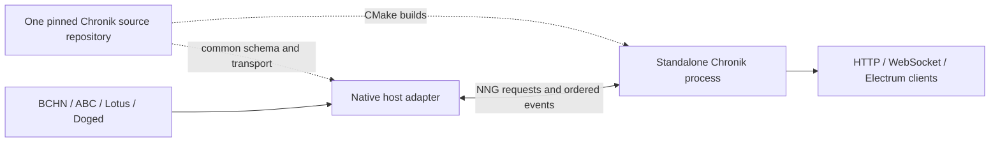

# Shared Chronik source and native-node adapters

A shared pinned Chronik repository is a reasonable maintenance boundary. Tobias's original NNG work supplies the relevant **process boundary**: a small native node service exposes blocks, undo, mempool state and events to a separate indexer. Current BCHN does not contain upstream Chronik. Modern ABC Chronik instead uses a Rust static library and a CXX bridge directly into node internals; moving its source outside the node repository alone would not make it a standalone indexer or runtime plugin.

This is an architectural audit and proposed implementation boundary. It does not introduce a new executable, alter the current NNG interfaces, or establish a working current-BCHN Chronik port.

## Exact upstream evidence

| Source | Audited revision | What exists |
|---|---|---|
| BCHN master | `abd433abe04f74780744b9eac06731f3690ce68a` | No tracked Chronik files, source references, or CMake option. |
| ABC master | `1fb7db17c176cdea8a2c60d887891589382ee4e3` | Embedded modern Chronik; subtree `84b19eab61f15c7887f12d1139026f3323d57de6`. |
| ABC-derived Doged | `9690833b8b6709b7a7837bc397f0d04bf3b885d1` | Embedded Chronik with Dogecoin adaptations; subtree `e30ee27506fd05cd73c87f228e4cb400da561084`. |
| Tobias's BCHN NNG branch | `11b5e3c46b1e0520ed849af458ed4f38e88eb02f` | Optional native NNG/FlatBuffers RPC and event service, on BCHN `13f5ed384aae11eaffd1097a0e75beca2b54f93d`. |
| Tobias's BCHN gRPC branch | `60152a2e5c45bb11117aee89eb6b3a50b8cab2de` | An alternative protobuf/streaming node service. |
| Original standalone Chronik | `raipay/chronik` `1970f249139a4a545bc5f4813e4f237910d34566` | A separate Rust executable using NNG plus node JSON-RPC, with sibling bitcoinsuite path dependencies. |

BCHN's exact current tree has no `chronik` match under `git grep -i`; its available history has no Chronik commit subject. GitLab merge-request searches for `chronik` and `NNG` return no entries; a `plugin` search returns unrelated documentation/build requests. Those searches do not prove no proposal ever existed under another title. They establish no located upstream merge/PR for this feature, while the current source conclusively lacks the integration.

Tobias's public [BCHN NNG branch](https://github.com/EyeOfPython/bitcoin-cash-node/tree/11b5e3c46b1e0520ed849af458ed4f38e88eb02f) contains eight unmatched feature commits dated May–September 2021, totaling 13 files / 1,756 inserted lines relative to its base, including a 668-line functional test. All eight remain outside current BCHN ancestry. The branch's full diff fails clean application at current BCHN in `.gitignore`, `src/CMakeLists.txt`, and `src/init.cpp`; [application evidence](evidence/tobias-nng-current-bchn-application-2026-10-14.json) records the actual check. No build or runtime test of this historical branch was attempted here.

## What Tobias's original “plugin” means

The original [CMake file](https://github.com/EyeOfPython/bitcoin-cash-node/blob/11b5e3c46b1e0520ed849af458ed4f38e88eb02f/src/plugin_nng/CMakeLists.txt) builds `plugin_nng` into the node, or a two-function stub when disabled. `src/init.cpp` calls `StartPluginNng` / `StopPluginNng`; the service registers `CValidationInterface` callbacks. There is no `dlopen` loader or portable native plugin ABI. The separate client/indexer is the independently deployed component.

The [FlatBuffers interface](https://github.com/EyeOfPython/bitcoin-cash-node/blob/11b5e3c46b1e0520ed849af458ed4f38e88eb02f/src/plugin_nng/flatbuffers/plugin_interface.fbs) already separates data from native C++ objects:

- Request/reply: blocks by height/hash, block ranges, structured block undo, mempool snapshot, chain info, transaction submission and block submission.
- Events: tip update, mempool add/remove, block connect/disconnect, chain-state flush, validation result and new proof-of-work block.
- Transport: NNG request/reply and pub/sub, with FlatBuffers payloads and 12-byte message topics.

The [gRPC alternative](https://github.com/EyeOfPython/bitcoin-cash-node/blob/60152a2e5c45bb11117aee89eb6b3a50b8cab2de/src/plugin_grpc/protos/plugin_grpc.proto) expresses the same broad separation through protobuf requests and a message stream. Changing transport is unnecessary to achieve maintenance sharing; the existing NNG direction is reusable.

The [standalone Chronik source](https://github.com/raipay/chronik/tree/1970f249139a4a545bc5f4813e4f237910d34566) is genuine precedent for keeping indexer logic outside the node. Its README describes XEC/XPI deployment through NNG; it does not demonstrate a current BCHN or Dogecoin port.

Its evolved contract also differs from the earlier BCHN branch: transactions carry spent coins; block transaction records carry disk/undo positions; RPC exposes raw block and undo slices; mempool records carry time; disconnect events provide a full block. The 2021 BCHN schema lacks several of these fields/services. Reuse the architecture and reviewable code lineage rather than assuming that those two historical revisions speak an identical protocol. The original standalone Cargo manifests also require an adjacent bitcoinsuite checkout whose revision must be pinned separately.

## Modern Chronik's concrete coupling

At the audited ABC revision:

- [`chronik-lib/Cargo.toml`](https://github.com/Bitcoin-ABC/bitcoin-abc/blob/1fb7db17c176cdea8a2c60d887891589382ee4e3/chronik/chronik-lib/Cargo.toml) declares `crate-type = ["staticlib"]`.
- [`chronik/CMakeLists.txt`](https://github.com/Bitcoin-ABC/bitcoin-abc/blob/1fb7db17c176cdea8a2c60d887891589382ee4e3/chronik/CMakeLists.txt) imports the Rust crate with Corrosion, compiles CXX-generated sources plus native bridge/validation-interface code, and links the resulting libraries into `server`.
- [`chronik-bridge/src/ffi.rs`](https://github.com/Bitcoin-ABC/bitcoin-abc/blob/1fb7db17c176cdea8a2c60d887891589382ee4e3/chronik/chronik-bridge/src/ffi.rs) names `NodeContext`, `CBlockIndex`, `CBlock`, `CBlockUndo`, `Coin` and `CTransaction` as native C++ types. The Rust indexer's `Node` stores `cxx::UniquePtr<ChronikBridge>`, and resynchronization passes native block-index references.
- Bridge methods read block/undo storage and transaction slices, query chain/mempool state, broadcast transactions and inspect Avalanche finalization. Validation callbacks provide spent coins, timestamps, chainstate roles and ordering; start/interrupt/stop lifetimes must preserve node objects until all HTTP handlers finish.
- Cargo workspace inheritance comes from the ABC root, which also lists unrelated apps/modules. CMake crate tests use `CMAKE_SOURCE_DIR` as the Cargo working directory. `RustHelper.cmake` and generated include locations also assume the enclosing host build.

Therefore a plain `add_subdirectory(external/chronik)` is insufficient. BCHN has no root Cargo workspace and lacks ABC headers including `blockindex.h`, `node/coin.h` and `kernel/chain.h`; its host API adaptation is substantive. Changing Rust `staticlib` to `cdylib` alone would retain C++ ABI/types, ownership and callback coupling and would not produce a portable drop-in indexer.

Modern Chronik's optional Python indexing plugins are a different extension mechanism: they customize indexed data/groups. They are not native host adapters or the old NNG process interface.

## Recommended shared boundary

Maintain one source repository for the modern Rust core, HTTP/WebSocket/Electrum services, token engines, schema, common NNG transport and tests. Keep only native host adaptation and protocol-specific representation changes in small, independently pinned host patches. Preserve copyright/license notices and import provenance during extraction.

The node still needs its native NNG service/hooks. The indexer and its Rust dependencies are deployed separately, following Tobias's original direction. Keep a direct CXX backend available for existing embedded deployments while the standalone backend is implemented and validated; using a shared repository must not force migration or NNG removal.

Two changes should be reviewed separately:

1. **Build-time source sharing.** Add an immutable source/provider pin and explicit CMake source/build/workspace variables. Extract the Chronik Cargo members into a self-contained workspace with a reviewed lockfile. Pass host targets/include directories and the host adapter explicitly; replace `CMAKE_SOURCE_DIR` assumptions. `FetchContent` or a pre-fetched offline checkout can supply the exact source commit. This reduces duplicated source maintenance, but an embedded build remains embedded.
2. **Runtime/process separation.** Replace direct `ChronikBridge`/`CBlockIndex` access in the core with an owned-data node/backend contract. Implement a common NNG client and standalone executable, alongside the existing direct backend. Port the small native data service per host. This is the work that removes the indexer from the node link; no current implementation of this modern backend is claimed.

A proposed common checkout should contain the Cargo workspace, core crates, shared schemas, NNG backend and CMake entry point. Each daemon records the common source commit, schema/capability revision, host adapter patch series and chain profile. Upstream ABC `1fb7db17` / Chronik subtree `84b19eab...` is the audited extraction source; no new external repository has been published by this audit. Large per-chain indexer forks are unnecessary if representation differences are explicit profiles/adapters rather than global replacements of Rust transaction logic.

## Host obligations

| Boundary | Required behavior |
|---|---|
| Headers and identities | Preserve exact raw headers and canonical hashes: ABC/BCHN 80-byte headers; Lotus 160-byte header plus block metadata; Dogecoin variable AuxPoW serialization. Preserve both Lotus merkleized TxId and raw TxHash. |
| Transactions and spent coins | Supply complete raw transactions, ordered inputs/outputs, spent values/scripts/heights/coinbase flags, and consistent integer/version widths. Preserve host-specific transaction/output encodings. |
| Historical storage | Serve exact block/undo/raw-transaction data or validated slices with correct offsets and size bounds. Do not read a running node's LevelDB from the external process. Detect pruning and unavailable historic data explicitly. |
| Reorg and durability | Include connect/disconnect semantics, fork/tip identity, durable checkpoints and restart reconciliation. Distinguish validated active-chain events from side chains/assumed-valid chainstates. |
| Mempool bootstrap | Obtain a consistent snapshot plus event watermark; subscribe/buffer before transition, detect loss/overflow/restart epochs, and resynchronize rather than silently dropping transactions. Pub/sub alone is not a durable log. |
| Tokens | ABC's SLP/ALP engine is not native BCH CashTokens support. BCHN `CTxOut::tokenDataPtr` and token-aware compression/undo require explicit preservation and indexing decisions; serializing only BCHN's bare `scriptPubKey` loses token data. |
| Coordination | Treat Avalanche finalization as an optional host capability. BCHN indexing cannot require an Avalanche quorum or unrelated miner-fund, mining, or mempool-policy changes. |
| API operations | Preserve broadcast validation/error semantics, raw reads, status/capability reporting and orderly shutdown. Keep data-plane retrieval separate from consensus decisions. |

The existing focused BCHN NNG publisher in this monorepo is independently useful but supplies a new raw-event protocol, not the complete historical FlatBuffers RPC/undo/bootstrap service. It must not be presented as wire-compatible standalone Chronik support. Existing Lotus NNG already has a richer evolved schema and should retain its current clients and service semantics.

Doged's variable header representation and generalized first-transaction offset are useful shared-core precedents; its ABC-derived Chronik does not establish BCHN compatibility. Current Lotus TxId/header/script adaptations must become explicit chain representation support in a common core, rather than replacing eCash's behavior globally.

## Acceptance before declaring a port working

First preserve imported source and its tests through a tree-verified extraction. Then validate the common backend contract against existing ABC behavior, retaining the direct backend for comparison. Each native host adapter needs its own build and isolated bootstrap, mempool graph, reorg, restart/loss recovery, raw/undo/header/TxId parity and token fixtures. Check NNG independently from embedded Chronik, ZeroMQ and policy candidates. Finally validate bounded public-chain synchronization/indexing separately from regtest and from any Avalanche claims.

No current-BCHN Chronik build, sync, indexing or runtime plugin validation was performed in this design audit. The concrete results are source/history/API inspection and the failed legacy clean-application check. No working node, production workspace, chain database, tag or release asset was changed.
