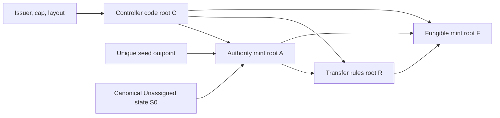
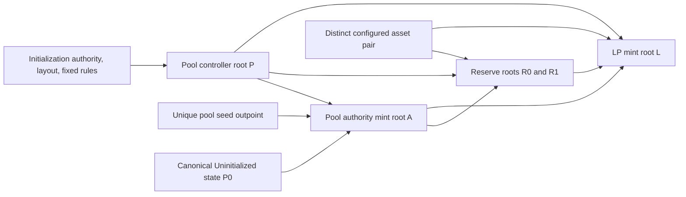

# Acyclic controller bootstrap and external identity

Status: reviewed-design correction candidate; **not executable contract evidence**. This replaces the cyclic constructor in the original ERC20 sketch. It does not change LC-1 entry/mint syntax, policy slots/paths, companion artifact schema, CABI-07/08, opcodes or transaction grammar. The preserved 16-case corpus did not exercise controller bootstrap and does not validate these constructions.

## Two separate checks

A generic controller authenticates its local state, verifies that it is spending a nonnative coin of value exactly 1, and requires the exact successor with the **same consumed asset ID**, value 1 and permitted state change. It does not contain its own authority TokenId as a constructor constant. It accepts analogous transitions under other asset IDs; that reuse is intentional.

A program relying on this controller for authority must independently bind and check the expected external authority TokenId `A`, controller code root `C`, exact policy and state layout, quantity 1 and authenticated state. Code equality, a familiar state commitment, and one unit of some token do not establish authority. The particular `A` has uniqueness because its mint requires consumption of one specified seed outpoint and creates exactly one unit into the specified initial controller policy. All later controller transitions preserve it, except an explicitly authorized irreversible revocation.

For the separate-state layout, the initial output is `asset=A, value=1, branches=[C,S0], paths=[[0]]`; `S0` commits to canonical Unassigned state. `C` and `S0` must satisfy normal distinct-branch checks. The authority mint compares the output asset to **its runtime BRANCHROOT** rather than embedding its own root in its script. It also enforces the exact initial policy/state, no extra positive issuance and the designated seed spend. No output-creation hook executes the controller at initialization.

Generic controller transitions validate both old and new complete policy structures. Reading `this.coin.token_id` is safe for preserving this consumed identity but is not a proof that it is the identity another application intended. The external program supplies that missing binding. An artifact declaration or an indexer's name for the token cannot replace either check.

## Fungible token build and deployment order

Arrows below mean “the left result is an input to building the right result.” `S0` has no target asset and no authority ID. `C` is built from issuer, cap, layout and fixed transition rules only.

There are no edges from `A` to `C`, `F` to `C`, `F` to `R`, or `F` to `S0`. `R` reads the tracked holding asset from its consumed coin; the fungible mint reads its own identity from BRANCHROOT. The generic controller reads a tracked target from authenticated **enrolled state**, not a compile-time binding. That state is constructed after `F` exists and is not an input to any of the code roots in this graph.

1. Compile `C`, then `A`, then `R`, then `F`. Each compilation fully binds the dependencies already produced. All are offline operations.
2. Consume the unique seed in an ordinary transaction with mint `A`, delta 1, producing the exact controller output in Unassigned state. Native funding covers its costs. The seed transaction is validated; merely naming a seed is not uniqueness.
3. Consume that controller using authorized enrollment, preserve `A` and value 1, and store target `F` with the initial supply accounting and nonce. Unassigned and Enrolled are tagged state variants; Unassigned omits the TokenId field rather than encoding zero as a valid TokenId.
4. Mint `F` only by consuming the genuine enrolled `A` controller. The mint checks expected `A/C`, enrolled target equal to BRANCHROOT, authorization, exact supply delta and exact successor. `R` performs corresponding checks on every relevant holding spend. Both check effects independently of the controller's selected method name.

An issuer may enroll an incorrect target and disable useful issuance; the initialization signer is responsible for the disclosed target configuration. That cannot make the correctly bound `F` mint accept a different authority asset or bypass the cap. Enrollment and subsequent code do not permit silent target replacement. Any allowed migration must separately state which guarantees survive.

## Pool bootstrap

Use the same ordering for a pool. `P` is generic pool-controller code bound to initialization authority, layout and fixed rules; it contains neither its own authority TokenId nor downstream reserve/LP roots. `P0` is an Uninitialized state without those downstream values. Reserve templates bind external authority `A`, controller root `P`, configured asset and reserve role. They read LP identity from authenticated controller state. `L` is the LP mint root; it binds `A/P`, configured asset pair and the expected reserve roots.

There is no `A -> P`, `R -> P`, `L -> P`, `L -> R` or downstream root embedded in `P0`. Any mandatory LP transfer program is compiled before `L`, from `A/P` and independent rules; it reads the held LP asset rather than embedding `L`. The offline deployment artifact records every binding and result, then constructs initialized **state** containing the asset pair, `R0/R1`, `L`, accounting and nonce.

Deploy `A` into `P0`, then perform authorized one-time initialization into a distinct **Ready** state with enrolled configuration, zero LP supply and no existing reserve roles. The first liquidity deposit consumes Ready, funding coins and the LP mint input, and creates the first two reserve outputs, controller Active state and authorized LP outputs. The controller and LP mint independently verify those effects; they do not pretend newly created reserve scripts have already executed. Later operations consume both existing reserve coins and the Active controller. This explicit Ready-to-Active transition avoids another bootstrap assumption that old reserve inputs already exist before the first deposit. No claim is made that initial reserve outputs can escape configured fees, token rules or resource checks.

Every reserve and LP operation checks expected external `A/P`, quantity 1, exact controller policy and authenticated initialized state. `L` compares the enrolled LP identity to its own BRANCHROOT and enrolled reserve roots/pair to its bound expected values. Initialization authority chooses and signs a disclosed configuration; a signature over an arbitrary code root does not prove it is the intended reserve program. The client verifies configured reserve programs against the full compiled deployment artifact. Pool-controller transitions preserve enrolled configuration and validate reserve effects; they do not require a compile-time reference to `R` or `L` to compare those effects against authenticated state.

## Negative counterexamples required before implementation acceptance

These are reasoning counterexamples and required future cases, not executed tests.

| Incorrect construction | Counterexample / consequence | Required behavior |
| --- | --- | --- |
| `C = compile Controller<authority=A>` and `A = compile Mint<controller=C>` | Neither root can be computed first; enrollment later does not remove the constructor cycle | Linker rejects the cycle; generic `C` has no own-authority binding |
| Authority mint embeds `A` in its own required output constant | Self-referential mint root before any deployment | Use runtime BRANCHROOT to check minted asset; reject a compile-time self-root dependency |
| Initial state `S0` commits target `F`, while `F` binds authority `A` and `A` binds `S0` | `F -> S0 -> A -> F` is a cycle even if controller code is generic | Unassigned state omits target; authorized enrollment writes it after compilation |
| `F` checks only root `C`, state and value 1 | Attacker mints unrelated token `B`, creates `branches=[C, forged_state]`, and presents its one-unit coin as the controller | Require the externally bound authority asset `A` as well as exact code/state/quantity |
| `F` checks `A/C` but allows value 0 | Anyone can create a zero-value output bearing a known TokenId with counterfeit state without consuming its genuine authority | Require value exactly 1 and authenticate every state transition |
| Controller preserves state/root but lets successor asset change | Legitimate authority disappears into an unrelated token output; later external checks cannot recover identity | Require successor asset equals consumed asset, quantity 1 and unique successor; explicit revocation is separate |
| Reserve `R` embeds `L` and LP mint `L` embeds `R` | Pair cannot compile despite separate authority initialization | `R` reads LP ID from authenticated controller state; `L` binds already compiled `R` |
| Pool `P` embeds `A` or reserve root `R`, while their mint/program binds `P` | Recreates the controller/authority cycle or `P -> A -> R -> P` cycle | Build generic `P` first, enroll downstream configuration in state |
| Reserve/LP accepts any coin with controller root `P` | Fake one-unit token `B` with invented reserves/LP supply can authorize theft or inflation | Bind and check external `A/P`, exact quantity/policy and initialized state |
| Initialization stores arbitrary reserve roots and labels them verified | A signature proves initializer choice, not reserve-code semantics | Compare to the compiled deployment artifact; LP mint pins expected reserve roots; disclose initializer trust |
| Initial deposit assumes new reserve policies executed on creation | A weak output policy could be created without its covenant running | Controller and LP mint validate initial reserve output bytes/effects themselves |

The state library and application tests must also cover mismatched enrollment, repeat enrollment, simultaneous mint/state updates, unauthorized migration, duplicate authority successors, explicit burns, wrong policy paths and all mint conservation/fee rules. No compiler source or consensus change is made by this correction.
