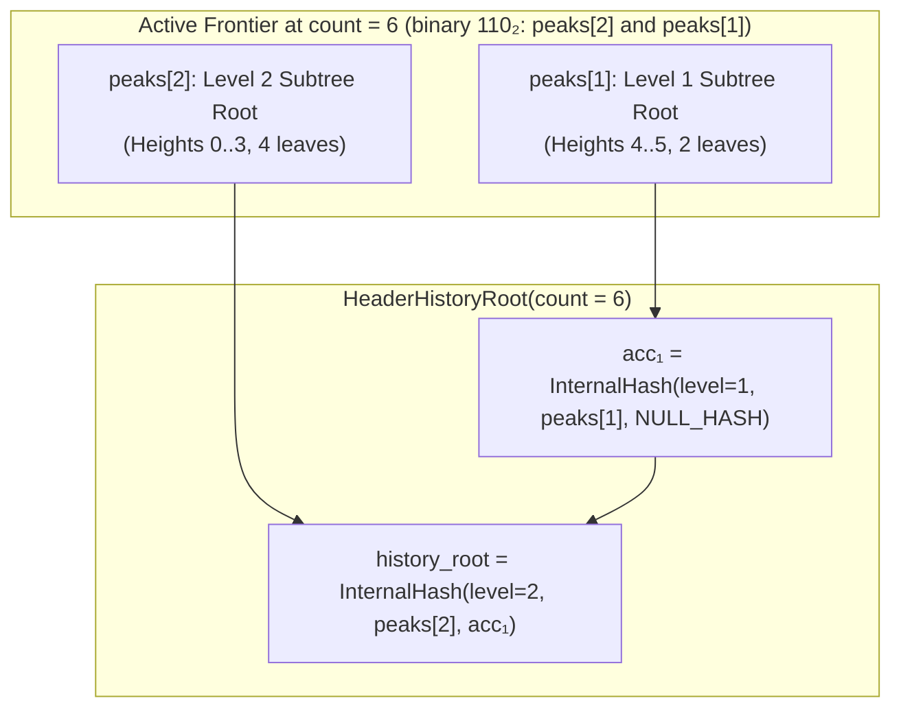

# Header History Merkle Tree (`HEADER_HISTORY`)

Status: **implemented in `lotusd` (`src/lotus_v2/header_history.{h,cpp}`) and specified in [P02](decisions/commitments-and-state.md)**.

---

## 1. Why: Trustless Historical Finality in Kilobytes

<div class="lens-grid">
<div class="lens-card lens-consumer">

### In Practice

When you open a wallet on your phone or browser, or verify an older payment or cross-chain proof, how does your app know that a block from six months ago really happened on the canonical Lotus blockchain—without downloading tens of gigabytes of history?

In legacy blockchains, each block header only points to the **immediately previous block** (`prev_block_hash`). Proving that Block #100,000 is part of the chain at Block #1,000,000 requires downloading all **900,000 headers in between** (~72–120 MB of linear chain links).

With the **Header History Merkle Tree**, every Lotus V2 block header cryptographically seals a compact fingerprint (`history_root`) of **every block hash from Genesis up to its parent**. Any device only needs the latest 134-byte header (confirmed by Avalanche/PoW) plus a **~1 KB cryptographic proof (`HeaderInclusionProof`)** to verify any historical block in less than a millisecond.

</div>
<div class="lens-card lens-engineer">

### Under the Hood

Linear hash chains ($H_{n} \to H_{n-1} \to \dots \to H_0$) require $O(N)$ bandwidth and $O(N)$ verification work to prove historical ancestry across $N$ blocks. FlyClient / MMR constructions solve this with logarithmic peaks, but naive MMR bagging either changes tree topology across heights or requires separate peak-bagging proofs.

Lotus V2 embeds a canonical **Binary Carry-Chain Mountain Frontier (`HeaderHistoryFrontier`)** directly into `MonetaryState::history_root` (committed inside the 134-byte header's `hashStateRoot`):
- **Consensus state footprint:** Fixed $64 \times 32\text{ B} + 8\text{ B} = 2{,}056\text{ bytes}$ in memory (`popcount(H) * 32` bytes on disk).
- **Per-block update cost:** Amortized $O(1)$—specifically $\text{ctz}(H)$ SHA-256 tagged hashes when appending block $H-1$ (1 leaf hash on odd heights, and $1 + \text{ctz}(H)$ hashes on even heights).
- **Proof size & verification:** Strictly $\lceil \log_2 H \rceil$ 32-byte siblings ($\le 20$ hashes for $10^6$ blocks, $\le 640\text{ B}$), verified in one bottom-up pass with canonical null-right-sibling enforcement.

</div>
</div>

---

## 2. HOW: The Binary Carry-Chain Frontier

Every block at height $H \ge 1$ commits to the ordered sequence of all $H$ prior canonical block hashes:

$$\big(0,\, \text{BlockID}_0\big),\; \big(1,\, \text{BlockID}_1\big),\; \dots,\; \big(H-1,\, \text{BlockID}_{H-1}\big)$$

### How Binary Carry Addition Builds the Tree

Think of the block count $H$ written in binary. Each set bit $k$ where `((H >> k) & 1) == 1` represents one **complete, immutable binary subtree of exactly $2^k$ headers** (`peaks[k]`):



When block $H$ is appended (`AppendHeaderToFrontier`):
1. Compute `carry = HeaderLeafHash(ChainID, H, BlockID_H)`.
2. Walk bit positions $k = 0, 1, \dots, 63$:
   - **Bit $k$ is `0`:** Slot $k$ is empty! Place `peaks[k] = carry`, increment `count = H + 1`, and **stop immediately**.
   - **Bit $k$ is `1`:** Slot $k$ already holds a complete $2^k$-leaf subtree `peaks[k]`. Merge it with our `carry` to form a complete $2^{k+1}$-leaf subtree (`carry = HeaderInternalHash(ChainID, k, peaks[k], carry)`), clear `peaks[k] = 0x00^32`, and carry into level $k + 1$.

Because half of all integers have bit $0 = 0$, **50% of blocks require zero internal node hashes**, 25% require 1 internal hash, 12.5% require 2, and the average number of internal hashes per block as $H \to \infty$ is **less than 1**.

---

## 3. WHAT: Exact Cryptographic Specification

### 3.1 Domain-Separated Leaf and Internal Hashes

All hashes use `TaggedHashWriter("HEADER_HISTORY", ChainID)` (`SHA256(SHA256("LotusV2/HEADER_HISTORY") || SHA256("LotusV2/HEADER_HISTORY") || ChainID || payload)`):

```text
NULL_HASH = 0x00^32

HeaderLeafHash(ChainID, height: u64, block_hash: h32) -> h32:
  TaggedHash("HEADER_HISTORY", ChainID,
             0x00 || u64_le(height) || block_hash)

HeaderInternalHash(ChainID, level: u8, left: h32, right: h32) -> h32:
  TaggedHash("HEADER_HISTORY", ChainID,
             0x01 || u8(level) || left || right)
```

- **Leaf vs. internal separation:** Prefix byte `0x00` vs. `0x01` prevents any internal node from colliding with a leaf preimage.
- **Height & level binding:** `u64_le(height)` binds the leaf to its exact chain height; `u8(level)` ($0 \le \text{level} < 64$) binds every internal node to its exact subtree height ($2^{\text{level}}$ leaves).

### 3.2 Computing `HeaderHistoryRoot` from `HeaderHistoryFrontier`

Given `frontier` with `count` committed prior headers:
- **Genesis (`count == 0`, height $H = 0$):** Returns `NULL_HASH` (`0x00^32`). In `MonetaryStateHash`, `history_root` is omitted when `history_root == NULL_HASH` so the Genesis block's `hashStateRoot` and PoW nonce are preserved verbatim.
- **Post-Genesis (`count >= 1`, height $H \ge 1$):**
  Let $k_0 = \text{ctz}(\text{count})$ be the index of the lowest set bit of `count` and $L = 63 - \text{clz}(\text{count})$ be the index of the highest set bit of `count`:
  - **Exact power of two ($k_0 == L$):** Return `frontier.peaks[L]` directly (the tree is a single complete binary tree of height $L$).
  - **Non-power of two ($k_0 < L$):** Fold active peaks from lowest level $k_0$ up to $L$, promoting partial right edges with `NULL_HASH`:
    ```text
    acc = HeaderInternalHash(ChainID, k0, frontier.peaks[k0], NULL_HASH)
    for k in (k0 + 1) .. L:
        if ((frontier.count >> k) & 1) == 1:
            acc = HeaderInternalHash(ChainID, k, frontier.peaks[k], acc)
        else:
            acc = HeaderInternalHash(ChainID, k, acc, NULL_HASH)
    return acc
    ```

### 3.3 Canonical Inclusion Proofs (`HeaderInclusionProof`)

A proof that `block_hash` was the canonical block at `leaf_height` inside a chain of `total_count` committed headers (`leaf_height < total_count`) is serialized as:

```text
HeaderInclusionProof =
    u64_le(leaf_height)
 || u64_le(total_count)
 || block_hash:h32
 || u8(num_siblings)
 || siblings: h32[num_siblings]
```

#### Verification Algorithm (`VerifyHeaderInclusionProof`)
1. **Bounds check:** Require `total_count > 0` and `leaf_height < total_count`.
2. **Exact depth check:** Let tree depth $D$ be:
   $$D = \begin{cases} \text{ctz}(\text{total\_count}) & \text{if } (\text{total\_count} \mathbin{\&} (\text{total\_count} - 1)) = 0 \\ 64 - \text{clz}(\text{total\_count}) & \text{otherwise} \end{cases}$$
   Require `siblings.size() == D`.
3. **Bottom-up fold with canonical null-sibling check:**
   Initialize `cur = HeaderLeafHash(ChainID, leaf_height, block_hash)`. For $k = 0, 1, \dots, D - 1$:
   - Let `idx = leaf_height >> k`.
   - If `(idx & 1) == 0` (left child):
     - Let `right_subtree_start = (idx + 1) << k`.
     - **Canonical null-sibling rule:** If `right_subtree_start >= total_count` (no leaves exist in the right child subtree at level $k$), require `siblings[k] == NULL_HASH`.
     - Set `cur = HeaderInternalHash(ChainID, k, cur, siblings[k])`.
   - Else (`(idx & 1) == 1`, right child):
     - Set `cur = HeaderInternalHash(ChainID, k, siblings[k], cur)`.
4. **Root comparison:** Return `cur == expected_root`.

### 3.4 Node Persistence & RPC Interface

- **Full-node storage (`HeaderHistoryTree`):** Maintained on `Chainstate` (`m_header_history_tree`), storing complete subtree roots `m_levels[k][i]` at every level $k \ge 0$ so historical proofs at any anchor height are generated in $O(\log H)$ time without re-hashing historical headers, and persisted atomically to `<datadir>/blocks/header_history_v2.dat` (magic `"LV2HHT01"`).
- **Delta snapshot files (`.bin`):** Appends `[4-byte LE frontier_len][frontier_bytes]` (`8 + popcount(count) * 32` bytes) after the coin records so FastSync and disk state snapshots restore `HeaderHistoryFrontier` and `MonetaryState::history_root` deterministically.
- **RPC commands:**
  - `getheaderhistoryproof(height, [anchor_height_or_hash])`: Returns `{leaf_height, total_count, block_hash, anchor_height, anchor_block_hash, history_root, siblings, proof_hex}`.
  - `verifyheaderhistoryproof(proof_hex, [expected_root_or_anchor])`: Decodes `proof_hex`, resolves the anchor's `history_root`, and returns `{valid, leaf_height, total_count, block_hash, expected_root}`.
