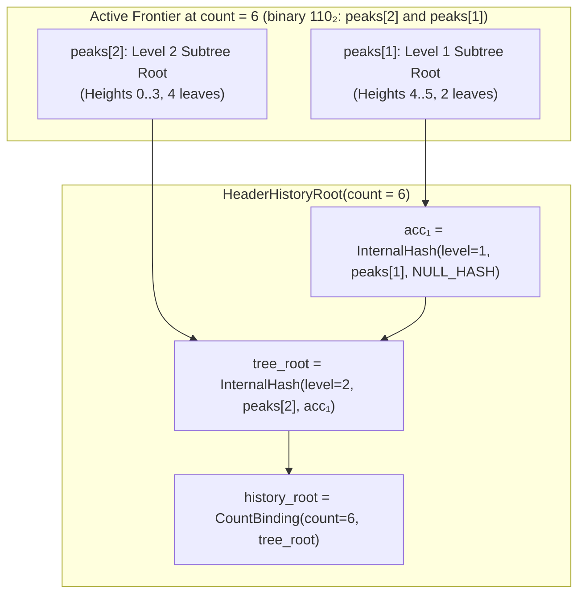

# Header History Merkle Tree (`HEADER_HISTORY`)

Status: **the consensus commitment is implemented in `lotusd` (`src/lotus_v2/header_history.{h,cpp}`) and specified in [P02](decisions/commitments-and-state.md). The proof RPCs are not implemented.** The tree and its verifier exist in the node, but nothing serves a proof, and the proof format can't yet be tied to a block header. Section 3.5 describes what is missing and the open anchor question. The light-client flow described in section 1 is the goal this enables, not something available today.

---

## 1. Why: Trustless Historical Finality in Kilobytes

<div class="lens-grid">
<div class="lens-card lens-consumer">

### In Practice

When you open a wallet on your phone or browser, or verify an older payment or cross-chain proof, how does your app know that a block from six months ago really happened on the canonical Lotus blockchain—without downloading tens of gigabytes of history?

In legacy blockchains, each block header only points to the **immediately previous block** (`prev_block_hash`). Proving that Block #100,000 is part of the chain at Block #1,000,000 requires downloading all **900,000 headers in between** (~72–120 MB of linear chain links).

With the **Header History Merkle Tree**, every Lotus V2 block header cryptographically seals a compact fingerprint (`history_root`) of **every block hash from Genesis up to its parent**. Any device only needs the latest 134-byte header (confirmed by Avalanche/PoW) plus a **~1 KB cryptographic proof (`HeaderInclusionProof`)** to verify any historical block in less than a millisecond.

</div>
<div class="lens-card lens-engineer">

### Under the Hood

Linear hash chains ($H_{n} \to H_{n-1} \to \dots \to H_0$) require $O(N)$ bandwidth and $O(N)$ verification work to prove historical ancestry across $N$ blocks. FlyClient / MMR constructions solve this with logarithmic peaks, but naive MMR bagging either changes tree topology across heights or requires separate peak-bagging proofs.

Lotus V2 embeds a canonical **Binary Carry-Chain Mountain Frontier (`HeaderHistoryFrontier`)** directly into `MonetaryState::history_root` (committed inside the 134-byte header's `hashStateRoot`):
- **Consensus state footprint:** Fixed $64 \times 32\text{ B} + 8\text{ B} = 2{,}056\text{ bytes}$ in memory (`popcount(H) * 32` bytes on disk).
- **Per-block update cost:** Amortized $O(1)$—specifically $\text{ctz}(H)$ domain-separated BLAKE3 tagged hashes (`"Lotus/v2/header/history"`) when appending block $H-1$ (1 leaf hash on odd heights, and $1 + \text{ctz}(H)$ hashes on even heights).
- **Proof size & verification:** Strictly $\lceil \log_2 H \rceil$ 32-byte siblings ($\le 20$ hashes for $10^6$ blocks, $\le 640\text{ B}$), verified in one bottom-up pass with canonical null-right-sibling enforcement.

</div>
</div>

---

## 2. HOW: The Binary Carry-Chain Frontier

Every block at height $H \ge 1$ commits to the ordered sequence of all $H$ prior canonical block hashes:

$$\big(0,\, \text{BlockID}_0\big),\; \big(1,\, \text{BlockID}_1\big),\; \dots,\; \big(H-1,\, \text{BlockID}_{H-1}\big)$$

### How Binary Carry Addition Builds the Tree

Think of the block count $H$ written in binary. Each set bit $k$ where `((H >> k) & 1) == 1` represents one **complete, immutable binary subtree of exactly $2^k$ headers** (`peaks[k]`):



When block $H$ is appended (`AppendHeaderToFrontier`):
1. Compute `carry = HeaderLeafHash(ChainID, H, BlockID_H)`.
2. Walk bit positions $k = 0, 1, \dots, 63$:
   - **Bit $k$ is `0`:** Slot $k$ is empty! Place `peaks[k] = carry`, increment `count = H + 1`, and **stop immediately**.
   - **Bit $k$ is `1`:** Slot $k$ already holds a complete $2^k$-leaf subtree `peaks[k]`. Merge it with our `carry` to form a complete $2^{k+1}$-leaf subtree (`carry = HeaderInternalHash(ChainID, k, peaks[k], carry)`), clear `peaks[k] = 0x00^32`, and carry into level $k + 1$.

Because half of all integers have bit $0 = 0$, **50% of blocks require zero internal node hashes**, 25% require 1 internal hash, 12.5% require 2, and the average number of internal hashes per block as $H \to \infty$ is **less than 1**.

---

## 3. WHAT: Exact Cryptographic Specification

### 3.1 Domain-Separated Leaf and Internal Hashes

All hashes use unkeyed 32-byte **BLAKE3** (`C08`, `C26`) with domain tag `"Lotus/v2/header/history"` (`H_header_history(x) = BLAKE3("Lotus/v2/header/history" || 0x00 || x)` in `src/lotus_v2/tagged_hash.cpp`):

```text
NULL_HASH = 0x00^32

HeaderLeafHash(ChainID, height: u64, block_hash: h32) -> h32:
  H_header_history(ChainID || 0x00 || u64_le(height) || block_hash)

HeaderInternalHash(ChainID, level: u8, left: h32, right: h32) -> h32:
  H_header_history(ChainID || 0x01 || u8(level) || left || right)

HeaderCountBinding(ChainID, count: u64, tree_root: h32) -> h32:
  H_header_history(ChainID || 0x02 || u64_le(count) || tree_root)
```

- **Leaf, internal and root separation:** The prefix bytes `0x00`, `0x01` and `0x02` prevent a leaf, an internal node and a bound root from colliding with one another.
- **Height & level binding:** `u64_le(height)` binds the leaf to its exact chain height; `u8(level)` ($0 \le \text{level} < 64$) binds every internal node to its exact subtree height ($2^{\text{level}}$ leaves).
- **Count binding:** `u64_le(count)` binds the root to the number of leaves. Without it, a leaf whose path crosses only complete subtrees would verify against the same tree under many claimed counts. Leaf 0 of a 65-leaf tree, for example, would also verify with any count up to 128.

### 3.2 Computing `HeaderHistoryRoot` from `HeaderHistoryFrontier`

Given `frontier` with `count` committed prior headers:
- **Genesis (`count == 0`, height $H = 0$):** Returns `NULL_HASH` (`0x00^32`). In `StateRoot`, `history_root` is omitted when `history_root == NULL_HASH` so the Genesis block's `hashStateRoot` and PoW nonce are preserved verbatim. A null root is only valid at height 0: a node derives the root for a fast-sync pivot from its own headers and rejects any other value, including null.
- **Post-Genesis (`count >= 1`, height $H \ge 1$):**
  Let $k_0 = \text{ctz}(\text{count})$ be the index of the lowest set bit of `count` and $L = 63 - \text{clz}(\text{count})$ be the index of the highest set bit of `count`:
  - **Exact power of two ($k_0 == L$):** `tree_root = frontier.peaks[L]` (the tree is a single complete binary tree of height $L$).
  - **Non-power of two ($k_0 < L$):** Fold active peaks from lowest level $k_0$ up to $L$, promoting partial right edges with `NULL_HASH`:
    ```text
    acc = HeaderInternalHash(ChainID, k0, frontier.peaks[k0], NULL_HASH)
    for k in (k0 + 1) .. L:
        if ((frontier.count >> k) & 1) == 1:
            acc = HeaderInternalHash(ChainID, k, frontier.peaks[k], acc)
        else:
            acc = HeaderInternalHash(ChainID, k, acc, NULL_HASH)
    tree_root = acc
    ```
  - **In both cases:** `history_root = HeaderCountBinding(ChainID, frontier.count, tree_root)`.

### 3.3 Canonical Inclusion Proofs (`HeaderInclusionProof`)

A proof that `block_hash` was the canonical block at `leaf_height` inside a chain of `total_count` committed headers (`leaf_height < total_count`) is serialized as:

```text
HeaderInclusionProof =
    u64_le(leaf_height)
 || u64_le(total_count)
 || block_hash:h32
 || u8(num_siblings)
 || siblings: h32[num_siblings]
```

#### Verification Algorithm (`VerifyHeaderInclusionProof`)
1. **Bounds check:** Require `total_count > 0` and `leaf_height < total_count`.
2. **Exact depth check:** Let tree depth $D$ be:
   $$D = \begin{cases} \text{ctz}(\text{total\_count}) & \text{if } (\text{total\_count} \mathbin{\&} (\text{total\_count} - 1)) = 0 \\ 64 - \text{clz}(\text{total\_count}) & \text{otherwise} \end{cases}$$
   Require `siblings.size() == D`.
3. **Bottom-up fold with canonical null-sibling check:**
   Initialize `cur = HeaderLeafHash(ChainID, leaf_height, block_hash)`. For $k = 0, 1, \dots, D - 1$:
   - Let `idx = leaf_height >> k`.
   - If `(idx & 1) == 0` (left child):
     - Let `right_subtree_start = (idx + 1) << k`.
     - **Canonical null-sibling rule:** If `right_subtree_start >= total_count` (no leaves exist in the right child subtree at level $k$), require `siblings[k] == NULL_HASH`.
     - Set `cur = HeaderInternalHash(ChainID, k, cur, siblings[k])`.
   - Else (`(idx & 1) == 1`, right child):
     - Set `cur = HeaderInternalHash(ChainID, k, siblings[k], cur)`.
4. **Root comparison:** Return `HeaderCountBinding(ChainID, total_count, cur) == expected_root`.

`lotus_v2_header_history_tests` has known-answer vectors for these hashes, computed independently of the node from the formulas above.

### 3.4 Node Storage

- **Tree (`HeaderHistoryTree`):** Kept in memory on `Chainstate` (`m_header_history_tree`), storing complete subtree roots `m_levels[k][i]` at every level $k \ge 0$, at about 96 bytes per block. It is not written to disk. It is derived entirely from the active chain and rebuilt at startup from `m_chain`, which holds every block hash whether block data has been pruned or the chain began from a snapshot. It doesn't feed consensus; block validation derives each root from the parent's frontier.
- **State files (`.bin`):** Each `v2_state/<hash>.bin` ends with exactly one `[4-byte LE frontier_len][frontier_bytes]` trailer (`8 + popcount(count) * 32` bytes) after the coin records. A file with no trailer, or with bytes after it, is rejected.
- **Missing frontier:** A block at height $H$ requires its parent's frontier to cover exactly $H - 1$ blocks. If it doesn't, the node reports a local error and doesn't mark the block invalid. It never computes a root from a substitute.

### 3.5 Not Implemented: Proof RPCs

No RPC serves or checks these proofs. An earlier draft defined `getheaderhistoryproof` and `verifyheaderhistoryproof`; they were left out because a proof built that way can't be tied to a chain header, so `valid: true` would only show that a hash chain is internally consistent.

Before proofs can be offered, a design has to settle:

1. **What the anchor is (open question).** Block $H$ commits only the $H$ blocks below it, so the root over blocks $0..H$ is committed by block $H + 1$. Either the anchor is "the highest block covered", in which case its root is committed by the next block and the root for the current tip isn't committed by anything yet, or the anchor is "the block whose header commits the root", in which case the count equals the anchor's height, height 0 can't be an anchor, and the tip can't prove itself.
2. **How to open `state_root`.** `history_root` sits inside `StateRoot(chain, height, utxo_root, monetary || history_root)`. A client holding only a header needs `utxo_root` and the 56-byte monetary state as well, so the proof must carry them. The roughly 1 KB size in section 1 assumes this is solved and doesn't include them.
3. **What the verifier takes.** It should resolve an anchor block and compare against its header, rather than accept a root from the caller.

---

## References

1. **[Merkle 1987]** Ralph C. Merkle, *"A Digital Signature Based on a Conventional Encryption Function"*, in *Advances in Cryptology — CRYPTO '87*, Lecture Notes in Computer Science, vol. 293, pp. 369–378, Springer, 1988.
2. **[Crosby & Wallach 2009]** Scott A. Crosby and Dan S. Wallach, *"Efficient Data Structures for Tamper-Evident Logging"*, in *Proceedings of the 18th USENIX Security Symposium*, pp. 317–334, August 2009.
3. **[Todd 2012/2016]** Peter Todd, *"Merkle Mountain Ranges"*, OpenTimestamps / Bitcoin Core developer notes, 2012–2016.
4. **[Bünz, Kiffer, Luu, & Zamani 2020]** Benedikt Bünz, Lucianna Kiffer, Loi Luu, and Mahdi Zamani, *"FlyClient: Super-Light Clients for Cryptocurrencies"*, in *2020 IEEE Symposium on Security and Privacy (SP)*, pp. 928–946, May 2020.
5. **[O'Connor, Aumasson, Neves, & Wilcox-O'Hearn 2020]** Jack O'Connor, Jean-Philippe Aumasson, Samuel Neves, and Zooko Wilcox-O'Hearn, *"BLAKE3: One Function, Fast Everywhere"*, January 2020 (`https://github.com/BLAKE3-team/BLAKE3-specs`).
6. **[Nakamoto 2008]** Satoshi Nakamoto, *"Bitcoin: A Peer-to-Peer Electronic Cash System"*, October 2008 (`https://bitcoin.org/bitcoin.pdf`).
