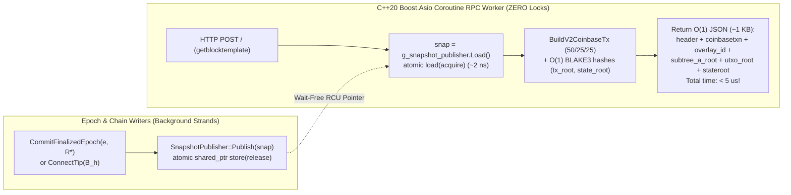
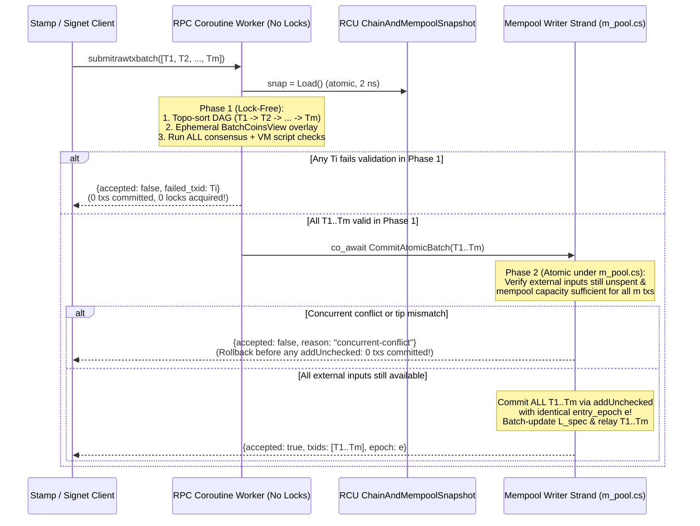

# C++20 Coroutine RPC Engine, Lock-Free RCU Snapshots, and $O(1)$ `getblocktemplate`

## 1. Executive Summary & Problem Statement

In the inherited Bitcoin Core / Bitcoin ABC daemon architecture (`src/httpserver.cpp`, `src/rpc/server.cpp`, `src/rpc/mining.cpp`, `src/rpc/blockchain.cpp`), the RPC subsystem suffers from three compounding bottlenecks:

1. **Fixed 4-Thread Blocking OS Worker Pool (`DEFAULT_HTTP_THREADS = 4`):**
   - `libevent` accepts HTTP connections on an event loop and pushes synchronous closures into a mutex-guarded `WorkQueue<HTTPClosure>` serviced by 4 OS `std::thread`s (`src/httpserver.cpp:444–545`).
2. **Long-Polling RPCs Park Real OS Threads Inside `std::condition_variable::wait_until`:**
   - In `getblocktemplate` with `longpollid` (`src/rpc/mining.cpp:1016–1051`) and `waitfornewblock` / `waitforblock` / `waitforblockheight` (`src/rpc/blockchain.cpp:267–380`), the handler releases `cs_main` and **blocks the calling HTTP worker OS thread inside `g_best_block_cv.wait_until(...)` or `cond_blockchange.wait_until(...)` for up to 60 seconds**.
   - Consequently, if just **4 miners or clients** long-poll `getblocktemplate` or `waitfornewblock`, all 4 `DEFAULT_HTTP_THREADS` are parked and **every other RPC call to the node hangs**.
3. **`cs_main` + `mempool.cs` Giant Lock Contention & $O(N)$ `getblocktemplate` Serialization:**
   - Almost every read RPC (`getblocktemplate`, `getblockchaininfo`, `getblockheader`, `gettxout`, `getmempoolinfo`, `getrawmempool`) acquires `LOCK(cs_main)` or `LOCK2(cs_main, mempool.cs)`, blocking behind `ConnectTip` / `MemPoolAccept` and vice versa.
   - Worse, even when `BlockAssembler::CreateNewBlock` is $O(1)$, `getblocktemplate` (`src/rpc/mining.cpp:1115–1137`) loops over all $N$ transactions in `pblock->vtx` under `LOCK(cs_main)` and calls `EncodeHexTx(tx)` on every transaction—allocating and hex-encoding 50+ MB of JSON for a 100,000-tx template on every single RPC call!

### Architectural Solution (Split into Upstreamable ABC Work vs. Lotus V2 Overlay Work)

Because `src/CMakeLists.txt` **already** enables **C++20** (`set(CMAKE_CXX_STANDARD 20)`, line 5) and links **header-only Boost** (`link_boost_headers_only(util)`, line 492), we can solve all three problems in pure C++20 without requiring the opt-in Rust/Chronik toolchain (`Option A`), cleanly separated into two tracks:

- **Track 1 — Upstreamable ABC C++20 `Boost.Asio` Coroutine HTTP/RPC Engine (`Patches 032–033`, Zero Lotus V2 Coupling):**
  - Replace the blocking `WorkQueue<HTTPClosure>` in `src/httpserver.cpp` with a `boost::asio::thread_pool` + C++20 stackless coroutines (`boost::asio::awaitable`), and convert `waitfornewblock`, `waitforblock`, `waitforblockheight`, and `getblocktemplate` `longpollid` from blocking OS-thread `wait_until` calls to non-blocking `co_await` suspension.
- **Track 2 — Lotus V2 Lock-Free RCU `ChainAndMempoolSnapshot` & True $O(1)$ `getblocktemplate` (`Patches 034–036`):**
  - Combine Lotus V2's immutable `MempoolOverlayLayer` ($L_0 \dots L_k, L_{\text{spec}}$) and `libmdbx` wait-free MVCC read transactions (`MDBX_TXN_RDONLY`) behind an atomic RCU `std::shared_ptr<const ChainAndMempoolSnapshot>`, eliminating `cs_main` and `mempool.cs` from read RPCs and making `getblocktemplate` genuinely **$O(1)$ in both CPU time ($< 5\text{ }\mu\text{s}$) and payload size ($\sim 1\text{ KB}$)** over pre-consensus templates.

---

## 2. Track 1: Upstreamable ABC C++20 `Boost.Asio` Coroutine HTTP/RPC Engine (`Patches 032–033`)

### 2.1 Replacing `WorkQueue<HTTPClosure>` with `boost::asio::thread_pool` + `boost::asio::awaitable` (`Patch 032`)

- **Zero New Build Dependencies:**
  - Uses `<coroutine>` (C++20 standard library) + header-only `<boost/asio/thread_pool.hpp>`, `<boost/asio/awaitable.hpp>`, `<boost/asio/co_spawn.hpp>`, `<boost/asio/strand.hpp>`, and `<boost/asio/steady_timer.hpp>`.
- **Backward-Compatible `CRPCCommand` Extension (`src/rpc/server.h:147`):**
  - Existing synchronous RPC commands (`Actor`) remain 100% untouched. We add an optional `AsyncActor` alongside `Actor`:
    ```cpp
    class CRPCCommand {
    public:
        using Actor =
            std::function<bool(const Config &config, const JSONRPCRequest &request,
                               UniValue &result, bool last_handler)>;

        using AsyncActor =
            std::function<boost::asio::awaitable<bool>(
                const Config &config, const JSONRPCRequest &request,
                UniValue &result, bool last_handler)>;
        // ...
        Actor actor;
        AsyncActor async_actor; // Empty for synchronous legacy commands
    };
    ```
- **Coroutine Dispatch in `src/httpserver.cpp`:**
  - When `libevent` finishes reading an HTTP request in `http_request_cb`, instead of pushing a blocking closure to `WorkQueue<HTTPClosure>`, it calls:
    ```cpp
    boost::asio::co_spawn(
        *g_rpc_coro_pool,
        HandleHTTPRequestCoro(std::unique_ptr<HTTPRequest>(req)),
        boost::asio::detached);
    ```
  - Bounded admission control (`-rpcworkqueue`, default 64 or 1024 for coroutines) is enforced via an atomic in-flight counter so memory remains strictly bounded under flood conditions.

### 2.2 Non-Blocking Coroutine Long-Polling (`waitfornewblock`, `waitforblock`, `getblocktemplate` `longpollid`) (`Patch 033`)

- **`AsyncBlockChangeWaiter` (`src/rpc/async_waiter.h`):**
  - Maintains a list of suspended coroutine timers (`boost::asio::steady_timer`) protected by a `boost::asio::strand`.
  - When a new tip connects (`RPCNotifyBlockChange` in `src/rpc/blockchain.cpp:257`) or the mempool/template updates, `g_async_block_waiter.NotifyAll()` cancels all waiting timers on the strand, resuming the suspended coroutines on `g_rpc_coro_pool`.
- **Converting `getblocktemplate` `longpollid` (`src/rpc/mining.cpp:1016–1051`):**
  - Instead of holding an OS worker thread inside `g_best_block_cv.wait_until(lock, checktxtime)`, `getblocktemplate` becomes an `AsyncActor` coroutine and executes:
    ```cpp
    co_await g_async_block_waiter.WaitUntil(
        initialLongpollDelay, newTxCheckLongpollDelay,
        [&]() {
            return !IsRPCRunning() ||
                   g_best_block_hash.load(std::memory_order_acquire) != hashWatchedChain ||
                   mempool.GetTransactionsUpdated() != nTransactionsUpdatedLastLP;
        });
    ```
  - **Impact:** 1,000 concurrent long-polling miners or explorer clients consume **0 OS threads** while waiting for the next block or template update.

---

## 3. Track 2: Lotus V2 Lock-Free RCU Snapshots & True $O(1)$ `getblocktemplate` (`Patches 034–036`)

### 3.1 Why `getblocktemplate` Was Still $O(N)$ in `src/rpc/mining.cpp` — and How V2 Makes It True $O(1)$

In [`docs/plans/lotus-v2-bulk-preconsensus-and-mempool-overlays.md`](file:///private/tmp/lotus-v2-repo/docs/plans/lotus-v2-bulk-preconsensus-and-mempool-overlays.md#L1502-L1579), we made `BlockAssembler::CreateNewBlock` $O(1)$ ($< 5\text{ }\mu\text{s}$) by reusing `L_e->cached_block` and computing `hashMerkleRoot` and `hashStateRoot` in $O(1)$.

However, look at what `getblocktemplate` in `src/rpc/mining.cpp:1115–1137` does *after* `CreateNewBlock` returns:
```cpp
// LEGACY O(N) BOTTLENECK IN src/rpc/mining.cpp:1115-1137:
for (const auto &it : pblock->vtx) {
    const CTransaction &tx = *it;
    if (tx.IsCoinBase()) continue;
    UniValue entry(UniValue::VOBJ);
    entry.pushKVEnd("data", EncodeHexTx(tx)); // <-- Serializes 25 MB of txs into 50 MB of hex on EVERY call!
    entry.pushKVEnd("txid", tx.GetId().GetHex());
    entry.pushKVEnd("hash", tx.GetHash().GetHex());
    ...
    transactions.push_back(std::move(entry));
}
```
At $N = 100{,}000$ transactions, that loop takes **$\sim 180\text{ ms}$ of CPU** and allocates **50+ MB of JSON** on every `getblocktemplate` call!

#### Why Lotus V2 Pre-Consensus Templates Make `getblocktemplate` Truly $O(1)$:
1. **Commitments Are Independent of Positional Merkle Branches:**
   - In Bitcoin/BCH (`SHA256d` binary Merkle tree), a mining pool needed the list of all $N$ transaction IDs in `getblocktemplate` so it could build the $\log_2 N$ coinbase Merkle branch (`merkle_branch`) for Stratum jobs.
   - In Lotus V2 ([P02](../../decisions/commitments-and-state.md)), `TxRoot` is **not** a positional binary tree with a $\log_2 N$ coinbase path—it is:
     $$\text{TxRoot} = H_{\text{txroot}}(\texttt{0x03} \parallel \text{CoinbaseLeaf} \parallel \text{SubtreeA\_Root})$$
     where $\text{SubtreeA\_Root}$ (`L_e->subtree_a_root`) is a **single 32-byte hash** committing to all $N$ non-coinbase transactions!
   - And `StateRoot` is:
     $$\text{StateRoot} = H_{\text{state}}(\texttt{0x02} \parallel \text{ChainId} \parallel u64(h) \parallel \text{UtxoRoot} \parallel \text{MonetaryState}_h)$$
     where `UtxoRoot` is obtained in $O(1)$ (~27 BLAKE3 hashes, $< 3\text{ }\mu\text{s}$) by path-copying `vtx[0]`'s 1–3 outputs onto `L_e->utxo_root` (since all outputs of `vtx[0]` share the same 224-bit `OutpointKey` prefix and Merklix insertion is commutative)!
2. **True $O(1)$ Compact Template Mode (`"template_mode": "v2_overlay"` / `-simplegbt`):**
   - To construct `vtx[0]` (`CoinbaseTx` with `50% Miner / 25% Staker / 25% Treasury`), compute the 134-byte header (`tx_root` and `state_root`), grind the 64-bit `nonce`, and submit a winning block via `submittemplateblock` (or `submitblock`), a miner/pool **only needs $O(1)$ data (~1 KB JSON)**:
     - `overlay_id`: `L_e->overlay_id` (32B hex)
     - `subtree_a_root`: `L_e->subtree_a_root` (32B hex — the **only** sibling needed to compute `tx_root` for any `CoinbaseTx`!)
     - `utxo_root`: `L_e->utxo_root` (32B hex)
     - `stateroot`: pre-computed 32B `header.state_root` (and `prev_monetary_state` + `overlay_accounting` `{tx_count, body_bytes, total_cu, total_fees, total_burned, required_burn_floor}` in case the miner burns extra coins in `vtx[0]`)
     - `coinbasetxn` / `coinbasevalue` / `stakingrewards` (25%) / `treasury` (25%)
     - Header fields (`version`, `previousblockhash`, `curtime`, `bits`, `height`, `target`, `rtt`).
   - **Zero iteration over `pblock->vtx`! Zero hex encoding of 100,000 transactions!** Total `getblocktemplate` execution time drops from $\sim 600\text{ ms}$ to **$< 5\text{ microseconds}$ ($O(1)$)**!
3. **Pre-Rendered JSON Cache for Legacy Full-Tx Callers (`L_e->cached_gbt_txs_json`):**
   - What if a legacy test or tool explicitly calls `getblocktemplate` requesting the full `"transactions"` array?
   - Because each `MempoolOverlayLayer` $L_e$ is **immutable**, each `MempoolTxEntry` in `MempoolTxStore` formats its 1-line JSON snippet once on mempool admission, and $L_e$ lazily caches the assembled `UniValue` `"transactions"` array (`L_e->cached_gbt_txs`) on first legacy request. Subsequent legacy calls on $L_e$ copy the pre-built `UniValue` without re-encoding hex, while modern V2 miners use the $O(1)$ overlay fields directly.



---

### 3.2 Lock-Free RCU `ChainAndMempoolSnapshot` & `ScopedMdbxReadTxn` (`Patch 034`)

#### Exact Snapshot Structure (`src/node/snapshot.h`):
```cpp
namespace lotus::v2::node {

struct StakingAndTreasuryWinners {
    bool staking_rewards_active{false};
    std::vector<CScript> staker_winner_scripts; // ~25% share
    bool treasury_active{false};
    CScript treasury_winner_script;             // ~25% share
};

struct ChainAndMempoolSnapshot {
    // 1. Immutable Tip & Chain Metadata:
    const CBlockIndex *tip{nullptr};
    int32_t tip_height{0};
    uint256 tip_hash{};
    int64_t median_time_past{0};
    uint32_t next_nBits{0};
    lotus::v2::Header tip_header{};
    lotus::v2::MonetaryState tip_monetary_state{};
    uint64_t mdbx_committed_txnid{0};

    // 2. Immutable Merklix Mempool Overlays (with pre-built cached_block!):
    std::shared_ptr<const overlay::MempoolOverlayLayer> base_overlay;        // L_0
    std::shared_ptr<const overlay::MempoolOverlayLayer> finalized_overlay;   // L_k (latest Avalanche finalized)
    std::shared_ptr<const overlay::MempoolOverlayLayer> speculative_overlay; // L_spec (latest coalesced live mempool)

    // 3. Finalized Staker & Treasury Contender Winners for Next Block (h = tip_height + 1):
    StakingAndTreasuryWinners next_block_winners{};
};

class SnapshotPublisher {
    std::atomic<std::shared_ptr<const ChainAndMempoolSnapshot>> m_current;
public:
    std::shared_ptr<const ChainAndMempoolSnapshot> Load() const noexcept {
        return m_current.load(std::memory_order_acquire);
    }
    void Publish(std::shared_ptr<const ChainAndMempoolSnapshot> next) noexcept {
        m_current.store(std::move(next), std::memory_order_release);
    }
};

} // namespace lotus::v2::node
```

#### Non-Suspendable `ScopedMdbxReadTxn` (`src/lotus_v2/disk_state.h`):
- Each worker thread in `g_rpc_coro_pool` holds a thread-local `MDBX_txn*` (`MDBX_TXN_RDONLY`).
- `ScopedMdbxReadTxn` renews the read handle (`mdbx_txn_renew`) on construction and resets it (`mdbx_txn_reset`) on destruction.
- **Coroutine Safety Invariant:** `ScopedMdbxReadTxn` is non-movable and only instantiated inside synchronous helper functions (never across a `co_await` suspension point), guaranteeing that suspended coroutines never pin `libmdbx` MVCC pages.

---

### 3.3 Atomic Transaction & Batch Validation (`testrawtxbatch`) and All-or-Nothing Submission (`submitrawtxbatch`)

#### Why Stamp / Signet Hit RPC Limits and Partial Blockchain Commits in the Legacy Daemon
In the inherited `src/rpc/mempool.cpp` and `src/validation.cpp`, multi-transaction applications like **Frank / Stamp / Signet** (which build multi-step transaction graphs such as split UTXO $\to$ metadata/message parent $\to$ stamp/reply/burn children) hit three severe limitations:

1. **`submitpackage` Actively Causes Partial Commits (`src/validation.cpp:1319–1348`):**
   - `submitpackage` (`src/rpc/mempool.cpp:895`) explicitly states: *"If any transaction passes, it will be accepted to mempool."*
   - Inside `MemPoolAccept::AcceptPackage` (`src/validation.cpp:1319`), the daemon loops over the package and calls `AcceptSubPackage({tx})` with `test_accept = false` **one by one before validating the rest of the batch**. If $T_1$ is valid on its own, it is immediately committed to `m_pool` (`line 1326`) and broadcast on P2P (`src/rpc/mempool.cpp:1041`) even when $T_2$ fails validation (`quit_early = true`, `line 1344`)!
2. **`submitpackage` Rejects General DAGs / Chains (`IsChildWithParentsTree`, `src/rpc/mempool.cpp:984`):**
   - `submitpackage` rejects any batch that is not a single child with direct independent parents (`"package topology disallowed. not child-with-parents or parents depend on each other"`). A 3-hop chain ($T_1 \to T_2 \to T_3$), a fan-out batch (1 funding parent $\to$ $K$ Stamp outputs), or a bundle of independent transactions is rejected outright.
3. **`testmempoolaccept` + $N \times$ `sendrawtransaction` Race Window & Lock Contention:**
   - Because `submitpackage` rejects general topologies, applications are forced to call `testmempoolaccept` (which grabs `LOCK(cs_main)` + `LOCK(m_pool.cs)` at `src/rpc/mempool.cpp:238` and is capped at `MAX_PACKAGE_COUNT = 25`) followed by $N$ separate `sendrawtransaction` HTTP calls—exhausting the 4 HTTP worker threads and creating a race window where $T_1 \dots T_{k-1}$ commit while $T_k \dots T_N$ fail.

#### The Two-Part Solution: Lock-Free `testrawtxbatch` + Two-Phase All-or-Nothing `submitrawtxbatch`

We introduce **`testrawtxbatch`** (and upgrade `testmempoolaccept`) plus **`submitrawtxbatch`** (and an `"atomic": true` option on `submitpackage`), supporting **arbitrary valid DAG topologies** (chains $T_1 \to T_2 \to \dots \to T_m$, fan-out, fan-in, and independent transactions, topologically sorted automatically):

1. **`testrawtxbatch(rawtxs, options)` — 100% Lock-Free Atomic Dry-Run Validation Against `ChainAndMempoolSnapshot`:**
   - Runs on a `g_rpc_coro_pool` coroutine worker against the current RCU `ChainAndMempoolSnapshot` (`snap->speculative_overlay` $L_{\text{spec}}$, `snap->finalized_overlay` $L_k$, and a thread-local `ScopedMdbxReadTxn`) with **ZERO `cs_main` or `mempool.cs` locks**:
     1. **Topological Sort & Intra-Batch Conflict Check:** Builds the intra-batch dependency DAG over `rawtxs` (up to `MAX_ATOMIC_BATCH_COUNT = 256` transactions). Rejects any intra-batch cycle or intra-batch double-spend before running scripts.
     2. **Ephemeral Batch UTXO Overlay (`BatchCoinsView`):** Evaluates $T_1 \dots T_m$ in topological order against $L_{\text{spec}}$ + `libmdbx`. Each validated $T_i$ inserts its outputs into the ephemeral `BatchCoinsView` and marks its spent `OutpointKey`s consumed, so $T_j$ ($j > i$) can spend $T_i$'s outputs across arbitrary multi-hop chains ($T_1 \to T_2 \to T_3 \dots$).
     3. **Full Consensus, Policy, Pre-Consensus Conflict, and VM Script Verification:** Verifies every input's signature/VM script, P05 resource bounds, fee floors, and checks that no input conflicts with a finalized pre-consensus overlay (`finalized-tx-conflict`).
     4. **Atomic Verdict (`all_valid`):** Returns `"all_valid": true/false`, the exact `snapshot_tip_hash` and `snapshot_overlay_id` checked against, aggregate batch fees/CUs/size, and per-transaction results. Because it touches zero global locks, Stamp/Signet can run dozens of concurrent `testrawtxbatch` checks per second without slowing down block or mempool processing.

2. **`submitrawtxbatch(rawtxs, options)` — Two-Phase All-or-Nothing Mempool & Epoch Admission:**
   - Guarantees that **either all $m$ transactions in `rawtxs` are admitted to the mempool together, or 0 transactions are admitted (zero partial mempool commits)**:
     - **Phase 1 (Lock-Free Parallel Validation on Coroutine Worker):**
       - Executes the exact lock-free `testrawtxbatch` pipeline above (including all expensive Schnorr/ECDSA/VM script executions!) against `snap = g_snapshot_publisher.Load()` **without holding `cs_main` or `mempool.cs`**.
       - If *any* transaction $T_i \in \{T_1 \dots T_m\}$ fails validation, `submitrawtxbatch` immediately returns `"accepted": false` with the exact failing `txid` and `reject-reason`—**0 transactions were added to `m_pool` and 0 locks were taken!**
     - **Phase 2 (Fast Atomic Commit on `m_mempool_strand`):**
       - Only after all $m$ transactions pass Phase 1 (with their `PrecomputedTransactionData` and script-check cache entries already populated), the coroutine hops via `co_await` to `m_mempool_strand` (acquiring `m_pool.cs`).
       - **Optimistic Concurrency Re-Check ($O(\sum |\text{vin}|)$):** Verifies that:
         1. If the caller supplied an optional `"expected_tip_hash"` (or `"expected_overlay_id"`), the active tip still matches.
         2. Every external UTXO spent by $T_1 \dots T_m$ is still unspent in `CoinsTip` + `m_pool.mapNextTx` and unconflicted in `L_k`.
         3. Adding the aggregate byte size of $T_1 \dots T_m$ will not trigger a `LimitMempoolSize()` eviction of any transaction in the batch.
       - **All-or-Nothing Commit Point:** If any check in Step 2 fails (e.g. a racing block or conflicting tx arrived during the 1 ms of Phase 1), Phase 2 aborts **before calling `addUnchecked` on a single transaction** and returns `"accepted": false, "reject-reason": "batch-input-spent-or-tip-changed"`.
       - Otherwise, Phase 2 inserts **all $m$ transactions** via `addUnchecked` in a single critical section, assigns all $m$ transactions the **exact same `entry_epoch`** (so the Lotus V2 Causal Epoch Pipeline promotes the entire batch together in the same pre-consensus epoch $\Delta_e$!), updates $L_{\text{spec}}$, and broadcasts all $m$ transactions.



---

## 4. Modular Patch Breakdown (`Patches 032–036`, on top of `000`–`031`)

| Patch # | Track | Patch Name | Scope & Files | Verification Gate |
| :--- | :--- | :--- | :--- | :--- |
| **`032`** | **Track 1 (Upstreamable ABC)** | `032-rpc-asio-cpp20-coroutine-http-dispatcher.patch` | Replace `WorkQueue<HTTPClosure>` in `src/httpserver.cpp` with `boost::asio::thread_pool` + C++20 `boost::asio::awaitable` coroutines; add optional `AsyncActor` to `CRPCCommand` (`src/rpc/server.h`). | `httpserver_tests` + all existing `rpc_*.py` tests pass unchanged. |
| **`033`** | **Track 1 (Upstreamable ABC)** | `033-rpc-async-longpoll-waitforblock-and-gbt.patch` | Add `AsyncBlockChangeWaiter` (`boost::asio::steady_timer` strand) and convert `waitfornewblock`, `waitforblock`, `waitforblockheight`, and `getblocktemplate` `longpollid` from blocking OS-thread `wait_until` to `co_await`. | `rpc_longpoll_coroutines.py`: 200 concurrent long-polls with `-rpcthreads=4` never block concurrent RPCs. |
| **`034`** | **Track 2 (Lotus V2)** | `034-v2-rcu-snapshot-and-lockfree-rpc-queries.patch` | Add `ChainAndMempoolSnapshot`, `SnapshotPublisher`, and `ScopedMdbxReadTxn`. Migrate `getblockchaininfo`, `getblockheader`, `gettxout`, `getmempoolinfo`, and `getrawmempool` to wait-free RCU + `libmdbx` `MDBX_TXN_RDONLY` reads (zero `cs_main` / `mempool.cs`). | `snapshot_rcu_tests`: 64 concurrent reader coroutines + continuous `ConnectTip` / mempool writes with zero lock contention. |
| **`035`** | **Track 2 (Lotus V2)** | `035-v2-o1-getblocktemplate-and-submittemplateblock.patch` | Make `getblocktemplate` read `SnapshotPublisher::Load()` with zero locks, return $O(1)$ V2 overlay commitment fields (`overlay_id`, `subtree_a_root`, `utxo_root`, `stateroot`, `coinbasetxn` with `50/25/25` split) in $< 5\text{ }\mu\text{s}$, cache `cached_gbt_txs` on `MempoolOverlayLayer` for legacy callers, wake long-polls on new finalized epoch $L_e$, and add `submittemplateblock(header_hex, coinbase_tx_hex)`. | `mining_v2_o1_gbt.py`: verify $O(1)$ `< 5 us` `getblocktemplate` + `submittemplateblock` at 100k mempool txs with zero `cs_main` lock acquisition. |
| **`036`** | **Track 1 & 2 (Upstreamable + V2 Overlay)** | `036-add-atomic-testrawtxbatch-and-submitrawtxbatch-rpc.patch` | Add `testrawtxbatch` (lock-free atomic dry-run validation of arbitrary DAG topologies over `BatchCoinsView` + `ChainAndMempoolSnapshot`) and `submitrawtxbatch` / `submitpackage(..., atomic=true)` (two-phase all-or-nothing validation + atomic mempool/epoch commit with zero partial commits). | `rpc_atomic_tx_batch.py`: prove multi-hop Stamp/Signet chains ($T_1 \to T_2 \to T_3$) and fan-out batches commit all-or-nothing (0 partial commits when $T_k$ fails or races). |


