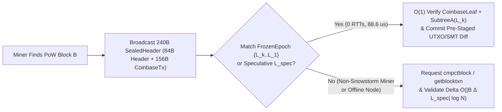
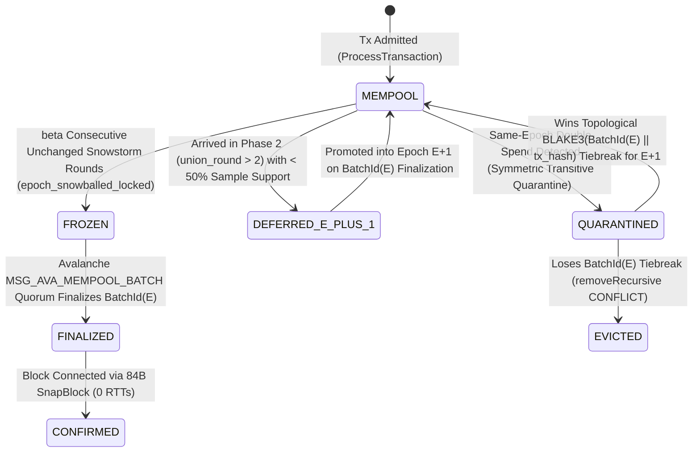

Superseded draft; see [the current Snowstorm specification](../snowstorm.md).

# Snowstorm: Multi-Peer Rateless $\text{GF}(2^{64})$ BCH Fountain Pseudo-Consensus

Status: **implemented & verified in `lotusd` (`src/net/v2_protocol_handler.*`, `src/lotus_v2/mempool_overlay.*`, `src/avalanche/processor.*`, `src/txmempool.*`)**.

---

## 1. Executive Summary & Pseudo-Consensus Philosophy

<div class="lens-grid">
<div class="lens-card lens-consumer">

### In Practice

- **Zero-Wait Block Propagation:** Instead of waiting until a block is mined to discover which transactions are inside it, **Snowstorm** lets nodes continuously stream lightweight mathematical "fountain" sketches to each other beforehand so everyone's mempool crystallizes into the exact same set of transactions *before* the block is found.
- **84-Byte Header + Coinbase Instant Blocks (`SnapBlock`):** When a miner finds a block, they don't need to broadcast megabytes of transactions—just a **`240-byte` `SealedHeader` (`SnapBlock`)** frame (`84-byte` block header + `156-byte` serialized `coinbase_tx`). Nodes snap the block into place in **`0.089 milliseconds` (`88.6 µs`)** with **`0` post-block RTTs**—**14× faster** in post-block CPU than `Merklix-Snowball` (`1.25 ms`) and **2,905× faster** in total WAN propagation than post-block recovery (`257.39 ms`).
- **Pseudo-Consensus (Optional, Never Splits the Chain):** No node or miner is forced to use Snowstorm. Block validity is still 100% decided by Proof-of-Work and Lotus V2's deterministic consensus rules (`C01`–`C28`). If a miner mines a custom block without Snowstorm, or a node turns Snowstorm off, the network never forks—nodes simply fall back to standard compact/full block download. Yet participating is overwhelmingly beneficial because Snowstorm blocks propagate in `0 RTTs` with near-zero orphan risk.

</div>
<div class="lens-card lens-engineer">

### Under the Hood

- **Multi-Peer Rateless $\text{GF}(2^{64})$ BCH Fountain Codes:** Interactive prefix-tree reconciliation (`Merklix-Snowball`, our earlier prototype combining Merklix prefix trees `[2]` with Snowball peer sampling `[14]`) requires interactive top-down traversal (`5 RTTs`, `118.5 B / missing tx`), fixed-capacity algebraic sketches (PinSketch `[5, 6]`, IBLT `[9]`, Graphene `[11]`, Erlay/Minisketch `[12]`) suffer a catastrophic "decoding cliff" when symmetric difference $|\Delta|$ exceeds table capacity, pairwise Rateless IBLTs `[16]` map coded symbols with decreasing density but peel singletons only (`count == 1`, strictly pairwise) without multi-peer coupling or algebraic cell fraud proofs, and block-byte fountain codes (LT `[7]`, Raptor `[8]`, Velocity `[13]`) only work on a single static byte array from one miner. **Snowstorm** combines **rateless multi-peer fountain streaming** with **$\text{GF}(2^{64})$ degree-3 BCH algebraic power sums** $(S_1, S_3, S_5)$ over $\mathbb{F}_2[x]/(x^{64}+x^4+x^3+x+1)$.
- **~30% Overhead & Cross-Peer Coupled Peeling ($d \le 2$ Solver + 64-Bit $S_5$ Integrity Tag):** Every `RatelessMiniblock` carries a `32 × 28 = 896 B` BCH cell array (`913 B` in compact stream mode with a `17 B` per-miniblock header, or `1,018 B` standalone with the full `122 B` self-describing scope/root header) that partitions a peer's epoch into 32 cells using `SplitMix64(short_id ^ seed)` with geometric decimation $1/2^L$. Because each cell resolves up to $d = 2$ items algebraically with an independent 64-bit $S_5$ integrity check (and $d = 3$ strictly for raw wire cell validation), a receiver collects miniblocks concurrently from $K \le 8$ sampled peers, subtracts its local mempool, and runs coupled degree-2 BCH root solving plus donor-isolated cross-peer projection across all divergent peers simultaneously—achieving **`2 RTTs`** (`2.5×` fewer RTTs) and **`34.97 B / missing tx`** (`20,980 B` total reconciliation wire payload = `18 × 896 B` cells + `4,852 B` `GETSHORTTX`, `3.39×` lower bandwidth, **`0.92 cells / item`**, which is below 1 cell/item and represents ~30% cell overhead above the $0.71\text{ cell/item}$ multi-root BCH peeling threshold) with zero interactive tree descent.
- **$O(1)$ Algebraic Fraud Proofs Keyed on `(peer_id, candidate_root)`:** Four mathematical invariants—Type 1 single-cell degree-3 BCH self-consistency (`count in {0..3}`), Type 2 $L=0$ 32-cell partition conservation, Type 3 generalized cell capacity conservation ($\text{peeled\_missing}_c \le \text{raw\_count}_c$), and exhausted-cell local-extra elimination (scoped per `(peer_id, candidate_root)` with bounded root rotations)—allow any node to prove in $O(1)$ that a Byzantine peer sent a poisoned miniblock, shun the peer, and purge its state without falsely penalizing honest mid-stream epoch updates.

</div>
</div>

---

## 2. Why Snowstorm is *Pseudo-Consensus*

A foundational architectural principle of Lotus V2 is the strict boundary between **Hard Consensus Validity** and **Snowstorm Pseudo-Consensus Coordination**.

### 2.1 Hard Consensus Invariance (`consensus.md` C01–C28)

Hard consensus validity is a pure, deterministic state-transition function of a block's bytes and its parent state commitment:
1. Valid Proof-of-Work (`BlockID <= Target`) under P04's two-stage BLAKE3 header specification.
2. Valid transaction encodings, multi-branch MAST scripts, BIP340 Schnorr signatures, bounded VM cost (`cu`), and token conservation (`C01`–`C24`).
3. Exact match of `Header.tx_root` (`H_txroot(0x03 || CoinbaseLeaf || SubtreeA)`) and `Header.state_root` (`UtxoRoot` + `MonetaryState` + `HeaderHistoryRoot`).

> [!IMPORTANT]
> **Consensus Non-Interference Guarantee:**
> - A block that satisfies `C01`–`C28` is **consensus-valid** whether or not its transactions passed through Snowstorm.
> - A block that violates any rule in `C01`–`C28` is **consensus-invalid** even if 100% of Snowstorm peers voted for its epoch batch.
> - Every transaction recovered via Snowstorm undergoes full `MemPoolAccept` (`ProcessTransaction`) signature, UTXO, and VM validation before it can enter a node's working epoch layer (`W_e`), and every epoch root must pass the **Strict 256-Bit Root-Verification Gate** (`recomputed_root_32B == peer_root_32B`).

### 2.2 Incentive Compatibility: Why Participation is a Strict Nash Equilibrium

Even though participation in Snowstorm is optional, rational miners, exchanges, and full nodes have strong economic and operational incentives to participate:

| Participant | Without Snowstorm (Stage 2 Fallback Path) | With Snowstorm (Stage 1 Fast Path) |
| :--- | :--- | :--- |
| **Miners** | Must transmit `cmpctblock` + answer `getblocktxn` over multiple WAN RTTs (`~258 ms` at 50 ms RTT for 600 missing txs), increasing stale/orphan rate at 100,000+ TPS and risking block delay if double-spends were resolved differently by peers. | Broadcasts a **`240-byte` `SealedHeader` (`SnapBlock` = `84 B` header + `156 B` serialized `coinbase_tx`)** that peers reconstruct in **$O(1)$ (`88.6 µs`, 0 post-block RTTs)**. Double-spend conflicts are pre-resolved deterministically via `BatchId(E)` before PoW is found. |
| **Full Nodes** | Must execute post-block `getblocktxn` round-trips, rebuild `SubtreeA`, and compute `UtxoRoot` state transitions on the critical path after block arrival. | Pre-crystallizes `FrozenEpoch` overlays (`SubtreeA` + `UtxoRoot` + cut-through UTXO delta) continuously before the block arrives; `ConnectBlock` commits the pre-validated overlay in $O(1)$. |
| **Wallets & Exchanges** | Only see binary `unconfirmed` vs. `confirmed` states; conflicted double-spends remain ambiguous until a block is mined. | Observe a monotonic **4-state transaction lifecycle** (`mempool` $\to$ `frozen` $\to$ `finalized` $\to$ `confirmed`) via RPC (`getmempoolinfo`, `getmempoolentry`, `getrawtransaction`), gaining sub-second pre-block finality. |

**Miner Fee-Tail vs. Orphan-Risk Equilibrium:**
Because `FrozenEpoch` layers crystallize every $\sim 100\text{--}250\text{ ms}$ (`m_adaptiveEpochController`), the un-crystallized mempool tail $M_{\text{tail}} = M_{\text{live}} \setminus L_k$ contains at most a fraction of a second of late arrivals. Including $M_{\text{tail}}$ outside $L_k$ forces the miner off the 0-RTT `SnapBlock` fast path onto the multi-RTT `cmpctblock` / `getblocktxn` fallback path, incurring additional propagation delay $\Delta \tau_{\text{fallback}} \approx 100\text{--}250\text{ ms}$ and additional orphan probability $\Delta \mathbb{P}(\text{orphan}) \approx 1 - e^{-\lambda_{\text{block}} \Delta \tau_{\text{fallback}}} \approx \frac{\Delta \tau_{\text{fallback}}}{T_{\text{block}}}$. Rational miners therefore mine the crystallized `FrozenEpoch` $L_k$ whenever:
$$(1 - \beta_{\text{burn}}) \cdot F(M_{\text{tail}}) < \Delta \mathbb{P}(\text{orphan}) \cdot \big(R_h + (1 - \beta_{\text{burn}}) \cdot F(L_k)\big)$$
which holds for all normal fee arrival distributions (since $M_{\text{tail}}$'s fees are automatically captured in the next epoch $L_{k+1}$ within milliseconds, whereas an orphaned block loses the entire block subsidy $R_h$ plus $100\%$ of net epoch fees).

### 2.3 Two-Stage Block Reception Pipeline (`SnapBlock` $\to$ `cmpctblock` Fallback)



### 2.4 System, Network, and Adversary Model

- **Network Model:** Nodes communicate over a P2P overlay subject to *partial synchrony*; during synchronous intervals, messages between honest peers arrive within bounded delay $\Delta_{\text{net}}$.
- **Cryptographic & Field Assumptions:** 256-bit BLAKE3 (`TaggedHash`) is modeled as a collision-resistant / random-oracle hash function, and per-epoch `SipHash-2-4(k0, k1, TxId)` is modeled as a pseudorandom function whose key $(k_0, k_1) = H(\texttt{"SNOWSTORM\_EPOCH\_ID"},\, P.\text{block\_hash} \parallel P.\text{batch\_id})$ is unpredictable prior to Proof-of-Work discovery of parent block $P$ `[17]`.
- **Adversary Budget:** An adversary controls a fraction $f < 1/3$ of sampled peer slots in an honest node's AS/subnet-diversified P2P table (`peering.md`, used for unweighted Snowstorm set reconciliation) and $< 1/3$ of bonded PoW-UTXO stake weight (`consensus.md`, used for Avalanche `MSG_AVA_MEMPOOL_BATCH` finality). Byzantine peers may inject arbitrary malformed miniblocks, rotate `candidate_root` values, drip late transactions across rounds, or broadcast conflicting double-spends to disjoint network partitions.

---

## 3. Resolving the Set-Reconciliation Trilemma

Prior block and mempool propagation protocols face a fundamental trilemma when reconciling $N \ge 100,000$ transactions across $K$ peers whose mempools differ by an unknown symmetric difference $|\Delta|$:

| Protocol Family | Representative Systems & Citations | Multi-Peer Streaming? | Works on Divergent Unconfirmed Sets? | Rateless (No Decoding Cliff)? | $O(1)$ Per-Packet Fraud Proofs? | Pre-Block WAN RTTs |
| :--- | :--- | :---: | :---: | :---: | :---: | :---: |
| **Short-ID Lists** | BIP152 Compact Blocks `[10]` | No | No (post-block only) | Yes | N/A | N/A (`1–2` post-block) |
| **Fixed Algebraic Sketches** | PinSketch `[5, 6]`, IBLT `[9]`, Graphene `[11]`, Erlay `[12]` | No (1-to-1 pairwise) | Pairwise only | **No** (catastrophic cliff if $\lvert\Delta\rvert > C$) | **No** (1 bad cell ruins entire decode silently) | `2–3` pairwise |
| **Pairwise Rateless IBLT** | Rateless IBLT `[16]` | No (pairwise degree-1 XOR) | Pairwise only | Yes | **No** (non-algebraic hash checksums; no BCH cell proofs) | `1–2` pairwise |
| **Block Erasure Codes** | LT `[7]`, Raptor `[8]`, Velocity `[13]` | Yes | **No** (requires 1 static block byte array) | Yes | No (requires full block/tree rebuild) | N/A (post-block only) |
| **Prefix-Tree Bisection** | Classical Merkle Walk `[4]`, `Merklix-Snowball` `[2, 14]` | No (interactive per-peer) | Yes | Yes | Yes (Merkle hashes) | `5+ RTTs` (`~118.5 B/tx`) |
| **Rateless $\text{GF}(2^{64})$ BCH Fountain** | **Snowstorm (Lotus V2)** | **Yes ($K$ peers simultaneously)** | **Yes (any $M_p \triangle M_{\text{local}}$)** | **Yes (infinite miniblock stream)** | **Yes (Type 1/2/3 algebraic proofs)** | **`2 RTTs` (`34.97 B/tx`)** |

---

## 4. Mathematical & Wire Specification of `RatelessMiniblock`

### 4.1 Finite Field $\text{GF}(2^{64})$ and Odd Power-Sum Syndromes

All syndrome arithmetic operates in the characteristic-2 extension field:
$$\text{GF}(2^{64}) = \mathbb{F}_2[x] \big/ (x^{64} + x^4 + x^3 + x + 1)$$
with primitive irreducible pentanomial modulus `0x1B` ($x^4 + x^3 + x + 1$). Multiplication in $\text{GF}(2^{64})$ is accelerated via hardware carry-less multiplication (`_mm_clmulepi64_si128` on x86_64 and `vmull_p64` on ARM64 NEON), achieving `745.6M tx/sec` syndrome accumulation and `41.34M roots/sec` BCH decoding.

For any non-zero 64-bit transaction short identifier $x \in \text{GF}(2^{64})^\times$ (computed via per-epoch keyed `SipHash-2-4(k0, k1, TxId)` and deduplicated per set), its contribution to a cell is:
$$\text{count} \mathrel{+}= 1, \qquad S_1 \mathrel{\oplus}= x, \qquad S_3 \mathrel{\oplus}= x^3, \qquad S_5 \mathrel{\oplus}= x^5$$

> [!NOTE]
> **Why Only Odd Power Sums $(S_1, S_3, S_5)$?**
> In characteristic 2 ($\mathbb{F}_2$), Freshman's Dream $(a \oplus b)^2 = a^2 \oplus b^2$ implies that all even power sums are redundant squares of earlier power sums:
> $$S_2 = \bigoplus_i x_i^2 = \left(\bigoplus_i x_i\right)^2 = S_1^2, \qquad S_4 = S_1^4, \qquad S_6 = S_3^2$$
> Thus the three 64-bit odd power sums $(S_1, S_3, S_5)$ provide all 6 consecutive BCH syndromes $(S_1, S_2, S_3, S_4, S_5, S_6)$ required to solve up to $t = 3$ unknown errors over $\text{GF}(2^{64})$ in just $24\text{ bytes}$.

### 4.2 Wire Format (`RatelessMiniblock` & Size Accounting)

Each `RatelessMiniblock` contains `NUM_CELLS = 32` algebraic BCH cells (`28 bytes` per cell = **`896 bytes`** cell array). Depending on whether the 105-byte epoch/root context (`context_id[32] + parent_base_root[32] + candidate_root[32] + salt_k0[8] + salt_k1[8]` = `112 B`, or `105 B` excluding session salt) is carried per frame or amortized across an epoch session stream, the wire sizes are:
- **Cell Payload (`32 × 28 B`):** **`896 bytes`** (`cells[0..31]`).
- **Compact Session-Stream Miniblock (`17 B` stream header + `896 B` cells):** **`913 bytes`** (`scope[1] + context_short_id[8] + total_tx_count[4] + miniblock_id[3] + decimation_level[1] + cells[896]`).
- **Standalone Self-Describing `RatelessMiniblock` (`122 B` full header + `896 B` cells):** **`1,018 bytes`** (`src/net/v2_protocol_handler.h:337-360`).

- **Canonical Scope Salt Verification (`salt_k0`, `salt_k1`):** In `PRECONSENSUS_EPOCH` scope (`0x01`), `(salt_k0, salt_k1)` is deterministically derived from `context_id = H("SNOWSTORM_EPOCH_ID", P.block_hash || P.batch_id)` (`salt_k0 = LE64(context_id[0..7])`, `salt_k1 = LE64(context_id[8..15])`). `RatelessMiniblockDecoder::AddPeerMiniblock` strictly rejects any incoming miniblock whose wire `(salt_k0, salt_k1)` does not equal the scope's derived `(m_salt_k0, m_salt_k1)` (`src/net/v2_protocol_handler.cpp:2109`), preventing any sender from choosing or grinding the SipHash salt.
- **Why `0.92 cells / item` Is Below 1 Cell/Item (~30% Overhead Above the $0.71\text{ cell/item}$ Threshold):** Because each 28-byte degree-2 BCH cell resolves up to $d = 2$ items simultaneously while retaining a 64-bit $S_5$ integrity check, the algebraic capacity ceiling is $0.50\text{ cells/item}$ (14 B/item). Under random Poisson cell occupancy across geometric decimation levels $2^{-L}$, the empirical $d \le 2$ peeling threshold is $\approx 0.71\text{ cells/item}$ ($443$ cells for $625$ items, compared to $> 1.35\text{ cells/item}$ for degree-1 IBLT/RIBLT), so $18 \times 32 = 576\text{ cells}$ for $625$ difference items equals **`0.92 cells / item`** ($\approx 30\%$ cell overhead above $0.71\text{ cells/item}$).

```text
MerklixSubBucketEntry / RatelessSketchCell (28 bytes):
  count : u32_le        # Non-negative element count in raw wire cell (signed i64 delta_count after local subtraction)
  s1    : u64_le        # XOR sum of x        in GF(2^64)
  s3    : u64_le        # XOR sum of x^3      in GF(2^64)
  s5    : u64_le        # XOR sum of x^5      in GF(2^64)

RatelessMiniblock (1,018 bytes standalone / 913 bytes compact session stream / 896 bytes cell array):
  scope            : u8                        # 1 B:  ReconScope (0x01 = PRECONSENSUS_EPOCH, 0x02 = LIVE_MEMPOOL)
  context_id       : h256                      # 32 B: Epoch / context identifier
  parent_base_root : h256                      # 32 B: Self-clocking crystallized parent SubtreeA root
  candidate_root   : h256                      # 32 B: Sender's active epoch SubtreeA root
  salt_k0          : u64_le                    # 8 B:  SipHash key k0
  salt_k1          : u64_le                    # 8 B:  SipHash key k1
  total_tx_count   : u32_le                    # 4 B:  Sender's total distinct short_id count in this scope
  miniblock_id     : u32_le                    # 4 B:  Monotonic fountain stream index (0, 1, 2, ...)
  decimation_level : u8                        # 1 B:  Multi-scale sampling exponent L in [0..12] (rate = 1 / 2^L)
  cells            : RatelessSketchCell[32]    # 896 B: 32 algebraic BCH cells (32 * 28 bytes)
```

### 4.3 Deterministic `SplitMix64` Cell Mapping & Multi-Scale Geometric Decimation

Given `(short_id, miniblock_id, decimation_level L)` with $L \in [0, 12]$:
1. Compute the per-miniblock 64-bit mix input:
   $$z = \text{short\_id} \oplus (\text{miniblock\_id} \times \texttt{0x9E3779B97F4A7C15}_{64}) \oplus (\text{decimation\_level} \times \texttt{0xBF58476D1CE4E5B9}_{64})$$
2. Apply the bijective `SplitMix64` finalizer:
   $$h = \text{SplitMix64}(z)$$
3. **Decimation Gate ($L > 0$):**
   If $L > 0$: let $\text{mask} = (1 \ll L) - 1$. If $\big((h \gg 8) \ \& \ \text{mask}\big) \neq 0$, the element is **not sampled** in this miniblock (returns `std::nullopt`).
4. **Cell Assignment ($0..31$):**
   Otherwise, the element maps to cell:
   $$c = h \ \& \ \texttt{0x1F} \quad \in \{0, 1, \dots, 31\}$$

Because step 3 inspects bits `8 .. 8+L-1` and step 4 inspects bits `0 .. 4`, the decimation filter and the 32-way cell partition are orthogonal. At $L = 0$, every element in the set maps to **exactly one** of the 32 cells.

**Multi-Scale Geometric Schedule (`SelectRatelessDecimationLevel`):**
When an estimated difference $|\hat{\Delta}| > 64$, the sender interleaves higher decimation levels $L_{\max} \to \dots \to 1 \to 0$ so that early miniblocks isolate sparse singletons/pairs even when $|\Delta|$ is thousands of transactions, while $L = 0$ miniblocks guarantee 100% coverage of the tail without coupon-collector gaps.

---

## 5. Multi-Peer Coupled BCH Peeling & The Six Formal Theorems

When a node holds local transaction set $M_{\text{local}}$ and receives `RatelessMiniblock` frames from $K$ peers (where Peer $p$ holds transaction set $M_p$), the decoder subtracts $M_{\text{local}}$ and runs an iterative coupled peeling solver across all stored miniblocks.

### Theorem 1 (Degree-3 BCH Elementary Symmetric Polynomial Reduction in $\text{GF}(2^{64})$)

Let $X = \{x_1, \dots, x_d\} \subset \text{GF}(2^{64})^\times$ ($1 \le d \le 3$) be a set of distinct non-zero elements with odd power sums $S_k = \bigoplus_{i=1}^d x_i^k$, and let $\sigma_1, \sigma_2, \sigma_3$ be the elementary symmetric polynomials of $X$ such that $\Lambda(z) = z^d \oplus \sigma_1 z^{d-1} \oplus \dots \oplus \sigma_d = \prod_{i=1}^d (z \oplus x_i) = 0$. Using Newton's identities in characteristic 2 ($S_2 = S_1^2,\ S_4 = S_1^4$):
$$\begin{aligned}
S_1 &= \sigma_1 \\
S_3 &= \sigma_1 S_2 \oplus \sigma_2 S_1 \oplus \sigma_3 = S_1^3 \oplus S_1 \sigma_2 \oplus \sigma_3 \\
S_5 &= \sigma_1 S_4 \oplus \sigma_2 S_3 \oplus \sigma_3 S_2 = S_1^5 \oplus \sigma_2 S_3 \oplus S_1^2 \sigma_3
\end{aligned}$$
Define $d_1 := S_3 \oplus S_1^3 = S_1 \sigma_2 \oplus \sigma_3$. Then:
1. **Single Root ($d = 1$):** $\sigma_2 = \sigma_3 = 0 \iff d_1 = 0 \land S_5 = S_1^5$, with unique root $x_1 = S_1$.
2. **Two Distinct Roots ($d = 2$):** $\sigma_3 = 0 \iff d_1 = S_1 \sigma_2 \neq 0$, giving:
   $$\sigma_1 = S_1, \qquad \sigma_2 = \frac{d_1}{S_1}, \qquad \text{subject to the 64-bit BCH check } S_5 = S_1^5 \oplus \sigma_2 S_3 = S_1^5 \oplus S_1^3 \sigma_2 \oplus S_1 \sigma_2^2 = x_1^5 \oplus x_2^5$$
3. **Three Distinct Roots ($d = 3$):** Substituting $\sigma_3 = d_1 \oplus S_1 \sigma_2$ into $S_5 = S_1^5 \oplus \sigma_2 S_3 \oplus S_1^2 \sigma_3$ gives $S_5 \oplus S_1^5 \oplus S_1^2 d_1 = S_5 \oplus S_1^2 S_3 = d_1 \sigma_2$, yielding (`RecoverGF64SyndromesUpTo3`):
   $$\sigma_1 = S_1, \qquad \sigma_2 = \frac{S_5 \oplus S_1^2 S_3}{d_1} = \frac{S_5 \oplus S_1^5 \oplus S_1^2 d_1}{d_1}, \qquad \sigma_3 = d_1 \oplus S_1 \sigma_2$$

### Theorem 2 ($2^{-64}$ Cross-Peer Projection & Signed-Difference Classification Soundness)

Suppose a residual cell $(m, c)$ of Peer $p$ has signed count $\Delta c = |U^+| - |U^-|$, where $U^+ \subset M_p \setminus M_{\text{local}}$ are unpeeled peer-missing items and $U^- \subset M_{\text{local}} \setminus M_p$ are unpeeled local-extra items. In characteristic 2, XOR syndromes do not carry sign bits, so `TryResolveCell` and `TryCrossPeerProjectCell` enforce two strict gates before classifying any recovered roots $\{r_1, \dots, r_d\}$ ($d = |\Delta c| \in \{1, 2\}$):
1. **Sign-Membership Partition Gate:**
   - When $\Delta c > 0$ ($\Delta c \in \{1, 2\}$): **every** root $r_i$ must satisfy $r_i \notin M_{\text{local}}$ (`!m_local_short_ids.contains(r_i)`) and pass `HasZeroCellVetoForPeer(peer_id, r_i) == false`.
   - When $\Delta c < 0$ ($\Delta c \in \{-1, -2\}$): **every** root $r_i$ must satisfy $r_i \in M_{\text{local}}$ (`m_local_short_ids.contains(r_i)`).
   - If any root violates the sign-membership partition or cell assignment `MapShortIdToMiniblockCell(r_i, m, L) == c`, the entire candidate resolution is rejected (`all_valid = false`).
2. **$\ge 64$-Bit Algebraic Redundancy Gate ($d \le 2$) & Adversarial Chosen-Syndrome Containment:**
   - **Random Mixed-Sign Residual Collisions ($< 2^{-74}$):** Over uniform `SipHash-2-4(k0, k1, TxId)` short IDs and independent `SplitMix64` cell/decimation bit slices:
     - For $d = 0$ (`proj.IsZero()`), all three 64-bit syndromes $(S_1, S_3, S_5)$ and `delta_count` must vanish simultaneously ($2^{-192}$ false-positive probability).
     - For $d = 1$, $S_3 = S_1^3$ and $S_5 = S_1^5$ provide **128 bits** of algebraic redundancy plus $5 + L$ bits of cell-mapping verification ($< 2^{-133}$ false-positive probability, preventing a mixed $2\text{-positive}, 1\text{-negative}$ residual $x_1 \oplus x_2 \oplus y_1$ with $\Delta c = +1$ from masquerading as a single root).
     - For $d = 2$, $\sigma_2 = d_1 / S_1$ uses only $(S_1, S_3)$, leaving $S_5 = S_1^5 \oplus \sigma_2 S_3 = x_1^5 \oplus x_2^5$ as a **completely independent 64-bit algebraic check**. Specifically, for any non-solvable residual cell with $k = |U^+| + |U^-| \ge 3$ unpeeled items in the cell pre-image $\mathcal{C}_{m,L,c}$ ($|\mathcal{C}_{m,L,c}| = 2^{59-L}$):
       - **Zero False Positives at $k = 3$:** False acceptance has probability **zero** when $k = 3$, because the degree-$2$ check polynomial factors identically as $z_1 z_2(z_1 \oplus z_2) X(X \oplus z_1)(X \oplus z_2) = 0$, whose only roots are $z_1, z_2$ (duplicates) and $0 \notin \mathbb{F}^\times$.
       - **Degree-$3$ Cancellation for $k \ge 4$:** Conditioning on fixed $z_1, \dots, z_{k-1} \in \mathcal{C}_{m,L,c}$ with $(A, B, C) = \bigoplus_{i=1}^{k-1} (z_i, z_i^3, z_i^5)$, expanding $S_1 S_5 \oplus S_3^2 \oplus S_1^3 S_3 \oplus S_1^6 = 0$ over $\mathbb{F}_2$ cancels $X^6, X^5, X^4$ identically in $X = z_k$, leaving the degree-$3$ polynomial:
         $$P_{A,B,C}(X) = (B \oplus A^3) X^3 \oplus A(B \oplus A^3) X^2 \oplus (C \oplus A^2 B) X \oplus (A C \oplus B^2 \oplus A^3 B \oplus A^6) = 0$$
       - **Root Classification of $P_{A,B,C}(X)$:**
         - *Generic prefix ($B \neq A^3$):* $P_{A,B,C}(X)$ has exact degree $3$ and therefore at most $3$ roots in $\mathbb{F}$.
         - *Degenerate cubic prefix ($B = A^3,\ C \neq A^5$):* $P_{A,B,C}(X)$ collapses to the degree-$1$ equation $(C \oplus A^5)(X \oplus A) = 0$, whose unique root $X = A$ yields $S_1 = A \oplus X = 0$ and is immediately rejected by the $S_1 \neq 0$ guard (`0` valid roots).
         - *Syndrome-equivalent prefix ($B = A^3,\ C = A^5$):* The $k-1$ prefix is already syndrome-equivalent to the single element $A$; here $B = A^3$ is itself a quadratic equation $A'(z_{k-1}^2 \oplus A' z_{k-1}) \oplus (B' \oplus A'^3) = 0$ in $z_{k-1}$ with $\le 2$ roots whenever $A' \neq 0$.
       - **Resulting Non-Heuristic Bound:** Conditioned on $(B, C) \neq (A^3, A^5)$, false acceptance has probability at most $3 / (2^{59-L} - k + 1)$ over $z_k \in \mathcal{C}_{m,L,c}$ (and $\le 3/(2^{64}-1) < 2^{-62.4}$ over $\mathbb{F}^\times$). For $k = 4$ (where $A' = z_1 \oplus z_2 \neq 0$ holds deterministically for distinct $z_1, z_2$), a union bound over $(z_3, z_4)$ gives an **unconditional** false-positive bound of $\le 5 / (2^{59-L} - 3)$ without any heuristic independence assumption.
     - By contrast, allowing $d = 3$ during residual peeling or cross-peer projection would consume $(S_1, S_3, S_5)$ to solve for $(\sigma_1, \sigma_2, \sigma_3)$, leaving only $3 \times 5 = 15$ bits of cell-mapping verification at $L=0$ ($2^{-15}$ birthday grinding surface). Therefore, **Snowstorm strictly restricts residual peeling and cross-peer projection to $d \le 2$, using $d = 3$ only for Type 1 raw wire cell validation (`raw_count == 3`)**.
   - **Adversarial Chosen-Syndrome Containment:** A Byzantine peer that intentionally computes valid $(S_1, S_3, S_5)$ for chosen roots $\{r_1, r_2\}$ mapping to cell $c$ does not face a $2^{-64}$ algebraic barrier on its own chosen cell; instead, **per-donor candidate isolation (`donor_cand_missing`)** prevents those candidates from contaminating honest peers' projections, and any forged or fabricated set $M'_p$ is caught deterministically either by cross-miniblock conservation (Theorems 3 & 4) or by the mandatory 256-bit `TxId` (`GETSHORTTX` / `ProcessTransaction`) and 256-bit `SubtreeARoot` commitment gate (§5.4).

### 5.3 Short-ID Collision Resilience & Mandatory 256-Bit `TxId` Commitment Gate

While 64-bit `SipHash-2-4(k0, k1, TxId)` short identifiers have a low accidental collision probability ($\approx 2.7 \times 10^{-10}$ at $N = 100,000$), a 64-bit short ID is **never** treated as an authoritative transaction identity:
1. **Unpredictable Per-Epoch SipHash Key:** `(k0, k1)` is derived from `H("SNOWSTORM_EPOCH_ID", parent_block_hash || parent_batch_id)`, preventing pre-computation of 64-bit collisions before the parent PoW block is mined.
2. **Miniblock Deduplication:** `BuildRatelessMiniblockFromShortIds` sorts and deduplicates `short_ids` before encoding so an accidental 64-bit collision within $M_p$ never creates a self-canceling $x \oplus x = 0$ syndrome with $\text{count} = 2$.
3. **Mandatory 256-Bit `TxId` & `SubtreeARoot` Verification Gate:** Recovered short IDs are used solely to request full serialized transactions via `GETSHORTTX`. Admitted transactions are indexed in the epoch overlay by their **full 256-bit `TxId`**, and an epoch candidate is only accepted as matching a peer's epoch if the local 256-bit Merklix root `SubtreeARoot` matches the peer's 256-bit `active_sketch_root` byte-for-byte (`recomputed_root_32B == peer_root_32B`).

### Theorem 3 (Generalized Cell Capacity Conservation & Exhausted-Cell Local-Extra Elimination)

For any miniblock $m$ and cell $c \in [0..31]$ received from Peer $p$ with raw wire count $\text{raw\_count}_{m,c} = |M_p(m, c)|$, partition $M_p(m, c)$ and $M_{\text{local}}(m, c)$ into:
- $A_{\text{peeled}}(m, c) = (M_p \setminus M_{\text{local}})(m, c) \cap \text{confirmed\_has}_p$ (missing items already peeled from Peer $p$),
- $U^+(m, c) = (M_p \setminus M_{\text{local}})(m, c) \setminus \text{confirmed\_has}_p$ (unpeeled missing items in cell $c$),
- $B(m, c) = (M_p \cap M_{\text{local}})(m, c)$ (shared items in cell $c$), and
- $L_{\text{unpeeled}}(m, c) = |B(m, c)| + |U^-(m, c)|$ (local items in $M_{\text{local}}(m, c)$ not yet marked missing from Peer $p$).

Then at every step of decoding, the residual cell's `delta_count` satisfies the exact identity:
$$\boxed{\text{cell.delta\_count} + L_{\text{unpeeled}}(m, c) = \text{raw\_count}_{m,c} - |A_{\text{peeled}}(m, c)| = |U^+(m, c)| + |B(m, c)| \ge 0}$$

From this identity, three powerful operational rules follow immediately:
1. **Capacity Overflow Fraud Proof (`|A_peeled| > raw_count`):**
   If `peeled_missing_count[c] > raw_count[c]` at any point, Peer $p$ has claimed more missing items in $(m, c)$ across its miniblocks than `raw_count[c]` permits $\implies$ **Type 3 Fraud Proof** (`MarkPeerFraudulent(peer_id)`).
2. **Exhausted-Cell Veto (`peeled_missing_count[c] >= raw_count[c]`):**
   As soon as `peeled_missing_count[c] == raw_count[c]`, $|U^+(m, c)| = 0$, so cell $(m, c)$ immediately vetoes any further missing-item candidate for Peer $p$ in `HasZeroCellVetoForPeer`—even before local-extra items in $(m, c)$ are peeled!
3. **Exhausted-Cell Local-Extra Elimination & Syndrome Zero Check:**
   When `peeled_missing_count[c] == raw_count[c]`, $|B(m, c)| = 0$, which proves $M_p(m, c) \cap M_{\text{local}} = \emptyset$. Therefore, **every** unpeeled local item $l \in M_{\text{local}}(m, c)$ is provably absent from Peer $p$ ($l \in M_{\text{local}} \setminus M_p$) regardless of how many local items map to $(m, c)$! The decoder immediately peels all such $l$ via `PeelLocalExtraFromPeer(peer_id, l)`, after which `mb.cells[c]` **must** equal `(0, 0, 0, 0)` (`IsZero()`). If `!mb.cells[c].IsZero()`, Peer $p$'s syndromes in $(m, c)$ are inconsistent with its claimed items $\implies$ **Type 3 Fraud Proof** (`MarkPeerFraudulent(peer_id)`).

### Theorem 4 (32-Cell $L = 0$ Partition Conservation Law Keyed on `(peer_id, candidate_root)`)

At decimation level $L = 0$, `MapShortIdToMiniblockCell` is a total function $M_p \to \{0, \dots, 31\}$ for every `miniblock_id`. Therefore, across all $L = 0$ miniblocks $m$ generated from a peer's epoch set $M_p$ for a given `candidate_root`, the global 4-tuple:
$$\mathcal{I}(M_p, \text{candidate\_root}) = \left(\sum_{c=0}^{31} \text{count}_{m,c},\ \bigoplus_{c=0}^{31} s_{1,m,c},\ \bigoplus_{c=0}^{31} s_{3,m,c},\ \bigoplus_{c=0}^{31} s_{5,m,c}\right) = \big(|M_p|,\ S_1(M_p),\ S_3(M_p),\ S_5(M_p)\big)$$
is strictly invariant.
- **Per-`(peer_id, candidate_root)` Scoping (`Pass 15A`):** Both the Type 2 $L=0$ invariant table (`m_peer_l0_invariants`) and Type 3 cell-capacity/zero-cell state are keyed on `(peer_id, candidate_root)` (`MAX_ROOT_ROTATIONS_PER_PEER = 4`). Consequently, an honest peer whose working epoch $M_p$ legitimately evolves to a new `candidate_root` mid-stream never triggers a false-positive fraud proof, whereas any peer transmitting two $L = 0$ miniblocks under the **same** `candidate_root` with differing $\mathcal{I}$ (or an $L > 0$ miniblock for that `candidate_root` whose cell count sum exceeds $|M_p|$, or exceeding `MAX_ROOT_ROTATIONS_PER_PEER`) is caught in $O(1)$ by a **Type 2 Fraud Proof**.

### 5.4 Scope of Algebraic Sketch-Inconsistency Proofs vs. Cryptographic Set Commitments

It is important to state the exact security boundary of Types 1, 2, and 3:
- **What Types 1, 2, and 3 Prove (Algebraic Sketch Consistency):** They prove in $O(1)$ whether a peer's `RatelessMiniblock` stream is **algebraically self-consistent and conservation-preserving** (preventing corrupted-syndrome sketch poisoning that silently stalls IBLT, Graphene, or Minisketch decoders).
- **What Binds the Sketch to Actual Valid Transactions (256-Bit `SubtreeARoot` + `MemPoolAccept`):** A Byzantine peer could construct a mathematically self-consistent sketch of a synthetic set $M'_p$ of nonexistent short IDs. That attack is defeated not by the sketch syndromes alone, but by the **two-layer cryptographic binding**: (1) every decoded short ID must resolve via `GETSHORTTX` / `SHORTTX` to a full consensus-valid transaction passing `ProcessTransaction`, and (2) the resulting Merklix overlay must match the peer's advertised **256-bit `SubtreeARoot`** (`recomputed_root_32B == peer_root_32B`).

Snowstorm further distinguishes between **immediate on-link peer shunning** (which requires no public-key signatures) and **network-wide relayable inconsistency proofs**:

1. **Immediate On-Link Peer Shunning (`MarkPeerFraudulent` + `RemovePeer`):**
   - Every node independently verifies Type 1, Type 2, and Type 3 invariants on all incoming `RATELESSMB` frames over its direct P2P links.
   - When any invariant fails for `peer_id`, `V2PeerProtocolHandler` immediately records `peer_id` in `m_fraudulent_peers`, executes `RemovePeer(peer_id)` to purge all miniblocks and uncorroborated candidate short IDs from `peer_id`, and signals `Misbehaving` to disconnect the offending peer so honest peers' miniblocks finish decoding cleanly without contamination.
2. **Third-Party Relayable Compact Fraud Proofs (Signed Validator / Node Identity Extension):**
   - Because raw `RATELESSMB` frames over P2P transport are not signed by a long-term key by default, an unsigned miniblock cannot be forwarded to a third party without allowing an attacker to fabricate a corrupted frame and blame an innocent peer.
   - However, notice a remarkable algebraic property of **Theorem 1 (Type 1)** and **Theorem 4 (Type 2)**: both invariants are **100% intrinsic to the sender's own miniblocks** and do **not** depend on the receiver's local mempool $M_{\text{local}}$!
   - Therefore, when a staking Avalanche peer (identified by its authenticated `ProofId` / staking public key) or signed-session peer attaches a 64-byte Schnorr signature (`BIP340`) over `H("SNOWSTORM_MINIBLOCK_SIG", epoch_id || scope_hash || miniblock_id || level || MerkleRoot32(cells[0..31]))`, any node can construct a **self-contained, publicly relayable compact fraud proof**:
     - **Relayable Type 1 Proof (`334 bytes`):** Header metadata (`17 B`) + 64-byte Schnorr signature + `cell_index` (`1 B`) + offending 28-byte cell `(count, S1, S3, S5)` + 5-step Merkle inclusion branch (`5 * 32 = 160 B`). Any node on the network verifies the signature and confirms `!ValidateSingleCell(cell)` in $< 5\ \mu\text{s}$.
     - **Relayable Type 2 Proof (`1,954 bytes`):** Two signed $L = 0$ `RatelessMiniblock` frames (`2 * (913 + 64) B`) from the same `ProofId` for the same `(epoch_id, scope_hash)` whose 32-cell XOR sums $\mathcal{I}(m_1) \neq \mathcal{I}(m_2)$ disagree. Any node verifies both signatures and the 32-cell conservation violation in $< 10\ \mu\text{s}$ with zero external state.

---

## 6. Epoch Crystallization State Machine, Anti-Drip Gate & `BatchId(E)` Conflict Quarantine



### 6.1 Multi-Round Peer Sampling (`k <= 8` / ~25% of Peers) & Boundary Race Handling

In each Snowstorm round, a node samples up to $K = \min(\lceil 0.25 \cdot N_{\text{peers}} \rceil,\ 8)$ peers and classifies each peer's `(peer_parent_base_root, peer_active_sketch_root)` against its local `(local_parent_base_root, local_active_sketch_root)` via `ClassifyPeerLayerSketch`:
1. **`SAME_ACTIVE_LAYER` (`peer_base == local_base && peer_active == local_active`):** Exact root match; increments `consecutive_unchanged_rounds` and `root_confidence[subARoot]`.
2. **`SAME_BASE_DIFFERENT_ACTIVE` (`peer_base == local_base && peer_active != local_active`):** Decodes `RatelessMiniblock` stream, fetches missing transactions via `GETSHORTTX`, and unions them via `UnionTransactionIntoActiveEpoch`.
3. **`PEER_AHEAD_CONFIRMS_LOCAL` (`peer_base == local_active`):** Peer has already crystallized our active layer $R_1$ as its `parent_base_root` and moved to $R_2$. Our node counts the peer as **confirming $R_1$** (without polluting $R_1$ with $R_2$'s transactions) and stages $R_2$'s delta to adopt immediately once $R_1$ crystallizes locally.
4. **`LOCAL_AHEAD_OF_PEER` (`local_base == peer_active`):** Our node is one layer ahead; ignores the lagging peer for active layer union while serving our frozen batch to help the peer catch up.

### 6.2 Separation of Admission Closure (`kMaxUnionRounds = 2`), Symmetric Phase 2 Demotion (`Pass 15B`), and Root Convergence ($\beta$ Supermajority Rounds)

A critical convergence property of Snowstorm is that **closing unrestricted transaction union after Wave 2 does NOT freeze the epoch at Wave 2**. Instead, Snowstorm combines **Two-Phase Admission Closure**, **Symmetric Phase 2 Minority-Support Demotion**, and **Supermajority Root Convergence**:

1. **Stage A — Two-Phase Union / Admission Closure (`max_unrestricted_union_rounds_ = 2`) & Symmetric Phase 2 Demotion (`Pass 15B`):**
   - **Phase 1 (`union_round_ <= 2`):** Admits any valid transaction discovered from any sampled peer (`peer_sample_support >= 1`).
   - **Phase 2 Majority Union (`union_round_ > 2`):** Newly discovered transactions require majority support among same-base sampled peers (`peer_sample_support * 2 >= peer_sample_size`). Transactions held by $\ge 50\%$ of the sample *still* enter the working epoch $W_e$ so lagging nodes catch up to the majority set (e.g., if the network majority holds $\{a,b,c,d\}$ while Node B holds $\{a,b,c\}$, Node B unions $d$ in Phase 2 because $\text{support}(d) \ge 50\%$). Conversely, low-support stragglers ($< 50\%$ sample support) are admitted to `CTxMemPool` (`MEMPOOL`), deferred to `deferred_next_epoch_txs_` for Epoch $E+1$, and latched in `deferred_txids_for_epoch_` so they cannot oscillate back into Epoch $E$.
   - **Phase 2 Symmetric Minority-Support Demotion (`Pass 15B`):** What if Node A admitted a boundary transaction $d$ at the end of Phase 1 (`{a,b,c,d}`), while the network majority entered Phase 2 holding `{a,b,c}` and deferred $d$ (`support(d) < 50%`)? Under a purely monotone union, Node A would retain $d$ while its peers defer $d$. To heal this Phase 1 / Phase 2 boundary split directly within the Snowstorm layer, `EvaluatePhase2MinorityDemotion` tracks per-transaction support across same-base peers (where an absent peer is counted via `confirmed_missing` peeled local-extra items or `SAME_ACTIVE_LAYER` peer matches). If an active-epoch transaction $d$ exhibits $< 50\%$ sample support (`support * 2 < peer_sample_size`) for $m = 2$ consecutive Phase 2 rounds (`minority_support_streak_[d] >= 2`), Node A **demotes $d$ and its in-epoch transitive descendant closure** from `active_epoch` into `deferred_next_epoch_txs_`, records them in `deferred_txids_for_epoch_`, and rebuilds the active overlay so Node A converges to `{a,b,c}` directly alongside its peers.
2. **Stage B — Mean-Field Absorbing-Latch Phase 2 Dynamics, Voting-Free Supermajority Crystallization (`frozen`), and Avalanche Finality (`finalized`):**
   - **4-State Mean-Field Absorbing Markov Chain $(S_0, A_0, A_1, D)$ & Hoeffding–Serfling Concentration:** Because $K$ peers are sampled without replacement from $N_{\text{peers}}$, Serfling's inequality (1974) strengthens Hoeffding's exponent by $(1 - \frac{K-1}{N_{\text{peers}}})^{-1} > 1$, and because each sampled peer $q$ carries its entire core set $T_{\text{core}}$ simultaneously, all $x \in T_{\text{core}}$ succeed together on the same cohort sample without a union bound over $|T_{\text{core}}|$. In Phase 2, under a mean-field model where each honest node draws an independent $K$-peer cohort given active population prevalence $p_r = \mu_r(A_0) + \mu_r(A_1)$ and effective observed support $\tilde{p}_r \in [p_r(1-f_{\text{peer}}),\, p_r(1-f_{\text{peer}})+f_{\text{peer}}]$, each node follows a 4-state Markov chain $(S_0, A_0, A_1, D)$ for any boundary transaction $d$ ($S_0$: unlatched-absent; $A_0, A_1$: active with low-support streak $s \in \{0, 1\}$; $D$: **absorbing** epoch-deferred state `deferred_txids_for_epoch_`). Let $G_K(\tilde{p}_r) = \sum_{j=\lceil K/2 \rceil}^{K} \binom{K}{j} \tilde{p}_r^j (1-\tilde{p}_r)^{K-j}$, $Q_K(\tilde{p}_r) = 1 - G_K(\tilde{p}_r)$, and $Q_K^+(\tilde{p}_r) = Q_K(\tilde{p}_r) - (1-\tilde{p}_r)^K = \sum_{j=1}^{\lceil K/2 \rceil - 1} \binom{K}{j} \tilde{p}_r^j (1-\tilde{p}_r)^{K-j}$:
     $$\mu_{r+1}(S_0) = \mu_r(S_0)(1-\tilde{p}_r)^K, \quad \mu_{r+1}(A_0) = \big(\mu_r(S_0) + \mu_r(A_0) + \mu_r(A_1)\big) G_K(\tilde{p}_r), \quad \mu_{r+1}(A_1) = \mu_r(A_0) Q_K(\tilde{p}_r), \quad \mu_{r+1}(D) = \mu_r(D) + \mu_r(S_0) Q_K^+(\tilde{p}_r) + \mu_r(A_1) Q_K(\tilde{p}_r)$$
     Once $d$ is observed ($\mu_r(S_0) = 0$), absorbing state $D$ makes active prevalence $p_{r+1} = p_r - \mu_r(A_1) Q_K(\tilde{p}_r) \le p_r$ monotonically non-increasing: items below the unstable separatrix lose active mass permanently into $D$ each round (driving $Q_K(\tilde{p}_r) \to 1$ and $p_r \to 0$ in $m \approx 2$ rounds), while a widely propagated transaction ($p_0 \ge 1 - \epsilon$) experiences per-round two-streak demotion hazard at most $Q_K(\tilde{p}_0)^2 = O(\epsilon^K)$. Because Stage B freezes the epoch as soon as $\beta$ consecutive root-agreement rounds complete ($\tau_{\text{freeze}} \approx 2 + m + \beta = O(1)$ rounds), Stage B acts as a bounded stopping rule: the **retention probability** that a widely propagated transaction survives until freeze is at least $1 - (\tau_{\text{freeze}} - 2) Q_K(\tilde{p}_0)^2 = 1 - O((m+\beta)\epsilon^K)$ (e.g., $> 1 - 10^{-6}$ at $\tilde{p}_0 = 0.85,\ K = 8,\ m+\beta = 5$), preventing absorbing drift from eroding honest fee templates.
   - **Whole-Epoch `SubtreeARoot` Safety Gate vs. Phase 2 Liveness (`MEMPOOL` $\to$ `FROZEN`):** Stage B provides the **safety gate** on the single 256-bit digest `SubtreeARoot(W_e)` while Phase 2's contraction to $\{0, 1\}$ provides **liveness**: if two competing roots $R_1 \neq R_2$ split the $1 - f_{\text{peer}}$ honest peers into $h_1 + h_2 \le 1 - f_{\text{peer}}$ (e.g., $0.6 / 0.3$), neither reaches the $\ge \lceil 0.75 \cdot K \rceil$ freeze threshold until Phase 2 demotion drives the boundary items together. Moreover, because $\min(h_1, h_2) \le (1 - f_{\text{peer}})/2$, even with all $f_{\text{peer}}$ Byzantine peers equivocating the minority root has support $q \le (1 + f_{\text{peer}})/2$ (margin $\tfrac{3}{4} - q = \tfrac{1}{4} - f_{\text{peer}}/2$), so under the idealized independent-cohort model `[14]`, a node freezes that minority root with probability $\le \exp(-2\beta K(\tfrac{1}{4} - f_{\text{peer}}/2)^2)$ (and two nodes split-freeze with probability $\le 2\exp(-2\beta K(\tfrac{1}{4} - f_{\text{peer}}/2)^2)$), while on a finite static peer table Avalanche finality (`Assumption A1`, $f_{\text{stake}} < 1/3$) provides the stake-weighted safety backstop via `VerifyOrAdoptEpochBatch`.
   - **Avalanche Batch Finality (`FROZEN` $\to$ `FINALIZED`):** Stake-weighted Avalanche polling (`MSG_AVA_MEMPOOL_BATCH`, requiring $f_{\text{stake}} < 1/3$) enters only afterward to certify batch finality (`FINALIZED`) and as a liveness backstop (`VerifyOrAdoptEpochBatch`).

### 6.3 Symmetric Transitive Conflict Quarantine, Incremental Confluence & Non-Self-Referential `BatchId(E)` Tiebreaking

#### Theorem 5 (Order-Independent & Incremental Confluence of Symmetric Conflict Quarantine)

Let $F(S) = (\text{Active}(S),\, \text{Quarantined}(S),\, \text{ConflictedOutpoints}(S))$ be the state produced by feeding a sequence of valid transactions $S$ into `UnionEpochTransaction`. Because `UnionEpochTransaction` retains every collided outpoint $o$ (and every `created_coin` of a quarantined transaction) in $\text{ConflictedOutpoints}(S)$ and retains the full transitive closure of colliding transactions in $\text{Quarantined}(S)$ rather than discarding them, $F$ is a **join-homomorphism on the conflict dependency graph**:
$$\boxed{F(A \cup B) = F(B \cup A) \qquad \text{and} \qquad F\big(F(A) \cup B\big) = F(A \cup B)}$$
for all transaction arrival sequences $A, B$. Every peer that receives the same union of candidate transactions $A \cup B$ in any permutation or incremental wave partition arrives at the **exact same conflict-free core $\text{Active}(A \cup B)$ and exact same quarantine set $\text{Quarantined}(A \cup B)$**.

- **Strictly Causal, Non-Self-Referential `BatchId(E)` Resolution (`ResolveQuarantinedTxsWithBatchId`):**
  Epoch $E$ freezes and finalizes **only** the conflict-free core $\text{Active}(E)$, producing canonical $\text{BatchId}(E)$. The transactions in $\text{Quarantined}(E)$ **never** re-enter Epoch $E$; instead, once $\text{BatchId}(E)$ is fixed, $\text{Quarantined}(E)$ (plus `deferred_next_epoch_txs_`) are scored deterministically via:
  $$\text{Score}(E, T) = \text{BLAKE3}\big(\texttt{"SNOWSTORM\_CONFLICT\_TIEBREAK"},\ \text{BatchId}(E) \;\|\; T.\text{tx\_hash}\big)$$
  and resolved topologically in dependency waves into **Epoch $E + 1$** (the *next* epoch's working overlay). Because winners enter Epoch $E + 1$ and never mutate Epoch $E$, $\text{BatchId}(E)$ is strictly causal and free of circular dependency.

### 6.4 Avalanche Batch Finalization: Mysticeti Uncontested Fast-Path vs. Metastable Snowball Fallback

Once a node's active epoch layer reaches $\beta$ consecutive unchanged Snowstorm rounds (`mempool` $\to$ `frozen`), a staking node registers a `MempoolBatchAnnouncement` (`MSG_AVA_MEMPOOL_BATCH`) for Avalanche polling (`tryFreezeAndRegisterNextEpochBatch`). How quickly can `BatchId(E)` transition from `frozen` $\to$ `finalized`?

1. **Why Contention & the "$N$ Distinct Initial Roots" Bootstrap Stall Vanish Before Voting Begins:**
   If $N$ nodes begin an epoch holding $N$ slightly different transaction sets with distinct opaque roots $R_0, R_1, \dots, R_{N-1}$ (for example, 10 nodes holding 10 distinct roots where each root has only $1/N$ initial support), pure Snowball polling over opaque root hashes stalls indefinitely because no single root can cross a supermajority polling threshold $\alpha$, and advisory similarity sketches (such as 1 KiB MinHash) only estimate set distance without reconciling the sets. Snowstorm eliminates both problems in Stage A: a single 913-byte `RatelessMiniblock` both provides an exact signed symmetric-difference count estimator ($\sum_{c=0}^{31} |\Delta c|$) and algebraically decodes the missing transactions across $K$ peers simultaneously, while Phase 1 union + Phase 2 symmetric minority-support demotion (§6.2) and symmetric transitive conflict quarantine (§6.3) drive all honest nodes to construct the **exact same `BatchId(E)`** (`subtree_a_root`, `utxo_root`, `tx_count`) *before* Stage B root confirmation or Avalanche voting begins.
2. **Mysticeti Uncontested Fast-Path Principle `[15]` vs. Metastable Snowball Fallback `[14]`:**
   - Under the Mysticeti Fast Commit Path principle `[15]`, an uncertified DAG vertex with **zero competing proposals at its slot** (`!hasEpochConflict(prev_block_hash, epoch_seq)`) and **100% unanimous `0` (accept) votes in the first polling wave** has no contention to resolve and can commit on the fast path (`setFastPathConfidenceThreshold`), whereas any competing `MempoolBatchAnnouncement` at the same `(prev_block_hash, epoch_seq)` or any non-zero error vote (`v.GetError() != 0`) immediately calls `markMempoolBatchConflict(batchId)`, disables fast-path credit, triggers AIMD settling-window backoff (`m_adaptiveEpochController.recordMissOrConflict()`), and requires full metastable Snowball (`AVALANCHE_FINALIZATION_SCORE = 128`) to break symmetry (`mysticeti_contention_fallback_to_metastable_snowball`).
3. **Sybil Resistance Across the Two Sampling Layers (`peering.md` & `consensus.md`):**
   - **Layer 1 (Unweighted P2P Snowstorm Reconciliation):** Because set reconciliation is a pre-consensus optimization rather than hard consensus, `SelectSnowballPeerSample` samples across the node's diverse P2P peer table (outbound and AS/subnet-bucketed connections per `peering.md`). A Sybil attacker on P2P links cannot forge valid transactions (`ProcessTransaction`), cannot forge `SubtreeARoot`, and any poisoned sketch triggers immediate on-link shunning (`MarkPeerFraudulent`). At worst, an eclipse of a node's P2P links can delay that node's `FrozenEpoch` convergence so it falls back to `cmpctblock` (`Stage 2`) without affecting consensus safety.
   - **Layer 2 (Stake-Weighted Avalanche `MSG_AVA_MEMPOOL_BATCH` Finalization):** Finalizing `BatchId(E)` (`frozen` $\to$ `finalized`) uses the authenticated, PoW-UTXO stake-weighted Avalanche quorum (`ProofId` proofs registered in `avalanche::Processor`), where Sybil identities without bonded UTXO stake carry zero voting weight.

### 6.5 Theorem 6 (`SnapBlock` Unconditional Soundness & Conditional Completeness)

Why can a receiving node reconstruct and validate a full Lotus V2 block $B_h$ from a 240-byte `SealedHeader` (`SnapBlock` = 84-byte header $H$ + 156-byte coinbase transaction $C = vtx[0]$) and a cached `FrozenEpoch` layer $L_k$ without re-executing the non-coinbase transactions $vtx[1..n-1]$ or recomputing the UTXO Sparse Merkle Tree?

1. **Coinbase UTXO Maturity Decoupling (`consensus.md` C03/C26):**
   In Lotus V2, coinbase outputs created in block $B_h$ do **not** enter the UTXO Sparse Merkle Tree at height $h$—they mature into the UTXO tree at height $h + 1$. Furthermore, the block's monetary state $\text{MonetaryState}_h$ depends only on `(Header.nBits, epoch_fee_burn)` where `epoch_fee_burn` is determined solely by the non-coinbase transactions $L_k$. Consequently, the post-block `UtxoRoot` at height $h$ is **100% invariant to Miner $M$'s coinbase payout script or coinbase nonce**!
2. **Two-Leaf `TxRoot` Decomposition (`consensus.md` C02):**
   $$\text{TxRoot}(B_h) = H_{\text{txroot}}\big(\texttt{0x03} \;\|\; \text{CoinbaseLeaf}(C) \;\|\; \text{SubtreeA}(L_k)\big)$$
   Thus verifying $\text{TxRoot}(B_h)$ for a new coinbase $C$ requires **one** BLAKE3 evaluation combining $\text{CoinbaseLeaf}(C)$ with the pre-computed 256-bit $\text{SubtreeA}(L_k)$.
3. **Unconditional Soundness ($\implies$) and Conditional Completeness on Layer Match ($\impliedby$):**
   Let $L_k$ be a local `FrozenEpoch` layer anchored at parent block $P = B_{h-1}$ whose transactions $vtx[1..n-1]$ were all validated against $S_{h-1}$ (`UtxoRoot(L_k)` and total fees/burn $F(L_k), B(L_k)$ pre-computed). Define the fast-path predicate:
   $$\text{FastPathAccept}(H, C, L_k) :\iff \begin{cases}
   \text{CheckBlockHeader}(H) \land \text{ContextualCheckBlockHeader}(H, P) \\
   \text{CheckCoinbase}(C, h) \land \text{ValueOut}(C) \le R_h + F(L_k) - B(L_k) \\
   H.\text{tx\_root} == H_{\text{txroot}}(\texttt{0x03} \,\|\, \text{CoinbaseLeaf}(C) \,\|\, \text{SubtreeA}(L_k)) \\
   H.\text{state\_root} == \text{StateRoot}(\text{UtxoRoot}(L_k),\, \text{MonState}(P, H.\text{nBits}, B(L_k)),\, \text{HistoryRoot}_h)
   \end{cases}$$
   Then:
   - **Unconditional Soundness ($\implies$):** $\text{FastPathAccept}(H, C, L_k) \implies \mathcal{V}(\text{Assemble}(H, C, L_k), S_{h-1}) = 1$. The fast path **never** admits a consensus-invalid block.
   - **Completeness Conditioned on Layer Match ($\impliedby$):** Conditioned on $\text{SubtreeA}(B_h) = \text{SubtreeA}(L_k) \in \{L_k, L_{k-1}, L_{k-2}, L_{\text{spec}}\}$, $\mathcal{V}(B_h, S_{h-1}) = 1 \iff \text{FastPathAccept}(H, C, L_k)$. Any consensus-valid block $B_h$ whose transaction set matches no cached layer is a fast-path cache miss that routes to the Stage 2 `cmpctblock` fallback validator without being rejected.

---

## 7. Complete 16-Pass Adversarial Red-Team Matrix

| Attack Vector | Adversary Strategy | Snowstorm Defense & Code Enforcement |
| :--- | :--- | :--- |
| **1. Raw Cell Syndrome Forgery (`count in 0..3`)** | Send `count == 0` with non-zero syndromes, or `count in {1, 2, 3}` with garbage syndromes or roots that map to a different cell $c' \neq c$. | **Type 1 Fraud Proof (`ValidateRatelessMiniblock`):** Immediately verifies `s1 == s3 == s5 == 0` for `count == 0`, and solves + verifies `MapShortIdToMiniblockCell(r_i) == c` for all `1 <= count <= 3`. Shuns peer on failure. |
| **2. Cross-Miniblock Set Substitution ($L = 0$)** | Send different sets or tampered syndromes across multiple $L=0$ miniblocks for the same `candidate_root` to prevent peeling convergence. | **Type 2 Fraud Proof (`m_peer_l0_invariants`):** Enforces exact 32-cell conservation of $(\sum \text{count}_c, \bigoplus S_1, \bigoplus S_3, \bigoplus S_5)$ across all $L=0$ miniblocks from the same `(peer_id, candidate_root)`. |
| **3. Zero-Cell Phantom Injection** | Claim a phantom `short_id` in Miniblock B that maps to a `raw_count == 0` cell in Miniblock A under the same `candidate_root`. | **Type 3 Fraud Proof (`raw_zero_cell_mask`):** Checks every claimed/peeled `short_id` against all `raw_zero_cell_mask` bits of that `(peer_id, candidate_root)` across all miniblocks. |
| **4. Non-Zero Cell Capacity Overflow (`raw_count >= 1` Evasion)** | Keep all 32 cells at `raw_count >= 1` to evade zero-cell checks, then inject extra phantom items mapping to a cell. | **Generalized Cell Capacity Conservation (`Pass 14`):** Tracks `peeled_missing_count[c] <= raw_count[c]`. As soon as `peeled_missing_count[c] == raw_count[c]`, peels all local items in `c` and verifies `mb.cells[c].IsZero()`; shuns peer if `!IsZero()` or `peeled_missing_count[c] > raw_count[c]`. |
| **5. 512-Fake-Singleton Cross-Peer Jamming** | Flood 16 miniblocks $\times$ 32 cells = 512 fake singletons to pollute `cand_missing` and break cross-peer projection between honest peers. | **Per-Donor-Peer Isolated Projection (`Pass 8`):** `TryCrossPeerProjectCell` runs candidate projections isolated per `donor_id` (`donor_cand_missing`), so a Byzantine peer's fake singletons never mix into honest donor projections. |
| **6. $2^{15}$ Birthday Grinding on $4 \to 3$ Cross-Peer Projection** | Grind transaction IDs so a 4-unknown cell projected down to 3 unknowns factors into 3 roots mapping to cell $c$ ($2^{-15}$ at $L=0$). | **$\le 2$ Unknowns BCH Redundancy Gate (`Pass 11`):** Both `TryResolveCell` and `TryCrossPeerProjectCell` require $\lvert\Delta c\rvert \le 2$ (`>= 64` bits of independent $S_5$ BCH verification, $< 2^{-74}$ false-positive probability). |
| **7. Late-Drip Convergence Stall** | Trickle 1 new transaction per reconciliation round so `SubtreeARoot` mutates endlessly and never reaches $\beta$ unchanged rounds. | **Two-Phase Anti-Drip Gate (`union_round_ > 2`):** After 2 unrestricted union rounds, requires $\ge 50\%$ sampled-peer support; minority stragglers defer to `deferred_next_epoch_txs_` for Epoch $E+1$. |
| **8. Empty-Delta Round Inflation** | Re-send already-known epoch transactions to artificially advance `union_round_` into Phase 2 early. | **Non-Empty Delta Guard (`Pass 10`):** `AdvanceUnionRound()` only advances when the active overlay has non-empty delta transactions beyond `lastFrozen`. |
| **9. Double-Spend Arrival-Order Split** | Broadcast $T_1$ to half the network and conflicting $T_2$ to the other half so peers lock incompatible epoch roots. | **Symmetric Transitive Conflict Quarantine:** Both $T_1$ and $T_2$ (and any chained in-epoch descendants) are pulled out of `active_epoch` into `quarantined_txs_`, leaving an identical conflict-free core epoch $E$. |
| **10. Chained Parent-Child Quarantine Order Bias** | Send $T_1 \to T_2 \to T_{\text{child}}$ in different orders across peers so $T_{\text{child}}$ stays in `active_epoch` on one node but is quarantined on another. | **Created-Outpoint Wave Closure & Topological `BatchId(E)` Sort (`Pass 9`):** `UnionEpochTransaction` includes `entry.created_coins` in `conflicted_outpoints_` and `wave`, and `ResolveQuarantinedTxsWithBatchId` resolves parent-child waves topologically. |
| **11. Mempool Fee-Eviction / Expiry of Frozen Txs** | Flood low-epoch or high-fee churn to evict frozen epoch transactions from `CTxMemPool` before the block is mined, breaking `SnapBlock`. | **Frozen Eviction Immunity (`Pass 10`):** `CTxMemPool::Expire` and `CTxMemPool::TrimToSize` skip any entry with `GetPreconsensusState() >= TxPreconsensusState::FROZEN`. |
| **12. Epoch Boundary Race (`Peer A` at $R_2$, `Peer B` at $R_1$)** | One peer finishes $\beta$ rounds 1 tick earlier and advances to $R_2$, causing lagging Peer B to mix $R_2$ transactions into $R_1$. | **Self-Clocking `parent_base_root` Classification (`PEER_AHEAD_CONFIRMS_LOCAL`):** Peer B sees `peer.parent_base_root == local.active_sketch_root` ($R_1$), counts Peer A as confirming $R_1$, crystallizes $R_1$, and then adopts $R_2$. |
| **13. Miniblock Flooding / Memory Exhaustion** | Send thousands of miniblocks per peer or invalid decimation levels $L > 12$ to exhaust RAM/CPU. | **Strict Per-Peer & Scope Caps:** Enforces `decimation_level <= 12`, `MAX_MINIBLOCKS_PER_PEER = 16`, `MAX_TRACKED_RECON_SCOPES`, and token-bucket rate limiting (`CheckPeerRateLimit`). |
| **14. Invalid Tx / StateRoot Poisoning via Batch Vote** | Collude to vote `ACCEPT` on a `MempoolBatchAnnouncement` containing an invalid signature, double-spend, or forged `utxo_root`. | **Strict 256-Bit Root & `MemPoolAccept` Gate:** Every transaction is validated through `ProcessTransaction`, and `VerifyOrAdoptEpochBatch` recomputes both `SubtreeARoot` and `UtxoRoot` before any positive vote or `SnapBlock` commit. |
| **15. Mid-Stream Epoch Evolution vs. Root-Rotation Spam** | Honest peer advances its working `candidate_root` mid-stream (risking false Type 2/3 shunning), or Byzantine peer rotates `candidate_root` on every miniblock to evade Type 2 conservation. | **`candidate_root`-Scoped Invariants & Rotation Cap (`Pass 15A`):** Keys Type 2 & Type 3 invariants on `(peer_id, candidate_root)` so honest epoch updates never trigger false shunning, while capping rotations at `MAX_ROOT_ROTATIONS_PER_PEER = 4`. |
| **16. Phase 1 / Phase 2 Monotone-Union Boundary Split** | Inject a transaction $d$ to a single node at the end of Phase 1 (`r = 2`) while all other peers enter Phase 2 (`r > 2`) with $\text{support}(d) < 50\%$, leaving the single node stuck with extra tx $d$. | **Symmetric Phase 2 Minority Demotion with $m = 2$ Hysteresis & Epoch Latch (`Pass 15B`):** `EvaluatePhase2MinorityDemotion` demotes any active-epoch tx (and its in-epoch descendants) with $< 50\%$ sample support for $m = 2$ consecutive Phase 2 rounds into `deferred_next_epoch_txs_` and latches `deferred_txids_for_epoch_`. |

---

## 8. Benchmark Summary

### 8.1 3-Way Protocol Benchmark (10,000 Epoch Txs, 600 Missing, 25 Local-Extra Tail Txs, 4 Peers)

| Metric | 1. No Preconsensus *(Post-Block Recovery)* | 2. `Merklix-Snowball` *(Interactive Tree Walk)* | 3. **`Snowstorm`** *(Multi-Peer Rateless Fountain)* | **`Snowstorm` Advantage** |
| :--- | :---: | :---: | :---: | :--- |
| **Pre-Block Reconciliation RTTs** | `0 RTTs` *(none)* | `5 RTTs` *(depth 0..4 walk)* | **`2 RTTs`** *(L=0 + L=2 stream)* | **2.5× fewer pre-block RTTs** |
| **Pre-Block Sketch Wire Bytes** | `0 B` | `71,084 B` (`118.47 B/tx`) | **`20,980 B`** (`18 × 896 B` cells + `4,852 B` `GETSHORTTX` = `34.97 B/tx`, `0.92 cells/item`) | **3.39× lower pre-block bandwidth** |
| **Pre-Block Convergence Latency (@ 50 ms WAN RTT)** | N/A | `262.67 ms` | **`117.09 ms`** (`17.09 ms` CPU) | **2.24× faster pre-block convergence** |
| **Post-Block Critical-Path RTTs** *(when PoW is found)* | `5 RTTs` *(stalls block relay!)* | `0 RTTs` *(`SEALEDHEADER`)* | **`0 RTTs`** *(`SEALEDHEADER`)* | **Eliminates all 5 post-block RTTs** |
| **Post-Block Critical-Path Wire Bytes** | `64,297 B` | `240 B` | **`240 B`** (`84 B` header + `156 B` `coinbase_tx`) | **267.9× smaller post-block frame** |
| **Post-Block CPU Time** | `7.39 ms` | `1.25 ms` *(overlay lookup + assemble)* | **`0.089 ms` (`88.6 µs`)** *(`0.058 ms` raw overlay hit)* | **14–21× faster than `Merklix-Snowball` CPU** |
| **Post-Block Total Propagation (@ 50 ms WAN RTT)** | `257.39 ms` | `1.25 ms` | **`0.089 ms` (`88.6 µs`)** | **2,905× faster than `No Preconsensus`** |

### 8.2 End-to-End 3-Node 100k+ TPS Verification (`opt-round20-1m-snapblock`)

- **Sustained 3-Peer Verified Convergence (`all_peer_verified_tps`):** **`102,482.82 tx/s`** (`113,501.42 tx/s` admission rate).
- **Post-Admission Convergence Lag:** **`29.47 ms`** (**21.8× faster** than pre-Snowstorm baseline `641.95 ms`).
- **`SnapBlock` (`SEALEDHEADER`) Fast-Path Hit Rate:** **`100%` (`5 / 5` blocks, `0` failures)**.

---

## 9. References

1. **[Vermorel, Séchet, Chancellor, & van der Wansem 2018]** Joannes Vermorel, Amaury Séchet, Shammah Chancellor, and Tomas van der Wansem, *"Canonical Transaction Ordering for Bitcoin"*, June 12, 2018.
2. **[Vermorel, Séchet, Chancellor, & Cox 2018]** Joannes Vermorel, Amaury Séchet, Shammah Chancellor, and Jason Cox, *"Merklix Tree for Bitcoin"*, July 2018.
3. **[Chancellor 2026]** Shammah Chancellor, *"Adaptive PoW Monetary Policy Without Oracles: A Constructive Mechanism for Pseudo-Stability via Work-Coupled Tail Emission and Burn"*, Lotus Network Technical Paper, 2026.
4. **[Merkle 1987]** Ralph C. Merkle, *"A Digital Signature Based on a Conventional Encryption Function"*, in *Advances in Cryptology — CRYPTO '87*, Lecture Notes in Computer Science, vol. 293, pp. 369–378, Springer, 1988.
5. **[Minsky, Trachtenberg, & Zippel 2003]** Yaron Minsky, Ari Trachtenberg, and Richard Zippel, *"Set Reconciliation with Nearly Optimal Communication Complexity"*, *IEEE Transactions on Information Theory*, vol. 49, no. 9, pp. 2213–2218, September 2003, DOI: `10.1109/TIT.2003.815784`.
6. **[Dodis, Ostrovsky, Reyzin, & Smith 2004/2008]** Yevgeniy Dodis, Rafail Ostrovsky, Leonid Reyzin, and Adam Smith, *"Fuzzy Extractors: How to Generate Strong Keys from Biometrics and Other Noisy Data"*, in *Advances in Cryptology — EUROCRYPT 2004* (extended version in *SIAM Journal on Computing*, vol. 38, no. 1, pp. 97–139, 2008; introduces BCH syndrome decoding / PinSketch).
7. **[Luby 2002]** Michael Luby, *"LT Codes"*, in *Proceedings of the 43rd Annual IEEE Symposium on Foundations of Computer Science (FOCS)*, pp. 271–280, November 2002.
8. **[Shokrollahi 2006]** Amin Shokrollahi, *"Raptor Codes"*, *IEEE Transactions on Information Theory*, vol. 52, no. 6, pp. 2551–2567, June 2006, DOI: `10.1109/TIT.2006.874390`.
9. **[Goodrich & Mitzenmacher 2011]** Michael T. Goodrich and Michael Mitzenmacher, *"Invertible Bloom Lookup Tables"*, in *Proceedings of the 49th Annual Allerton Conference on Communication, Control, and Computing*, pp. 792–799, September 2011 (`arXiv:1101.2245`).
10. **[Corallo 2016]** Matt Corallo, *"BIP 152: Compact Block Relay"*, Bitcoin Improvement Proposals, May 2016.
11. **[Ozisik et al. 2019]** A. Pinar Ozisik, Gavin Andresen, Brian N. Levine, Darren Tapp, George Bissias, and Sunny Katkoori, *"Graphene: A New Protocol for Block Propagation Using Set Reconciliation"*, in *Proceedings of the ACM Special Interest Group on Data Communication (SIGCOMM)*, pp. 303–317, August 2019.
12. **[Naumenko et al. 2019]** Gleb Naumenko, Gregory Maxwell, Pieter Wuille, Alexandra Fedorova, and Ivan Beschastnikh, *"Erlay: Efficient Transaction Relay for Bitcoin"*, in *Proceedings of the 2019 ACM SIGSAC Conference on Computer and Communications Security (CCS)*, pp. 817–831, November 2019 (`arXiv:1905.10518`).
13. **[Chawla et al. 2019]** Nakul Chawla, Hans Walter Behrens, Darren Tapp, Dragan Boscovic, and K. Selçuk Candan, *"Velocity: Scalability Improvements in Block Propagation Through Rateless Erasure Coding"*, in *2019 IEEE International Conference on Blockchain and Cryptocurrency (ICBC)*, pp. 447–454, May 2019.
14. **[Rocket et al. 2019]** Team Rocket, Maofan Yin, Kevin Sekniqi, Robbert van Renesse, and Emin Gün Sirer, *"Scalable and Probabilistic Leaderless BFT Consensus through Metastability"*, `arXiv:1906.08936`, 2019.
15. **[Babel et al. 2023/2025]** Kushal Babel, Andrey Chursin, George Danezis, Lefteris Kokoris-Kogias, and Alberto Sonnino, *"Mysticeti: Low-Latency DAG Consensus with Fast Commit Path"* (*"Mysticeti: Reaching the Limits of Latency with Uncertified DAGs"*), `arXiv:2310.14821` / *Network and Distributed System Security Symposium (NDSS)*, 2025.
16. **[Yang, Gilad, & Alizadeh 2024]** Lei Yang, Yossi Gilad, and Mohammad Alizadeh, *"Practical Rateless Set Reconciliation"*, in *Proceedings of the ACM SIGCOMM 2024 Conference*, pp. 186–205, August 2024 (`arXiv:2402.02668`).
17. **[Nakamoto 2008]** Satoshi Nakamoto, *"Bitcoin: A Peer-to-Peer Electronic Cash System"*, October 2008 (`https://bitcoin.org/bitcoin.pdf`).
18. **[Oak 2026]** Professor Oak, *"Snowball to Snowstorm: Rateless Set Reconciliation and Probabilistic Mempool Preconsensus for Proof-of-Work Blockchains"*, October 2026.

