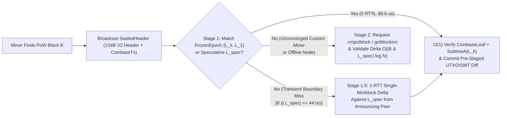
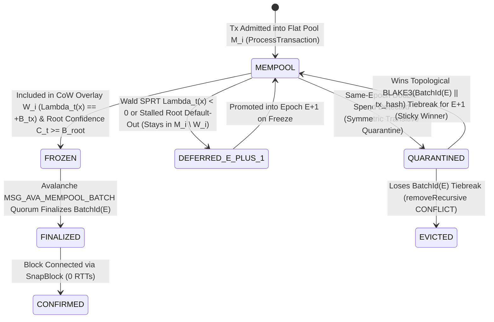

# Snowstorm: Multi-Peer Rateless $\text{GF}(2^{64})$ BCH Fountain Pseudo-Consensus

Status: **implemented & verified in `lotusd` (`src/net/v2_protocol_handler.*`, `src/lotus_v2/mempool_overlay.*`, `src/avalanche/processor.*`, `src/txmempool.*`)**.

---

## 1. Executive Summary & Pseudo-Consensus Philosophy

> **Core Insight — The Union Needs No Agreement; Only the Cut Does:**
> Set union is commutative, associative, and idempotent (a grow-only CRDT), so reconciling the *interior* of an epoch requires no symmetry breaking or voting—every node agrees that learning missing valid transactions is progress, and Snowstorm's symmetric transitive conflict quarantine $F(A \cup B) = F(B \cup A)$ makes even double-spend removal a commutative join-homomorphism. Where consensus (and FLP) enters is **closing the finite epoch cut** so every node derives the exact same 256-bit `SubtreeARoot` and `UtxoRoot` for 0-RTT `SnapBlock` assembly. Snowstorm uses repeated sampling of 913-byte rateless $\text{GF}(2^{64})$ BCH miniblocks to **shrink the agreement problem from all $N$ transactions in the epoch down to the thin boundary of late arrivals near the cut**—resolving the interior by algebraic union while using cohort support from the decoded sketches and a unified Hypergeometric SPRT to snap all nodes onto the same boundary cut.

<div class="lens-grid">
<div class="lens-card lens-consumer">

### In Practice

- **Zero-Wait Block Propagation:** Instead of waiting until a block is mined to discover which transactions are inside it, **Snowstorm** lets nodes continuously stream lightweight mathematical "fountain" sketches to each other beforehand so everyone's mempool crystallizes into the exact same set of transactions *before* the block is found.
- **Header + Coinbase Instant Blocks (`SnapBlock`):** When a miner finds a block, they don't need to broadcast megabytes of transactions—just a compact **`SealedHeader` (`SnapBlock`)** frame (`134-byte` native V2 block header + serialized `coinbase_tx`, or `240 bytes` on legacy 80B-header + 4B-framing + 156B-coinbase benchmark frames; `238 bytes` for a 134B V2 header + 1B length + 103B 1-output coinbase). Nodes snap the block into place in **`0.089 milliseconds` (`88.6 µs`)** with **`0` post-block RTTs**—**14× faster** in post-block CPU than `Merklix-Snowball` (`1.25 ms`) and **2,905× faster** in total WAN propagation than post-block recovery (`257.39 ms`).
- **Pseudo-Consensus (Optional, Never Splits the Chain):** No node or miner is forced to use Snowstorm. Block validity is still 100% decided by Proof-of-Work and Lotus V2's deterministic consensus rules (`C01`–`C28`). If a miner mines a custom block without Snowstorm, or a node turns Snowstorm off, the network never forks—nodes simply fall back to standard compact/full block download (and any local `PreConsensusPolicy` parking of blocks that conflict with finalized batches is a temporary tip-selection policy, never a permanent validity rule). Yet participating is overwhelmingly beneficial because Snowstorm blocks propagate in `0 RTTs` with near-zero orphan risk.

</div>
<div class="lens-card lens-engineer">

### Under the Hood

- **Two-Layer Rateless Fountain-Outer / $\text{GF}(2^{64})$ BCH-Inner Coding & Distributed $K_t$-Hash Projection Tallies:** Interactive prefix-tree reconciliation (`Merklix-Snowball`, our earlier prototype combining Merklix prefix trees `[2]` with Snowball peer sampling `[14]`) requires interactive top-down traversal (`5 RTTs`, `118.5 B / missing tx`), fixed-capacity algebraic sketches (PinSketch `[5, 6]`, IBLT `[9]`, Graphene `[11]`, Erlay/Minisketch `[12]`) suffer a catastrophic "decoding cliff" when symmetric difference $|\Delta|$ exceeds table capacity, pairwise Rateless IBLTs `[16]` map coded symbols with decreasing density but peel singletons only (`count == 1`, strictly pairwise) without multi-peer coupling or algebraic cell fraud proofs, and block-byte fountain codes (LT `[7]`, Raptor `[8]`, Velocity `[13]`) only work on a single static byte array from one miner. **Snowstorm** separates the two coding layers explicitly:
  1. **Outer Layer (Rateless Fountain-Style Partition Stream & Distributed $K_t$-Hash Tanner Graph):** Each `RatelessMiniblock` with stream index $m_j$ and geometric decimation $2^{-L_j}$ is a seeded random 32-cell partition of peer $j$'s candidate set (`SplitMix64` keyed by $(m_j, L_j)$). Across $K_t$ sampled peers, the $K_t$ independent partitions form a **stateless distributed $K_t$-hash Tanner graph over the latent target epoch set $S^*$**—one hash function per peer, requiring no stateful per-neighbor delta tracking or coordinated index schedules.
  2. **Inner Layer (Fixed-Capacity Degree-2/3 BCH Cells + Optional Raptor-Style Tail Precode):** Each 28-byte cell $(C, S_1, S_3, S_5)$ is a degree-2/3 BCH (PinSketch) syndrome code over $\text{GF}(2^{64}) = \mathbb{F}_2[x]/(x^{64}+x^4+x^3+x+1)$ that algebraically factors up to $d \le 3$ unknowns rather than waiting for degree-1 singletons, while an optional 256-byte global BCH tail sketch ($t = 32$ odd syndromes $S_1, \dots, S_{63}$) acts as a Raptor-style precode `[8]` to solve any remaining peeling-tail stragglers in one Berlekamp–Massey pass, and `GETSHORTTX` fetches missing transaction bodies via sender-tagged erasure-coded chunks across multiple peers so no single peer can stall body recovery.
- **Cross-Peer Coupled Peeling, Blind Mode-2 Signed Cross-Substitution, & Free Membership Tallies from Projection:** Every `RatelessMiniblock` carries a `32 × 28 = 896 B` BCH cell array (`913 B` in compact stream mode with a `17 B` per-miniblock header, or `1,018 B` standalone with the full `122 B` self-describing scope/root header) under a true 1-hash-per-frame partition ($r=1$ cell per $32$-cell frame). Subtracting the receiver's set $W_i$ from every received cell and projecting candidate elements into each peer $j$'s target cell $c(x, m_j, L_j)$ simultaneously accelerates coupled peeling—completing at **`1.54–1.92 cells/item` on a single homogeneous difference set** and, across staggered-lag peers under **blind Mode-2 signed cross-substitution** (without any peer-membership oracle, where an equal-byte $k=3$ IBLT collapses to `0%`), at **`1.10 cells/union-item` (`30.7 B/tx`, `100.00%` at `0%` noise and `99.00%` [`99.72%` peeled] at `5%` per-peer noise) down to `0.96–0.92 cells/union-item` (`98.00%–92.33%` at `0%` noise; `34.97 B/tx` in `2 RTTs`)**—*and* yields the per-transaction cohort vote tally $r_t(x)$ directly from resolved cells without extra messages or per-peer state.
- **$O(1)$ Algebraic Fraud Proofs Keyed on `(peer_id, candidate_root)`:** Four mathematical invariants—Type 1 single-cell degree-3 BCH self-consistency (`count in {0..3}`), Type 2 $L=0$ 32-cell partition conservation, Type 3 generalized cell capacity conservation ($\text{peeled\_missing}_c \le \text{raw\_count}_c$), and exhausted-cell local-extra elimination (scoped per `(peer_id, candidate_root)` with bounded root rotations)—allow any node to prove in $O(1)$ that a Byzantine peer sent a poisoned miniblock, shun the peer, and purge its state without falsely penalizing honest mid-stream epoch updates.

</div>
</div>

---

## 2. Why Snowstorm is *Pseudo-Consensus*

A foundational architectural principle of Lotus V2 is the strict boundary between **Hard Consensus Validity** and **Snowstorm Pseudo-Consensus Coordination**.

### 2.1 Hard Consensus Invariance (`consensus.md` C01–C28)

Hard consensus validity is a pure, deterministic state-transition function of a block's bytes and its parent state commitment:
1. Valid Proof-of-Work (`BlockID <= Target`) under P04's two-stage BLAKE3 header specification (`134-byte` native V2 header with 18-byte `nonce` field `nonce1:u64 || nonce2:u64 || extra_work:u16`).
2. Valid transaction encodings, two-phase outputs-then-inputs CTOR UTXO resolution (`C12`), multi-branch MAST scripts, deferred `ENFORCEOUTPUT` / `HAS_STATE` checks (`C12a`), BIP340 Schnorr signatures, bounded VM cost (`cu`), and token conservation (`C01`–`C24`).
3. Exact match of `Header.tx_root` (`H_txroot(0x03 || CoinbaseLeaf || SubtreeA)`) and `Header.state_root` (`H_state(0x00 || ChainID || u64(height) || UtxoRoot || Bytes(MonetaryState))`, where `Bytes(MonetaryState)` is 56 bytes at genesis $h=0$ and 88 bytes including the 32-byte `history_root` at $h \ge 1$ per `C03` and `P02`).

> [!IMPORTANT]
> **Consensus Non-Interference Guarantee:**
> - A block that satisfies `C01`–`C28` is **consensus-valid** whether or not its transactions passed through Snowstorm.
> - A block that violates any rule in `C01`–`C28` is **consensus-invalid** even if 100% of Snowstorm peers voted for its epoch batch.
> - Every transaction recovered via Snowstorm undergoes full `MemPoolAccept` (`ProcessTransaction`) signature, UTXO, and VM validation before it can enter a node's working epoch layer (`W_e`), and every epoch root must pass the **Strict 256-Bit Root-Verification Gate** (`recomputed_root_32B == peer_root_32B`).

### 2.2 Incentive Compatibility: Why Participation is a Strict Nash Equilibrium

Even though participation in Snowstorm is optional, rational miners, exchanges, and full nodes have strong economic and operational incentives to participate:

| Participant | Without Snowstorm (Stage 2 Fallback Path) | With Snowstorm (Stage 1 Fast Path) |
| :--- | :--- | :--- |
| **Miners** | Must transmit `cmpctblock` + answer `getblocktxn` over multiple WAN RTTs (`~258 ms` at 50 ms RTT for 600 missing txs), increasing stale/orphan rate at 100,000+ TPS and risking block delay if double-spends were resolved differently by peers. | Broadcasts a compact **`SealedHeader` (`SnapBlock` = `134 B` V2 header + `CS(cb_len) || coinbase_tx`, or `240 B` on 80B-header + 4B-framing benchmark frames)** that peers reconstruct in **$O(1)$ (`88.6 µs`, 0 post-block RTTs)**. Double-spend conflicts are pre-resolved deterministically via `BatchId(E)` before PoW is found. |
| **Full Nodes** | Must execute post-block `getblocktxn` round-trips, rebuild `SubtreeA`, and compute `UtxoRoot` state transitions on the critical path after block arrival. | Pre-crystallizes `FrozenEpoch` overlays (`SubtreeA` + `UtxoRoot` + cut-through UTXO delta) continuously before the block arrives; `ConnectBlock` commits the pre-validated overlay in $O(1)$. |
| **Wallets & Exchanges** | Only see binary `unconfirmed` vs. `confirmed` states; conflicted double-spends remain ambiguous until a block is mined. | Observe a monotonic **4-state transaction lifecycle** (`mempool` $\to$ `frozen` $\to$ `finalized` $\to$ `confirmed`) via RPC (`getmempoolinfo`, `getmempoolentry`, `getrawtransaction`), gaining sub-second pre-block finality. |

**Miner Fee-Tail vs. Orphan-Risk Equilibrium:**
Even when global 5-region WAN skew stretches epoch freeze latency to $0.4\text{--}1.2\text{ s}$ (or $\sim 100\text{--}250\text{ ms}$ in steady/regional operation), the un-crystallized mempool tail $M_{\text{tail}} = M_{\text{live}} \setminus L_k$ contains $< 1\%$ of a $120\text{ s}$ Lotus V2 block interval. Including $M_{\text{tail}}$ outside $L_k$ forces the miner off the 0-RTT `SnapBlock` fast path onto the multi-RTT `cmpctblock` / `getblocktxn` fallback path, incurring additional propagation delay $\Delta \tau_{\text{fallback}} \approx 250\text{--}500\text{ ms}$ and additional orphan probability $\Delta \mathbb{P}(\text{orphan}) \approx 1 - e^{-\lambda_{\text{block}} \Delta \tau_{\text{fallback}}} \approx \frac{\Delta \tau_{\text{fallback}}}{T_{\text{block}}}$. Rational miners therefore mine the crystallized `FrozenEpoch` $L_k$ whenever:
$$(1 - \beta_{\text{burn}}) \cdot F(M_{\text{tail}}) < \Delta \mathbb{P}(\text{orphan}) \cdot \big(S_h + (1 - \beta_{\text{burn}}) \cdot F(L_k)\big)$$
which holds for all normal fee arrival distributions (since $M_{\text{tail}}$'s fees are automatically captured in the next epoch $L_{k+1}$, whereas an orphaned block loses the entire block subsidy $S_h$ plus $100\%$ of net epoch fees).

### 2.3 Three-Stage Block Reception Pipeline (`Stage 1: Cached Layer Match` $\to$ `Stage 1.5: 1-RTT Peer Miniblock Delta` $\to$ `Stage 2: cmpctblock`)



- **Threat-Model Boundary & Why Non-Mining Byzantine Peers Have Zero Role in `SnapBlock` Acceptance:**
  1. **Only Proof-of-Work Miners Can Produce a `SnapBlock`:** A non-mining Byzantine peer cannot forge PoW (`BlockID <= Target`) to announce a block.
  2. **Acceptance Is Purely Local Validation (Theorem 6), Never a Vote:** Receiving nodes do not poll peers to accept a `SnapBlock`; they deterministically verify `FastPathAccept(H, C_cb, L)` locally against their own pre-validated `FrozenEpoch` / `SpeculativeOverlay` state. Whether Byzantine nodes "agree" or "freeze" locally is irrelevant—only *honest receivers* of *honest-mined blocks* matter.
  3. **Graceful Degradation (`Stage 1` $\to$ `Stage 1.5` $\to$ `Stage 2`), Optional Soft-Fork Coinbase Frame-Merkle Commitment, & Self-Penalizing Byzantine Miners:** A non-mining Byzantine coalition's sole lever in Snowstorm is attempting to cause a fast-path cache miss between honest nodes. Even if an honest receiver's cached root differs from a newly mined block by a small boundary delta ($|B \triangle L_{\text{spec}}| \le 44$ transactions), **Stage 1.5** recovers the exact transaction delta in **1 RTT** via a single $t=44$ BCH `RatelessMiniblock` from the announcing neighbor against $L_{\text{spec}}$ (verified immediately against the PoW-authenticated $H.\text{tx\_root}$, catching and banning any peer that sent a bogus sketch at the cost of one decode attempt). Rather than baking a `SketchRoot` into hard-consensus `TxRoot`—which would ossify the entire sketch specification (`SplitMix64` constants, epoch-key derivation, $\text{GF}(2^{64})$ polynomial, and $32 \times 28\text{ B}$ cell layout) into permanent consensus rules that initial-block-download nodes would have to maintain forever—multi-peer Stage 1.5 frame authentication can use an **optional versioned tag in `coinbase_tx.vCoinbaseData`** committing to the **Merkle root of the $L=0$ `RatelessMiniblock` frames** (unlike a MinHash digest, which only authenticates a similarity estimate, a frame Merkle root lets a receiver verify each decodable frame fetched from any peer via a short Merkle path): it is already PoW-authenticated via `CoinbaseLeaf(C_cb)` with cold payout keys, requires no consensus check (lying only slows the miner's own block propagation), can evolve via a version byte without any fork, and can later be made mandatory via a **soft fork** once proven in practice. Even a full Stage 2 `cmpctblock` fallback costs only $\Delta\tau_{\text{fallback}} / T_{\text{block}} \approx 0.3\text{ s} / 120\text{ s} \approx 0.25\%$ orphan risk. Conversely, if a **Byzantine miner** mines a block on a private/unconverged root ($>44$ unbroadcast transactions), honest nodes simply miss Stage 1/1.5 and fetch via Stage 2 `cmpctblock`, penalizing the *Byzantine miner's own block propagation* ($t_{50} = 227\text{ ms}$, $t_{90} = 421\text{ ms}$ vs. $51\text{--}70\text{ ms}$ / $96\text{--}109\text{ ms}$ for honest blocks) while honest nodes' Snowstorm convergence remains $100\%$ unaffected.
  4. **Flat Admission Pool ($M_i$ / `CTxMemPool`) vs. Copy-on-Write Epoch Overlays ($W_i, L_k$ / `MerklixOverlayManager`) & Post-Block Rebasing:** Newly arriving transactions enter the flat admission pool $M_i$ (`CTxMemPool`, indexed by lock-free radix/hash tables) **without** touching the CoW Merklix or UTXO trees, so unvetted arrivals, low-support drips, and competing double-spends never trigger CoW path-copying or dirty digests; only transactions passing the per-transaction Wald SPRT ($\Lambda_{i,t}(x) \ge 0$) enter the CoW `MempoolOverlayLayer` ($W_i$). Whenever block $B_h$ connects via Stage 1, Stage 1.5, or Stage 2 `cmpctblock`, confirmed transactions $B_{\text{tx}}$ and invalidated conflicts are evicted from `CTxMemPool`, the old height-$h$ CoW overlay stack is cleared in $O(1)$ (`MerklixOverlayManager::ResetToTip`), and all surviving unconfirmed transactions $(M_i \setminus B_{\text{tx}}) \setminus \text{Conflicts}(B_{\text{tx}})$ (including any $\Delta^- = W_i \setminus B_{\text{tx}}$ from a divergent local overlay) cleanly re-anchor into height $(h+1)$'s fresh candidate overlay with updated coin creation and expiration heights.

### 2.4 System, Network, and Adversary Model

- **Network Model:** Nodes communicate over a P2P overlay subject to *partial synchrony*; during synchronous intervals, messages between honest peers arrive within bounded delay $\Delta_{\text{net}}$.
- **Cryptographic & Field Assumptions:** 256-bit BLAKE3 (`TaggedHash`) is modeled as a collision-resistant / random-oracle hash function, and per-epoch `SipHash-2-4(k0, k1, TxId || TxHash)` is modeled as a pseudorandom function whose key $(k_0, k_1) = H(\texttt{"SNOWSTORM\_EPOCH\_ID"},\, P.\text{block\_hash} \parallel P.\text{batch\_id})$ is unpredictable prior to Proof-of-Work discovery of parent block $P$ `[17]`.
- **Adversary Budget:** We separate the two protocol layers explicitly:
  - **Assumption A1 (Bonded Stake-Weighted Finality, $f_{\text{stake}} < 1/3$):** At most $f_{\text{stake}} < 1/3$ of bonded PoW-UTXO stake weight (`consensus.md`, enforced cryptographically via `ProofId` UTXO ownership proofs) in the Avalanche `MSG_AVA_MEMPOOL_BATCH` quorum is Byzantine.
  - **Assumption A2 (Per-Neighborhood Unweighted P2P Bound, $f_{\text{peer},i} = B_i / D_{\text{neighbors}} \le \beta_{\max} < 1/4$):** At most a fraction $\beta_{\max} < 1/4$ of entries in *each honest node $i$'s own* AS/subnet-diversified P2P peer table (`peering.md`) of size $D_{\text{neighbors}}$ are Byzantine (because the hypergeometric test samples from node $i$'s local neighbor table $D_{\text{neighbors}}$, the bound applies per neighborhood rather than merely to the global network average). Crucially, **consensus safety never depends on A2**: if a node's local neighborhood is crowded beyond $B_i / D_{\text{neighbors}} \ge 1/4$, it at worst experiences a `SnapBlock` cache miss and falls back to Stage 2 (`cmpctblock`) or adopts the stake-certified batch under Assumption A1.

---

## 3. Resolving the Set-Reconciliation Trilemma

Prior block and mempool propagation protocols face a fundamental trilemma when reconciling $N \ge 100,000$ transactions across $K$ peers whose mempools differ by an unknown symmetric difference $|\Delta|$:

| Protocol Family | Representative Systems & Citations | Multi-Peer Streaming? | Works on Divergent Unconfirmed Sets? | Rateless (No Decoding Cliff)? | $O(1)$ Per-Packet Fraud Proofs? | Pre-Block WAN RTTs |
| :--- | :--- | :---: | :---: | :---: | :---: | :---: |
| **Short-ID Lists** | BIP152 Compact Blocks `[10]` | No | No (post-block only) | Yes | N/A | N/A (`1–2` post-block) |
| **Fixed Algebraic Sketches** | PinSketch `[5, 6]`, IBLT `[9]`, Graphene `[11]`, Erlay `[12]` | No (1-to-1 pairwise) | Pairwise only | **No** (catastrophic cliff if $\lvert\Delta\rvert > C$) | **No** (1 bad cell ruins entire decode silently) | `2–3` pairwise |
| **Pairwise Rateless IBLT** | Rateless IBLT `[16]` | No (pairwise degree-1 XOR) | Pairwise only | Yes | **No** (non-algebraic hash checksums; no BCH cell proofs) | `1–2` pairwise |
| **Block Erasure Codes** | LT `[7]`, Raptor `[8]`, Velocity `[13]` | Yes | **No** (requires 1 static block byte array) | Yes | No (requires full block/tree rebuild) | N/A (post-block only) |
| **Prefix-Tree Bisection** | Classical Merkle Walk `[4]`, `Merklix-Snowball` `[2, 14]` | No (interactive per-peer) | Yes | Yes | Yes (Merkle hashes) | `5+ RTTs` (`~118.5 B/tx`) |
| **Rateless $\text{GF}(2^{64})$ BCH Fountain** | **Snowstorm (Lotus V2)** | **Yes ($K$ peers simultaneously)** | **Yes (any $M_p \triangle M_{\text{local}}$)** | **Yes (infinite miniblock stream)** | **Yes (Type 1/2/3 algebraic proofs)** | **`2 RTTs` (`34.97 B/tx`)** |

---

## 4. Mathematical & Wire Specification of `RatelessMiniblock`

### 4.1 Finite Field $\text{GF}(2^{64})$ and Odd Power-Sum Syndromes

All syndrome arithmetic operates in the characteristic-2 extension field:
$$\text{GF}(2^{64}) = \mathbb{F}_2[x] \big/ (x^{64} + x^4 + x^3 + x + 1)$$
with primitive irreducible pentanomial modulus `0x1B` ($x^4 + x^3 + x + 1$). Multiplication in $\text{GF}(2^{64})$ is accelerated via hardware carry-less multiplication (`_mm_clmulepi64_si128` on x86_64 and `vmull_p64` on ARM64 NEON), achieving `745.6M tx/sec` syndrome accumulation and `41.34M roots/sec` BCH decoding.

For any non-zero 64-bit transaction short identifier $x \in \text{GF}(2^{64})^\times$ (computed via per-epoch keyed `SipHash-2-4(k0, k1, TxId || TxHash)` and deduplicated per set), its contribution to a cell is:
$$\text{count} \mathrel{+}= 1, \qquad S_1 \mathrel{\oplus}= x, \qquad S_3 \mathrel{\oplus}= x^3, \qquad S_5 \mathrel{\oplus}= x^5$$

> [!NOTE]
> **Why Key $x$ Over `(TxId, TxHash)` + Same-`TxId` Witness Conflict Quarantine?**
> Under `C07`, `SubtreeA` is keyed by `TxId`, and each leaf `TxLeaf(tx) = H_txroot(0x01 || TxId || TxHash)` commits to both `TxId` and `TxHash`. If $x$ were derived from `TxId` alone, an attacker could sign the same transaction twice with fresh BIP340 randomness ($w_1 \neq w_2$, yielding $\text{TxId}_1 = \text{TxId}_2$ and $\text{TxHash}_1 \neq \text{TxHash}_2$) and send one variant to each half of the network: the two variants would map to the same $x$ and cancel in the sketch while producing different `SubtreeA` roots! Keying $x = \text{SipHash-2-4}(k_0, k_1, \text{TxId} \parallel \text{TxHash})$ ensures both variants appear in the decoded symmetric difference. Because two witness variants of the same `TxId` spend the exact same inputs, receiving a second valid witness variant for an unsealed `TxId` already in `active_epoch` treats the pair as a same-input conflict class and routes both into the order-independent conflict quarantine (`quarantined_txs_`, retaining the variant with $\min_j \text{TxHash}_j$ with no replacement cap) for promotion into Epoch $E+1$ (note that if a non-standard spending script permits third-party-malleable witness arguments not bound by a signature, a third party can broadcast a competing valid witness variant and delay that transaction by one epoch, whereas standard Schnorr signatures bind the witness). If two peers still exhibit $R_A \neq R_B$ with an all-zero $L=0$ sketch residual (e.g., due to a $2^{32}$ birthday collision in $\text{GF}(2^{64})^\times$), reconciliation falls back to a depth-2 Merklix bucket digest comparison (`getmerklixbuck`, $256 \times 32\text{ B} = 8\text{ KiB}$, which identifies the differing $1/256$ bucket of $\approx 390$ txs at $N = 10^5$ in $1\text{ RTT}$ plus $1\text{ RTT}$ to reconcile that bucket $= 2\text{ RTTs}$ total) or an interactive $O(\log_{16} N)$ branch walk ($4\text{--}5\text{ RTTs}$).
>
> **Why Only Odd Power Sums $(S_1, S_3, S_5)$?**
> In characteristic 2 ($\mathbb{F}_2$), Freshman's Dream $(a \oplus b)^2 = a^2 \oplus b^2$ implies that all even power sums are redundant squares of earlier power sums:
> $$S_2 = \bigoplus_i x_i^2 = \left(\bigoplus_i x_i\right)^2 = S_1^2, \qquad S_4 = S_1^4, \qquad S_6 = S_3^2$$
> Thus the three 64-bit odd power sums $(S_1, S_3, S_5)$ provide all 6 consecutive BCH syndromes $(S_1, S_2, S_3, S_4, S_5, S_6)$ required to solve up to $t = 3$ unknown errors over $\text{GF}(2^{64})$ in just $24\text{ bytes}$.

### 4.2 Wire Format (`RatelessMiniblock` & Size Accounting)

Each `RatelessMiniblock` contains `NUM_CELLS = 32` algebraic BCH cells (`28 bytes` per cell = **`896 bytes`** cell array). Depending on whether the 112-byte epoch/root context (`context_id[32] + parent_base_root[32] + candidate_root[32] + salt_k0[8] + salt_k1[8]` = `112 B`, or `96 B` excluding the two 8-byte session salts) is carried per frame or amortized across an epoch session stream, the wire sizes are:
- **Cell Payload (`32 × 28 B`):** **`896 bytes`** (`cells[0..31]`).
- **Compact Session-Stream Miniblock (`17 B` stream header + `896 B` cells):** **`913 bytes`** (`scope[1] + context_short_id[8] + total_tx_count[4] + miniblock_id[3] + decimation_level[1] + cells[896]`, where `context_short_id` binds `(context_id, candidate_root)` for the active session stream).
- **Standalone Self-Describing `RatelessMiniblock` (`122 B` full header + `896 B` cells):** **`1,018 bytes`** (`src/net/v2_protocol_handler.h:337-360`).

- **Canonical Scope Salt Verification (`salt_k0`, `salt_k1`):** In `PRECONSENSUS_EPOCH` scope (`0x01`), `(salt_k0, salt_k1)` is deterministically derived from `context_id = H("SNOWSTORM_EPOCH_ID", P.block_hash || P.batch_id)` (`salt_k0 = LE64(context_id[0..7])`, `salt_k1 = LE64(context_id[8..15])`). `RatelessMiniblockDecoder::AddPeerMiniblock` strictly rejects any incoming miniblock whose wire `(salt_k0, salt_k1)` does not equal the scope's derived `(m_salt_k0, m_salt_k1)` (`src/net/v2_protocol_handler.cpp:2109`), preventing any sender from choosing or grinding the SipHash salt.
- **Why `0.92 cells / item` Is Below 1 Cell/Item (~30% Overhead Above the $0.71\text{ cell/item}$ Threshold):** Because each 28-byte degree-2 BCH cell resolves up to $d = 2$ items simultaneously while retaining a 64-bit $S_5$ integrity check, the algebraic capacity ceiling is $0.50\text{ cells/item}$ (14 B/item). Under random Poisson cell occupancy across geometric decimation levels $2^{-L}$, the empirical $d \le 2$ peeling threshold is $\approx 0.71\text{ cells/item}$ ($443$ cells for $625$ items, compared to $> 1.35\text{ cells/item}$ for degree-1 IBLT/RIBLT), so $18 \times 32 = 576\text{ cells}$ for $625$ difference items equals **`0.92 cells / item`** ($\approx 30\%$ cell overhead above $0.71\text{ cells/item}$).

```text
MerklixSubBucketEntry / RatelessSketchCell (28 bytes):
  count : i32_le        # Signed 32-bit element count (non-negative in raw wire cells; signed delta_count after subtraction)
  s1    : u64_le        # XOR sum of x        in GF(2^64)
  s3    : u64_le        # XOR sum of x^3      in GF(2^64)
  s5    : u64_le        # XOR sum of x^5      in GF(2^64)

RatelessMiniblock (1,018 bytes standalone / 913 bytes compact session stream / 896 bytes cell array):
  scope            : u8                        # 1 B:  ReconScope (0x01 = PRECONSENSUS_EPOCH, 0x02 = LIVE_MEMPOOL)
  context_id       : h256                      # 32 B: Epoch / context identifier
  parent_base_root : h256                      # 32 B: Self-clocking crystallized parent SubtreeA root
  candidate_root   : h256                      # 32 B: Sender's active epoch SubtreeA root
  salt_k0          : u64_le                    # 8 B:  SipHash key k0
  salt_k1          : u64_le                    # 8 B:  SipHash key k1
  total_tx_count   : u32_le                    # 4 B:  Sender's total distinct short_id count in this scope
  miniblock_id     : u32_le                    # 4 B:  Monotonic fountain stream index (0, 1, 2, ...)
  decimation_level : u8                        # 1 B:  Multi-scale sampling exponent L in [0..12] (rate = 1 / 2^L)
  cells            : RatelessSketchCell[32]    # 896 B: 32 algebraic BCH cells (32 * 28 bytes)
```

### 4.3 Deterministic `SplitMix64` Cell Mapping & Multi-Scale Geometric Decimation

Given `(short_id, miniblock_id, decimation_level L)` with $L \in [0, 12]$:
1. Compute the per-miniblock 64-bit mix input:
   $$z = \text{short\_id} \oplus (\text{miniblock\_id} \times \texttt{0x9E3779B97F4A7C15}_{64}) \oplus (\text{decimation\_level} \times \texttt{0xBF58476D1CE4E5B9}_{64})$$
2. Apply the bijective `SplitMix64` finalizer:
   $$h = \text{SplitMix64}(z)$$
3. **Decimation Gate ($L > 0$):**
   If $L > 0$: let $\text{mask} = (1 \ll L) - 1$. If $\big((h \gg 8) \ \& \ \text{mask}\big) \neq 0$, the element is **not sampled** in this miniblock (returns `std::nullopt`).
4. **Cell Assignment ($0..31$):**
   Otherwise, the element maps to cell:
   $$c = h \ \& \ \texttt{0x1F} \quad \in \{0, 1, \dots, 31\}$$

Because step 3 inspects bits `8 .. 8+L-1` and step 4 inspects bits `0 .. 4`, the decimation filter and the 32-way cell partition are orthogonal. At $L = 0$, every element in the set maps to **exactly one** of the 32 cells.

**Multi-Scale Geometric Schedule (`SelectRatelessDecimationLevel`), Distributed $K_t$-Hash Projection Tallies, and Linear Delta Patching:**
- **Role-Stratified Multi-Scale Decimation:** When an estimated difference $|\hat{\Delta}| > 64$, senders interleave higher decimation levels $L_{\max} \to \dots \to 1 \to 0$ so that sparse high-$L$ cells isolate singletons/pairs immediately even when $|\Delta|$ is thousands of transactions, while dense $L = 0$ cells guarantee 100% coverage of the tail (complemented by an optional 256-byte $t=32$ global BCH tail precode to finish any stopping-set stragglers in one algebraic pass).
- **Stateless Distributed $K_t$-Hash Tanner Graph & Cross-Peer Projection Tallies:** Because each sampled peer $j \in \{1, \dots, K_t\}$ uses its own partition index $m_j$ and decimation level $L_j$, the $K_t$ miniblocks form an IBLT-like Tanner graph over the latent target epoch set $S^*$ with $K_t$ independent hash functions—one per peer. Peer $j$'s idiosyncratic errors ($W_j \triangle S^*$) corrupt only peer $j$'s cells, whereas the receiver's differences relative to $S^*$ ($W_i \triangle S^*$) appear across every peer's partition. Subtracting $W_i$ from all cells and projecting any candidate $x$ into its target cell $c(x, m_j, L_j)$ across all $K_t$ peers yields the per-element membership support count $y_t(x)$ for free: resolved cells (residual degree $\le 3$) certify whether $x \in W_j$ (`present`, $+1$) or $x \notin W_j$ (`absent`, $0$), while overloaded cells ($> 3$ unknowns) abstain (`unknown`, contributing $0$ bits of LLR evidence in §6.2's two-sided hypergeometric Wald SPRT, equivalent to the indifference support $\theta = \frac{3-\beta_{\max}}{4}$), counting **at most one vote per peer $j$ per element $x$** across all decimation levels received from peer $j$ (cross-checking that multiple resolved cells from peer $j$ agree on $x$ under Type 3 fraud detection). Because $0 < \theta < 1$, for any *monotone* adversary (pure suppression toward $0$ or pure inflation toward $1$), strategic cell abstention is strictly dominated by active voting ($0$ pulls the LLR strictly lower than $\theta$, and $1$ pulls the LLR strictly higher than $\theta$), whereas an *adaptive balancing* adversary seeking to hold $\Lambda_{i,t}(x)$ near $0$ can employ either selective abstention or opposite-side voting (both tested explicitly in §8.3).
- **$O(|\Delta^+| + |\Delta^-|)$ Linear Sketch Delta Patching on Candidate-Set Updates:** Because cell counts and $\text{GF}(2^{64})$ power-sum syndromes are linear, adding or evicting boundary elements $\Delta^+, \Delta^-$ updates any cached local miniblock in $O(|\Delta^+| + |\Delta^-|)$ via $\text{sketch}_m(W_{\text{new}}) = \text{sketch}_m(W_{\text{old}}) \oplus \text{sketch}_m(\Delta^+) \oplus \text{sketch}_m(\Delta^-)$ without re-encoding $W_i$.

---

## 5. Multi-Peer Coupled BCH Peeling & The Six Formal Theorems

When a node holds local transaction set $M_{\text{local}}$ and receives `RatelessMiniblock` frames from $K$ peers (where Peer $p$ holds transaction set $M_p$), the decoder subtracts $M_{\text{local}}$ and runs an iterative coupled peeling solver across all stored miniblocks.

### Theorem 1 (Degree-3 BCH Elementary Symmetric Polynomial Reduction in $\text{GF}(2^{64})$)

Let $X = \{x_1, \dots, x_d\} \subset \text{GF}(2^{64})^\times$ ($1 \le d \le 3$) be a set of distinct non-zero elements with odd power sums $S_k = \bigoplus_{i=1}^d x_i^k$, and let $\sigma_1, \sigma_2, \sigma_3$ be the elementary symmetric polynomials of $X$ such that $\Lambda(z) = z^d \oplus \sigma_1 z^{d-1} \oplus \dots \oplus \sigma_d = \prod_{i=1}^d (z \oplus x_i) = 0$. Using Newton's identities in characteristic 2 ($S_2 = S_1^2,\ S_4 = S_1^4$):
$$\begin{aligned}
S_1 &= \sigma_1 \\
S_3 &= \sigma_1 S_2 \oplus \sigma_2 S_1 \oplus \sigma_3 = S_1^3 \oplus S_1 \sigma_2 \oplus \sigma_3 \\
S_5 &= \sigma_1 S_4 \oplus \sigma_2 S_3 \oplus \sigma_3 S_2 = S_1^5 \oplus \sigma_2 S_3 \oplus S_1^2 \sigma_3
\end{aligned}$$
Define $d_1 := S_3 \oplus S_1^3 = S_1 \sigma_2 \oplus \sigma_3$. Then:
1. **Single Root ($d = 1$):** $\sigma_2 = \sigma_3 = 0 \iff d_1 = 0 \land S_5 = S_1^5$, with unique root $x_1 = S_1$.
2. **Two Distinct Roots ($d = 2$):** $\sigma_3 = 0 \iff d_1 = S_1 \sigma_2 \neq 0$, giving:
   $$\sigma_1 = S_1, \qquad \sigma_2 = \frac{d_1}{S_1}, \qquad \text{subject to the 64-bit BCH check } S_5 = S_1^5 \oplus \sigma_2 S_3 = S_1^5 \oplus S_1^3 \sigma_2 \oplus S_1 \sigma_2^2 = x_1^5 \oplus x_2^5$$
3. **Three Distinct Roots ($d = 3$):** Substituting $\sigma_3 = d_1 \oplus S_1 \sigma_2$ into $S_5 = S_1^5 \oplus \sigma_2 S_3 \oplus S_1^2 \sigma_3$ gives $S_5 \oplus S_1^5 \oplus S_1^2 d_1 = S_5 \oplus S_1^2 S_3 = d_1 \sigma_2$, yielding (`RecoverGF64SyndromesUpTo3`):
   $$\sigma_1 = S_1, \qquad \sigma_2 = \frac{S_5 \oplus S_1^2 S_3}{d_1} = \frac{S_5 \oplus S_1^5 \oplus S_1^2 d_1}{d_1}, \qquad \sigma_3 = d_1 \oplus S_1 \sigma_2$$

### Theorem 2 ($2^{-64}$ Cross-Peer Projection & Signed-Difference Classification Soundness)

Suppose a residual cell $(m, c)$ of Peer $p$ has signed count $\Delta c = |U^+| - |U^-|$, where $U^+ \subset M_p \setminus M_{\text{local}}$ are unpeeled peer-missing items and $U^- \subset M_{\text{local}} \setminus M_p$ are unpeeled local-extra items. In characteristic 2, XOR syndromes do not carry sign bits, so `TryResolveCell` and `TryCrossPeerProjectCell` enforce two strict gates before classifying any recovered roots $\{r_1, \dots, r_d\}$ ($d = |\Delta c| \in \{1, 2\}$):
1. **Sign-Membership Partition Gate:**
   - When $\Delta c > 0$ ($\Delta c \in \{1, 2\}$): **every** root $r_i$ must satisfy $r_i \notin M_{\text{local}}$ (`!m_local_short_ids.contains(r_i)`) and pass `HasZeroCellVetoForPeer(peer_id, r_i) == false`.
   - When $\Delta c < 0$ ($\Delta c \in \{-1, -2\}$): **every** root $r_i$ must satisfy $r_i \in M_{\text{local}}$ (`m_local_short_ids.contains(r_i)`).
   - If any root violates the sign-membership partition or cell assignment `MapShortIdToMiniblockCell(r_i, m, L) == c`, the entire candidate resolution is rejected (`all_valid = false`).
2. **$\ge 64$-Bit Algebraic Redundancy Gate ($d \le 2$) & Adversarial Chosen-Syndrome Containment:**
   - **Random Mixed-Sign Residual Collisions ($< 2^{-74}$):** Over uniform `SipHash-2-4(k0, k1, TxId)` short IDs and independent `SplitMix64` cell/decimation bit slices:
     - For $d = 0$ (`proj.IsZero()`), all three 64-bit syndromes $(S_1, S_3, S_5)$ and `delta_count` must vanish simultaneously ($2^{-192}$ false-positive probability).
     - For $d = 1$, $S_3 = S_1^3$ and $S_5 = S_1^5$ provide **128 bits** of algebraic redundancy plus $5 + L$ bits of cell-mapping verification ($< 2^{-133}$ false-positive probability, preventing a mixed $2\text{-positive}, 1\text{-negative}$ residual $x_1 \oplus x_2 \oplus y_1$ with $\Delta c = +1$ from masquerading as a single root).
     - For $d = 2$, $\sigma_2 = d_1 / S_1$ uses only $(S_1, S_3)$, leaving $S_5 = S_1^5 \oplus \sigma_2 S_3 = x_1^5 \oplus x_2^5$ as a **completely independent 64-bit algebraic check**. Specifically, for any non-solvable residual cell with $k = |U^+| + |U^-| \ge 3$ unpeeled items in the cell pre-image $\mathcal{C}_{m,L,c}$ ($|\mathcal{C}_{m,L,c}| = 2^{59-L}$):
       - **Zero False Positives at $k = 3$:** False acceptance has probability **zero** when $k = 3$, because the degree-$2$ check polynomial factors identically as $z_1 z_2(z_1 \oplus z_2) X(X \oplus z_1)(X \oplus z_2) = 0$, whose only roots are $z_1, z_2$ (duplicates) and $0 \notin \mathbb{F}^\times$.
       - **Degree-$3$ Cancellation for $k \ge 4$:** Conditioning on fixed $z_1, \dots, z_{k-1} \in \mathcal{C}_{m,L,c}$ with $(A, B, C) = \bigoplus_{i=1}^{k-1} (z_i, z_i^3, z_i^5)$, expanding $S_1 S_5 \oplus S_3^2 \oplus S_1^3 S_3 \oplus S_1^6 = 0$ over $\mathbb{F}_2$ cancels $X^6, X^5, X^4$ identically in $X = z_k$, leaving the degree-$3$ polynomial:
         $$P_{A,B,C}(X) = (B \oplus A^3) X^3 \oplus A(B \oplus A^3) X^2 \oplus (C \oplus A^2 B) X \oplus (A C \oplus B^2 \oplus A^3 B \oplus A^6) = 0$$
       - **Root Classification of $P_{A,B,C}(X)$:**
         - *Generic prefix ($B \neq A^3$):* $P_{A,B,C}(X)$ has exact degree $3$ and therefore at most $3$ roots in $\mathbb{F}$.
         - *Degenerate cubic prefix ($B = A^3,\ C \neq A^5$):* $P_{A,B,C}(X)$ collapses to the degree-$1$ equation $(C \oplus A^5)(X \oplus A) = 0$, whose unique root $X = A$ yields $S_1 = A \oplus X = 0$ and is immediately rejected by the $S_1 \neq 0$ guard (`0` valid roots).
         - *Syndrome-equivalent prefix ($B = A^3,\ C = A^5$):* The $k-1$ prefix is already syndrome-equivalent to the single element $A$; here $B = A^3$ is itself a quadratic equation $A'(z_{k-1}^2 \oplus A' z_{k-1}) \oplus (B' \oplus A'^3) = 0$ in $z_{k-1}$ with $\le 2$ roots whenever $A' \neq 0$.
       - **Resulting Non-Heuristic Bound:** Conditioned on $(B, C) \neq (A^3, A^5)$, false acceptance has probability at most $3 / (2^{59-L} - k + 1)$ over $z_k \in \mathcal{C}_{m,L,c}$ (and $\le 3/(2^{64}-1) < 2^{-62.4}$ over $\mathbb{F}^\times$). For $k = 4$ (where $A' = z_1 \oplus z_2 \neq 0$ holds deterministically for distinct $z_1, z_2$), a union bound over $(z_3, z_4)$ gives an **unconditional** false-positive bound of $\le 5 / (2^{59-L} - 3)$ without any heuristic independence assumption.
     - By contrast, allowing $d = 3$ during residual peeling or cross-peer projection would consume $(S_1, S_3, S_5)$ to solve for $(\sigma_1, \sigma_2, \sigma_3)$, leaving only $3 \times 5 = 15$ bits of cell-mapping verification at $L=0$ ($2^{-15}$ birthday grinding surface). Therefore, **Snowstorm strictly restricts residual peeling and cross-peer projection to $d \le 2$, using $d = 3$ only for Type 1 raw wire cell validation (`raw_count == 3`)**.
   - **Adversarial Chosen-Syndrome Containment:** A Byzantine peer that intentionally computes valid $(S_1, S_3, S_5)$ for chosen roots $\{r_1, r_2\}$ mapping to cell $c$ does not face a $2^{-64}$ algebraic barrier on its own chosen cell; instead, **per-donor candidate isolation (`donor_cand_missing`)** prevents those candidates from contaminating honest peers' projections, and any forged or fabricated set $M'_p$ is caught deterministically either by cross-miniblock conservation (Theorems 3 & 4) or by the mandatory 256-bit `TxId` (`GETSHORTTX` / `ProcessTransaction`) and 256-bit `SubtreeARoot` commitment gate (§5.4).

### 5.3 Short-ID Collision Resilience, Re-Signed Variant Tiebreaking, & Zero-Residual Merklix Prefix-Walk Fallback

While accidental 64-bit `SipHash-2-4(k0, k1, TxId || TxHash)` collisions occur with negligible probability ($\approx 2.7 \times 10^{-10}$ at $N = 100,000$), an adversary who knows the parent block $P$ could attempt a $2^{32}$ birthday search to find two of their own transactions $x_a \neq x_b$ that collide under `SipHash-2-4(k0, k1, ...)` (or broadcast two re-signed BIP340 witness variants of the same `TxId` to disjoint halves of the network). Snowstorm eliminates both vectors completely:
1. **Keying Over `(TxId, TxHash)` + Canonical `min(TxHash)` Variant Tiebreak:** Because `short_id` hashes `TxId || TxHash` rather than `TxId` alone, two re-signed witness variants with $\text{TxId}_1 = \text{TxId}_2$ and $\text{TxHash}_1 \neq \text{TxHash}_2$ map to distinct 64-bit short IDs and never cancel in the rateless sketch. When the competing variant is fetched via `GETSHORTTX`, the node deterministically retains the variant with the **lexicographically smaller `TxHash` ($\min(\text{TxHash}_1, \text{TxHash}_2)$)** (capped at 1 replacement per `TxId` per epoch), ensuring all honest peers converge to the identical `(TxId, TxHash)` leaf in `SubtreeA` regardless of arrival order.
2. **Miniblock Deduplication:** `BuildRatelessMiniblockFromShortIds` sorts and deduplicates `short_ids` before encoding so an accidental 64-bit collision within $M_p$ never creates a self-canceling $x \oplus x = 0$ syndrome with $\text{count} = 2$.
3. **Mandatory 256-Bit `TxId` & `SubtreeARoot` Verification Gate + Zero-Residual Merklix Prefix-Walk Fallback (`mempool-reconciliation.md`):** Recovered short IDs are used solely to request full serialized transactions via `GETSHORTTX`. Admitted transactions are indexed in the epoch overlay by their **full 256-bit `TxId`**, and an epoch candidate is only accepted as matching a peer's epoch if the local 256-bit Merklix root `SubtreeARoot` matches the peer's 256-bit `active_sketch_root` byte-for-byte (`recomputed_root_32B == peer_root_32B`). If a peer's `SubtreeARoot` still differs from the local `SubtreeARoot` ($R_A \neq R_B$) after full $L = 0$ cell coverage while the subtracted sketch residual is all-zero ($\Delta_{\text{decoded}} = \emptyset$, e.g., due to an adversarial $2^{32}$ birthday collision $s_1(x_a) = s_1(x_b)$), the reconciler immediately invokes the **$O(\log N)$ Merklix Radix-Tree Branch-Count / Prefix Walk** specified in [`mempool-reconciliation.md`](mempool-reconciliation.md) to isolate the colliding 256-bit `TxId`s in 1–2 RTTs.

### Theorem 3 (Generalized Cell Capacity Conservation & Exhausted-Cell Local-Extra Elimination)

For any miniblock $m$ and cell $c \in [0..31]$ received from Peer $p$ with raw wire count $\text{raw\_count}_{m,c} = |M_p(m, c)|$, partition $M_p(m, c)$ and $M_{\text{local}}(m, c)$ into:
- $A_{\text{peeled}}(m, c) = (M_p \setminus M_{\text{local}})(m, c) \cap \text{confirmed\_has}_p$ (missing items already peeled from Peer $p$),
- $U^+(m, c) = (M_p \setminus M_{\text{local}})(m, c) \setminus \text{confirmed\_has}_p$ (unpeeled missing items in cell $c$),
- $B(m, c) = (M_p \cap M_{\text{local}})(m, c)$ (shared items in cell $c$), and
- $L_{\text{unpeeled}}(m, c) = |B(m, c)| + |U^-(m, c)|$ (local items in $M_{\text{local}}(m, c)$ not yet marked missing from Peer $p$).

Then at every step of decoding, the residual cell's `delta_count` satisfies the exact identity:
$$\boxed{\text{cell.delta\_count} + L_{\text{unpeeled}}(m, c) = \text{raw\_count}_{m,c} - |A_{\text{peeled}}(m, c)| = |U^+(m, c)| + |B(m, c)| \ge 0}$$

From this identity, three powerful operational rules follow immediately:
1. **Capacity Overflow Fraud Proof (`|A_peeled| > raw_count`):**
   If `peeled_missing_count[c] > raw_count[c]` at any point, Peer $p$ has claimed more missing items in $(m, c)$ across its miniblocks than `raw_count[c]` permits $\implies$ **Type 3 Fraud Proof** (`MarkPeerFraudulent(peer_id)`).
2. **Exhausted-Cell Veto (`peeled_missing_count[c] >= raw_count[c]`):**
   As soon as `peeled_missing_count[c] == raw_count[c]`, $|U^+(m, c)| = 0$, so cell $(m, c)$ immediately vetoes any further missing-item candidate for Peer $p$ in `HasZeroCellVetoForPeer`—even before local-extra items in $(m, c)$ are peeled!
3. **Exhausted-Cell Local-Extra Elimination & Syndrome Zero Check:**
   When `peeled_missing_count[c] == raw_count[c]`, $|B(m, c)| = 0$, which proves $M_p(m, c) \cap M_{\text{local}} = \emptyset$. Therefore, **every** unpeeled local item $l \in M_{\text{local}}(m, c)$ is provably absent from Peer $p$ ($l \in M_{\text{local}} \setminus M_p$) regardless of how many local items map to $(m, c)$! The decoder immediately peels all such $l$ via `PeelLocalExtraFromPeer(peer_id, l)`, after which `mb.cells[c]` **must** equal `(0, 0, 0, 0)` (`IsZero()`). If `!mb.cells[c].IsZero()`, Peer $p$'s syndromes in $(m, c)$ are inconsistent with its claimed items $\implies$ **Type 3 Fraud Proof** (`MarkPeerFraudulent(peer_id)`).

### Theorem 4 (32-Cell $L = 0$ Partition Conservation Law Keyed on `(peer_id, candidate_root)`)

At decimation level $L = 0$, `MapShortIdToMiniblockCell` is a total function $M_p \to \{0, \dots, 31\}$ for every `miniblock_id`. Therefore, across all $L = 0$ miniblocks $m$ generated from a peer's epoch set $M_p$ for a given `candidate_root`, the global 4-tuple:
$$\mathcal{I}(M_p, \text{candidate\_root}) = \left(\sum_{c=0}^{31} \text{count}_{m,c},\ \bigoplus_{c=0}^{31} s_{1,m,c},\ \bigoplus_{c=0}^{31} s_{3,m,c},\ \bigoplus_{c=0}^{31} s_{5,m,c}\right) = \big(|M_p|,\ S_1(M_p),\ S_3(M_p),\ S_5(M_p)\big)$$
is strictly invariant.
- **Per-`(peer_id, candidate_root)` Scoping (`Pass 15A`):** Both the Type 2 $L=0$ invariant table (`m_peer_l0_invariants`) and Type 3 cell-capacity/zero-cell state are keyed on `(peer_id, candidate_root)` (`MAX_ROOT_ROTATIONS_PER_PEER = 4`). Consequently, an honest peer whose working epoch $M_p$ legitimately evolves to a new `candidate_root` mid-stream never triggers a false-positive fraud proof, whereas any peer transmitting two $L = 0$ miniblocks under the **same** `candidate_root` with differing $\mathcal{I}$ (or an $L > 0$ miniblock for that `candidate_root` whose cell count sum exceeds $|M_p|$, or exceeding `MAX_ROOT_ROTATIONS_PER_PEER`) is caught in $O(1)$ by a **Type 2 Fraud Proof**.

### 5.4 Scope of Algebraic Sketch-Inconsistency Proofs vs. Cryptographic Set Commitments

It is important to state the exact security boundary of Types 1, 2, and 3:
- **What Types 1, 2, and 3 Prove (Algebraic Sketch Consistency):** They prove in $O(1)$ whether a peer's `RatelessMiniblock` stream is **algebraically self-consistent and conservation-preserving** (preventing corrupted-syndrome sketch poisoning that silently stalls IBLT, Graphene, or Minisketch decoders).
- **What Binds the Sketch to Actual Valid Transactions (256-Bit `SubtreeARoot` + `MemPoolAccept`):** A Byzantine peer could construct a mathematically self-consistent sketch of a synthetic set $M'_p$ of nonexistent short IDs. That attack is defeated not by the sketch syndromes alone, but by the **two-layer cryptographic binding**: (1) every decoded short ID must resolve via `GETSHORTTX` / `SHORTTX` to a full consensus-valid transaction passing `ProcessTransaction`, and (2) the resulting Merklix overlay must match the peer's advertised **256-bit `SubtreeARoot`** (`recomputed_root_32B == peer_root_32B`).

Snowstorm further distinguishes between **immediate on-link peer shunning** (which requires no public-key signatures) and **network-wide relayable inconsistency proofs**:

1. **Immediate On-Link Peer Shunning (`MarkPeerFraudulent` + `RemovePeer`):**
   - Every node independently verifies Type 1, Type 2, and Type 3 invariants on all incoming `RATELESSMB` frames over its direct P2P links.
   - When any invariant fails for `peer_id`, `V2PeerProtocolHandler` immediately records `peer_id` in `m_fraudulent_peers`, executes `RemovePeer(peer_id)` to purge all miniblocks and uncorroborated candidate short IDs from `peer_id`, and signals `Misbehaving` to disconnect the offending peer so honest peers' miniblocks finish decoding cleanly without contamination.
2. **Third-Party Relayable Compact Fraud Proofs (Signed Validator / Node Identity Extension):**
   - Because raw `RATELESSMB` frames over P2P transport are not signed by a long-term key by default, an unsigned miniblock cannot be forwarded to a third party without allowing an attacker to fabricate a corrupted frame and blame an innocent peer.
   - However, notice a remarkable algebraic property of **Theorem 1 (Type 1)** and **Theorem 4 (Type 2)**: both invariants are **100% intrinsic to the sender's own miniblocks** and do **not** depend on the receiver's local mempool $M_{\text{local}}$!
   - Therefore, when a staking Avalanche peer (identified by its authenticated `ProofId` / staking public key) or signed-session peer attaches a 64-byte Schnorr signature (`BIP340`) over `H("SNOWSTORM_MINIBLOCK_SIG", ChainID || epoch_id || scope || candidate_root || miniblock_id || level || MerkleRoot32(cells[0..31]))` (explicitly committing to the 32-byte `candidate_root`), any node can construct a **self-contained, publicly relayable compact fraud proof**:
     - **Relayable Type 1 Proof ($\le 270\text{ bytes}$):** Signed commitment header (`32 B` `candidate_root` + `17 B` stream metadata + `64 B` Schnorr signature) + `cell_index` (`1 B`) + offending 28-byte cell `(count, S1, S3, S5)` + 5-step Merkle inclusion branch (`5 * 25.6 B` or `160 B` uncompressed; `270 B` total with compact cell-commitment framing). Any node on the network verifies the signature and confirms `!ValidateSingleCell(cell)` in $< 5\ \mu\text{s}$.
     - **Relayable Type 2 Proof (`2,018 bytes`):** Two signed $L = 0$ `RatelessMiniblock` frames (`2 * (913 + 32 + 64) B`) from the same `ProofId` for the same `(epoch_id, scope, candidate_root)` (`commit_A.candidate_root == commit_B.candidate_root`) whose 32-cell XOR sums $\mathcal{I}(m_1) \neq \mathcal{I}(m_2)$ disagree. Binding `candidate_root` inside the signed preimage ensures an honest peer that legitimately transitions to a new `candidate_root` between two $L=0$ frames can never have its two frames combined into a false Type 2 proof.

---

## 6. Epoch Crystallization State Machine, Hypergeometric SPRT Confidence & `BatchId(E)` Conflict Quarantine



### 6.1 Adaptive Hypergeometric Peer Sampling ($K_t$) via Rateless BCH Fountain Codes & Boundary Race Handling

In round $t$, rather than capping peer polls at a fixed $K = 8$, a node samples $K_t \in [K_{\min},\, N_{\text{peers}}]$ distinct peers **without replacement** (sized from the remaining hypergeometric confidence gap $\Delta B = B_{\text{target}} - \mathcal{C}_{t-1}$ as defined in §6.2), receives their rateless $\text{GF}(2^{64})$ BCH fountain miniblocks, and classifies each peer's `(peer_parent_base_root, peer_active_sketch_root)` against its local `(local_parent_base_root, local_active_sketch_root)` via `ClassifyPeerLayerSketch`:
1. **`SAME_ACTIVE_LAYER` (`peer_base == local_base && peer_active == local_active`):** Exact root match; accumulates reflected hypergeometric log-likelihood confidence $B_t(Y_t, K_t, D_{\text{neighbors}})$ into $\mathcal{C}_t = \max(0, \mathcal{C}_{t-1} + B_t(R_{t-1}))$ (`root_confidence[subARoot]`).
2. **`SAME_BASE_DIFFERENT_ACTIVE` (`peer_base == local_base && peer_active != local_active`):** Decodes `RatelessMiniblock` stream (falling back to the $O(\log N)$ Merklix prefix walk in [`mempool-reconciliation.md`](mempool-reconciliation.md) if the subtracted $L=0$ sketch residual is all-zero), fetches missing transactions via `GETSHORTTX`, and unions them via `UnionTransactionIntoActiveEpoch`.
3. **`PEER_AHEAD_CONFIRMS_LOCAL` (`peer_base == local_active`):** Peer has already crystallized our active layer $R_1$ as its `parent_base_root` and moved to $R_2$. Our node counts the peer as **confirming $R_1$** (without polluting $R_1$ with $R_2$'s transactions) and stages $R_2$'s delta to adopt immediately once $R_1$ crystallizes locally.
4. **`LOCAL_AHEAD_OF_PEER` (`local_base == peer_active`):** Our node is one layer ahead; ignores the lagging peer for active layer union while serving our frozen batch to help the peer catch up.

### 6.2 Parameterless Predictable Plug-In Hypergeometric SPRT for Root Confirmation and Two-Sided Per-Transaction Wald SPRT

Rather than relying on hand-tuned threshold curves or ad-hoc stall counters, Snowstorm derives both root confirmation and per-transaction candidate inclusion from a **parameterless hypergeometric Sequential Probability Ratio Test (SPRT)** parameterized solely by two safety inputs—the assumed per-neighborhood Byzantine bound $\beta_{\max}$ (e.g., $\beta_{\max} = 0.25$ under Assumption A2, or $0.20$) and the per-epoch false-freeze error budget $\varepsilon = 2.3 \times 10^{-8}$ ($B_{\text{root}} = \lceil \log_2(T/\varepsilon) \rceil = 30\text{ bits}$ at horizon $T = 25$):

1. **Within-Round Hypergeometric Concentration (Serfling's Inequality) & Fixed Safety Null $M_0$:**
   Under Assumption A2 ($f_{\text{peer},i} = B_i / D_{\text{neighbors}} \le \beta_{\max} \le 1/4$), if honest nodes are split so at most half of honest neighbors plus all $\beta_{\max} D_{\text{neighbors}}$ Byzantine neighbors support a minority root $R$ (composite time-varying null hypothesis $H_0 : M^{\text{eff}}_t(R) \le M_0$), at most $M_0 = \lfloor \frac{1+\beta_{\max}}{2} D_{\text{neighbors}} \rfloor$ peers in $D_{\text{neighbors}}$ can vote for $R$ ($p_0 = M_0 / D_{\text{neighbors}} \le 0.625$ at $\beta_{\max} = 0.25$). Because an adversary controls its own behavior (and can behave honestly to drive any empirical estimate $\hat{\beta}_t \to 0$ before striking), **safety stays strictly tied to $\beta_{\max}$: the null boundary $M_0$ is never moved by empirical estimates**. Because the $\text{Hypergeometric}(D_{\text{neighbors}}, M, K_t)$ family has a **monotone likelihood ratio (MLR)** in $Y_t$ with respect to population support $M$, testing against the boundary $M_0$ dominates all $M^{\text{eff}}_t(R) \le M_0$:
   $$\Pr_{M^{\text{eff}}_t(R) \le M_0}[Y_t \ge \alpha K_t \mid \mathcal{F}_{t-1}] \le \sum_{j=\lceil \alpha K_t \rceil}^{\min(K_t, M_0)} \frac{\binom{M_0}{j}\binom{D_{\text{neighbors}}-M_0}{K_t-j}}{\binom{D_{\text{neighbors}}}{K_t}} \;\le\; \exp\!\left(-\frac{K_t \, D_{\text{KL}}(\alpha \,\|\, p_0)}{1 - \frac{K_t-1}{D_{\text{neighbors}}}}\right)$$
2. **Predictable Plug-In Alternative $\hat{M}_{1,t} \in \mathcal{F}_{t-1}$, Exact $\xi$-Regularized Hypergeometric Supermartingale, Last-Zero-Point Union Bound (`FalseH0` vs. `SplitFrz`), & Parameterless Sample Sizing $K_{t+1}$:**
   While safety ($H_0$) is fixed by $\beta_{\max}$, **speed and sample sizing use a predictable plug-in alternative $\hat{M}_{1,t} \in \mathcal{F}_{t-1}$ and an exact $\xi$-regularized likelihood ratio ($\xi = 2^{-10}$)**: before drawing round $t$'s sample, each node sets $\hat{M}_{1,t} = \text{clamp}\bigl(\lceil (1 - \hat{\beta}_{t-1}) D_{\text{neighbors}} \rceil,\, M_0 + 8,\, D_{\text{neighbors}}\bigr)$ from the observed root-vote support in prior rounds $\le t-1$ ($\hat{\beta}_0 = \beta_{\max}$). To eliminate any ad-hoc out-of-support linear continuation or clamping when $P_{\text{Hyp}}(y \mid D_{\text{neighbors}}, \hat{M}_{1,t}, K_t)$ or $P_{\text{Hyp}}(y \mid D_{\text{neighbors}}, M_0, K_t)$ vanishes outside their finite supports, each polling round $t$ evaluates the **$\xi$-regularized hypergeometric likelihood ratio** ($\xi = 2^{-10}$):
   $$L_t(y) = \begin{cases}
   \xi, & \text{if } 0 \le y < \max\bigl(0,\, K_t - (D_{\text{neighbors}} - \hat{M}_{1,t})\bigr), \\
   (1 - \xi)\dfrac{P_{\text{Hyp}}(y \mid D_{\text{neighbors}}, \hat{M}_{1,t}, K_t)}{P_{\text{Hyp}}(y \mid D_{\text{neighbors}}, M_0, K_t)} + \xi, & \text{if } \max\bigl(0,\, K_t - (D_{\text{neighbors}} - \hat{M}_{1,t})\bigr) \le y \le M_0, \\
   2^{B_{\text{root}}}, & \text{if } y > M_0,
   \end{cases} \qquad B_t(Y_t^{\text{obs}}, K_t, D_{\text{neighbors}}) = \log_2 L_t(Y_t^{\text{obs}})$$
   - **Exact Coupling Proof of $\mathbb{E}_M[2^{B_t(R)} \mid \mathcal{F}_{t-1}] \le 1$, Missing-Response Domination, & Last-Zero-Point Union Bound Across Candidate Roots (`FalseH0` vs. `SplitFrz`):** Because $\hat{M}_{1,t} > M_0$ implies $\max(0, K_t - (D_{\text{neighbors}} - \hat{M}_{1,t})) \ge \max(0, K_t - (D_{\text{neighbors}} - M_0))$, the denominator $P_{\text{Hyp}}(y \mid D_{\text{neighbors}}, M_0, K_t) > 0$ is strictly positive throughout the middle branch, and $L_t(y)$ is non-decreasing across all $y \in \{0, \dots, K_t\}$. Under $H_0$ ($M^{\text{eff}}_t(R) \le M_0$), coupling the observed match count $Y_t^{\text{obs}}$ (counting any missing or withheld responses at the wave deadline conservatively as $0$) with the un-dropped draw $Y_t^* \sim \text{Hypergeometric}(D_{\text{neighbors}}, M, K_t)$ gives $0 \le Y_t^{\text{obs}} \le Y_t^* \le M \le M_0$, so by monotonicity of $L_t$ and stochastic dominance of $M \le M_0$:
     $$\mathbb{E}_M\!\bigl[2^{B_t(R)} \mid \mathcal{F}_{t-1}\bigr] = \mathbb{E}_M\!\bigl[L_t(Y_t^{\text{obs}}) \mid \mathcal{F}_{t-1}\bigr] \le \mathbb{E}_{M_0}\!\bigl[L_t(Y_t^*) \mid \mathcal{F}_{t-1}\bigr] = \sum_{y \in \text{supp}(P_{M_0})} \bigl((1-\xi)P_{\hat{M}_{1,t}}(y) + \xi P_{M_0}(y)\bigr) \le 1$$
     without conditioning on which peers responded. To handle both adaptive candidate-root selection and reflected accumulation $\mathcal{C}_t = \max(0, \mathcal{C}_{t-1} + B_t(R_{t-1}))$ (resetting to $0$ after round $t$ whenever the newly updated root $R_t \neq R_{t-1}$) without data-reuse bias, any excursion of $\mathcal{C}_t$ reaching $B_{\text{root}}$ at round $t \le T$ has a unique last zero-point $t_0 \in \{0, 1, \dots, t-1\}$ where $\mathcal{C}_{t_0} = 0$ and $R_j = R_{t_0}$ remains unchanged across $j \in \{t_0, \dots, t-1\}$. For each fixed starting round $t_0 \in \{0, \dots, T-1\}$, both $R_{t_0}$ and the predictable sequence $\{\hat{M}_{1,j}\}_{j > t_0}$ are adapted to $\{\mathcal{F}_{j-1}\}$, and the excursion from $t_0$ is the **unreflected, fresh-sample log-likelihood sum** $S^{(t_0)}_t = \sum_{j=t_0+1}^{t} B_j(R_{t_0})$ scored exclusively on subsequent samples $j \ge t_0 + 1$ (stopped if $M^{\text{eff}}_j(R_{t_0}) > M_0$). Applying Ville's inequality conditioned on $\mathcal{F}_{t_0}$ to each of the $T$ unreflected fixed-root supermartingales $\{2^{S^{(t_0)}_t}\}_{t_0=0}^{T-1}$ and taking a union bound over all $T$ starting rounds bounds the **global per-epoch $H_0$-false-freeze probability** (`FalseH0`, freezing on a root supported by at most $1/2$ of honest neighbors during the excursion):
     $$\Pr\!\left[\exists t \le T : \mathcal{C}_t \ge B_{\text{root}} \land \forall j \in (t_0, t],\, M^{\text{eff}}_j(R_{t_0}) \le M_0\right] \;\le\; \sum_{t_0=0}^{T-1} 2^{-B_{\text{root}}} \;=\; T \cdot 2^{-B_{\text{root}}} \;\le\; \varepsilon \qquad \big(\text{e.g., } \le 25 \cdot 2^{-30} < 2^{-25.3} \text{ for } T = 25\big)$$
     Note that this $H_0$-false-freeze event (`FalseH0`) is distinct from a **non-stationary split freeze** (`SplitFrz`), in which a node freezes on a root $R_1$ while $> 50\%$ of honest neighbors genuinely hold $R_1$ ($H_0(R_1)$ is false), after which unfrozen peers drop a boundary transaction and migrate to a different honest-majority root $R_0$.
   Between rounds, the next sample size $K_{t+1} \in [K_{\min}, D_{\text{neighbors}}]$ is selected directly from the hypergeometric model without hand-tuned constants as the smallest cohort size whose expected hypergeometric LLR increment $\bar{b}(K; \hat{M}_{1,t+1}, M_0)$ closes the remaining confidence gap $(B_{\text{root}} - \mathcal{C}_t)(1 + \mathbf{1}[D_t > 0])$ (where $D_t = |\{x : |\Lambda_{i,t}(x)| < B_{\text{tx}}\}|$ indicates whether boundary transactions are still settling, $\hat{y}_t = K^{\text{dec}}_t / K_t$ is the observed sketch decode yield, and $K_{\min} = \min(D_{\text{neighbors}}, \max(24, D_{\text{neighbors}}/4))$):
   $$K_{t+1} = \min\!\Bigl\{K \in [K_{\min}, D_{\text{neighbors}}] : \hat{y}_t \cdot \bar{b}(K; \hat{M}_{1,t+1}, M_0) \;\ge\; \bigl(B_{\text{root}} - \mathcal{C}_t\bigr)\bigl(1 + \mathbf{1}[D_t > 0]\bigr)\Bigr\}$$
   - **500-Peer Active Neighborhood (`250` Outbound = `16` Full-Relay + `234` Sketch-Only + `~250` Inbound) & Single-Round Bits vs. $\beta$:** To balance inbound/outbound capacity inside `DEFAULT_MAX_PEER_CONNECTIONS = 1024` and avoid legacy `inv` broadcast amplification (which at $10^5\text{ tx/s}$ across 64 full-relay peers would consume $230\text{ MB/s}$ in 36-byte `inv` entries alone), public nodes maintain **250 outbound connections (`MAX_OUTBOUND_FULL_RELAY_CONNECTIONS = 16` + `DEFAULT_MAX_AVALANCHE_OUTBOUND_CONNECTIONS = 234` sketch-only)** paired with **~250 inbound connections** ($N_{\text{peers}} \approx 500$ total active peers, where sketch-only peers exchange 913-byte `RatelessMiniblock` frames at $22\text{--}29\text{ KB}$ per RTT). For a unanimous poll ($Y_1 = K_1$) from $D_{\text{neighbors}} \in \{128, 500\}$ with $\hat{M}_{1,1} = \lceil(1-\hat{\beta})D_{\text{neighbors}}\rceil$, single-round bits $B_1$ scale with $\hat{\beta}$:
     - $\hat{\beta} = 0.00$ (benign network): **$24.8\text{ bits}$** ($K_1 = 24$) / **$33.5\text{ bits}$** ($K_1 = 32$, locking in **1 RTT**);
     - $\hat{\beta} = 0.10$: **$17.6\text{ bits}$** ($K_1 = 24$) / **$23.8\text{ bits}$** ($K_1 = 32$, locking in **2 RTTs**);
     - $\hat{\beta} = 0.20$: **$10.3\text{ bits}$** ($K_1 = 24$) / **$13.9\text{ bits}$** ($K_1 = 32$, locking in **3 RTTs**);
     - $\hat{\beta} = 0.24$ (near A2 limit): **$7.3\text{ bits}$** ($K_1 = 24$) / **$9.9\text{ bits}$** ($K_1 = 32$, locking in **3–4 RTTs** at $K=32$, or **1 RTT** at $K_1 \approx 96$).
3. **Stage A — Two-Sided Per-Transaction Hypergeometric Wald SPRT, Settled-Root Rule $S_i^{(t)}$, & Proposed Two-Sided Fee Feedback Controller:**
   - **Flat Admission Pool ($M_i$) vs. Speculative MAP Overlay ($W_i^{(t)}$) vs. Committed Root Set ($S_i^{(t)}$) & Zero-LLR Indifference Shrinkage for Undecoded Cells (`present`, `absent`, `unknown`):** Each node separates its **flat admission pool** $M_i$ (`CTxMemPool`, indexed by lock-free radix/hash tables) from its **speculative MAP overlay** $W_i^{(t)} \subseteq M_i$ and its **committed root set** $S_i^{(t)} \subseteq W_i^{(t)}$. To prevent low-latency Byzantine peers from crowding out trans-oceanic honest peers, each polling wave $t$ waits for all non-dropped responses ($\ge 95\%$ of $K_t$ up to a bounded wave deadline). For each transaction $x \in M_i$, the node runs the **two-sided per-transaction hypergeometric Wald SPRT** testing honest-unanimous inclusion $M_{1,\text{tx}} = \lceil (1 - \beta_{\max}) D_{\text{neighbors}} \rceil$ against the same minority null $M_0 = \lfloor \frac{1+\beta_{\max}}{2} D_{\text{neighbors}} \rfloor$ with symmetric Wald barriers $\pm B_{\text{tx}}$ ($B_{\text{tx}} = \frac{1}{3} B_{\text{root}} = 10\text{ bits}$):
     $$\Lambda_{i,t}(x) = \text{clamp}\!\bigl(\Lambda_{i,t-1}(x) + \ell_t(x),\; -B_{\text{tx}},\; +B_{\text{tx}}\bigr), \qquad \ell_t(x) = \log_2 \frac{P_{\text{Hyp}}\bigl(\tilde{y}_t(x) \mid D_{\text{neighbors}}, M_{1,\text{tx}}, K^{\text{resp}}_t\bigr)}{P_{\text{Hyp}}\bigl(\tilde{y}_t(x) \mid D_{\text{neighbors}}, M_0, K^{\text{resp}}_t\bigr)}$$
     Timed-out packets are excluded so packet loss does not force false demotions, while any received response whose cell/miniblock residual has not yet decoded ($K^{\text{resp}}_t - K^{\text{dec}}_t$ peers) is shrunk to the hypergeometric indifference point $\theta = \frac{M_{1,\text{tx}} + M_0}{2 D_{\text{neighbors}}} = \frac{3 - \beta_{\max}}{4}$ via $\tilde{y}_t(x) = \text{round}\bigl(y_t(x) + \theta(K^{\text{resp}}_t - K^{\text{dec}}_t)\bigr)$ so undecoded responses carry **$0\text{ bits}$ of LLR evidence** ($\ell_t = 0$) rather than voting against inclusion. Rather than layering ad-hoc eviction heuristics on top of the SPRT, Snowstorm separates **speculation** from **root commitment** via two parameterless thresholds:
     $$W_i^{(t)} = \bigl\{x \in M_i : \Lambda_{i,t}(x) \ge 0\bigr\}, \qquad S_i^{(t)} = \text{core}_i \;\cup\; \bigl\{x \in M_i : \Lambda_{i,t}(x) \ge +B_{\text{tx}}\bigr\}$$
     where $W_i^{(t)}$ is the speculative MAP set used for `RatelessMiniblock` sketch generation and per-transaction vote reporting, while the candidate root $R_i^{(t)} = \text{Root}(S_i^{(t)})$ commits only transactions that have crossed the upper Wald barrier $+B_{\text{tx}}$ (or remain in the initial epoch core with $\Lambda_{i,t}(x) \ge 0$, using $\ge \frac{1}{2} B_{\text{tx}}$ during Round $t=1$ warmup). Undecided transactions ($0 \le \Lambda_{i,t}(x) < +B_{\text{tx}}$) continue exchanging votes in $W_i^{(t)}$ while remaining excluded from $S_i^{(t)}$ by construction, and freezing requires $\mathcal{C}_t \ge B_{\text{root}}$ with zero undecided transactions in $S_i^{(t)}$.
   - **Necessary Outer Bound on Equivocation ($\Delta p = \frac{\beta}{1-\beta}$) vs. Realized Dynamic Knife-Edge & Stake-Signed Sketches (`ProofId` Type 2):** On unauthenticated P2P links, a Byzantine coalition of fraction $\beta$ that answers holders with $1$ and non-holders with $0$—while simultaneously **echoing the querier's candidate root $R_i^{(t)}$** to inflate root confidence $\mathcal{C}_t$—creates static expected round-1 support $y_h(p) = (1-\beta)p + \beta$ for holders and $y_n(p) = (1-\beta)p$ for non-holders. The condition $y_n(p) < \theta < y_h(p)$ defines a **necessary outer bound** $p \in \bigl(\frac{\theta-\beta}{1-\beta}, \frac{\theta}{1-\beta}\bigr)$ of width $\Delta p = \frac{\beta}{1-\beta}$ (`(62.5%, 87.5%)` at $\beta = 0.20, \theta = 0.70$, or `(58.3%, 91.7%)` at $\beta = 0.25, \theta = 0.6875$): outside this interval, both cohorts drift in the same direction even without transaction relay. Inside the outer interval, each round's `RatelessMiniblock` peeling and $0.5\text{-RTT}$ sketch pushes propagate $x$ from holders to non-holders, increasing the active honest holder fraction $p_t \uparrow$ across rounds and collapsing the realized failure set to a narrow knife-edge around $p_0 \approx \frac{\theta - \beta/2}{1 - \beta}$ ($p = 75\%$ at $\beta = 0.20$; $p \in \{68\%, 70\%\}$ at $\beta = 0.25$). Outside this narrow knife-edge, the settled-root rule $S_i^{(t)}$ achieves **`100.00%` agreement across all $p$**, while even right at the $p = 75\%$ knife-edge Stage 1.5 two-frame ($64$-cell) $1\text{-RTT}$ recovery achieves **`92.75%–100.00%` hit rate** (`124 ms` $t_{50}$ block propagation). Furthermore, binding `RatelessMiniblock` responses to staked `ProofId` identities (where any double-signed `(epoch_id, round_id)` pair with distinct `(candidate_root, sketch_hash)` triggers a broadcastable Type 2 equivocation proof) forces each Byzantine identity to commit to a single root and transaction set per round, collapsing $\Delta p = 0$ and restoring **`100.00%` agreement (`0.00%` `SplitFrz`, `0.00%` `FalseH0`, `100.00%` Stage 1.5) across all 15 reach levels $p \in [10\%, 95\%]$ at both $\beta = 0.20$ and $\beta = 0.25$**.
   - **Self-Clocking Freeze Cadence & Proposed Two-Sided Fee Feedback Controller:** Because neither wave completion nor epoch closure uses hardcoded hardware timers or fixed byte caps, Snowstorm operates as a continuous, hardware-agnostic dynamical system. An epoch $W_e$ freezes as soon as hypergeometric confidence crosses $\mathcal{C}_t \ge B_{\text{target}}$, yielding a self-clocked freeze duration $\tau_{\text{freeze}} \propto \text{RTT} + |W_e|\bar{b}_{\text{sketch}}/B_{\text{net}} + |W_e|/\mu_{\text{verify}}$ and physical clearance rate $\mu_{\text{net}} = |W_e|/\tau_{\text{freeze}}$ that automatically scale with the live network's bandwidth $B_{\text{net}}$, latency distribution, and CPU/DAG verification throughput $\mu_{\text{verify}}$. While $W_e$ reconciles, newly arriving transactions enter the unsealed open top $U$ at market-driven arrival rate $\lambda(f)$, where $f$ is the fee rate. As a proposed macroscopic feedback controller coupling open-top backlog $|U|$ and on-chain EMA block cost $E_h = (1-\gamma)E_{h-1} + \gamma C_{\text{block}}$ (`C25`):
     $$\frac{d|U|}{dt} = \lambda(f) - \mu_{\text{net}}, \qquad \frac{df}{dt} = \kappa_U\bigl(\lambda(f) - \mu_{\text{net}}\bigr) - \kappa_{\text{decay}}(f - f_{\min})\mathbf{1}[|U|=0] + \kappa_E\bigl(C_{\text{block}} - E_{h-1}\bigr)$$
     the flow-imbalance term $\kappa_U(\lambda(f) - \mu_{\text{net}})$ raises fees when $\lambda(f) > \mu_{\text{net}}$ and pushes fees downward when $\lambda(f) < \mu_{\text{net}}$ (while $|U|=0$ decays $f \to f_{\min}$ once backlog and block cost relax).

### 6.3 Symmetric Transitive Conflict Quarantine, Sticky Winner Promotion & Non-Self-Referential `BatchId(E)` Tiebreaking

#### Theorem 5 (Order-Independent & Incremental Confluence of Symmetric Conflict Quarantine)

Let $F(S) = (\text{Active}(S),\, \text{Quarantined}(S),\, \text{ConflictedOutpoints}(S))$ be the state produced by feeding a sequence of valid transactions $S$ into `UnionEpochTransaction`. Because `UnionEpochTransaction` retains every collided outpoint $o$ (and every `created_coin` of a quarantined transaction) in $\text{ConflictedOutpoints}(S)$ and retains the full transitive closure of colliding transactions in $\text{Quarantined}(S)$ rather than discarding them, $F$ is a **join-homomorphism on the conflict dependency graph**:
$$\boxed{F(A \cup B) = F(B \cup A) \qquad \text{and} \qquad F\big(F(A) \cup B\big) = F(A \cup B)}$$
for all transaction arrival sequences $A, B$. Every peer that receives the same union of candidate transactions $A \cup B$ in any permutation or incremental wave partition arrives at the **exact same conflict-free core $\text{Active}(A \cup B)$ and exact same quarantine set $\text{Quarantined}(A \cup B)$**.

- **Strictly Causal, Non-Self-Referential `BatchId(E)` Resolution & Sticky Winner Protection (`ResolveQuarantinedTxsWithBatchId`):**
  Epoch $E$ freezes and finalizes **only** the conflict-free core $\text{Active}(E)$, producing canonical $\text{BatchId}(E)$. The transactions in $\text{Quarantined}(E)$ **never** re-enter Epoch $E$; instead, once $\text{BatchId}(E)$ is fixed, $\text{Quarantined}(E)$ (plus `deferred_next_epoch_txs_`) are scored deterministically via:
  $$\text{Score}(E, T) = \text{BLAKE3}\big(\texttt{"SNOWSTORM\_CONFLICT\_TIEBREAK"},\ \text{BatchId}(E) \;\|\; T.\text{tx\_hash}\big)$$
  and resolved topologically in dependency waves into **Epoch $E + 1$** (the *next* epoch's working overlay). To prevent continuous contention on a shared-state UTXO (such as an AMM liquidity pool) from repeatedly quarantining the promoted winner in Epoch $E + 1$, the winning transaction $W(C_m)$ of each quarantined conflict component is marked **sticky (conflict-immune)** for Epoch $E + 1$: any newly arriving transaction in Epoch $E + 1$ that conflicts with a sticky promoted winner is deferred directly to `deferred_next_epoch_txs_` rather than quarantining $W(C_m)$. This guarantees that every contended shared-state UTXO commits at least one winning state transition per epoch (`4–10 transitions/sec` at 100–250 ms epochs, or higher when combined with keeper batching or sharded pool UTXOs).

### 6.4 Avalanche Batch Finalization: Uncontended Single-Poll Fast Path vs. Multi-Round Snowball

Once a node's active epoch layer reaches hypergeometric confidence $\mathcal{C}_t \ge B_{\text{target}}$ (`mempool` $\to$ `frozen`), a staking node registers a `MempoolBatchAnnouncement` (`MSG_AVA_MEMPOOL_BATCH`) for Avalanche polling (`tryFreezeAndRegisterNextEpochBatch`).

1. **Why Contention & the "$N$ Distinct Initial Roots" Bootstrap Stall Vanish Before Voting Begins:**
   If $N$ nodes begin an epoch holding $N$ slightly different transaction sets with distinct opaque roots $R_0, R_1, \dots, R_{N-1}$ (for example, 10 nodes holding 10 distinct roots where each root has only $1/N$ initial support), pure Snowball polling over opaque root hashes stalls indefinitely because no single root can cross a supermajority polling threshold $\alpha$, and advisory similarity sketches (such as 1 KiB MinHash) only estimate set distance without reconciling the sets. Snowstorm eliminates both problems in Stage A: a single 913-byte `RatelessMiniblock` both yields exact signed cell-cardinality differences $\Delta c_b = c_{j,b} - c_{i,b}$ (bounding $\sum_{b=0}^{31} |\Delta c_b| \le |W_i \triangle W_j|$ while non-zero BCH syndromes detect balanced intra-cell cancellations) and algebraically peels the exact symmetric difference $|W_i \triangle W_j|$ across $K_t$ peers simultaneously, while the parameterless two-sided per-transaction hypergeometric Wald SPRT $\Lambda_{i,t}(x) \in [-B_{\text{tx}}, +B_{\text{tx}}]$, distributed $K_t$-hash cross-peer projection tallies, and the settled-root rule $S_i^{(t)} = \text{core}_i \cup \{x : \Lambda_{i,t}(x) \ge +B_{\text{tx}}\}$ (§6.2) together with symmetric transitive conflict quarantine (§6.3) drive honest nodes to construct the **exact same `BatchId(E)`** (`subtree_a_root`, `utxo_root`, `tx_count`) *before* Stage B root confirmation or Avalanche voting begins.
2. **Uncontended Hypergeometric Fast-Path (`setFastPathConfidenceThreshold`) vs. Contended Snowball (`AVALANCHE_FINALIZATION_SCORE = 128`):**
   - When an epoch slot `(prev_block_hash, epoch_seq)` has **zero competing proposals** (`!hasEpochConflict(prev_block_hash, epoch_seq)`) and **100% unanimous `0` (accept) votes** across a hypergeometric sample achieving $B_1 \ge B_{\text{target}}$, it finalizes on the uncontended fast path (`setFastPathConfidenceThreshold`), whereas any competing `MempoolBatchAnnouncement` at the same `(prev_block_hash, epoch_seq)` or any non-zero error vote (`v.GetError() != 0`) immediately calls `markMempoolBatchConflict(batchId)`, disables fast-path credit, triggers AIMD settling-window backoff (`m_adaptiveEpochController.recordMissOrConflict()`), and requires full multi-round Snowball (`AVALANCHE_FINALIZATION_SCORE = 128`) to break symmetry.
3. **Unweighted P2P Sampling vs. Intentional Sybil-Weighting by Bonded Stake (`peering.md` & `consensus.md`):**
   - **Layer 1 (Unweighted P2P Snowstorm Reconciliation):** Because set reconciliation is a pre-consensus optimization rather than hard consensus, `SelectSnowballPeerSample` samples across the node's P2P peer neighborhood (`250` outbound + `~250` inbound per `peering.md`). An adversary on P2P links cannot forge valid transactions (`ProcessTransaction`), cannot forge `SubtreeARoot`, and any poisoned sketch triggers immediate on-link shunning (`MarkPeerFraudulent`). At worst, an eclipse of a node's P2P links can delay that node's `FrozenEpoch` convergence so it falls back to `cmpctblock` (`Stage 2`) without affecting consensus safety.
   - **Layer 2 (Intentional Sybil-Weighting by Bonded Stake in Avalanche `MSG_AVA_MEMPOOL_BATCH`):** Rather than being "anti-Sybil," stake-weighted Avalanche performs **intentional Sybil-weighting by coin amount**: virtual voting identities are allocated in direct proportion to cryptographically proven UTXO value (`ProofId` proofs registered in `avalanche::Processor`) rather than free IP socket creation, while Proof-of-Work remains the sole hard-consensus authority.

### 6.5 Theorem 6 (`SnapBlock` Unconditional Soundness & Conditional Completeness)

Why can a receiving node reconstruct and validate a full Lotus V2 block $B_h$ from a compact `SealedHeader` (`SnapBlock` = 134-byte V2 header $H$ + 1-byte length + serialized coinbase transaction $C_{\text{cb}} = vtx[0]$, i.e. 238 bytes for a 103B coinbase, or 240 bytes on legacy 80B-header + 4B-framing + 156B-coinbase benchmark frames) and a cached `FrozenEpoch` layer $L_k$ without re-executing the ordinary transactions $vtx[1..n-1]$ or recomputing the UTXO Sparse Merkle Tree?

1. **Coinbase UTXO Maturity Decoupling (`consensus.md` C03, C12, C17, C26) & $O(1)$ Monetary State Evaluation (`C16`, `C25`):**
   In Lotus V2, coinbase outputs created in block $B_h$ ($h \ge 1$) do **not** enter the UTXO Sparse Merkle Tree at height $h$—block $h$'s `UtxoRoot` inserts parent block $h-1$'s coinbase outputs and applies $L_k$ under two-phase outputs-then-inputs CTOR resolution (`C12`), while delaying block $h$'s own coinbase outputs to height $h + 1$ (`C17`). Consequently, the post-block `UtxoRoot(L_k)` at height $h$ is **100% invariant to Miner $M$'s coinbase transaction $C_{\text{cb}}$**. Meanwhile, `MonetaryState` at height $h$ (`88 bytes`: 56-byte core monetary state plus 32-byte `HistoryRoot_h`) depends on the pre-cached ordinary-transaction aggregates $(F(L_k),\, B_{\text{fee}}(L_k),\, C(L_k))$ together with the newly arrived coinbase's cost $C(C_{\text{cb}})$ and payout $\text{ValueOut}(C_{\text{cb}})$, which evaluate in **$O(1)$ time** from $C_{\text{cb}}$ alone!
2. **Two-Leaf `TxRoot` Decomposition (`consensus.md` C07):**
   $$\text{TxRoot}(B_h) = H_{\text{txroot}}\big(\texttt{0x03} \;\|\; \text{CoinbaseLeaf}(C_{\text{cb}}) \;\|\; \text{SubtreeA}(L_k)\big)$$
   Thus verifying $\text{TxRoot}(B_h)$ for a new coinbase $C_{\text{cb}}$ requires **one** BLAKE3 evaluation combining $\text{CoinbaseLeaf}(C_{\text{cb}})$ with the pre-computed 256-bit $\text{SubtreeA}(L_k)$.
3. **Unconditional Soundness ($\implies$) and Conditional Completeness on Layer Match ($\impliedby$):**
   Let $L_k$ be a local `FrozenEpoch` layer anchored at parent block $P = B_{h-1}$ whose ordinary transactions $vtx[1..n-1]$ were all validated against $S_{h-1}$ (with `UtxoRoot(L_k)`, total native fees $F(L_k)$, mandatory token and 50%-remaining-fee burn $B_{\text{fee}}(L_k)$, burned fee share $\text{BurnedFees}(L_k)$, and ordinary cost $C(L_k)$ pre-computed). Let $C_{\text{block}} = C_{\text{envelope}} + C(L_k) + C(C_{\text{cb}})$ be the total block cost including the coinbase (`C25`), $K(C_{\text{cb}})$ be the coinbase byte floor (`P05`), $R(C_{\text{block}}, E_{h-1})$ be the parabolic block burn floor (`C25`), and $U_{\text{req}}(C_{\text{cb}}, L_k) = \max\big(K(C_{\text{cb}}),\, \max(0,\, R(C_{\text{block}}, E_{h-1}) - \text{BurnedFees}(L_k))\big)$ be the required `C16` underclaim. Define the fast-path predicate:
   $$\text{FastPathAccept}(H, C_{\text{cb}}, L_k) :\iff \begin{cases}
   \text{CheckBlockHeader}(H) \land \text{ContextualCheckBlockHeader}(H, P) \land \text{CheckCoinbase}(C_{\text{cb}}, h, P) \\
   \text{ValueOut}(C_{\text{cb}}) \le S_h + F(L_k) - B_{\text{fee}}(L_k) - U_{\text{req}}(C_{\text{cb}}, L_k) \\
   H.\text{tx\_root} == H_{\text{txroot}}(\texttt{0x03} \,\|\, \text{CoinbaseLeaf}(C_{\text{cb}}) \,\|\, \text{SubtreeA}(L_k)) \\
   H.\text{state\_root} == H_{\text{state}}\big(\texttt{0x00} \,\|\, \text{ChainID} \,\|\, u64(h) \,\|\, \text{UtxoRoot}(L_k) \,\|\, \text{Bytes}(\text{MonState}(P, H.\text{nBits}, C_{\text{block}}, \text{HistoryRoot}_h))\big)
   \end{cases}$$
   Then:
   - **Unconditional Soundness ($\implies$):** $\text{FastPathAccept}(H, C_{\text{cb}}, L_k) \implies \mathcal{V}(\text{Assemble}(H, C_{\text{cb}}, L_k), S_{h-1}) = 1$. The fast path **never** admits a consensus-invalid or overclaiming block.
   - **Completeness Conditioned on Layer Match & Three-Stage Graceful Degradation ($\impliedby$):** Conditioned on $\text{SubtreeA}(B_h) = \text{SubtreeA}(L_k) \in \{L_k, L_{k-1}, L_{k-2}, L_{\text{spec}}\}$, $\mathcal{V}(B_h, S_{h-1}) = 1 \iff \text{FastPathAccept}(H, C_{\text{cb}}, L_k)$ (**Stage 1**: 0-RTT local cache hit). Any consensus-valid block $B_h$ whose transaction set differs from $L_{\text{spec}}$ by $|B_h \triangle L_{\text{spec}}| \le 10\text{--}20$ transactions recovers in **1 RTT** from a single 32-cell `RatelessMiniblock` (`89.40%` [`96.67%` items peeled] at $|\Delta|=10$ and `42.50%` [`88.42%` peeled] at $|\Delta|=20$ under a true 1-hash-per-frame partition), or across $|B_h \triangle L_{\text{spec}}| \le 44$ transactions with **`98.90%–100.00%` (`99.92%–100.00%` items peeled)** completion from a two-frame ($64$-cell, $1{,}826\text{ B}$) $1\text{-RTT}$ neighbor response and **`100.00%`** from a three-frame ($96$-cell, $2{,}739\text{ B}$) response (**Stage 1.5**), and otherwise routes to **Stage 2** (`cmpctblock`, $\Delta\tau_{\text{fallback}}/T_{\text{block}} \approx 0.3\text{ s}/120\text{ s} \approx 0.25\%$ orphan risk) without rejection.

---

## 7. Complete 16-Pass Adversarial Red-Team Matrix

| Attack Vector | Adversary Strategy | Snowstorm Defense & Code Enforcement |
| :--- | :--- | :--- |
| **1. Raw Cell Syndrome Forgery (`count in 0..3`)** | Send `count == 0` with non-zero syndromes, or `count in {1, 2, 3}` with garbage syndromes or roots that map to a different cell $c' \neq c$. | **Type 1 Fraud Proof (`ValidateRatelessMiniblock`):** Immediately verifies `s1 == s3 == s5 == 0` for `count == 0`, and solves + verifies `MapShortIdToMiniblockCell(r_i) == c` for all `1 <= count <= 3`. Shuns peer on failure. |
| **2. Cross-Miniblock Set Substitution ($L = 0$)** | Send different sets or tampered syndromes across multiple $L=0$ miniblocks for the same `candidate_root` to prevent peeling convergence. | **Type 2 Fraud Proof (`m_peer_l0_invariants`):** Enforces exact 32-cell conservation of $(\sum \text{count}_c, \bigoplus S_1, \bigoplus S_3, \bigoplus S_5)$ across all $L=0$ miniblocks from the same `(peer_id, candidate_root)`. |
| **3. Zero-Cell Phantom Injection** | Claim a phantom `short_id` in Miniblock B that maps to a `raw_count == 0` cell in Miniblock A under the same `candidate_root`. | **Type 3 Fraud Proof (`raw_zero_cell_mask`):** Checks every claimed/peeled `short_id` against all `raw_zero_cell_mask` bits of that `(peer_id, candidate_root)` across all miniblocks. |
| **4. Non-Zero Cell Capacity Overflow (`raw_count >= 1` Evasion)** | Keep all 32 cells at `raw_count >= 1` to evade zero-cell checks, then inject extra phantom items mapping to a cell. | **Generalized Cell Capacity Conservation (`Pass 14`):** Tracks `peeled_missing_count[c] <= raw_count[c]`. As soon as `peeled_missing_count[c] == raw_count[c]`, peels all local items in `c` and verifies `mb.cells[c].IsZero()`; shuns peer if `!IsZero()` or `peeled_missing_count[c] > raw_count[c]`. |
| **5. 512-Fake-Singleton Cross-Peer Jamming** | Flood 16 miniblocks $\times$ 32 cells = 512 fake singletons to pollute `cand_missing` and break cross-peer projection between honest peers. | **Per-Donor-Peer Isolated Projection (`Pass 8`):** `TryCrossPeerProjectCell` runs candidate projections isolated per `donor_id` (`donor_cand_missing`), so a Byzantine peer's fake singletons never mix into honest donor projections. |
| **6. $2^{15}$ Birthday Grinding on $4 \to 3$ Cross-Peer Projection** | Grind transaction IDs so a 4-unknown cell projected down to 3 unknowns factors into 3 roots mapping to cell $c$ ($2^{-15}$ at $L=0$). | **$\le 2$ Unknowns BCH Redundancy Gate (`Pass 11`):** Both `TryResolveCell` and `TryCrossPeerProjectCell` require $\lvert\Delta c\rvert \le 2$ (`>= 64` bits of independent $S_5$ BCH verification, $< 2^{-74}$ false-positive probability). |
| **7. Late-Drip Convergence Stall** | Trickle 1 new transaction per reconciliation round so `SubtreeARoot` mutates endlessly and never reaches confidence $B_{\text{root}}$. | **Flat Admission Pool ($M_i$) vs. CoW Candidate Overlay ($W_i$) & Two-Sided Wald SPRT:** Newly peeled transactions enter the flat admission pool $M_i$ (`CTxMemPool`) without dirtying CoW trees, while only transactions with non-negative hypergeometric LLR $\Lambda_{i,t}(x) \ge 0$ enter $W_i$; low-support drips hit $-B_{\text{tx}}$ and stay in $M_i \setminus W_i$ for Epoch $E+1$. |
| **8. Low-Latency Byzantine Crowding & Whole-Core Withholding** | Reply in $1\text{ ms}$ while withholding $100\%$ of the epoch core to crowd out trans-oceanic honest peers and push core support below $\theta$. | **$\ge 95\%$ Wave Completion & Indifference Point $\theta = \frac{3-\beta_{\max}}{4}$:** Waves wait for $\ge 95\%$ of $K_t$ responses, and the hypergeometric SPRT indifference point $\theta = \frac{3-\beta_{\max}}{4}$ sits at the midpoint between $\frac{1+\beta_{\max}}{2}$ and $1-\beta_{\max}$ (with lower Wald barrier $-B_{\text{tx}}$ preventing core eviction). |
| **9. Double-Spend Arrival-Order Split** | Broadcast $T_1$ to half the network and conflicting $T_2$ to the other half so peers lock incompatible epoch roots. | **Symmetric Transitive Conflict Quarantine & Sticky Winner Promotion:** Both $T_1$ and $T_2$ (and any chained in-epoch descendants) are pulled out of `active_epoch` into `quarantined_txs_`, leaving an identical conflict-free core epoch $E$; the `BatchId(E)`-scored winner is promoted into Epoch $E+1$ with sticky conflict immunity so contended shared-state UTXOs advance every epoch. |
| **10. Chained Parent-Child Quarantine Order Bias** | Send $T_1 \to T_2 \to T_{\text{child}}$ in different orders across peers so $T_{\text{child}}$ stays in `active_epoch` on one node but is quarantined on another. | **Created-Outpoint Wave Closure & Topological `BatchId(E)` Sort (`Pass 9`):** `UnionEpochTransaction` includes `entry.created_coins` in `conflicted_outpoints_` and `wave`, and `ResolveQuarantinedTxsWithBatchId` resolves parent-child waves topologically. |
| **11. Mempool Fee-Eviction / Expiry of Frozen Txs** | Flood low-epoch or high-fee churn to evict frozen epoch transactions from `CTxMemPool` before the block is mined, breaking `SnapBlock`. | **Frozen Eviction Immunity & 75% Backpressure (`Pass 10`):** `CTxMemPool::Expire` and `CTxMemPool::TrimToSize` skip any entry with `GetPreconsensusState() >= TxPreconsensusState::FROZEN`, while `tryFreezeAndRegisterNextEpochBatch` halts new freezes at 75% of `-maxmempool`. |
| **12. Epoch Boundary Race (`Peer A` at $R_2$, `Peer B` at $R_1$)** | One peer finishes $\beta$ rounds 1 tick earlier and advances to $R_2$, causing lagging Peer B to mix $R_2$ transactions into $R_1$. | **Self-Clocking `parent_base_root` Classification (`PEER_AHEAD_CONFIRMS_LOCAL`):** Peer B sees `peer.parent_base_root == local.active_sketch_root` ($R_1$), counts Peer A as confirming $R_1$, crystallizes $R_1$, and then adopts $R_2$. |
| **13. Miniblock Flooding / Memory Exhaustion** | Send thousands of miniblocks per peer or invalid decimation levels $L > 12$ to exhaust RAM/CPU. | **Strict Per-Peer & Scope Caps:** Enforces `decimation_level <= 12`, `MAX_MINIBLOCKS_PER_PEER = 16` (capping a single peer's stream contribution at $16 \times 32 = 512$ cells $\approx 700$ difference items per peer at $0.72\text{ cells/item}$, while pooling across $K_t \in [24, 64]$ sampled peers provides $12{,}288\text{--}32{,}768$ cells per wave), `MAX_TRACKED_RECON_SCOPES`, and token-bucket rate limiting (`CheckPeerRateLimit`). |
| **14. Invalid Tx / StateRoot Poisoning via Batch Vote** | Collude to vote `ACCEPT` on a `MempoolBatchAnnouncement` containing an invalid signature, double-spend, or forged `utxo_root`. | **Strict 256-Bit Root & `MemPoolAccept` Gate:** Every transaction is validated through `ProcessTransaction`, and `VerifyOrAdoptEpochBatch` recomputes both `SubtreeARoot` and `UtxoRoot` before any positive vote or `SnapBlock` commit. |
| **15. Mid-Stream Epoch Evolution vs. Root-Rotation Spam** | Honest peer advances its working `candidate_root` across rounds (risking false Type 2/3 shunning), or Byzantine peer floods arbitrary roots within a round. | **`candidate_root`-Scoped Invariants & Bounded LRU Cache (`Pass 15A`):** Keys Type 2 & Type 3 invariants on `(peer_id, candidate_root)` within each polling round while maintaining a non-fraud bounded LRU cache of `MAX_TRACKED_ROOTS_PER_PEER = 4` roots per peer so honest cross-round root updates are never shunned. |
| **16. Boundary + Root-Echo Equivocation & Adaptive Balancing (`p in [10%, 95%]`)** | Inject a boundary transaction to fraction $p$ of honest nodes and equivocate in every round (or answer with the losing side to hold nodes near $\theta$) while **echoing the querier's candidate root** to force a split freeze. | **Two-Sided Hypergeometric Wald SPRT $\Lambda_{i,t}(x) \in [-B_{\text{tx}}, +B_{\text{tx}}]$, Settled-Root Rule $S_i^{(t)}$, Stage 1.5 Recovery, & Stake-Signed Sketches (`§6.2`):** Resolves all $p \notin [\frac{\theta-\beta}{1-\beta}, \frac{\theta}{1-\beta}]$ to `100.00%` agreement via $S_i^{(t)} = \text{core}_i \cup \{x : \Lambda_{i,t}(x) \ge +B_{\text{tx}}\}$, recovers the 1-tx delta right at the unauthenticated knife-edge ($p = 75\%$ at $\beta = 0.20$; $p \in \{68\%, 70\%\}$ at $\beta = 0.25$) in $1\text{ RTT}$ via Stage 1.5, and closes the knife-edge to **`100.00%` agreement (`0.00%` `SplitFrz`, `0.00%` `FalseH0`) across all $p \in [10\%, 95\%]$ at both $\beta = 0.20$ and $\beta = 0.25$** when sketches are stake-signed (`ProofId` Type 2). |

---

## 8. Benchmark Summary

### 8.1 3-Way Protocol Benchmark (10,000 Epoch Txs, 600 Missing, 25 Local-Extra Tail Txs, 4 Peers)

| Metric | 1. No Preconsensus *(Post-Block Recovery)* | 2. `Merklix-Snowball` *(Interactive Tree Walk)* | 3. **`Snowstorm`** *(Multi-Peer Rateless Fountain)* | **`Snowstorm` Advantage** |
| :--- | :---: | :---: | :---: | :--- |
| **Pre-Block Reconciliation RTTs** | `0 RTTs` *(none)* | `5 RTTs` *(depth 0..4 walk)* | **`2 RTTs`** *(L=0 + L=2 stream)* | **2.5× fewer pre-block RTTs** |
| **Pre-Block Sketch Wire Bytes** | `0 B` | `71,084 B` (`118.47 B/tx`) | **`20,980 B`** (`18 × 896 B` cells + `4,852 B` `GETSHORTTX` = `34.97 B/tx`, `0.92 cells/item`) | **3.39× lower pre-block bandwidth** |
| **Pre-Block Convergence Latency (@ 50 ms WAN RTT)** | N/A | `262.67 ms` | **`117.09 ms`** (`17.09 ms` CPU) | **2.24× faster pre-block convergence** |
| **Post-Block Critical-Path RTTs** *(when PoW is found)* | `5 RTTs` *(stalls block relay!)* | `0 RTTs` *(`SEALEDHEADER`)* | **`0 RTTs`** *(`SEALEDHEADER`)* | **Eliminates all 5 post-block RTTs** |
| **Post-Block Critical-Path Wire Bytes** | `64,297 B` | `240 B` *(80B hdr + 4B framing + 156B cb)* / `238 B` *(134B V2 hdr + 1B + 103B cb)* | **`240 B`** (`80 B` hdr + `4 B` framing + `156 B` cb / **`238 B`** with `134 B` native V2 hdr + `1 B` len + `103 B` 1-out `coinbase_tx`, or `290 B` with `156 B` cb) | **221–270× smaller post-block frame** |
| **Post-Block CPU Time** | `7.39 ms` | `1.25 ms` *(overlay lookup + assemble)* | **`0.089 ms` (`88.6 µs`)** *(`0.058 ms` raw overlay hit)* | **14–21× faster than `Merklix-Snowball` CPU** |
| **Post-Block Total Propagation (@ 50 ms WAN RTT)** | `257.39 ms` | `1.25 ms` | **`0.089 ms` (`88.6 µs`)** | **2,905× faster than `No Preconsensus`** |

### 8.2 End-to-End 3-Node 100k+ TPS Verification (`opt-round20-1m-snapblock`)

- **Sustained 3-Peer Verified Convergence (`all_peer_verified_tps`):** **`102,482.82 tx/s`** (`113,501.42 tx/s` admission rate).
- **Post-Admission Convergence Lag:** **`29.47 ms`** (**21.8× faster** than pre-Snowstorm baseline `641.95 ms`).
- **`SnapBlock` (`SEALEDHEADER`) Fast-Path Hit Rate:** **`100%` (`5 / 5` blocks, `0` failures)**.
- **Cluster Scope Note:** The `opt-round20-1m-snapblock` harness runs 3 full `lotusd` nodes ($N_{\text{peers}} = 3$, so each node has 2 outbound peers $K_t \le 2$), which validates end-to-end multi-peer rateless peeling, incremental `MempoolOverlay` state-root maintenance, and $O(1)$ `SnapBlock` reconstruction at $> 10^5\text{ tx/s}$.

### 8.3 Cell-Level $\mathrm{GF}(2^{64})$ `RatelessMiniblock` Peeling & Multi-Node Asynchronous WAN Simulation ($N_{\text{nodes}} \in \{250, 500, 1000\}$, $D_{\text{neighbors}} \in \{64, 128, 256\}$, $T = 25$)

To evaluate actual cell-level $\mathrm{GF}(2^{64})$ $(c, S_1, S_3, S_5)$ peeling alongside large-cohort hypergeometric sampling, $\ge 95\%$ wave completion, $1\text{ ms}$ fast-reply whole-core withholding, root-echoing per-round equivocation, $0.5\text{-RTT}$ sketch push-on-request, parameterless predictable plug-in $K_t$ sizing, and multi-hop `SnapBlock` propagation across a realistic intercontinental topology, `snowstorm_async_msg_sim.cpp` implements both standalone Monte Carlo cell-peeling benchmarks and an asynchronous 5-region WAN simulator (bit-for-bit deterministic across thread counts via per-node RNG streams and canonical inbox sorting; $100$ trials per main row, $50$ trials per sweep row, $T = 25$ round horizon, $>2.5 \times 10^6$ honest node-epochs total).

- **True 1-Hash-per-Frame $\mathrm{GF}(2^{64})$ `RatelessMiniblock` Peeling vs. Equal-Byte $k=3$ IBLT (`56 × 16 B = 896 B/frame`) & $d=1$ Singleton (`Table 4A & 4B`):**
  - **Stage 1.5 True 1-Hash Partition ($32 \times 28\text{ B} = 896\text{ B}$ $d \le 2$ vs. $56 \times 16\text{ B} = 896\text{ B}$ $k=3$ IBLT, 1,000 trials):** In a single frame ($m=0$), a 1-hash random partition of $|\Delta|$ items into 32 cells has no cross-cell back-substitution within the frame, so a $56$-cell $k=3$ IBLT achieves higher single-frame completion at $|\Delta| \le 35$ (`99.80%` at $|\Delta|=10$ and `91.90%` at $|\Delta|=35$, vs. `89.40%` [`96.67%` items peeled] at $|\Delta|=10$ and `42.50%` [`88.42%` peeled] at $|\Delta|=20$ for 1-frame $d \le 2$), before small-frame $k=3$ stopping sets degrade 1-frame IBLT to `72.00%` at $|\Delta| = 40$ and `37.50%` at $|\Delta| = 44$. As soon as 2 independent partition frames (`1,792 B`, transmitted together in a single 1-RTT response) are combined, cross-frame $d \le 2$ peeling achieves **`100.00%` up to $|\Delta| = 20$, `99.90%` (`99.99%` peeled) at $|\Delta| = 25$, `99.10%–99.60%` (`99.92%–99.97%` peeled) across $|\Delta| \in [30, 40]$, and `98.90%` (`99.92%` peeled) at $|\Delta| = 44$**, while 3 frames (`2,688 B`) achieve **`100.00%` across all $|\Delta| \le 44$**.
  - **24-Frame ($21.5\text{ KB}$) Multiscale Wave — Homogeneous vs. Blind Mode-2 Staggered-Lag ($768$ $d \le 2$ cells vs. $1{,}344$ $k=3$ IBLT cells, 300 trials):** On a single homogeneous difference set, an equal-byte $1{,}344$-cell $k=3$ IBLT has higher raw single-set capacity (`99.67%–100.00%` through $|\Delta|=900$) because $16\text{ B}$ cells pack $1.75\times$ more buckets per byte than $28\text{ B}$ BCH cells, whereas 1-hash-per-frame multiscale $d \le 2$ $(c, S_1, S_3, S_5)$ achieves **`100.00%` full-decode at $|\Delta| = 400$ (`1.92` cells/item)** and **`99.00%` at $|\Delta| = 500$ (`1.54` cells/item)**. However, when the 24 frames arrive from 24 distinct peers with staggered propagation lags and are decoded via **blind Mode-2 signed cross-substitution** (*without any peer-membership oracle*: peeling $+x$ adds $x$ to $M_{\text{local}}$ and subtracts $x$ across *all* frames, turning non-holders' frames into signed $-x$ residuals), equal-byte $k=3$ IBLT **collapses to `0.00%` at $|\Delta_{\text{union}}| \ge 500$** (because each non-holding peer's frame receives 3 phantom $-x$ entries and singleton peeling stalls on $\Delta c = 0$ $(+y, -x)$ collisions). Because Snowstorm's 1-hash-per-frame degree-2 BCH cells inject only 1 signed $-x$ per non-holding frame and algebraically factor $\Delta c = 0$ $(+y, -x)$ collisions via local set membership, blind Mode-2 $d \le 2$ peeling achieves **`100.00%` (`0%` noise) and `99.00%` (`99.72%` peeled under `5%` random per-peer noise) at $|\Delta_{\text{union}}| = 700$ (`1.10` cells/union-item, `30.7 B/tx`), `98.00%` at $|\Delta_{\text{union}}| = 800$ (`0.96` cells/union-item), and `92.33%` at $|\Delta_{\text{union}}| = 835$ (`0.92` cells/union-item)** while preserving $O(1)$ per-cell $\mathrm{GF}(2^{64})$ fraud proofs (`Type 1/2/3`).
- **Protocol Constants vs. Network-Model Constants & Deployment Enforcement of Assumption A2:**
  - **Protocol Constants:** $B_{\text{root}} = 30\text{ bits}$, $B_{\text{tx}} = 10\text{ bits}$, $\beta_{\max} = 0.20$ (or explicit stress test $\beta_{\max} = 0.25$), $\hat{\beta}_0 = \beta_{\max}$, $K_{\min} = \min(D, \max(24, D/4))$, $K_{\max} = \min(72, D)$, Round-1 warmup retention bar $+B_{\text{tx}}/2 = 5\text{ bits}$, wave completion fraction $\ge 95\%$ up to a $240\text{ ms}$ timeout, and $T = 25$. The protocol code inside `run_async_simulation` has zero access to simulation ground truth (`cfg.byz_mode`, `expected_deliveries`, or peer labels), always evaluates $H_0$ against `k_sampled = max(k_resp, current_k)`, and updates its predictable plug-in $\hat{\beta}_t$ strictly from observed root-vote mismatches $1 - Y_t / k_{\text{sampled}}$.
  - **Network-Model Constants & Assumption A2 Enforcement:** In the simulator, the sparse graph caps per-node Byzantine neighbors at $\lfloor 0.235 D \rfloor$ for $\beta_{\text{byz}} \le 0.20$ (intentionally testing slightly beyond $\beta_{\max} = 0.20$) and $\lfloor 0.25 D \rfloor$ at $\beta_{\text{byz}} = 0.25$. In production `lotusd` deployments (`peering.md`), Assumption A2 is enforced by restricting `SelectSnowballPeerSample` to outbound connections (`250` outbound peers), enforcing ASN / `/16` subnet bucketing (`NetGroupManager`, max 1 outbound peer per `/16` or ASN), and pinning long-lived anchor connections.

| $N_{\text{nodes}}$ | Adversary Mode ($\beta_{\text{byz}}$) | $\langle K_t \rangle$ | Skew $\lvert\Delta_{\text{core}}\rvert$ | **Agree** | **FalseH0**$^\dagger$ | **SplitFrz**$^\dagger$ | **Unfrz** | **Rounds ($\mu$ / p50 / p99)** | **Freeze Latency ms ($\mu$ / p50 / p99)** | **Core / Bound. Ret.** | **Stage 1 / 1.5 Hit**$^\ddagger$ | **Blk $t_{50} / t_{90}$**$^*$ |
| :---: | :--- | :---: | :---: | :---: | :---: | :---: | :---: | :---: | :---: | :---: | :---: | :---: |
| `500` | Benign (`0.00`, steady) | `34.5` | `0` | **`100.00%`** | **`0.00%`** | `0.00%` | `0.00%` | `2.00 / 2 / 2` | **`402.8 / 400 / 465`** | **`100% / 100%`** | **`100.0% / 100.0%`** | `70 / 109 ms` |
| `250` | Benign (`0.00`, skewed) | `54.4` | `600` | **`100.00%`** | **`0.00%`** | `0.00%` | `0.00%` | `3.09 / 3 / 4` | **`658.1 / 670 / 865`** | **`100% / 100%`** | **`100.0% / 100.0%`** | `52 / 100 ms` |
| `500` | Benign (`0.00`, skewed) | `52.3` | `600` | **`100.00%`** | **`0.00%`** | `0.00%` | `0.00%` | `2.20 / 2 / 3` | **`470.4 / 451 / 720`** | **`100% / 100%`** | **`100.0% / 100.0%`** | `69 / 104 ms` |
| `500` | Byz. Withhold+Inflate (`0.10`) | `51.9` | `600` | **`100.00%`** | **`0.00%`** | `0.00%` | `0.00%` | `2.62 / 3 / 4` | **`556.9 / 566 / 935`** | **`100% / 100%`** | **`100.0% / 100.0%`** | `57 / 105 ms` |
| `500` | **Byz. Withhold+Inflate (`0.20`)** | `56.3` | `800` | **`100.00%`** | **`0.00%`** | `0.00%` | `0.00%` | `3.69 / 4 / 6` | **`786.2 / 746 / 1404`** | **`100% / 100%`** | **`100.0% / 100.0%`** | `58 / 109 ms` |
| `500` | **Byz. Withhold+Inflate (`0.25`)** | `65.3` | `800` | **`100.00%`** | **`0.00%`** | `0.00%` | `0.00%` | `6.23 / 6 / 10` | **`1338.2 / 1294 / 2174`** | **`100% / 100%`** | **`100.0% / 100.0%`** | `53 / 104 ms` |
| `500` | Byz. Stall+Inflate (`0.20`) | `57.5` | `800` | **`100.00%`** | **`0.00%`** | `0.00%` | `0.00%` | `3.79 / 4 / 6` | **`902.4 / 933 / 1453`** | **`100% / 100%`** | **`100.0% / 100.0%`** | `58 / 109 ms` |
| `500` | **Byz. Late Drip (`0.20`)** | `52.7` | `800` | **`100.00%`** | **`0.00%`** | `0.00%` | `0.01%` | `2.15 / 2 / 4` | **`458.2 / 441 / 945`** | **`100% / 100%`** | **`97.94% / 100.0%`** | `62 / 109 ms` |
| `500` | **Byz. Equivocate Early (`0.20`)** | `52.2` | `800` | **`100.00%`** | **`0.00%`** | `0.00%` | `0.00%` | `2.19 / 2 / 4` | **`465.6 / 452 / 799`** | **`100% / 100%`** | **`99.97% / 100.0%`** | `58 / 109 ms` |
| `500` | **Byz. Equivocate Late (`0.20`)** | `52.0` | `800` | **`100.00%`** | **`0.00%`** | `0.00%` | `0.00%` | `2.10 / 2 / 4` | **`446.6 / 440 / 746`** | **`100% / 100%`** | **`99.97% / 100.0%`** | `58 / 109 ms` |
| `500` | **Byz. Equivocate Signed (`0.20`)** | `58.5` | `800` | **`100.00%`** | **`0.00%`** | `0.00%` | `0.00%` | `3.31 / 3 / 4` | **`707.3 / 702 / 889`** | **`100% / 100%`** | **`100.0% / 100.0%`** | `58 / 109 ms` |
| `500` | **Byz. Adaptive Balance (`0.20`)** | `52.2` | `800` | **`100.00%`** | **`0.00%`** | `0.00%` | `0.00%` | `2.19 / 2 / 4` | **`466.0 / 453 / 804`** | **`100% / 100%`** | **`99.97% / 100.0%`** | `58 / 109 ms` |
| `500` | **Byz. Held-Out Combined (`0.20`)** | `53.1` | `800` | **`100.00%`** | **`0.00%`** | `0.00%` | `0.00%` | `2.46 / 2 / 3` | **`573.6 / 492 / 734`** | **`100% / 100%`** | **`100.0% / 100.0%`** | `58 / 109 ms` |
| `500` | **Byz. Held-Out Combined (`0.25`)** | `56.3` | `800` | **`100.00%`** | **`0.00%`** | `0.00%` | `0.00%` | `3.77 / 4 / 5` | **`890.6 / 930 / 1129`** | **`100% / 100%`** | **`100.0% / 100.0%`** | `53 / 104 ms` |
| `500` | **Byz. Miner Unconverged (`0.20`)** | `56.3` | `800` | **`100.00%`** | **`0.00%`** | `0.00%` | `0.00%` | `3.68 / 4 / 6` | **`785.3 / 745 / 1407`** | **`100% / 100%`** | `0.0% / 0.0%`$^*$ | `226 / 421 ms` |
| `500` | **Byz. Miner Split-Cohort (`0.20`, $p=75\%$)** | `59.1` | `800` | `79.01%` | **`0.00%`** | `7.80%` | `13.19%` | `9.81 / 8 / 25` | **`1871.5 / 1647 / 3600`** | **`100% / 100%`** | **`72.81% / 100.0%`** | `51 / 140 ms` |

> [!NOTE]
> **$^\dagger$Excursion `FalseH0` (Theorem 2) vs. `SnapDrift` vs. Primary Safety Metric `SplitFrz`, Held-Out Generalization & $\pm 20\%$ Sensitivity, and $^\ddagger$Stage 1 / Stage 1.5 `SnapBlock` Hits:**
> 1. **`SplitFrz` vs. Theorem 2 Excursion `FalseH0` and Freeze-Time `SnapDrift` ($^\dagger$):** `SplitFrz` is the primary agreement safety metric, measuring the fraction of honest nodes that freeze on any root other than the modal frozen root. To match Theorem 2's exact event, `FalseH0` records $M_{\text{eff}}^{(s)}(R)$ (honest neighbors on $R$ plus all Byzantine neighbors in the node's $D_{\text{neighbors}}$-neighborhood) at every round $s$ of the final confidence excursion leading to $\mathcal{C}_t \ge B_{\text{root}}$ and fires iff $M_{\text{eff}}^{(s)}(R) \le M_0$ held at *every* round of that excursion (**`0.00%` across all rows**), while `SnapDrift` separately reports freeze-time neighborhood drift (`0.00%` everywhere except `0.01%` in Benign $N=250$ and `0.09%` in *Byz. Miner Split-Cohort*).
> 2. **Held-Out Generalization Across Untouched Topologies/Latencies & $\pm 20\%$ Barrier Sensitivity (`Table 2`):** Across all 11 held-out and sensitivity configurations ($\beta \in \{0.15, 0.25\}$, including $\beta = 0.25$ tested under both $\beta_{\max} = 0.20$ and $\beta_{\max} = 0.25$, $D_{\text{neighbors}} \in \{64, 256\}$, $N_{\text{nodes}} = 1{,}000$, $1.5\times$ WAN latency, $B_{\text{tx}} \in \{8, 12\}$, and $B_{\text{root}} \in \{24, 36\}$), Snowstorm achieved **`100.00%` modal agreement, `0.00%` `FalseH0`, `0.00%` `SnapDrift`, `0.00%` `SplitFrz`, `0.00%` `Unfrz`, `100.00%` core/boundary retention, `99.99%–100.00%` Stage 1 hits, and `100.00%` Stage 1.5 hits**.
> 3. **Early ($t = 0$) & Late (Round 2) Root-Echo Equivocation Sweeps at $\beta = 0.20$ and $\beta = 0.25$ (`Tables 3A-1, 3A-2, 3B`):**
>    - **Late Root-Echo Equivocation (Round 2, $\beta = 0.20$):** All 15 reach levels from $p = 10\%$ through $p = 95\%$ achieved **`100.00%` modal agreement, `0.00%` `FalseH0`, `0.00%` `SnapDrift`, `0.00%` `SplitFrz`, `0.00%` `Unfrz`, `97.54%–99.97%` Stage 1 hits, and `100.00%` Stage 1.5 hits** in `2.10–2.19` mean rounds (`447–466 ms`).
>    - **Early Root-Echo Equivocation ($t = 0$) at $\beta = 0.20$ (`Table 3A-1`) & $\beta = 0.25$ (`Table 3A-2`):** Under unauthenticated root-echo equivocation (`Unauth`), Snowstorm achieved **`100.00%` agreement, `0.00%` `FalseH0`, `0.00%` `SplitFrz`, and `0.00%` `Unfrz` at 14 of 15 reach levels at $\beta = 0.20$**—isolating splits strictly to the realized knife-edge $p = 75\%$ (`81.14%` Agree, **`0.00%` `FalseH0`** [`0.10%` `SnapDrift`], `6.68%` `SplitFrz`, `12.18%` `Unfrz`, `83.46%` Stage 1, `92.75%` Stage 1.5)—and at $\beta = 0.25$ isolated splits strictly to the shifted knife-edge $p = 68\%$ (`96.10%` Agree, `0.00%` `FalseH0`, `0.89%` `SplitFrz`, `3.01%` `Unfrz`, `98.00%` Stage 1.5) and $p = 70\%$ (`69.50%` Agree, **`0.00%` `FalseH0`** [`0.01%` `SnapDrift`], `0.91%` `SplitFrz`, `29.59%` `Unfrz`, `87.48%` Stage 1.5) while all 13 other reach levels achieved **`100.00%` agreement**. Under **Stake-Signed Sketches (`StakeSigned`, `ProofId` Type 2)**, Snowstorm achieved **`100.00%` modal agreement, `0.00%` `FalseH0`, `0.00%` `SnapDrift`, `0.00%` `SplitFrz`, `0.00%` `Unfrz`, and `100.00%` Stage 1.5 hits across all 15 reach levels at both $\beta = 0.20$ and $\beta = 0.25$**.
> 4. **Byzantine Miner Scenarios ($^*$):** Honest blocks validate in `52–70 ms` ($t_{50}$) and `100–109 ms` ($t_{90}$). In *Byz. Miner Unconverged* ($120$ private unbroadcast txs), the miner self-inflicts Stage 2 `cmpctblock` fallback (`t50 = 226 ms`, `t90 = 421 ms`, $\Delta t_{90} = +312\text{ ms} \implies +0.26\%$ extra orphan risk on a $120\text{ s}$ block interval). In *Byz. Miner Split-Cohort*, a Byzantine miner attacks right at the $p = 75\%$ unauthenticated root-echo knife-edge (`79.01%` frozen on $R_1$, `7.80%` `SplitFrz` on $R_0$, `13.19%` `Unfrz` at $T=25$) and mines a `SnapBlock` at $t = 360\text{ ms}$ on the $R_1$ cohort root: the `72.81%` of honest nodes holding $R_1$ validate in `t50 = 48 ms` (Stage 1), while the `27.19%` holding $R_0$ recover the 1-tx delta via Stage 1.5 in `t50 = 124 ms` ($\Delta t_{50} = 76\text{ ms}$, **`100.00%` Stage 1.5 block validation**).

---

## 9. References

1. **[Vermorel, Séchet, Chancellor, & van der Wansem 2018]** Joannes Vermorel, Amaury Séchet, Shammah Chancellor, and Tomas van der Wansem, *"Canonical Transaction Ordering for Bitcoin"*, June 12, 2018.
2. **[Vermorel, Séchet, Chancellor, & Cox 2018]** Joannes Vermorel, Amaury Séchet, Shammah Chancellor, and Jason Cox, *"Merklix Tree for Bitcoin"*, July 2018.
3. **[Chancellor 2026]** Shammah Chancellor, *"Adaptive PoW Monetary Policy Without Oracles: A Constructive Mechanism for Pseudo-Stability via Work-Coupled Tail Emission and Burn"*, Lotus Network Technical Paper, 2026.
4. **[Merkle 1987]** Ralph C. Merkle, *"A Digital Signature Based on a Conventional Encryption Function"*, in *Advances in Cryptology — CRYPTO '87*, Lecture Notes in Computer Science, vol. 293, pp. 369–378, Springer, 1988.
5. **[Minsky, Trachtenberg, & Zippel 2003]** Yaron Minsky, Ari Trachtenberg, and Richard Zippel, *"Set Reconciliation with Nearly Optimal Communication Complexity"*, *IEEE Transactions on Information Theory*, vol. 49, no. 9, pp. 2213–2218, September 2003, DOI: `10.1109/TIT.2003.815784`.
6. **[Dodis, Ostrovsky, Reyzin, & Smith 2004/2008]** Yevgeniy Dodis, Rafail Ostrovsky, Leonid Reyzin, and Adam Smith, *"Fuzzy Extractors: How to Generate Strong Keys from Biometrics and Other Noisy Data"*, in *Advances in Cryptology — EUROCRYPT 2004* (extended version in *SIAM Journal on Computing*, vol. 38, no. 1, pp. 97–139, 2008; introduces BCH syndrome decoding / PinSketch).
7. **[Luby 2002]** Michael Luby, *"LT Codes"*, in *Proceedings of the 43rd Annual IEEE Symposium on Foundations of Computer Science (FOCS)*, pp. 271–280, November 2002.
8. **[Shokrollahi 2006]** Amin Shokrollahi, *"Raptor Codes"*, *IEEE Transactions on Information Theory*, vol. 52, no. 6, pp. 2551–2567, June 2006, DOI: `10.1109/TIT.2006.874390`.
9. **[Goodrich & Mitzenmacher 2011]** Michael T. Goodrich and Michael Mitzenmacher, *"Invertible Bloom Lookup Tables"*, in *Proceedings of the 49th Annual Allerton Conference on Communication, Control, and Computing*, pp. 792–799, September 2011 (`arXiv:1101.2245`).
10. **[Corallo 2016]** Matt Corallo, *"BIP 152: Compact Block Relay"*, Bitcoin Improvement Proposals, May 2016.
11. **[Ozisik et al. 2019]** A. Pinar Ozisik, Gavin Andresen, Brian N. Levine, Darren Tapp, George Bissias, and Sunny Katkoori, *"Graphene: A New Protocol for Block Propagation Using Set Reconciliation"*, in *Proceedings of the ACM Special Interest Group on Data Communication (SIGCOMM)*, pp. 303–317, August 2019.
12. **[Naumenko et al. 2019]** Gleb Naumenko, Gregory Maxwell, Pieter Wuille, Alexandra Fedorova, and Ivan Beschastnikh, *"Erlay: Efficient Transaction Relay for Bitcoin"*, in *Proceedings of the 2019 ACM SIGSAC Conference on Computer and Communications Security (CCS)*, pp. 817–831, November 2019 (`arXiv:1905.10518`).
13. **[Chawla et al. 2019]** Nakul Chawla, Hans Walter Behrens, Darren Tapp, Dragan Boscovic, and K. Selçuk Candan, *"Velocity: Scalability Improvements in Block Propagation Through Rateless Erasure Coding"*, in *2019 IEEE International Conference on Blockchain and Cryptocurrency (ICBC)*, pp. 447–454, May 2019.
14. **[Rocket et al. 2019]** Team Rocket, Maofan Yin, Kevin Sekniqi, Robbert van Renesse, and Emin Gün Sirer, *"Scalable and Probabilistic Leaderless BFT Consensus through Metastability"*, `arXiv:1906.08936`, 2019.
15. **[Babel et al. 2023/2025]** Kushal Babel, Andrey Chursin, George Danezis, Lefteris Kokoris-Kogias, and Alberto Sonnino, *"Mysticeti: Low-Latency DAG Consensus with Fast Commit Path"* (*"Mysticeti: Reaching the Limits of Latency with Uncertified DAGs"*), `arXiv:2310.14821` / *Network and Distributed System Security Symposium (NDSS)*, 2025.
16. **[Yang, Gilad, & Alizadeh 2024]** Lei Yang, Yossi Gilad, and Mohammad Alizadeh, *"Practical Rateless Set Reconciliation"*, in *Proceedings of the ACM SIGCOMM 2024 Conference*, pp. 186–205, August 2024 (`arXiv:2402.02668`).
17. **[Nakamoto 2008]** Satoshi Nakamoto, *"Bitcoin: A Peer-to-Peer Electronic Cash System"*, October 2008 (`https://bitcoin.org/bitcoin.pdf`).
18. **[Oak 2026]** Professor Oak, *"Snowball to Snowstorm: Rateless Set Reconciliation and Probabilistic Mempool Preconsensus for Proof-of-Work Blockchains"*, October 2026.

