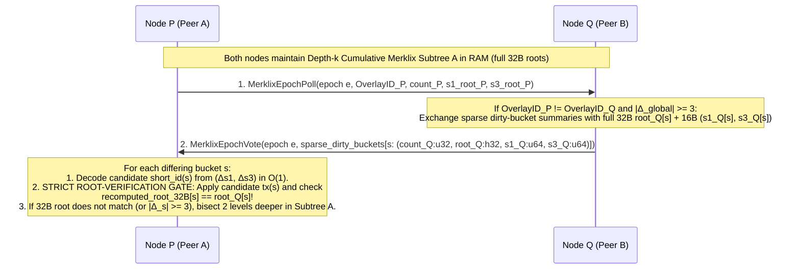
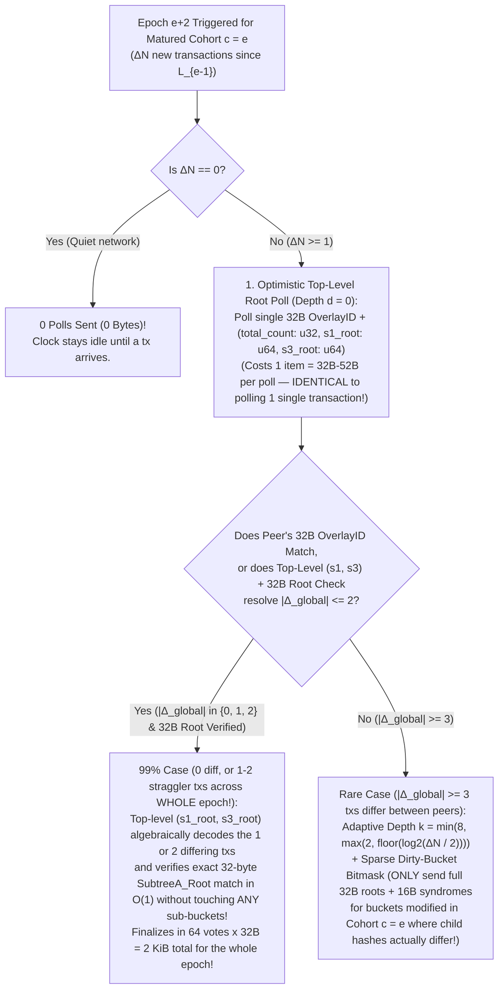
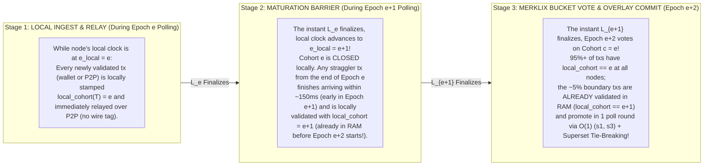
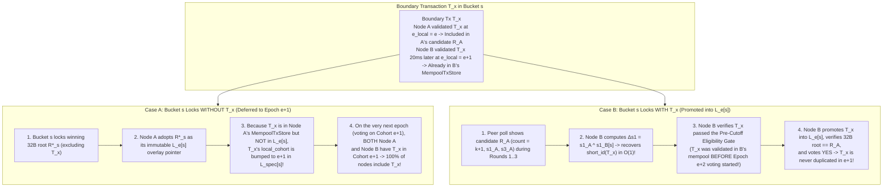
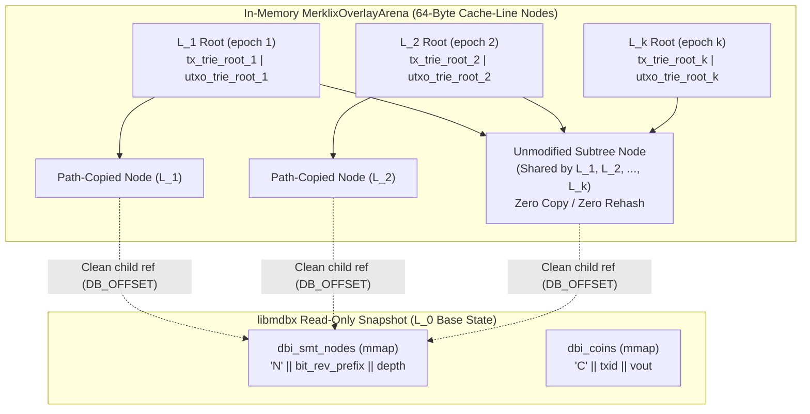
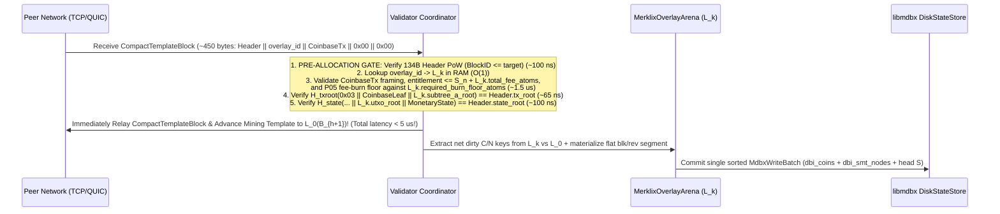
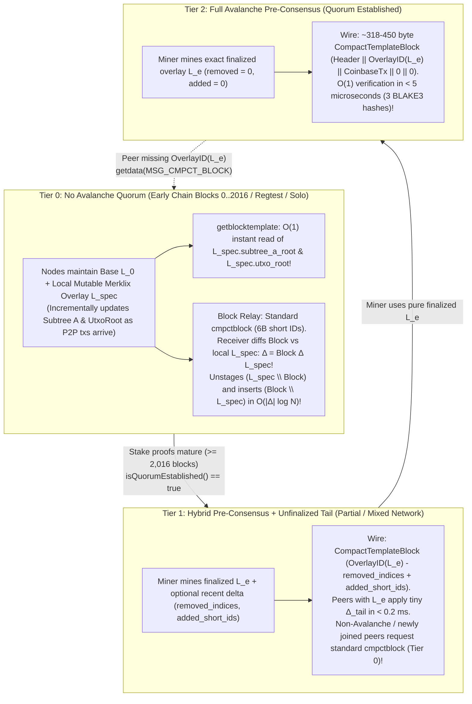
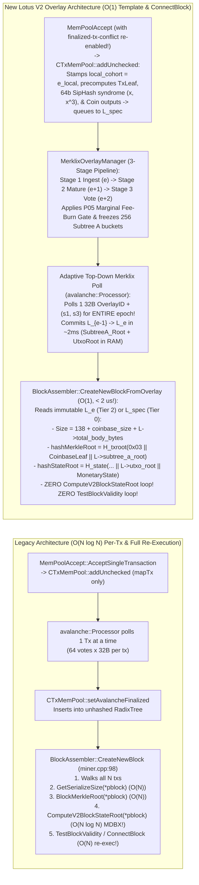
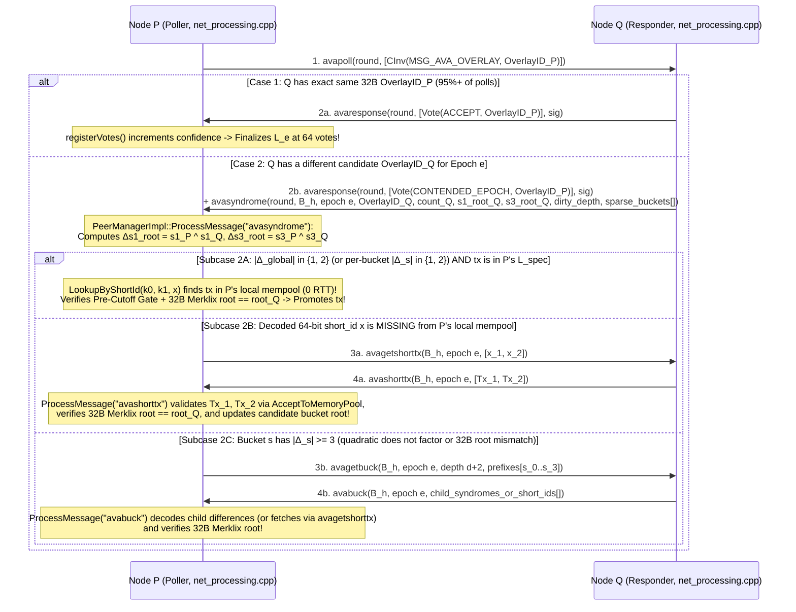

# Lotus V2 Bulk Template Pre-Consensus, Distributed Set Reconciliation, and Progressively Overlayed Merklix Mempools

Status: **Architecture and Protocol Specification Proposal, 2026-10-16 (Review Required Before Implementation)**.

Refines and connects:
- [P02: Hash commitments and authenticated state](../lotus-v2/decisions/commitments-and-state.md) — specifically the Maintainer Architecture Direction (2026-10-16) on horizontal sharding via prefix-keyed Merklix trees (`Subtree A`), `OutpointKey = txid || vout` prefix preservation, and delayed/pipelined coinbase UTXO insertion.
- [P04: Header design and mining](../lotus-v2/decisions/header-and-mining.md) — 134-byte recursive BLAKE3 header (`BodyHash`, `WorkHash`, `BlockID`), 120-second target block spacing, and Avalanche/PoW integration.
- [N01–N07: Lotus V2 peering candidate](../lotus-v2/peering.md) — `TxID` (outpoint/conflict identity) vs. `TxHash` (witness-complete wire identity) separation, compact block profile 2 (`cmpctblock`), and TCP/QUIC stream mapping.
- Persistent `libmdbx` state engine (`DiskStateStore` in `src/lotus_v2/disk_state.h` / `disk_state.cpp` and `src/lotus_v2/sparse_state.h` / `sparse_state.cpp`) — `dbi_coins` (`'C' || txid || vout_u32le`) and `dbi_smt_nodes` (`'N' || bit_reversed_prefix_32B || depth_u16le`).

---

## Executive Summary & Architectural Thesis

Traditional Proof-of-Work blockchains perform **post-PoW block propagation and validation**: a miner privately selects a mempool snapshot, constructs a block, finds a PoW nonce, and then broadcasts a compact block (`cmpctblock` or Graphene) across the peer-to-peer network. Even with compact blocks, receiving nodes must:
1. Reconcile any missing transactions that arrived late or differed from the miner's mempool,
2. Reconstruct the ordered transaction vector and recompute the block's transaction Merkle root (`tx_root`),
3. Execute all state transitions (UTXO deletions and insertions) and recompute the post-block UTXO state commitment (`state_root`) on the critical path of block relay before forwarding or building on the new tip.

At high throughput (e.g., $10^5$–$10^6$ transactions per 120-second block), doing set reconciliation, Merklix tree updates, and `libmdbx` B+Tree page modifications *after* PoW is found creates a propagation and validation bottleneck that increases orphan rates and centralizes mining pressure.

Lotus V2's commitment architecture ([P02](../lotus-v2/decisions/commitments-and-state.md)) unlocks a qualitatively different paradigm—**Progressive Bulk Template Pre-Consensus with Persistent Merklix Overlays**:

1. **100% Miner-Independent `Subtree A` and `UtxoRoot`:**
   - Non-coinbase transactions (`vtx[1 .. n - 1]`) are canonically ordered by `TxID` (CTOR) and committed in **`Subtree A`**, a 256-bit `TxID`-prefix-keyed single-leaf-collapsed Merklix tree whose root combines with the winning miner's `CoinbaseLeaf` in a single $O(1)$ top-level hash:
     $$\text{TxRoot} = H_{\text{txroot}}(\texttt{0x03} \parallel \text{CoinbaseLeaf} \parallel \text{SubtreeA})$$
   - Under **delayed/pipelined coinbase UTXO insertion**, Block $h$'s coinbase outputs are inserted into `UtxoRoot` at the start of Block $h+1$ (when Block $h$ is already connected and its `coinbase_txid` is immutable), while Block $h$'s own candidate transactions (`vtx[1 .. n - 1]`) determine 100% of the UTXO mutations during Block $h$.
   - Consequently, **every node on the network can pre-validate and pre-compute the exact post-block `SubtreeA` root, `UtxoRoot`, cumulative fees, and cumulative block cost units ($C_{\text{block}}$) *before* a PoW block is ever found**, without knowing which miner will win Block $h$ or what coinbase payout addresses/extranonce that miner will use.

2. **Solving the Three Hard Problems of Bulk Pre-Consensus:**
   - **Problem 1 (Distributed Set Reconciliation):** Why probabilistic whole-mempool schemes (Graphene's Bloom + IBLT and MinHash) fail catastrophically in adversarial P2P environments, and how **Merklix Prefix-Count Bisection + Exact-Count-Guided `Minisketch` ($GF(2^{64})$ BCH syndromes)** over `Subtree A`'s native `(count, root)` internal nodes achieves zero-cliff, deterministic reconciliation.
   - **Problem 2 (Transaction Receipt Order & Defining the Reconciled Set):** How continuous, uncoordinated P2P transaction arrival is discretized into **Progressive Epoch Overlay Batches ($\Delta_1, \Delta_2, \dots, \Delta_k$)** every $\tau_{\text{epoch}} \in [2\text{ s}, 5\text{ s}]$, binding `TxID` to exact witness `TxHash` variants and resolving double-spends and intra-template parent-child chains cleanly.
   - **Problem 3 (Progressively Overlayed Mempools in RAM + Zero-Copy `libmdbx`):** How to store $k \approx 24$ progressive mempool overlay layers ($L_0 \to L_1 \to \dots \to L_k \to L_{\text{spec}}$) in a **Multi-Layer Persistent (Copy-on-Write / Functional) Radix-Merklix Arena** where each overlay step updates both `Subtree A` (`TxRoot`) and `UtxoRoot` in $O(|\Delta_i| \log N)$ time (single-digit milliseconds) and tens of megabytes of total RAM, reducing post-PoW block validation and `libmdbx` commit to an **$O(1)$ microsecond operation**.

---

## Problem 1: Distributed Set Reconciliation (Why IBLT/Bloom Fails, and What Works)

### 1.1 Critique of Graphene (Bloom Filter + IBLT) and MinHash in UTXO Networks

Historically, bulk block/template compression proposals in Bitcoin and Bitcoin Cash centered on **Graphene** (combining a variable-sized Bloom filter with an Invertible Bloom Lookup Table, or IBLT) and **MinHash** sketches. Neither achieved reliable production deployment for pre-consensus or adversarial P2P relay, for fundamental information-theoretic and security reasons:

#### A. The IBLT Parameterization Cliff (`Peeling Failure`)
An Invertible Bloom Lookup Table (IBLT) encodes a set into $m = c \cdot d$ cells (typically $c \approx 1.3$–$1.5$, with $k \in \{3, 4\}$ hash functions), where $d = |A \triangle B| = |A \setminus B| + |B \setminus A|$ is the size of the symmetric difference between sender set $A$ and receiver set $B$.
- Decoding an IBLT relies on iterative **peeling** of a random hypergraph: finding cells with `count == ±1` (pure cells), removing their elements from the other $k-1$ cells they touch, and repeating until all cells are empty.
- **Phase-transition cliff:** Random $k$-uniform hypergraph peeling exhibits a sharp threshold around $c_{\text{crit}}(k)$ (the 2-core emergence threshold). If the actual symmetric difference $d_{\text{actual}}$ exceeds the capacity $d_{\text{param}}$ for which the IBLT was sized by even **10–15%**, the hypergraph traps a non-empty 2-core (a cycle of cells all having $|\text{count}| \ge 2$).
- When peeling stalls on a 2-core, **IBLT recovery drops to 0% of the remaining elements**. Every single unresolved transaction in the 2-core is lost simultaneously, forcing a fallback round-trip that wastes the entire IBLT payload and adds a full RTT of latency on the critical path.

#### B. Failure of the Graphene Bloom Filter Estimator
To keep the IBLT small, Graphene first sends a Bloom filter $BF(A)$ of the block's transactions so the receiver can filter its mempool $M$ down to a candidate set $B \subseteq M$ and bound false positives $FP = |B \setminus A|$.
- Sizing the IBLT still requires the sender to *guess* how many transactions in $A$ the receiver is *missing* ($FN = |A \setminus B|$). The sender does not know the receiver's mempool!
- If the receiver recently connected, experienced a brief network stall, has slightly different fee/orphan policy, or hasn't received the latest 500 transactions, $FN = |A \setminus B|$ exceeds the sender's guess, and the IBLT immediately hits the 2-core peeling cliff.

#### C. Adversarial Boundary / Churn Injection Attacks (P2P DoS)
In a permissionless P2P network, the symmetric difference $d = |A \triangle B|$ is **adversarially controllable**:
- An attacker can broadcast a burst of low-cost or replacement-boundary transactions to half the network right before an epoch boundary or block announcement, or selectively trickle distinct valid transactions to different peer partitions.
- For a negligible fee budget (or zero fee if exploiting orphan/policy edges), the attacker inflates $|A \triangle B|$ across honest peers beyond $d_{\text{param}}$, causing **100% IBLT decode failure network-wide**.
- Furthermore, in an unkeyed or predictable IBLT/Bloom construction, an adversary can grind transaction hashes that collide into the same IBLT cells (a targeted 2-core poisoning attack), guaranteeing peeling failure even when $|A \triangle B| \ll d_{\text{param}}$.

#### D. Why MinHash Cannot Perform Set Reconciliation
**MinHash** (Minimum Hash sketching) maintains $k$ minimum hash values over a set $A$ to estimate the **Jaccard similarity** $J(A, B) = \frac{|A \cap B|}{|A \cup B|}$ with standard error $O(1/\sqrt{k})$.
- MinHash is an **estimator of set overlap cardinality**, not an **error-correcting code or set-difference recovery algorithm**.
- Knowing that $J(A, B) \approx 0.985 \pm 0.01$ over $100{,}000$ transactions tells a node that roughly $1{,}500$ transactions differ, but identifies **zero** of the specific missing `TxHash`es outside the $k$ sampled minima. It provides neither exact difference counts per prefix nor algebraic recovery of the missing elements.

---

### 1.2 Merklix Prefix-Count Bisection (Native to `Subtree A`)

In Lotus V2, `Subtree A` is *already* a 256-bit `TxID`-prefix-keyed Merklix radix tree ([P02](../lotus-v2/decisions/commitments-and-state.md)). Unlike Bitcoin's positional Merkle tree (where internal nodes commit only to positional slices and carry no key-range semantics), every internal node at depth $d$ (`0 <= d < 256`) of `Subtree A` covers a deterministic prefix $p \in \{0, 1\}^d$ of the 256-bit `TxID` space and commits to both the **exact leaf count** and the **full 256-bit (32-byte) subtree cryptographic root** of its left and right children:

```text
TxLeaf(TxID, TxHash)                 = H_txroot(0x00 || TxID || TxHash)
TxMerklixNode(d, c_L, root_L, c_R, root_R) = H_txroot(0x01 || u16(d) || u32(c_L) || root_L || u32(c_R) || root_R)
EmptyTxMerklixRoot                   = H_txroot(0x02)
```

*(Note: For a depth-$d$ subtree with count $c = c_L + c_R$, the canonical node summary is `(count: u32, root: h32)` = 36 bytes).*

#### How Depth-$k$ Merklix Prefix Exchange Isolates Differences
Suppose Node $P$ and Node $Q$ hold candidate transaction sets $A$ and $B$ (or epoch batch sets) of size $N \approx 100{,}000$, and their top-level `(count, SubtreeA_Root)` differs.

1. **Full 256-Bit (32-Byte) Merklix Roots on Sparse Dirty Subtrees (Zero 64-Bit Truncation):**
   - At depth $k$ (e.g., $k = 8 \implies 256$ shards, or adaptive $k \in [2..8]$ per Section 1.5), `Subtree A` partitions the 256-bit `TxID` space into $S = 2^k$ disjoint prefix buckets $s \in [0, 2^k - 1]$.
   - For each prefix bucket $s$, a node already has the cached Merklix summary `(count[s]: u32, root[s]: h32)` in RAM (maintained natively by its $2^k$ horizontal shards or Merklix overlay).
   - **Why Full 32-Byte Roots Are Mandatory (Preventing $2^{32}$ Birthday Root Forgery):** Truncating bucket roots to 64 bits (`root64`) would allow an adversary to grind two distinct transaction subsets in a bucket that collide on a 64-bit truncated root in $2^{32} \approx 4.3 \times 10^9$ BLAKE3 evaluations (< 1 second on a single GPU!), causing honest nodes to think a bucket matches when their true 256-bit `SubtreeA` roots diverge. Because Adaptive Top-Down Polling (Section 1.5) only transmits **dirty/mismatched subtrees**, every bucket comparison uses the **full 256-bit (32-byte) `root[s]: h32`** ($128\text{-bit}$ birthday security).
2. **Immediate Isolation of Identical Shards:**
   - For every shard $s \in [0, 2^k - 1]$ where `count_P[s] == count_Q[s]` and `root_P[s] == root_Q[s]` (full 32-byte equality), **the entire subtree of $N / 2^k$ transactions is 100% cryptographically identical** (including both `TxID` and `TxHash` at every leaf!). Zero further work is performed on matching shards.
3. **Exact Count Delta in Differing Shards:**
   - For any shard $s$ where `root_P[s] != root_Q[s]`, both nodes immediately learn the net cardinality difference $\Delta c_s = |\text{count}_P[s] - \text{count}_Q[s]|$ and the total subtree size $c_s = \max(\text{count}_P[s], \text{count}_Q[s])$.
4. **Pure Bisection Trade-Off (RTTs vs. Bandwidth):**
   - If reconciliation used *pure* interactive bisection down the Merklix tree (stepping 4 bits / 16-way per round-trip from depth 8 to depth 16):
     - **Bandwidth** is minimal when $d = |A \triangle B|$ is tiny ($d \le 20$), requiring only $O(d \log(N/d))$ node summaries.
     - **Latency (RTTs)** scales as $O(\log_{2^b}(N/d))$ round-trips (typically 2 to 4 RTTs to reach singleton leaves). Across intercontinental P2P links ($100\text{–}150\text{ ms}$ RTT), 3–4 interactive RTTs cost $300\text{–}600\text{ ms}$.
   - Can we get the **1-RTT latency** of algebraic sketching *and* the **exact shard isolation and zero-cliff determinism** of Merklix trees? Yes—by combining Merklix prefix counts with `Minisketch`.

---

### 1.3 Hybrid Merklix Prefix Buckets + Exact-Count-Guided `Minisketch` ($GF(2^{64})$ BCH Syndromes)

Unlike IBLT (which uses random hash peeling and fails on 2-core cycles), **`Minisketch` (PinSketch / BIP330 Erlay)** operates algebraically over the finite field $GF(2^{64})$:
- Each element $x \in GF(2^{64}) \setminus \{0\}$ is a 64-bit short transaction identifier:
  $$x = \text{SipHash-2-4}(k_0^{(e)}, k_1^{(e)}, \text{TxHash})$$
  (if the 64-bit SipHash output is `0`, it is mapped to `1` so $x \in GF(2^{64})^\times$).
- **Unpredictable Per-Epoch SipHash Key Derivation:** To prevent an adversary from pre-grinding transactions whose 64-bit `short_id`s collide ($x(T_1) = x(T_2) \implies x_1 \oplus x_2 = 0$) or form a forged 3-tuple $(x_1, x_2, x_3)$ in $GF(2^{64})$ before an epoch begins, the 128-bit SipHash key $(k_0^{(e)}, k_1^{(e)})$ is rotated on every epoch $e$ using the unpredictability of the parent PoW block and the preceding finalized overlay:
  $$(k_0^{(e)}, k_1^{(e)}) = \text{BLAKE3\_Keyed\_128}\!\left(\texttt{"Lotus/v2/preconsensus/sipkey"},\; B_h.\text{BlockID} \parallel \text{u32}(e) \parallel L_{e-1}.\text{overlay\_id}\right)$$
- A sketch of capacity $t$ for a set $S$ consists of the first $t$ **odd power-sum syndromes** in $GF(2^{64})$:
  $$\sigma_j(S) = \sum_{x \in S} x^{2j - 1} \pmod{P_{64}(X)} \quad \text{for } j = 1, 2, \dots, t$$
  where addition in $GF(2^{64})$ is bitwise XOR ($\oplus$).
- Because XOR is linear over $GF(2^{64})$, combining two sketches $\Sigma(A) \oplus \Sigma(B)$ yields the exact power-sum syndromes of their symmetric difference $\Sigma(A \triangle B)$:
  $$\sigma_j(A) \oplus \sigma_j(B) = \sum_{x \in A \triangle B} x^{2j - 1}$$
- **Zero Peeling Cliff (Deterministic Berlekamp–Massey + Chien/Cantor–Zassenhaus Root Finding):**
  - If $|A \triangle B| \le t$, Berlekamp–Massey finds the unique degree-$d$ error-locator polynomial $\Lambda(z) = \prod_{x \in A \triangle B} (1 - x z)$ and factors it over $GF(2^{64})$ with **100% algebraic certainty** (save for a $2^{-64}$ field collision probability) and **8 bytes per difference element** ($t \times 8\text{ bytes}$ total, vs. IBLT's ~18–24 bytes per element with a peeling cliff).

#### Inline 16-Byte Bucket Syndromes (`s1, s3`) for $O(1)$ 1-or-2-Tx Recovery (Zero Bloom / Zero IBLT)
Even `Minisketch` requires choosing a capacity $t \ge |A \triangle B|$ when applied monolithically to a whole block. **Combining `Subtree A`'s depth-$k$ Merklix prefix buckets with fast epochs ($\tau = 0.5\text{s}\text{–}2.0\text{s}$) and fixed 2-element $GF(2^{64})$ bucket syndromes (`s1, s3`) eliminates dynamic sketch sizing, Bloom filters, and IBLTs entirely:**

- At depth $k = 8$ ($256$ buckets) with a $\tau = 0.5\text{s}\text{–}2.0\text{s}$ epoch cadence, even at $1{,}000\text{ tx/s}$, each bucket receives an average of only **$2\text{ to }8$ new transactions per epoch**, and after the Stage 2 Maturation Barrier (Section 2.2), boundary arrival jitter affects **at most $|\Delta_s| = 1\text{ or }2$ transactions** in the few buckets that differ!
- Therefore, every Merklix bucket summary at depth $k$ maintains two running 64-bit $GF(2^{64})$ power-sum syndromes over the transactions in bucket $s$:
  $$s_1[s] = \bigoplus_{x \in \text{Bucket}_s} x, \qquad s_3[s] = \bigoplus_{x \in \text{Bucket}_s} x^3 \pmod{P_{64}(X)}$$
- Maintaining `(s1, s3)` costs **two 64-bit XORs (~2 nanoseconds)** whenever a transaction is inserted into or removed from a bucket!
- When two nodes compare bucket $s$ and see `root_P[s] != root_Q[s]`, they compute:
  $$\Delta s_1 = s_{1, P}[s] \oplus s_{1, Q}[s], \qquad \Delta s_3 = s_{3, P}[s] \oplus s_{3, Q}[s], \qquad \Delta c = |\text{count}_P[s] - \text{count}_Q[s]|$$
  1. **1-Tx Difference ($|\Delta_s| = 1$, i.e., $\Delta c = 1$ and $(\Delta s_1)^3 \equiv \Delta s_3 \pmod{P_{64}}$):**
     - $\Delta s_1$ yields the candidate 64-bit `short_id` of the single differing transaction in **1 CPU instruction**.
  2. **2-Tx Difference ($|\Delta_s| = 2$, i.e., $\Delta c \in \{0, 2\}$ and quadratic $z^2 + (\Delta s_1) z + \frac{\Delta s_3 \oplus (\Delta s_1)^3}{\Delta s_1} = 0$ has two distinct roots in $GF(2^{64})$):**
     - Solves the degree-2 quadratic over $GF(2^{64})$ in **~80 nanoseconds** to recover both candidate 64-bit `short_id`s $x_1, x_2$.
  3. **Rare $\ge 3$-Tx Difference in Bucket $s$ (or Failed Root Verification):**
     - Simply bisect **1 or 2 levels deeper in the Merklix tree** for *only* that specific bucket $s$ (where its 4 children at depth $k+2$ each have $1/4$ the transactions, reducing child differences back to $\le 2$).

> [!CAUTION]
> **Normative Security Invariant — The Strict 256-Bit Root-Verification Gate:**
> Any 64-bit `short_id` $x$ (or pair $x_1, x_2$) algebraically decoded from `(Δs1, Δs3)` is treated **strictly as an untrusted lookup hint** into the local `MempoolTxStore` (or peer `getdata`). A node **MUST NEVER** mark a bucket reconciled or vote `YES` on a peer's bucket root `root_Q[s]: h32` merely because `(Δs1, Δs3)` yielded a valid polynomial root in $GF(2^{64})$. Instead, the node MUST:
> 1. Resolve the full transaction(s) matching $x$, verify their consensus validity, and tentatively apply them to `Subtree A` bucket $s$,
> 2. Recompute the **full 256-bit (32-byte) Merklix root `recomputed_root[s]: h32`**, and
> 3. Verify exact 32-byte equality **`recomputed_root[s] == root_Q[s]`**.
> If `recomputed_root[s] != root_Q[s]` (e.g., due to a $2^{-64}$ syndrome collision or a Byzantine peer spoofing syndromes or hiding $\ge 3$ differences that alias a degree-1/degree-2 equation), the syndrome decode is immediately discarded and the node falls back to deterministic 256-bit Merklix child bisection on bucket $s$.



---

### 1.4 Comparison Matrix: Set Reconciliation & Template Sync Mechanisms

| Mechanism | Payload for Epoch Batch ($d = 12$ boundary txs across 10 dirty buckets) | Round-Trips (RTTs) | Failure Mode Under Adversarial Churn ($d > d_{\text{est}}$) | Handles `TxID` vs. `TxHash` Variant Mismatch? | CPU Cost (Encode + Decode) |
| :--- | :--- | :--- | :--- | :--- | :--- |
| **Graphene (Bloom + Global IBLT)** | ~4.5 KiB (when $d \le d_{\text{est}}$) | 1 RTT (happy path) / **3+ RTTs on cliff** | **Catastrophic 0% recovery cliff** across entire batch if $d$ exceeds param by ~15% | No (unless keyed by `TxHash`, losing `Subtree A` alignment) | Low encode; fail-prone peeling |
| **MinHash Sketch** | N/A (cannot recover set difference) | N/A | Only estimates Jaccard index $J(A,B)$; **recovers 0 missing transactions** | No | Low |
| **Pure Merklix Prefix Bisection** | ~3–6 KiB total across rounds | **2–3 RTTs** (interactive tree walk) | **Zero cliff** (deterministic tree walk), higher latency on WAN links | **Yes** (`TxLeaf` commits to `TxID \|\| TxHash`) | Negligible (reads cached Merklix nodes) |
| **Compact Short-ID List (`cmpctblock`-style)** | $1{,}500 \times 6\text{ B} = \mathbf{9.0\text{ KiB}}$ | **1 RTT** (0.5 RTT announce + 1 RTT missing tx fetch) | **Zero cliff** (100% deterministic exact list) | **Yes** (6-byte SipHash of `TxHash` in CTOR `TxID` order) | **< 0.08 ms** (1,500 SipHashes) |
| **Adaptive Merklix Full-32B Roots + Inline 16B `(s1, s3)` Syndromes (Recommended)** | $52\text{ B}$ root poll (+ $10 \times 52\text{ B} = 520\text{ B}$ on dirty diff) | **1 RTT** (0.5 RTT for matching root/buckets; $O(1)$ decode for $|\Delta_s| \le 2$) | **Zero global cliff**; Strict 32B Root-Verification Gate + Merklix child bisection if $|\Delta_s| \ge 3$ | **Yes** (Bucket by `TxID` prefix; `s1, s3` over per-epoch `SipHash(TxHash)`) | **< 0.01 ms** (XOR + quadratic solve + 32B root check) |

### 1.5 Bandwidth Parity at Low Traffic & Massive Compression at Scale: Adaptive Top-Down Merklix Polling

> [!IMPORTANT]
> **Maintainer Bandwidth Constraint:**
> *"Pre-consensus happens on every transaction right now, and the batches and reconciliation shouldn't use more bandwidth than just doing that. It's approximately 64 votes right now on a 32-byte hash or shortid for each txn."*

Let us calculate the exact baseline cost of per-transaction Avalanche polling:
- In per-transaction pre-consensus, finalizing a single transaction requires $\sim 64\text{ votes} \times 32\text{ B} = \mathbf{2{,}048\text{ bytes}}$ ($\sim 2\text{ KiB}$) per transaction (or $64 \times 6\text{ B} \approx 384\text{ B}$ plus poll headers $\approx 1\text{–}2\text{ KiB}$).
- If an epoch during a quiet period only contains $\Delta N = 1$ or $\Delta N = 5$ new transactions, **naively polling all 256 depth-8 Merklix buckets on every poll** ($256 \times 36\text{ B} = 9.2\text{ KiB}$ per poll $\times 64\text{ polls} = 589\text{ KiB}$) would consume **more bandwidth than per-transaction polling whenever $\Delta N < 280\text{ tx/epoch}$!**

To guarantee that bulk Merklix pre-consensus **NEVER uses more bandwidth than per-transaction polling—even when an epoch has only $\Delta N = 1$ transaction—and uses $10\times\text{–}500\times$ LESS bandwidth when $\Delta N \ge 10$**, Lotus V2 uses **Adaptive Top-Down Merklix Polling (`d = 0` Root-First + Top-Level `(s1, s3)` Syndrome + Sparse Dirty-Bucket Bitmask)**:



#### The Three Rules of Adaptive Top-Down Merklix Polling:

1. **Rule 1 — Zero-Traffic Suppression ($\Delta N = 0 \implies 0\text{ Bytes}$):**
   - If no new transactions matured in Cohort $c = e$ ($\Delta N = 0$), **zero polls are emitted**.
2. **Rule 2 — Depth-$0$ Root-First Poll with Top-Level `(s1, s3)` Syndrome ($\le 1\times$ Per-Tx Bandwidth at $\Delta N = 1$):**
   - Because the 3-stage pipeline (`Ingest -> Mature -> Vote`, Section 2.2) gives Cohort $c = e$ a full epoch (~$0.5\text{–}1.0\text{ s}$) to finish propagating across the network before voting starts, in the vast majority of epochs **all honest nodes already have 100% identical sets (or differ by at most 1 or 2 straggler transactions across the entire mempool)**!
   - Furthermore, the root of `Subtree A` itself has a top-level 16-byte $GF(2^{64})$ syndrome:
     $$s_{1, \text{root}} = \bigoplus_{s=0}^{255} s_1[s], \qquad s_{3, \text{root}} = \bigoplus_{s=0}^{255} s_3[s]$$
   - Therefore, every node begins Epoch $e+2$ by polling **only the single 32-byte `OverlayID` (plus 4-byte `count` and 16-byte `(s1_root, s3_root)` on first poll/mismatch)**:
     - **If $\Delta N = 1$ transaction in the epoch:** Polling `OverlayID` takes $64\text{ votes} \times 32\text{ B} = \mathbf{2{,}048\text{ B}}$—**100% identical to polling 1 single transaction!**
     - **If $\Delta N = 5{,}000$ transactions in the epoch, and 0, 1, or 2 boundary transactions differed across the entire network:** The top-level `(s1_root, s3_root)` syndrome immediately recovers those 1 or 2 straggler transactions across the *entire $5{,}000$-transaction batch* in $O(1)$ and verifies the 32-byte `SubtreeA_Root` without descending into **any** sub-buckets! All $5{,}000$ transactions finalize for a total network poll cost of **$\sim 2\text{–}3\text{ KiB}$ ($0.5\text{ bytes}$ per transaction—a $4{,}000\times$ bandwidth reduction!)**.
3. **Rule 3 — Adaptive Depth $k$ + Sparse Dirty-Bucket Bitmask with Full 32-Byte Bucket Roots When $|\Delta_{\text{global}}| \ge 3$:**
   - Only if a peer replies `MISMATCH` on `OverlayID` *and* top-level syndrome recovery fails the 32-byte `SubtreeA_Root` check (indicating $|\Delta_{\text{global}}| \ge 3$) does the node request sub-bucket summaries:
     - **Adaptive Depth $k$:** Instead of fixed depth 8 ($256$ buckets), choose depth $k = \min(8, \max(2, \lfloor \log_2(\Delta N / 2) \rfloor))$. If an epoch only had $\Delta N = 8$ transactions and 3 differed, depth $k = 2$ ($4$ buckets) is used, not $256$!
     - **Sparse Dirty Bitmask + Full 32-Byte `root[s]`:** Even at depth $k$, only buckets that were actually modified in Cohort $c = e$ (`dirty_bitmap`) are queried, and each differing bucket transmits its **full 32-byte `root[s]: h32` + 4-byte `count[s]` + 16-byte `(s1[s], s3[s])`** ($52\text{ B}$ per differing bucket). Once a sub-bucket's 32-byte root matches, it is omitted from subsequent poll rounds.

#### Bandwidth Comparison Across All Traffic Regimes ($64\text{ Polls}$ per Finalization)

| Transactions per Epoch ($\Delta N$) | Per-Tx Pre-Consensus Baseline ($64 \times 32\text{ B} \times \Delta N$) | Naive Fixed 256-Bucket Poll (Bad at Low $\Delta N$) | **Adaptive Top-Down Merklix + Full 32B Roots + `(s1, s3)` (Normative)** | Bandwidth Savings vs. Per-Tx Baseline |
| :--- | :--- | :--- | :--- | :--- |
| **$\Delta N = 0$ (Idle)** | $0\text{ B}$ | $589\text{ KiB}$ (Wasted) | **$0\text{ B}$** (Idle suppression) | **Parity ($0\text{ B}$)** |
| **$\Delta N = 1\text{ tx}$** | **$2.0\text{ KiB}$** | $589\text{ KiB}$ ($294\times$ worse) | **$2.0\text{ KiB}$** (Single 32B `OverlayID` poll!) | **$1.0\times$ (Exact Parity!)** |
| **$\Delta N = 10\text{ txs}$** | **$20.0\text{ KiB}$** | $589\text{ KiB}$ ($29\times$ worse) | **$2.0\text{–}3.5\text{ KiB}$** (Root poll + $O(1)$ top syndrome) | **$5.7\times\text{–}10\times$ LESS bandwidth** |
| **$\Delta N = 100\text{ txs}$** | **$200.0\text{ KiB}$** | $589\text{ KiB}$ ($2.9\times$ worse) | **$2.5\text{–}8.0\text{ KiB}$** (Root poll + sparse $k=5$ full-32B diff) | **$25\times\text{–}80\times$ LESS bandwidth** |
| **$\Delta N = 1{,}000\text{ txs}$** | **$2.0\text{ MiB}$** | $595\text{ KiB}$ | **$3.0\text{–}18.0\text{ KiB}$** (Root poll + sparse dirty 32B buckets) | **$110\times\text{–}660\times$ LESS bandwidth** |
| **$\Delta N = 10{,}000\text{ txs}$** | **$20.0\text{ MiB}$** | $610\text{ KiB}$ | **$4.0\text{–}36.0\text{ KiB}$** (Root poll + sparse depth-8 32B diff) | **$550\times\text{–}5{,}000\times$ LESS bandwidth** |

---

## Problem 2: Leaderless Candidate Set Construction, Pipelined Vector Clocks, and Transaction Shuffling

> [!IMPORTANT]
> **The Fundamental Pre-Consensus Questions (Maintainer Guidance):**
> 1. *"Avalanche just allows voting on if people will accept those snapshots (e.g. state root hashes) but that doesn't solve the problem of figuring out **what should be voted on in the first place**. Given that they need to be constructed by each node to vote on... how do you build those sets to begin with in a reasonably consistent way?"*
> 2. *"I prefer **leaderless methods** provided they can actually be made to work. 5 seconds is reasonable finality, but do we want faster? **How do you decide where an epoch boundary is? And how do transactions get shuffled between them?** Like every 100 txns every node calls an epoch and then starts reconciling?"*
> 3. *"Do we have a mechanism for like an **Avalanche vector clock** or something that would make it easier to trigger epochs?"*

### 2.1 Why Naive Monolithic Mempool Hashing and "Every 100 Txns" Triggers Fail

#### A. Why Hashing the Monolithic Mempool Fails
Suppose $M = 1{,}000$ honest nodes are connected over a global P2P network with one-way propagation delay $\tau_{\text{prop}} \approx 100\text{ ms}$ and transaction arrival rate $\lambda = 1{,}000\text{ tx/s}$.
- Even if two nodes $P$ and $Q$ agree on **99.9%** of their mempool transactions and differ on **just 1 single in-flight boundary transaction**, cryptographic hash functions (`BLAKE3`) have the **avalanche property**: changing a single leaf changes 100% of the bits of a monolithic `SubtreeA_Root` and `UtxoRoot`!
- With $b = 20$ boundary transactions in flight across the network, there are up to $2^{20} \approx 10^6$ possible subsets of boundary transactions. Every node computes a completely distinct monolithic root hash, and Avalanche can never form a quorum.

#### B. Why "Every 100 Transactions" Cannot Be Used to Trigger an Epoch Boundary
In an uncoordinated, leaderless P2P network, **count-triggered epochs fail for three structural reasons**:
1. **Out-of-Order Arrival Desynchronizes the Cut:** Because transactions arrive in different orders at different nodes, Node A's "first 100 transactions" ($\{T_1 \dots T_{98}, T_X, T_Y\}$) and Node B's "first 100 transactions" ($\{T_1 \dots T_{98}, T_Z, T_W\}$) are different sets even when both nodes have received 102 transactions total!
2. **Low-Traffic Liveness Stall:** If network traffic drops to $2\text{ tx/s}$ (or $1$ transaction during a quiet period), waiting for $100$ transactions would stall pre-consensus finality for $50+$ seconds (or forever for a single transaction), defeating fast pre-consensus.
3. **Burst Epoch-Number Desynchronization:** During a burst of $5{,}000\text{ tx/s}$, one side of the network would race to Epoch $e = 50$ in one second while another side is still polling on Epoch $e = 12$.

---

### 2.2 The Pipelined Avalanche Logical Clock (`Ingest -> Mature -> Vote`) & Local Receive-Epoch Stamping

#### What Exists Today vs. What We Add
In the current Lotus V2 codebase (`src/lotus_v2/avalanche_poll.h`), `lotus::v2::ava::OutgoingPoll` carries only a local per-peer request nonce (`uint64_t round{}`):
```cpp
// Current src/lotus_v2/avalanche_poll.h:
struct OutgoingPoll { NodeId node{}; uint64_t round{}; std::vector<PollItem> items; };
```
There is no logical or causal clock shared across peers in `OutgoingPoll` today.

To trigger epochs leaderlessly without wall-clock guessing or count desynchronization, we introduce the **Piggybacked Avalanche Logical Epoch Clock ($e$)** and **Local Receive-Epoch Cohort Stamping**:

1. **Piggybacked Lamport Logical Clock (`finalized_epoch e`):**
   - Every confirmed block height $h$ resets the logical epoch clock to $e = 0$ (`L_0 = Base Block B_h + Pipelined Coinbase`).
   - Every `avapoll` and `avaresponse` message piggybacks a compact causal header:
     ```text
     CausalEpochHeader = tip_block_id:h32 || finalized_epoch:u32 || finalized_overlay_id:h32
     ```
   - This forms a strict **Lamport causal chain** $L_0 \prec L_1 \prec L_2 \prec \dots \prec L_e$: whenever a node reaches Avalanche finality on $L_e$ (or receives an `avaresponse` + verifies the 32-byte roots of $L_e$), it immediately advances its local logical clock $e_{\text{local}}$ to **$e + 1$**.

2. **Zero Wire-Cohort Trust (Local Receive-Epoch Stamping Prevents Backdated/Future-Dated Tag Spoofing):**
   - **Why Sender-Provided Cohort Tags Are Forbidden:** If P2P `inv`/`tx` relay carried a sender-asserted `(cohort = e, Tx)` tag, a Byzantine node could wait until the very last millisecond of Stage 2 (Epoch $e+1$) and broadcast 5,000 brand-new transactions carrying a **backdated** tag `cohort = e` to half the network right as Epoch $e+2$ begins voting, shattering candidate set convergence (or broadcast a **future-dated** tag `cohort = e + 50` to poison future cohorts).
   - **Normative Local Stamping Rule:** Standard P2P `inv` and `tx` messages carry **zero `cohort` field on the wire**. Instead, when any node receives and consensus-validates a transaction $T$ into its local `MempoolTxStore`, it stamps $T$ with **its own local logical clock `local_cohort(T) = e_local` at the instant of local validation**!

3. **The 3-Stage Hardware-Style Causal Pipeline (`Ingest -> Mature -> Vote`):**
   Because honest P2P broadcast takes $\tau_{\text{prop}} \approx 100\text{–}150\text{ ms}$ while each Avalanche epoch takes $\tau_{\text{epoch}} \approx 500\text{–}1{,}000\text{ ms}$, local receive-epoch stamping + a 1-epoch maturation barrier guarantees that **95%+ of honestly broadcast transactions receive the exact same `local_cohort = e` across the network**, and the remaining ~5% of epoch-boundary transactions have already arrived into every node's local mempool (`local_cohort = e+1`) a full epoch *before* voting on Cohort $e$ begins!



   - **Why This Defeats Backdated/Last-Millisecond Injection Attacks:**
     - **Honest Transaction Broadcast in Epoch $e$:** Arrives at 100% of honest nodes within $\sim 150\text{ ms}$—either before $L_e$ finalizes (`local_cohort = e`) or within the first $150\text{ ms}$ of Epoch $e+1$ (`local_cohort = e+1`). In both cases, **100% of honest nodes already hold the validated transaction in RAM before Epoch $e+2$ begins voting on Cohort $e$!**
     - **Byzantine Last-Millisecond Dump at the End of Epoch $e+1$:** If an attacker withholds transactions until the end of Epoch $e+1$ ($500\text{–}1{,}000\text{ ms}$ after Epoch $e$ closed) and dumps them right as Epoch $e+2$ starts, **every honest node's local clock is already at $e_{\text{local}} = e+1$ (or $e+2$)**. Therefore, **zero honest nodes** stamp the attacker's late dump with `local_cohort = e`, and the Pre-Cutoff Eligibility Gate (Section 2.4) forbids them from disrupting Epoch $e+2$'s vote!

---

### 2.3 Intra-Epoch Bucket Convergence Vector $\mathbf{B}_e$ vs. Global Atomic Epoch Commit $L_e$

> [!CAUTION]
> **Critical Architectural Distinction — Why `Subtree A` Shards Reconcile Independently Within an Epoch, While `UtxoRoot` Commits Atomically at the Epoch Barrier:**
> In `Subtree A`, transactions are keyed by their own `TxID`, and under `OutpointKey = txid || vout`, all **created outputs** of a transaction with prefix $s \in [0..255]$ also reside in `UtxoRoot` shard $s$. **However, a transaction's spent inputs (`prev_txid || prev_vout`) spend UTXOs created by arbitrary historical transactions whose `prev_txid` prefixes $s' \ne s$ are uniformly distributed across all 256 `UtxoRoot` shards!**
> Therefore:
> 1. If Bucket $s_1$ depended on an unfinalized parent transaction in Bucket $s_2$ inside the same asynchronously advancing vector clock, or if `UtxoRoot` shards advanced at mismatched epoch numbers, cross-shard input deletions would create dangling UTXO references and Combinatorial State Root Explosion.
> 2. To achieve **both** independent per-bucket reconciliation (so a contended bucket never stalls uncontended buckets) **and** a single canonical global `UtxoRoot` per epoch, Lotus V2 separates the **Intra-Epoch Bucket Convergence Vector $\mathbf{B}_e$** from the **Global Epoch Overlay Commit $L_e$**:

1. **Cross-Bucket Dependency Invariant (Cohort Eligibility Rule):**
   - A transaction $T$ is eligible for inclusion in Cohort $c = e$ **if and only if every outpoint $o = (\text{prev\_txid}, \text{prev\_vout})$ spent by $T$ already exists as an unspent coin in the previously finalized global overlay $L_e$ (or Base $L_0$)**!
   - What about an unconfirmed child transaction $T_{\text{child}}$ that spends an output of an unconfirmed parent $T_{\text{parent}}$?
     - $T_{\text{parent}}$ is finalized in Epoch Overlay $L_e$ (~$0.5\text{–}1.0\text{ s}$).
     - Immediately upon $L_e$'s commit, $T_{\text{parent}}$'s outputs exist in $L_e.\text{utxo\_root}$, so $T_{\text{child}}$ is automatically eligible for the very next cohort $c = e+1$ (~$0.5\text{–}1.0\text{ s}$ later)!
     - *(Note: Tier 0/1/2 full block validation in Section 2.6.A still supports arbitrary same-block parent-child chains; the Cross-Bucket Dependency Invariant applies strictly to candidate selection during pre-consensus Cohort $e$ so that the 256 `Subtree A` buckets have **zero cross-bucket causal dependencies** within Epoch $e$!)*

2. **Intra-Epoch Bucket Convergence Vector $\mathbf{B}_e = \langle b_0, b_1, \dots, b_{255} \rangle$ (Parallel `Subtree A` Reconciliation):**
   - During Epoch $e+2$ (voting on Cohort $c = e$), if the top-level `OverlayID` does not finalize on Round 1 (Rule 3 of Section 1.5), the 256 prefix buckets of `Subtree A` reconcile in parallel.
   - Each bucket $s \in [0..255]$ tracks its own convergence state $b_s \in \{\texttt{CLEAN}, \texttt{POLLING}, \texttt{LOCKED}(R^*_s)\}$:
     - Uncontended buckets lock their winning 32-byte `Subtree A` bucket root $R^*_s$ in 1–2 rounds and stop polling (`b_s = LOCKED`).
     - Any bucket $s$ that fails to lock within `kMaxBucketPollRounds = 8` (~$400\text{ ms}$) simply **keeps its previous epoch's bucket root $R^*_s = L_{e-1}.\text{shard\_tx\_roots}[s]$** (deferring its new transactions to Cohort $e+1$) so a single contended bucket can **never** stall epoch progression!

3. **Global Atomic Epoch Barrier ($L_{e-1} \to L_e$ Across All 256 `UtxoRoot` Shards):**
   - The instant all dirty buckets in $\mathbf{B}_e$ are `LOCKED` (or hit the 8-round deferral cap), the epoch batch $\Delta_e = \bigcup_{s=0}^{255} \Delta_{e, s}$ is completely determined.
   - The node then executes a **single atomic barrier transition $L_{e-1} \to L_e$**:
     - All spent input deletions $(\text{prev\_txid}, \text{prev\_vout})$ from $\Delta_e$ are routed by `prev_txid[0..7]` to their target `UtxoRoot` shards $s' \in [0..255]$.
     - All created output insertions $(\text{txid}, \text{vout})$ from $\Delta_e$ are routed by `txid[0..7]` to their target `UtxoRoot` shards $s \in [0..255]$.
     - All 256 `UtxoRoot` shards apply their sorted batch updates in parallel (~$1.35\text{ ms}$ across 8 threads) to produce the single deterministic global **`L_e.utxo_root`**, **`L_e.subtree_a_root`**, and **`L_e.overlay_id`**:
       $$\text{OverlayID}(L_e) = H_{\text{blockid}}(\texttt{"Lotus/v2/preconsensus/overlay\0"} \parallel B_h.\text{BlockID} \parallel \text{u32}(e) \parallel L_e.\text{subtree\_a\_root} \parallel L_e.\text{utxo\_root})$$

---

### 2.4 How Straggler Transactions Are "Shuffled" (Promoted or Deferred) & Hardened Superset Tie-Breaking

What happens when a boundary transaction $T_x$ broadcast near the end of Epoch $e$ arrives at Node A just before $L_e$ finalized (`local_cohort = e`, so Node A includes $T_x$ in its initial candidate $R_A$ for bucket $s$), while arriving at Node B $20\text{ ms}$ after $L_e$ finalized (`local_cohort = e+1`, so Node B holds $T_x$ in its validated $L_{\text{spec}}[s]$)?

Because every bucket vote commits to the **Cumulative 32-Byte Merklix Bucket Root $L_e[s]$** plus the **inline 16-byte `(s1, s3)` $GF(2^{64})$ syndrome**:



- **Strict Conservation Invariant (Zero Dropped or Duplicated Transactions):**
  - For every prefix bucket $s \in [0..255]$, a node's speculative bucket tail is defined by the invariant:
    $$L_{\text{spec}}[s] = \left\{ tx \in \text{ValidMempool}[s] \;\middle|\; tx \notin L_e[s] \text{ and inputs of } tx \text{ are unspent in } L_e \right\}$$
  - If $T_x$ is **promoted** into $L_e[s]$ (Case B), $tx \in L_e[s]$ becomes true, so $T_x$ is atomically removed from $L_{\text{spec}}[s]$ and can never be double-included in $L_{e+1}$.
  - If $T_x$ is **deferred** from $L_e[s]$ (Case A), $tx \notin L_e[s]$ remains true, so $T_x$ stays in $L_{\text{spec}}[s]$ (with `local_cohort = e+1`) and is guaranteed to be included by 100% of honest nodes in the immediately following epoch $L_{e+1}$!

#### Hardening Superset Tie-Breaking Against the "Drip-Feed Superset Stall" Attack
Suppose an adversary attempts to prevent bucket $s$ from ever converging during Epoch $e+2$ by drip-feeding 1 brand-new valid transaction $T_{\text{drip}, r}$ every poll round $r = 1, 2, 3, \dots$ and advertising a successively larger candidate set $R_{\text{adv}}^{(r)}$ with `count = k + r`. If honest nodes naively switched to any higher-count valid superset on every round, the adversary could reset Avalanche confidence counters indefinitely for the price of 1 transaction fee per round!

To make Superset Tie-Breaking **100% immune to drip-feed liveness stalls**, nodes enforce two strict gates:
1. **Gate 1 — Pre-Cutoff Local Eligibility Gate (`validated_at_epoch <= e + 1`):**
   - During Epoch $e+2$ (which votes on Cohort $c = e$), a node will **ONLY** consider promoting a missing transaction $T_x$ into a peer's higher-count superset candidate $R_A$ if $T_x$ was **already validated in the node's own local `MempoolTxStore` prior to the start of Epoch $e+2$ (`local_cohort(T_x) <= e + 1`)**!
   - Any transaction that arrives over P2P *after* Epoch $e+2$ voting has begun has `local_cohort >= e + 2` and is **strictly ineligible** for promotion into Epoch $e+2$. Thus, an attacker drip-feeding new transactions during voting cannot trigger a single superset switch on any honest node!
2. **Gate 2 — Confidence Lock-In Ceiling (`kSupersetLockConfidence = 3`):**
   - Superset preference switching (`count_peer > count_self` with $|\Delta_s| \le 2$ pre-cutoff eligible transactions verified against `root_peer[s]: h32`) is permitted **only during the initial convergence phase while the node's current candidate confidence is `< kSupersetLockConfidence` ($3$ consecutive positive polls)**.
   - Once any candidate root $R_s$ accumulates $\ge 3$ consecutive matching polls, the node **locks its preference** on $R_s$ (unless overturned by an explicit majority quorum vote) and refuses any further count-based superset jumps for the remainder of that epoch, deferring any straggler to $L_{e+1}$.

---

### 2.5 Binding `TxID` to `TxHash` (Preventing Witness / Argument Malleability Split)

In Lotus V2 ([P01](../lotus-v2/decisions/commitments-and-state.md), [N03](../lotus-v2/peering.md)):
- **`TxID`** commits to `chain_id || header_core || inputs_core_root || outputs_root` (excluding input witness scripts, arguments, and signatures). `TxID` determines outpoints (`txid || vout`), conflict detection, and the 256-bit key path in `Subtree A`.
- **`TxHash`** commits to `chain_id || header_core || full_inputs_root || outputs_root` (including all witness arguments and signatures).
- In `Subtree A`, the key path is `TxID`, while the leaf hash at that path commits to **both** `TxID` and `TxHash`:
  $$\text{TxLeaf}(\text{TxID}, \text{TxHash}) = H_{\text{txroot}}(\texttt{0x00} \parallel \text{TxID} \parallel \text{TxHash})$$

**The Malleability Hazard in Set Reconciliation:**
Suppose a transaction has two valid witness variants $(T_1, T_2)$ with the **same `TxID`** but **different `TxHash`es** ($\text{TxHash}_1 \ne \text{TxHash}_2$, e.g., different third-party signature padding or alternative MAST branch satisfaction).
- If set reconciliation only exchanged `TxID`s (or short IDs derived from `TxID`), Node $P$ (holding $T_1$) and Node $Q$ (holding $T_2$) would believe they have the same transaction set, yet they would compute **different `TxLeaf` hashes** and therefore **different `SubtreeA` roots**, breaking block validation!

**Normative Protocol Rule for Variant Binding:**
1. **Merklix Shard Roots Automatically Detect Variant Mismatch:** Because `TxLeaf` hashes `TxID || TxHash`, if Node $P$ has `(TxID, TxHash_1)` and Node $Q$ has `(TxID, TxHash_2)` in shard $s$, their shard counts match (`count_P[s] == count_Q[s]`), but their 32-byte Merklix shard roots differ (`root_P[s] != root_Q[s]`).
2. **Syndromes `(s1, s3)` and Short-IDs MUST Key on `TxHash` (Never `TxID`):**
   - Every 64-bit $GF(2^{64})$ syndrome element $x \in GF(2^{64})$ and every 48-bit compact short ID is computed over the full **`TxHash`**:
     $$x = \text{SipHash-2-4}(k_0^{(e)}, k_1^{(e)}, \text{TxHash})$$
   - If Node $P$ holds $T_1$ ($\text{TxHash}_1$) and Node $Q$ holds $T_2$ ($\text{TxHash}_2$) for the same `TxID`, the $GF(2^{64})$ syndrome difference $A_s \triangle B_s$ contains **both** $x(\text{TxHash}_1)$ and $x(\text{TxHash}_2)$ (a two-sided difference of size 2 in bucket $s$, decoded immediately by the degree-2 quadratic over `(Δs1, Δs3)` and verified via the 32-byte `root[s]` gate!).
   - Upon decoding $x(\text{TxHash}_1)$, Node $Q$ fetches $T_1$ by `TxHash_1` via `getdata(MSG_TX, TxHash_1)`, verifies $T_1$, and binds $T_1$ as the canonical representative for that `TxID` in overlay $L_e$ (retaining $T_2$ in its bounded recent-variant cache per [N03](../lotus-v2/peering.md)).

---

### 2.6 Intra-Template Parent-Child Spends & Seniority-Hardened Conflict Resolution

#### A. Intra-Template Parent-Child Spends Under CTOR (`TxID` Ordering)
In Lotus V2, non-coinbase transactions in a block (`vtx[1 .. n - 1]`) are canonically ordered by ascending 256-bit little-endian `TxID` (**CTOR**), and committed in `Subtree A` by `TxID` bit-path.
- Because `TxID` is a cryptographic hash, a child transaction $T_{\text{child}}$ spending an output `(T_parent.TxID, vout)` has an ~50% probability that $T_{\text{child}}.\text{TxID} < T_{\text{parent}}.\text{TxID}$ in CTOR wire order!
- In pre-consensus overlays, per the **Cross-Bucket Dependency Invariant** (Section 2.3), $T_{\text{parent}}$ is finalized in Layer $L_e$ ($\Delta_e$) and $T_{\text{child}}$ is finalized in Layer $L_{e+1}$ ($\Delta_{e+1}$, ~$0.5\text{–}1.0\text{ s}$ later). And in Tier 0 / Tier 1 block validation (or within $L_{\text{spec}}$), $T_{\text{parent}}$ and $T_{\text{child}}$ may also be applied together in the same batch.

**How Validation and `UtxoRoot` Updates Handle Intra-Template Spends Commutatively:**
1. **Across Overlay Layers ($T_{\text{parent}} \in \Delta_e, T_{\text{child}} \in \Delta_{e+1}$ — Standard Pre-Consensus Path):**
   - When $\Delta_e$ is applied to $L_{e-1} \to L_e$, `(T_parent.TxID, vout)` is inserted into `utxo_trie_root_e` (`UtxoRoot` of $L_e$) and `T_parent` is inserted into `tx_trie_root_e` (`Subtree A` of $L_e$).
   - When $\Delta_{e+1}$ is applied to $L_e \to L_{e+1}$:
     - In `Subtree A`, `T_child` is inserted at its 256-bit `TxID` path into `tx_trie_root_e` to produce `tx_trie_root_{e+1}` (whether `T_child.TxID` is less than or greater than `T_parent.TxID` does not matter—`Subtree A` is a key-addressed radix trie!).
     - In `UtxoRoot`, `(T_parent.TxID, vout)` already exists as a live leaf in `utxo_trie_root_e`! Applying `T_child` simply deletes `(T_parent.TxID, vout)` from `utxo_trie_root_e` and inserts `T_child`'s spendable outputs to produce `utxo_trie_root_{e+1}`.
2. **Within the Same Batch ($T_{\text{parent}}, T_{\text{child}} \in \Delta_{\text{block}}$ — Tier 0/1 Block Validation or $L_{\text{spec}}$):**
   - Within a single block/tail batch $\Delta_{\text{block}}$, UTXO state transitions are a **pure commutative map mutation** on outpoints:
     - Let $C(\Delta_{\text{block}})$ be the set of all spendable coins created by transactions in $\Delta_{\text{block}}$, and $S(\Delta_{\text{block}})$ be the set of all outpoints spent by transactions in $\Delta_{\text{block}}$.
     - Every input in $S(\Delta_{\text{block}})$ is resolved either from the base overlay's UTXO state or from $C(\Delta_{\text{block}})$ (checking that no cycle exists—which is cryptographically impossible without breaking BLAKE3 `TxID` preimage resistance—and that `timelock`/`sequence` rules pass; note that intra-block spends require relative locktime `0`).
     - Any ephemeral outpoint created **and** spent within the same batch ($o \in C(\Delta_{\text{block}}) \cap S(\Delta_{\text{block}})$) is validated in RAM (feeding its `Coin` record directly to the child's VM execution and `owninput`/`sighash` checks) and **elided from the `UtxoRoot` trie update altogether** (net insertion + deletion = no-op on `utxo_trie_root`!).

#### B. Double-Spend Conflict Resolution with Cohort Seniority (Defeating Late Conflict Censorship)
When two conflicting transactions $T_A$ and $T_B$ ($\text{TxID}_A \ne \text{TxID}_B$) spend the same outpoint $o = (\text{prev\_txid}, \text{prev\_vout})$:
1. **Single-Owner Shard Routing:** Because outpoints are keyed by `OutpointKey = prev_txid || prev_vout` ([P02](../lotus-v2/decisions/commitments-and-state.md)), the UTXO shard owning `prev_txid`'s $k$-bit prefix is the **single authoritative conflict detector** for outpoint $o$ on every node.
2. **Cohort Seniority / First-Seen Maturation Lock (Preventing Zero-Cost Censorship Griefing):**
   - *The Griefing Hazard:* If any conflicting transaction $T_B$ arriving during Stage 2 (Maturation, Epoch $e+1$) or Stage 3 (Voting, Epoch $e+2$) could force a matured Cohort $e$ transaction $T_A$ into a withheld `ConflictSet[o]`, an attacker who sees a victim's transaction $T_A$ in Stage 1 could wait until Stage 2, broadcast a conflicting double-spend $T_B$, and force honest nodes to withhold $T_A$ from $\Delta_e$ for **zero fee cost** (since neither $T_A$ nor $T_B$ would be included!).
   - *Normative Cohort Seniority Rule:* Once Cohort $c = e$ closes at the end of Stage 1 (`L_e` finalizes and local clock advances to $e_{\text{local}} = e + 1$), any transaction $T_A$ already admitted into Cohort $c = e$ acquires **Cohort Seniority** over outpoint $o$. A conflicting transaction $T_B$ that arrives in a strictly later cohort (`local_cohort(T_B) >= e + 1`) **MUST NOT** displace $T_A$ or trigger `ConflictSet[o]` withholding for Cohort $e$; instead, $T_B$ is held as a subordinate standby candidate that is discarded as soon as $T_A$ finalizes in $L_e$.
3. **Same-Cohort Contention (`local_cohort(T_A) == local_cohort(T_B) == e`):**
   - Only when two conflicting transactions $T_A$ and $T_B$ arrive within the **same** Stage 1 cohort window $e$ do nodes place `{TxID_A, TxID_B}` into `ConflictSet[o]` and withhold outpoint $o$ from Cohort $e$ while 1 epoch of per-conflict Avalanche polling resolves the winning `TxID` for Cohort $e+1$.
4. **Immutability Once Locked in $L_e$:** Once $T_A$ is finalized into an overlay layer $L_e$, outpoint $o$ is marked spent in `utxo_trie_root_e`. Any subsequently arriving conflicting transaction $T_B$ is immediately rejected against $L_e$.

---

## Problem 3: Progressively Overlayed Mempools with Low-Cost Merklix `TxRoot` and `UtxoRoot` Updates

### 3.1 Why Key-Addressed Merklix Trees Are $O(\Delta \log N)$ While Positional Merkle Trees Are $O(N)$

This is the foundational data-structure insight of the Lotus V2 architecture:

- **In Bitcoin / Bitcoin Cash (Positional Array-Split Merkle Tree, even with CTOR):**
  - Suppose a mempool template $L_1$ has $N = 100{,}000$ transactions sorted by `TxID` (`vtx[1 .. 100,000]`).
  - Now a new batch $\Delta_2$ of $m = 4{,}000$ transactions arrives. Because their `TxID`s are uniformly distributed across $[0, 2^{256}-1)$, inserting those $4{,}000$ transactions in CTOR order shifts the array index `idx` of **almost every single one of the original $100{,}000$ transactions**!
  - Shifting an element's array index from even to odd (or across power-of-two boundaries) invalidates its parent hash at layer 0, which invalidates layer 1, and so on—forcing a **100% full rebuild of all $104{,}000$ leaves ($O(N)$ hashes)** on every single template update!

- **In Lotus V2 (Prefix-Keyed Single-Leaf-Collapsed Merklix Trees for `Subtree A` and `UtxoRoot`):**
  - Both `Subtree A` (keyed by 256-bit `TxID`) and `UtxoRoot` (keyed by `OutpointKey = txid || vout`) are **radix tries (patricia / compressed binary tries)** over fixed bit-paths.
  - A transaction's position in `Subtree A` is determined **solely by the bits of its own `TxID`**, never by how many other transactions exist to its left or right.
  - Therefore, inserting $m = |\Delta_i|$ new transactions into a template of $N$ existing transactions touches **only the $m$ root-to-leaf paths of the newly inserted transactions**!
  - Every unmodified subtree is **100% structurally shared (zero copies, zero re-hashes)** between Layer $L_{i-1}$ and Layer $L_i$. Updating `Subtree A` and `UtxoRoot` from $L_{i-1} \to L_i$ requires only $O(m \log(N/m))$ node allocations and BLAKE3 hashes!

---

### 3.2 Multi-Layer Persistent (Copy-on-Write / Functional) Merklix Overlay Stack

To support $k \approx 24$ progressive epoch overlays ($L_0, L_1, \dots, L_k$) plus a speculative mempool tail ($L_{\text{spec}}$)—and to allow instant rollback or switching if an epoch batch is re-polled or a block arrives at an earlier overlay $L_j$ ($j \le k$)—Lotus V2 uses a **Persistent (Functional / Copy-on-Write) Radix-Merklix Trie** backed by a cache-aligned slab arena (`MerklixOverlayArena`).



---

### 3.3 Concrete C++ Data Structures for the Overlay Stack

#### 1. Compact 64-Byte Cache-Line-Aligned `TxOverlayNode` (`Subtree A`)
Every internal and leaf node of `Subtree A` in the overlay arena fits in **two 64-byte CPU cache lines (128 bytes)**—or **one 64-byte cache line** when child hashes are fetched via child node indices:

```cpp
namespace lotus::v2::overlay {

// 32-bit arena index. High bit (0x80000000) distinguishes special states.
using NodeIdx = uint32_t;
constexpr NodeIdx kEmptyNodeIdx = 0;

// Exactly 64 bytes (1 CPU cache line) per node in TxOverlayArena!
struct alignas(64) TxOverlayNode {
    Hash digest;               // 32B: TxLeaf(TxID, TxHash) if count==1, else TxMerklixNode hash
    Hash key_or_txid;          // 32B: Full TxID if leaf (count==1); prefix bits if branch (count>1)
    NodeIdx left{0};           //  4B: Left child index in TxOverlayArena (0 if empty/leaf)
    NodeIdx right{0};          //  4B: Right child index in TxOverlayArena (0 if empty/leaf)
    uint32_t count{0};         //  4B: Total transactions in this subtree (1 = collapsed leaf)
    uint16_t split_depth{0};   //  2B: Bit depth d (0..255) for branch, or 256 for leaf
    uint16_t epoch_born{0};    //  2B: Overlay layer index i that allocated this node
    uint32_t pool_tx_idx{0};   //  4B: Index into MempoolTxStore if leaf (gives O(1) access to TxHash/bytes)
    uint32_t reserved{0};      //  4B: Alignment padding -> 88B (or 64B if key_or_txid is looked up via pool_tx_idx)
};
```
*Optimization:* Because a leaf (`count == 1`) already has `pool_tx_idx` pointing to the immutable `MempoolTxEntry` (which stores `TxID`, `TxHash`, `fee`, `cost_units`, and `size_bytes`), `TxOverlayNode` does **not** need to duplicate `key_or_txid` inside the node! Dropping `key_or_txid` makes `TxOverlayNode` **exactly 56 bytes (padded to 64 bytes = 1 CPU cache line)**:
- `digest` (32 B)
- `left` (4 B), `right` (4 B)
- `count` (4 B), `pool_tx_idx` (4 B)
- `split_depth` (2 B), `epoch_born` (2 B), `flags` (4 B), `subtree_fee_delta` / `padding` (8 B) $\implies$ **64 bytes**.

#### 2. Persistent `UtxoOverlayNode` with Value-Copied `libmdbx` Summaries & `txid || vout` Co-Location
For `UtxoRoot`, the base UTXO set in `libmdbx` (`dbi_smt_nodes` and `dbi_coins`) may hold $10^8$ coins (~3–8 GB on disk), of which a 120-second block touches at most $\sim 2 \times 10^5$ outpoints ($0.2\%$).
- Therefore, the in-memory `UtxoOverlayArena` **never loads the full UTXO tree into RAM**.
- Instead, any child pointer in `UtxoOverlayNode` can be in one of three states encoded in its `ChildRef`:
  1. `EMPTY` (`kind == 0`): Empty subtree (`EmptyUtxoRoot()`).
  2. `ARENA_IDX` (`bit 31 == 0`): Points to a dirty/path-copied `UtxoOverlayNode` in RAM allocated by one of layers $L_1 \dots L_k$.
  3. `MDBX_CLEAN` (`bit 31 == 1`): Unmodified subtree since $L_0$ (`dbi_smt_nodes` at `path.Child(bit).Key()`). The parent node in RAM caches a **by-value copy** of the child's `(kind, digest)` summary (`33 bytes`) loaded when the parent was first split, so **recomputing the parent's `UtxoNode(d, left.digest, right.digest)` requires ZERO further `libmdbx` reads for clean siblings!**
- **Zero Long-Lived `MDBX_TXN_RDONLY` Pinning & Zero Dangling `mmap` Views:**
  - In `src/lotus_v2/disk_state.cpp`, `RawGetView` returns a raw `std::string_view` pointing into `libmdbx`'s memory-mapped file under `read_txn_`. Holding `MDBX_TXN_RDONLY` open for 120 seconds across epochs would pin old MVCC pages in `libmdbx` (preventing page reclamation and risking `MDBX_MAP_FULL`), and any `ResizeMap` or write commit invalidates raw `string_view` pointers (`SIGSEGV` use-after-unmap).
  - **Normative `libmdbx` Lifetime Rule:** `MerklixOverlayArena` **NEVER stores a `std::string_view` or raw pointer into `libmdbx`'s `mmap` across an epoch transition**. During the ~0.45 ms batch lookup pass of Epoch $e$, each worker acquires a short-lived `MDBX_TXN_RDONLY`, copies the 33-byte `(kind, digest)` sibling summary **by value** into `CleanSummaryArena` and copies each spent/split `Coin` ($\le 868\text{ B}$) **by value** into `CoinRecordArena`, and **immediately calls `ResetReadTxn()` (`mdbx_txn_reset`)** as soon as the 0.45 ms read pass completes!

```cpp
// 64-byte cache-line-aligned persistent UTXO Merklix node in UtxoOverlayArena
struct alignas(64) UtxoOverlayNode {
    Hash digest;               // 32B: UtxoLeaf(key, coin) if kind==1, else UtxoNode(d, l, r)
    uint32_t left_ref{0};      //  4B: Arena index (if dirty) or 0x80000000 | clean_summary_idx (by-value copy)
    uint32_t right_ref{0};     //  4B: Arena index (if dirty) or 0x80000000 | clean_summary_idx (by-value copy)
    uint32_t coin_arena_idx{0};//  4B: If kind==1 (singleton leaf), index into by-value CoinRecordArena
    uint16_t depth{0};         //  2B: Bit depth d (0..255)
    uint8_t  kind{0};          //  1B: 0 = Empty, 1 = Singleton Leaf, 2 = Branch
    uint8_t  left_kind{0};     //  1B: Cached Summary.kind (0, 1, 2) of left child
    uint8_t  right_kind{0};    //  1B: Cached Summary.kind (0, 1, 2) of right child
    uint8_t  epoch_born{0};    //  1B: Overlay layer index (0..255)
    uint16_t tx_sub_count{0};  //  2B: Number of outputs sharing this txid prefix (for depth <= 256)
    uint8_t  padding[12];      // 12B: Pad to 64 bytes (1 cache line)
};
```

#### Why `OutpointKey = txid || vout` Prefix Preservation Is a Massive Multiplier for `UtxoRoot` Overlays
Under the Maintainer Architecture Direction ([P02](../lotus-v2/decisions/commitments-and-state.md)), `OutpointKey` preserves the 32-byte `txid` as bits $0 \dots 255$ and places the 32-bit `vout` in bits $256 \dots 287$ (or mixes `vout` only in the trailing bits):
1. **Single Shared Path for Multi-Output Transactions:**
   - Suppose a transaction `tx` in $\Delta_i$ creates $m_{\text{out}} = 4$ spendable outputs (`vout = 0, 1, 2, 3`).
   - In a hashed-outpoint tree (`H_outpointkey(txid || vout)`), those 4 outputs scatter to 4 completely unrelated 27-level paths in `UtxoRoot`, requiring $4 \times 27 = 108$ node allocations, $108$ BLAKE3 hashes, and 4 random `libmdbx` B+Tree page lookups!
   - With `OutpointKey = txid || vout` prefix preservation, **all 4 outputs share the exact same 256-bit `txid` prefix**!
   - First, we build the tiny mini-tree of `tx`'s 4 outputs in 3 BLAKE3 hashes ($vout \in \{0,1,2,3\}$).
   - Then, we insert that single mini-tree into `utxo_trie_root` along **one single path of depth $k \approx 25$** (~25 node allocations, ~25 BLAKE3 hashes, and **1 single `libmdbx` 4 KB leaf page touch**)!
   - For a 2-output average transaction, this cuts `UtxoRoot` insertion path copies, `libmdbx` reads, and BLAKE3 hashes by **nearly $2\times$** (and by $10\times$ for batch payout/airdrop transactions with 10+ outputs!).
2. **Co-Located Output Shard Ownership (+Epoch Barrier Input Routing):**
   - The horizontal shard $s \in [0, 2^k - 1]$ that owns `tx.TxID` in `Subtree A` **also** owns the `UtxoRoot` subtree where all of `tx`'s created outputs `(tx.TxID, vout)` are inserted, while spent inputs `(prev_txid, prev_vout)` are routed by `prev_txid[0..7]` at the global atomic epoch barrier $L_{e-1} \to L_e$ (Section 2.3).

#### 3. The Immutable `MempoolOverlayLayer` Descriptor ($L_i$)
Each layer $L_i$ ($i = 0, 1, \dots, k$) is a lightweight header pointing into the shared arenas:

```cpp
struct MempoolOverlayLayer {
    uint32_t layer_index{0};             // 0 = Base (B_h + B_h coinbase), 1..k = Epoch overlays
    Hash parent_block_id{};              // BlockID of tip B_h
    Hash overlay_id{};                   // Pre-consensus commitment ID for L_i

    // Persistent Merklix Trie Roots (per-shard and aggregated)
    std::array<NodeIdx, 256> shard_tx_roots{};   // Depth-8 shard roots for Subtree A
    std::array<NodeIdx, 256> shard_utxo_roots{}; // Depth-8 shard roots for UtxoRoot
    Hash subtree_a_root{};               // 32B: Aggregated Subtree A root (vtx[1..N_i])
    Hash utxo_root{};                    // 32B: Aggregated post-L_i UtxoRoot

    // Cumulative Block Accounting State (for instant coinbase, P05 burn floor, & StateRoot)
    uint32_t total_tx_count{0};          // N_i = sum(|Δ_1| .. |Δ_i|)
    uint64_t total_body_bytes{0};        // Exact framed byte size of all vtx[1..N_i]
    uint64_t total_cost_units{0};        // Cumulative P05 cost units C_tx of vtx[1..N_i]
    uint64_t total_fee_atoms{0};         // Cumulative claimable miner fees (excluding IS_BURN)
    uint64_t total_burned_atoms{0};      // Cumulative burned atoms (IS_BURN + implicit coinbase burn)
    uint64_t required_burn_floor_atoms{0}; // Exact P05 parabolic burn floor at cumulative cost C(L_i)

    // Batch Delta Reference (for O(|Δ_i|) incremental diffing & libmdbx commit)
    std::vector<uint32_t> batch_tx_indices; // Sorted by TxID within Δ_i
};
```

---

### 3.4 Concrete Step-by-Step Lifecycle: Base $L_0 \to$ Overlays $L_1 \dots L_k \to$ Speculative $L_{\text{spec}}$

#### Step 1: Initializing Base Layer $L_0$ When Tip Block $B_h$ Connects
When Block $B_h$ connects at height $h$:
1. `DiskStateStore` acquires a short-lived `MDBX_TXN_RDONLY` snapshot at tip $B_h$, copies the root summaries of `dbi_smt_nodes`, and releases the read transaction via `ResetReadTxn()`.
2. **Delayed Coinbase UTXO Insertion ([P02](../lotus-v2/decisions/commitments-and-state.md)):**
   - Block $B_h$'s coinbase transaction (`B_h.vtx[0]`) is now immutable and known to every node.
   - Its spendable outputs (`(flags & 0x02) == 0`) are inserted into the empty `UtxoOverlayArena` on top of $B_h$'s `dbi_smt_nodes` root to form **`L_0.utxo_root`**.
   - `L_0.subtree_a_root` is initialized to `EmptyTxMerklixRoot` (`H_txroot(0x02)`), and all cumulative counters (`total_tx_count`, `total_body_bytes`, `total_cost_units`, `total_fee_atoms`, `required_burn_floor_atoms`) are `0`.

#### Step 2: Enforcing the Dynamic P05 Marginal Fee-Burn Cutoff Before Freezing Cohort $c = e$
In Lotus V2 ([P05](../lotus-v2/decisions/resources-and-parameters.md)), `MAX_BLOCK_BYTES` is replaced by an elastic block cost model governed by the rolling `ema_block_cost` ($E_n$) and a **parabolic mandatory fee-burn floor** $\text{BurnFloor}(E_n, C_{\text{block}})$ that grows quadratically once cumulative block cost $C_{\text{block}}$ exceeds the free zone above $E_n$.
- **The Negative Marginal Miner Revenue Hazard:** If pre-consensus blindly admitted every low-fee transaction from Cohort $e$ into $L_e$ during a traffic spike ($C(L_e) > 2 E_n$), a transaction paying `1 atom/cu` at a point on the parabola where the marginal burn increase is `5 atoms/cu` would **reduce the miner's net claimable coinbase reward by `4 atoms/cu`** (or push `required_burn_floor_atoms > total_fee_atoms + total_burned_atoms`, making $L_e$ consensus-invalid to mine!). Rational miners would be forced to abandon $L_e$, breaking Tier 2 $O(1)$ block relay.
- **Normative Dynamic P05 Marginal Fee-Rate Gate:**
  When assembling candidate transactions from matured Cohort $c = e$ on top of $L_{e-1}$ (at cumulative cost $C_0 = L_{e-1}.\text{total\_cost\_units}$):
  1. Candidate transactions in Cohort $c = e$ are evaluated in descending order of **`effective_fee_per_cu` $= \frac{\text{fee\_atoms}(tx) + \text{explicit\_burn\_atoms}(tx)}{\text{cost\_units}(tx)}$** (with deterministic tie-breaking by lowest `TxID`).
  2. For each candidate transaction $tx$ with cost $\Delta C = \text{cost\_units}(tx)$, let the P05 marginal burn increment at cumulative cost $C$ be:
     $$\Delta \text{Burn}(E_n, C, C + \Delta C) = \text{BurnFloor}(E_n, C + \Delta C) - \text{BurnFloor}(E_n, C)$$
  3. **Strict Non-Negative Marginal Miner Value Rule:** A transaction $tx$ is admitted into Epoch Batch $\Delta_e$ **if and only if**:
     $$\text{fee\_atoms}(tx) + \text{explicit\_burn\_atoms}(tx) \ge \Delta \text{Burn}(E_n, C, C + \Delta C)$$
     Any transaction in Cohort $c = e$ whose fee rate falls below the current P05 marginal burn slope is **automatically deferred to $L_{\text{spec}}$ for Block $h+2$**, guaranteeing that **every finalized overlay $L_e$ is 100% consensus-valid under P05 and strictly increases net miner revenue!**

#### Step 3: Advancing $L_{i-1} \to L_i$ by Applying Epoch Batch $\Delta_i$ (Sort-Merge Batch Path-Copying)
Instead of inserting each of the $m = |\Delta_i|$ transactions one by one from the root (which would re-copy the top $\log_2 m$ levels $m$ times), we sort the $m$ operations by their 256-bit key (`TxID` for `Subtree A`; `OutpointKey` for `UtxoRoot`) and apply them in a **single recursive top-down divide-and-conquer pass** (executed in parallel across the $2^8 = 256$ prefix shards):

```cpp
// Batch-update a Subtree A shard from L_{i-1} to L_i in O(|ops| * log(N_shard / |ops|))
NodeIdx ApplyTxBatchRecursive(
    TxOverlayArena &arena,
    NodeIdx old_node_idx,
    std::span<const TxBatchOp> sorted_ops, // Pre-sorted by 256-bit TxID
    uint16_t depth,
    uint16_t epoch_id)
{
    if (sorted_ops.empty()) {
        return old_node_idx; // 100% structural sharing: 0 allocations, 0 hashes!
    }
    if (old_node_idx == kEmptyNodeIdx && sorted_ops.size() == 1) {
        // Single-leaf collapse: allocate 1 leaf node directly at current depth!
        return arena.AllocateLeaf(sorted_ops[0], epoch_id);
    }
    // If old_node_idx is a collapsed singleton leaf (count == 1), push it down to split
    // against sorted_ops; otherwise partition sorted_ops at bit `depth` via std::partition_point
    auto split_it = std::partition_point(sorted_ops.begin(), sorted_ops.end(),
        [depth](const TxBatchOp &op) { return !Bit(op.tx_id, depth); });

    std::span<const TxBatchOp> left_ops(sorted_ops.begin(), split_it);
    std::span<const TxBatchOp> right_ops(split_it, sorted_ops.end());

    const TxOverlayNode &old_node = arena.Get(old_node_idx);
    NodeIdx new_left  = ApplyTxBatchRecursive(arena, old_node.left,  left_ops,  depth + 1, epoch_id);
    NodeIdx new_right = ApplyTxBatchRecursive(arena, old_node.right, right_ops, depth + 1, epoch_id);

    // Allocate 1 path-copied branch node and compute 1 BLAKE3 hash:
    // H_txroot(0x01 || u16(depth) || u32(c_L) || root_L || u32(c_R) || root_R)
    return arena.AllocateBranch(depth, new_left, new_right, epoch_id);
}
```

Notice the power of **Sort-Merge Batch Path-Copying**:
- The top $\log_2 m$ levels of the tree ($d = 0 \dots 11$ for $m = 4{,}096$) are traversed and allocated **only once per batch**, not once per transaction!
- For $m = 4{,}096$ transactions inserted into a tree of $N = 100{,}000$ transactions:
  - The top 12 levels contain at most $2^{12} - 1 = 4{,}095$ shared internal nodes.
  - Below depth 12, each of the $4{,}096$ transactions diverges for an average of only $\log_2(100{,}000 / 4{,}096) \approx 4.6$ levels before hitting a collapsed singleton leaf!
  - Total new `TxOverlayNode`s allocated for the entire $4{,}096$-tx batch $\Delta_i$:
    $$\text{Nodes}_{\text{SubtreeA}}(\Delta_i) \approx 4{,}095\text{ (top levels)} + 4{,}096 \times (4.6\text{ branch} + 1\text{ leaf}) \approx \mathbf{27{,}000\text{ nodes}}$$
  - Compare this to naive one-by-one insertion ($4{,}096 \times 18 = 73{,}728$ nodes): batch divide-and-conquer cuts both memory allocations and BLAKE3 hashes by **$2.7\times$**!

---

### 3.5 Exact Memory and CPU Budget Math, Speculative Poll Isolation, and Elastic P05 Scaling (Zero Block Size Limit)

Let us calculate the exact memory footprint and CPU execution time for maintaining **24 progressive immutable overlays ($L_1 \dots L_{24}$)** over a 120-second block window ($\tau_{\text{epoch}} = 5\text{ s}$) with a massive throughput of **$N = 100{,}000$ transactions per block** ($\approx 833\text{ tx/s}$, or $m = 4{,}167$ transactions per 5-second overlay batch $\Delta_i$, with an average of $2.0$ inputs and $2.0$ spendable outputs per transaction):

#### A. Memory Budget Across All 24 Persistent Overlays ($L_1 \dots L_{24}$)

| Component | Per-Overlay $\Delta_i$ ($4{,}167$ txs) | Cumulative Across All 24 Overlays ($100{,}000$ txs) | Notes |
| :--- | :--- | :--- | :--- |
| **`Subtree A` (`TxOverlayArena`)** | $\sim 27{,}500\text{ nodes} \times 64\text{ B} = \mathbf{1.76\text{ MiB}}$ | $660{,}000\text{ nodes} \times 64\text{ B} = \mathbf{42.2\text{ MiB}}$ *(or **$\mathbf{14.1\text{ MiB}}$** with In-Place Epoch Folding)* | Only ~2.2 nodes per live tx after folding superseded interior nodes! |
| **`UtxoRoot` (`UtxoOverlayArena`)** | $\sim 4{,}167\text{ new txid paths} + 8{,}334\text{ spends} \to \sim 145{,}000\text{ nodes} \times 64\text{ B} = \mathbf{9.28\text{ MiB}}$ | **$\mathbf{37.1\text{ MiB}}$** with In-Place Epoch Folding ($L_{k-2}, L_{k-1}, L_k$) | Because `OutpointKey = txid \|\| vout` co-locates all outputs of a tx under one path! |
| **New `Coin` Records (`CoinRecordArena`)** | $8{,}334\text{ coins} \times 96\text{ B} = \mathbf{0.80\text{ MiB}}$ | $200{,}000\text{ coins} \times 96\text{ B} = \mathbf{19.2\text{ MiB}}$ | Stored by value in `CoinRecordArena`; overlays reference by 32-bit `coin_arena_idx`. |
| **Clean `libmdbx` Sibling Summaries** | $8{,}334\text{ paths} \times 12\text{ clean siblings} \times 33\text{ B} = \mathbf{3.30\text{ MiB}}$ | **$\mathbf{39.6\text{ MiB}}$** (deduplicated by value across overlays) | Copied by value into `CleanSummaryArena` during 0.45ms read pass (`ResetReadTxn()`). |
| **Total Overlay RAM (In-Place Folded Base + 3 Recent Epochs)** | **$\sim 15.1\text{ MiB}$ per epoch** | **$\approx 88\text{–}98\text{ MiB}$ total RAM** for $100{,}000$ txs | Fits comfortably in L3 cache / a fraction of 1 GB RAM! |

#### B. How `MerklixOverlayArena` Prevents Speculative Poll OOM *Without* Limiting Maximum Block Size
> [!IMPORTANT]
> **Maintainer Question — Does `MerklixOverlayArena` Bound or Impact Maximum Block Size?**
> **No.** In Lotus V2 ([P05](../lotus-v2/decisions/resources-and-parameters.md)), `MAX_BLOCK_BYTES` is removed; block size scales elastically with economic demand via the rolling `ema_block_cost` ($E_n$) and parabolic fee-burn floor. A naive hard memory ceiling on finalized overlay state (e.g., a hard `128 MiB` cap) would impose an artificial limit of ~250,000 transactions per block.
> To provide **100% immunity to Byzantine candidate-poll OOM attacks** while imposing **ZERO limit on maximum finalized block size**, `MerklixOverlayArena` enforces three architectural rules:

1. **Zero `UtxoOverlayArena` Allocation for Unfinalized Peer Poll Candidates (`0 Bytes`):**
   - During Stage 3 Avalanche polling (Sections 1.3–1.5), peers vote solely on `Subtree A` bucket roots (`TxMerklixNode` hashes over `MempoolTxStore` entries).
   - **`UtxoOverlayArena` is NEVER branched, mutated, or allocated for unfinalized peer poll candidates!** Even if 100 Byzantine peers advertise 100 distinct candidate sets on every poll round, `UtxoOverlayArena` allocates **0 bytes**. `UtxoOverlayArena` advances **strictly once per finalized epoch** ($L_{e-1} \to L_e$, plus 1 single disposable scratch layer for the node's own local $L_{\text{spec}}$).
2. **In-Place Epoch Folding ($L_{e-3} \to L_{\text{base}}$ Reclamation):**
   - Once Epoch $L_e$ is finalized by Avalanche, nodes only need to retain the last 3 finalized epoch handles ($L_{e-2}, L_{e-1}, L_e$, covering any race-condition block mined during the last ~3–15 seconds) plus $L_{\text{base}}$.
   - When $L_e$ finalizes, layer $L_{e-3}$ is **folded into $L_{\text{base}}$**: any path-copied interior node born in epoch $\le e - 3$ that was superseded by a newer path-copy in epochs $e-2 \dots e$ is immediately returned to its shard's $O(1)$ slab freelist!
   - As a result, total overlay RAM scales **only with the net number of unique transactions in the current block**, completely independent of how many epochs ($24, 100, \text{ or } 500$) occur per block!
3. **Elastic Scaling + `libmdbx` Staged Checkpoint Spillover for Ultra-Large Blocks (e.g., $10^6+$ Txs / Multi-GB Blocks):**
   - `MerklixOverlayArena` grows dynamically via $8\text{ MiB}$ slab chunks proportional to `maxmempool` and $E_n$ (~$0.95\text{ MiB}$ per $1{,}000$ finalized transactions).
   - If a massive elastic block (e.g., $1{,}000{,}000+$ transactions) causes the folded base overlay $L_{\text{base}}$ to exceed a node's configured RAM cache watermark (`-maxoverlayram`, default `512 MiB` or auto-scaled with system RAM), the node **flushes $L_{\text{base}}$'s dirty `C`/`N` records into an uncomitted/staged `libmdbx` checkpoint table (`dbi_staged_coins`, `dbi_staged_smt`) on disk** and resets `UtxoOverlayArena` in RAM back to `0 MiB` (marking flushed subtrees as `MDBX_STAGED_CLEAN` with cached 33-byte root summaries)!
   - Consequently, **blocks of 1 million, 10 million, or arbitrary P05-permitted size execute with bounded RAM and zero artificial block-size ceiling!**

#### C. CPU & BLAKE3 Hashing Budget per 5-Second Epoch Update ($L_{i-1} \to L_i$)

Each internal Merklix node hash is a single-chunk (67-byte or 75-byte) tagged BLAKE3 evaluation ($\approx 65\text{ ns}$ on a single modern x86-64/ARM64 core, or $\approx 15\text{ ns}$ with AVX2/AVX-512/NEON multi-buffer SIMD hashing across sibling paths):

| Operation per 5-Second Batch $\Delta_i$ ($4{,}167$ txs) | Number of BLAKE3 Hashes | Single-Core Time | 8-Core Sharded Time (256 Shards across 8 Threads) |
| :--- | :--- | :--- | :--- |
| **`Subtree A` (`TxRoot`) Update** | $\sim 23{,}300$ node hashes ($+ 4{,}167$ `TxLeaf` hashes precomputed on tx arrival) | $\sim 1.5\text{ ms}$ | **$\sim 0.22\text{ ms}$** |
| **`UtxoRoot` Update (with `txid \|\| vout` prefix co-location)** | $\sim 8{,}334$ `UtxoLeaf` hashes $+ \sim 136{,}000$ `UtxoNode` hashes | $\sim 9.4\text{ ms}$ | **$\sim 1.35\text{ ms}$** |
| **`libmdbx` Short-Lived Read Pass (`By-Value Copy + ResetReadTxn`)** | $\sim 8{,}334$ spent outpoints $\times \sim 6$ new page touches (in RAM page cache) | $\sim 3.2\text{ ms}$ | **$\sim 0.45\text{ ms}$** |
| **Top-Level 256-Shard Aggregation (Depth $7 \to 0$)** | $255$ `TxMerklixNode` $+ 255$ `UtxoNode` hashes $= 510$ hashes | $\sim 0.03\text{ ms}$ | **$\sim 0.03\text{ ms}$** |
| **Total Per-Epoch Overlay Transition ($L_{i-1} \to L_i$)** | **$\sim 168{,}000$ BLAKE3 hashes** | **$\approx 14.1\text{ ms}$** | **$\approx 2.05\text{ ms}$ every $5{,}000\text{ ms}$ ($0.04\%$ CPU duty cycle!)** |

---

### 3.6 $O(1)$ Block Receipt, Validation, and `libmdbx` Commit When PoW Arrives

Because every node has already pre-validated all transactions in $L_k$ and pre-computed `L_k.subtree_a_root`, `L_k.utxo_root`, `L_k.total_body_bytes`, `L_k.total_cost_units`, `L_k.total_fee_atoms`, and `L_k.required_burn_floor_atoms`:

#### 1. How a Miner Constructs a Block Header from $L_k$ in $O(1)$
When `getblocktemplate` runs (or whenever $L_k$ advances):
1. The miner constructs its own coinbase transaction `vtx[0]` claiming up to `S_n + L_k.total_fee_atoms - max(0, required_burn - L_k.total_burned_atoms)` ([P05/P06](../lotus-v2/decisions/commitments-and-state.md)) and computes `CoinbaseLeaf = H_txroot(0x00 || coinbase_txid || coinbase_txhash)`.
2. The miner computes `header.tx_root` in **1 single BLAKE3 hash ($O(1)$, ~65 ns)** without touching any shard:
   $$\text{header.tx\_root} = H_{\text{txroot}}(\texttt{0x03} \parallel \text{CoinbaseLeaf} \parallel L_k.\text{subtree\_a\_root})$$
3. Because Block $h+1$'s coinbase outputs are pipelined into `UtxoRoot` in Block $h+2$ ([P02](../lotus-v2/decisions/commitments-and-state.md)), **`L_k.utxo_root` is ALREADY the exact final `UtxoRoot` of Block $h+1$!**
4. The miner updates the 56-byte `MonetaryState` ($R_{n+1}, T_{n+1}, W_n, E_{n+1}$) using $C_{\text{block}} = C_{\text{coinbase}} + L_k.\text{total\_cost\_units}$ and computes `header.state_root` in **1 single 130-byte BLAKE3 hash ($O(1)$, ~100 ns)**:
   $$\text{header.state\_root} = H_{\text{state}}(\texttt{0x00} \parallel \text{ChainID} \parallel \text{u64}(h+1) \parallel L_k.\text{utxo\_root} \parallel \texttt{0x38} \parallel \text{MonetaryState}_{n+1})$$
5. `header.size` is simply $134 + 4 + \text{framed\_len}(\text{vtx}[0]) + L_k.\text{total\_body\_bytes}$.

#### 2. Hardened Wire Format: `CompactTemplateBlock` (`cmpcttmpl`)
When the winning miner finds a valid 64-bit PoW `nonce` for `Header`, it broadcasts a tiny **`CompactTemplateBlock`** message over TCP/QUIC:

```text
CompactTemplateBlock = Header (134 bytes)
                       || overlay_id:h32 (32 bytes, identifying L_k; or 0x00^32 if empty L_0)
                       || Bytes(CoinbaseTx) (~150-300 bytes)
                       || CS(removed_count)
                       || CS(removed_delta_index)[removed_count]  # Differential CTOR indices in L_k removed by miner (0 in Tier 2!)
                       || CS(added_tail_count)
                       || short_id:u48[added_tail_count]          # Added tail txs Δ_add beyond L_k (0 in Tier 2!)
                       || CS(prefilled_tail_count)
                       || PrefilledTx[prefilled_tail_count]
```

**Three Normative Security & Completeness Rules for `CompactTemplateBlock`:**
1. **Strict Pre-Allocation Header PoW & Bounds Gate (Anti-DoS):**
   - Upon receiving the first 134 bytes (`Header`) of a `CompactTemplateBlock`, a node **MUST verify `Header` PoW (`BlockID <= ASERT_Target`), timestamp bounds, and `Header.size` sanity BEFORE parsing or allocating memory for `removed_count`, `added_tail_count`, or `PrefilledTx`**!
   - Furthermore, `removed_count <= L_k.total_tx_count` and `added_tail_count <= Header.size / kMinTxBytes` are enforced before any vector reservation, completely eliminating unauthenticated pre-PoW memory exhaustion DoS.
2. **Zero-Byte Deterministic `short_id` SipHash Key Derivation:**
   - Every 48-bit `short_id:u48` in `added_tail_count` is computed via `SipHash-2-4(k0_blk, k1_blk, TxHash) & 0xFFFFFFFFFFFF`, where the 128-bit key is derived deterministically from the PoW-verified `Header.BlockID` itself:
     $$(k_{0, \text{blk}}, k_{1, \text{blk}}) = \text{BLAKE3\_Keyed\_128}(\texttt{"Lotus/v2/cmpcttmpl/sipkey"},\; \text{Header.BlockID})$$
   - Because `Header.BlockID` depends on the winning PoW `nonce`, **no attacker or miner can pre-grind `TxHash` collisions against `(k0_blk, k1_blk)` prior to finding a valid PoW block**, and it requires **0 extra bytes on the wire**!
3. **Full Bidirectional Delta Support (`removed_delta_index` + `added_tail_count`):**
   - Including `CS(removed_count) || CS(removed_delta_index)[removed_count]` (differentially encoded CTOR indices into $L_k$) allows a Tier 1 miner to both **remove** transactions from $L_k$ (e.g., if a miner applies custom local policy) and **add** recent tail transactions (`added_tail_count`), while in standard Tier 2 operation both `removed_count == 0` and `added_tail_count == 0` (2 bytes total: `0x00 0x00`).
- When the miner mined against finalized overlay $L_k$ (`removed_count == 0, added_tail_count == 0`), the **entire block announcement for a 100,000-transaction (~25 MB) block is ~450 bytes** and fits inside a **single UDP datagram / single QUIC packet**!

#### 3. Microsecond Validation & Commit Path on Receiving `CompactTemplateBlock`



1. **Instantaneous Header + Root Verification ($< 5\text{ }\mu\text{s}$):**
   - Verify 134-byte `Header` PoW (`BodyHash`, `WorkHash`, `BlockID <= target`) in $\sim 100\text{ ns}$ *before* parsing the body.
   - Look up `overlay_id` in the local overlay table to obtain $L_k$ (and if `removed_count > 0` or `added_tail_count > 0`, apply the delta on top of $L_k$ via `ApplyBatch`).
   - Validate `CoinbaseTx` (`vtx[0]`) syntax, check `header.size == 138 + framed_len(CoinbaseTx) + L_k.total_body_bytes`, verify coinbase output claims against $S_n + L_k.\text{total\_fee\_atoms}$, and check P05 mandatory fee burn against `L_k.required_burn_floor_atoms`.
   - Compute `TxRoot = H_txroot(0x03 || CoinbaseLeaf || L_k.subtree_a_root)` (1 hash) and compare with `header.tx_root`.
   - Compute `StateRoot` from `L_k.utxo_root` and `MonetaryState` (1 hash) and compare with `header.state_root`.
   - **Total verification time before relaying the block and switching miners to Block $h+2$'s $L_0$: $< 5\text{ microseconds}$!**
2. **Flattening $L_k$ to `libmdbx` (`dbi_coins` and `dbi_smt_nodes`):**
   - Only the net difference between $L_0$ and $L_k$ needs to be written to `libmdbx`:
     - Any node in `UtxoOverlayArena` reachable from `L_k.utxo_root` with `epoch_born >= 1` is emitted as a `Put('N' || bit_rev_prefix || depth_u16le, EncodeNode(node))` into `MdbxWriteBatch`.
     - Any node in $L_0$ that was replaced or collapsed in $L_1 \dots L_k$ without a survivor at its `Path::Key()` is emitted as a `Delete('N' || ...)`.
     - All net created coins in $L_1 \dots L_k$ are emitted as `Put('C' || txid || vout, CoinBytes)` and all spent coins from $L_0$ as `Delete('C' || ...)`.
   - Because `OutpointKey = txid || vout` and `Path::Key()` (`'N' || bit_reversed_prefix || depth_u16le`) sort in the **exact same lexicographic prefix order** as `dbi_coins` and `dbi_smt_nodes`, the batch writes stream sequentially into `libmdbx` B+Tree leaf pages with minimal page splits.

---

## Problem 4: Bootstrap & Graceful Fallback When No Avalanche Nodes Are Present

> [!IMPORTANT]
> **Maintainer Question:**
> *"How does this fall back early on when there are no Avalanche nodes?"*

A critical systems requirement for Lotus V2 is **Zero Hard-Consensus Coupling** between the Avalanche pre-consensus overlay protocol and deterministic Proof-of-Work block validity. The system must operate seamlessly—and still gain massive $O(|\text{Block} \triangle L_{\text{spec}}| \log N)$ Merklix overlay speedups—from Block 0 (genesis bootstrap, regtest, solo mining, or periods without an Avalanche quorum) all the way to full-quorum pre-consensus.

### 4.1 Zero Consensus Coupling in the 134-Byte Block Header

In Lotus V2 ([P04](../lotus-v2/decisions/header-and-mining.md)), the 134-byte block header commits **only** to `tx_root` (32 bytes) and `state_root` (32 bytes):
```text
Header = prev_id:h32 || bits:u32 || time:u48 || nonce:u64
         || version:u32(2) || size:u64 || height:u64
         || tx_root:h32 || state_root:h32                     # 134 bytes
```
- The header contains **no** `OverlayID`, **no** vector clock, **no** epoch counter, and **no** Avalanche quorum certificate.
- `tx_root` ($H_{\text{txroot}}(\texttt{0x03} \parallel \text{CoinbaseLeaf} \parallel \text{SubtreeA})$) and `state_root` ($H_{\text{state}}(\dots \parallel \text{UtxoRoot} \parallel \text{MonetaryState})$) are **pure deterministic functions of the ordered transaction set in the block**.
- Therefore, **block validity is 100% identical whether 0 nodes, 5 nodes, or 10,000 nodes are running Avalanche**.

---

### 4.2 The 3-Tier Graceful Fallback Architecture (`Tier 0 -> Tier 1 -> Tier 2`)



#### Tier 0: Zero Avalanche Nodes (`isQuorumEstablished() == false`, Bootstrap Blocks 0–2,016, Regtest, Solo Mining)
As specified in [quorum bootstrap](lotus-v2-quorum-bootstrap.md), stake proofs require `AVALANCHE_STAKE_MATURITY = 2,016` confirmations (~2.8 days from genesis) before an Avalanche quorum can even form. Furthermore, early testnets or private networks may run with zero Avalanche nodes.

Even with **zero Avalanche nodes**, the Persistent Merklix Overlay (`MerklixOverlayArena`) provides two huge performance wins over traditional nodes:

1. **Instant $O(1)$ `getblocktemplate` (Mining Without Avalanche):**
   - With `isQuorumEstablished() == false`, the finalized overlay stack stops at $L_0$ (the base UTXO state of Tip Block $B_h$ plus $B_h$'s pipelined coinbase outputs).
   - However, as transactions arrive in the local mempool over P2P or RPC, the node **still maintains the live Merklix overlay $L_{\text{spec}}$ on top of $L_0$** (coalescing updates every 100–250 ms across the 256 prefix shards while enforcing the P05 marginal fee-burn gate of Section 3.4).
   - Consequently, whenever a miner calls `getblocktemplate` in Tier 0, **`L_spec.subtree_a_root`, `L_spec.utxo_root`, `L_spec.total_fee_atoms`, and `L_spec.total_cost_units` are ALREADY pre-computed in RAM**! Constructing a mining template in Tier 0 is still an **$O(1)$ microsecond operation** (1 hash for `TxRoot` + 1 hash for `StateRoot`).
2. **$O(|\text{Block} \triangle L_{\text{spec}}| \log N)$ Fast Block Validation via Symmetric Diff Against Local $L_{\text{spec}}$:**
   - In Tier 0, miners announce newly mined blocks using Compact Block Profile 2 (`cmpctblock`, [N04](../lotus-v2/peering.md)), listing the 6-byte `SipHash(TxHash)` short IDs of the block's transactions.
   - A traditional node receiving `cmpctblock` must apply all $N$ transactions in the block from scratch starting at $L_0$ ($O(N \log N)$ work).
   - A Lotus V2 node already has its own local mempool overlay $L_{\text{spec}}$ (containing, say, $98\%$ of the same transactions as the miner's block) pre-applied in `MerklixOverlayArena`!
   - Instead of rebuilding `Subtree A` and `UtxoRoot` from $L_0$, the receiving node computes the **symmetric difference between the block's transaction set $B$ and its local overlay $L_{\text{spec}}$**:
     - **Extra local mempool txs ($L_{\text{spec}} \setminus B$):** Erased/unstaged from the copy-on-write overlay (`EraseBatch`).
     - **Missing block txs ($B \setminus L_{\text{spec}}$):** Validated and inserted into the copy-on-write overlay (`InsertBatch`).
   - Because key-addressed Merklix trees (`Subtree A` and `UtxoRoot`) are **100% insertion/deletion-order independent**, starting from $L_{\text{spec}}$ and applying only the small symmetric difference $B \triangle L_{\text{spec}}$ (typically $1\text{–}3\%$ of the block!) produces the **exact same `SubtreeA` root and `UtxoRoot`** in **$O(|B \triangle L_{\text{spec}}| \log N)$ time ($\sim 50\times$ faster than full block validation, even with zero Avalanche nodes on the network!)**.

---

#### Tier 1: Hybrid Pre-Consensus + Bidirectional Delta (`OverlayID(L_e) - Δ_rem + Δ_add`, Mixed / Transitioning Networks)
When Avalanche is active (or partially deployed across a subset of nodes):
1. **Miner With Unfinalized Tail or Custom Removal:** Suppose Avalanche has finalized overlay $L_e$, and the miner wants to include 50 brand-new high-fee transactions from its local $L_{\text{spec}}$ that arrived in the last 300 ms (`added_tail_count = 50`) or remove 2 transactions (`removed_count = 2`).
   - The miner sends `CompactTemplateBlock` referencing `OverlayID(L_e)` plus `removed_delta_index[2]` and `short_id[50]`.
   - Peers holding $L_e$ verify `Header` PoW first, then apply the 2 removals and 50 additions on top of $L_e$ in **$< 0.1\text{ ms}$** and verify the header roots immediately.
2. **Seamless Fallback for Non-Avalanche or Newly Connected Peers:**
   - What if a peer receiving `CompactTemplateBlock` just booted up, is syncing near tip, or has Avalanche disabled, and therefore does not recognize `OverlayID(L_e)`?
   - That peer simply replies with standard `getdata(MSG_CMPCT_BLOCK, BlockID)` (or `getdata(MSG_BLOCK, BlockID)`), receives the standard [N04](../lotus-v2/peering.md) `cmpctblock`, and validates it via **Tier 0** (diffing against its local $L_{\text{spec}}$)!
   - No node is ever forked off or stalled for lacking pre-consensus state.

---

#### Tier 2: Full Pre-Consensus (`OverlayID(L_e)` Only, $\sim 318\text{–}450\text{ Bytes}$, $O(1)$ Microsecond Receipt)
In steady-state operation with an active Avalanche quorum, miners mine directly against the latest finalized overlay $L_e$ (`removed_count == 0, added_tail_count == 0`):
- The entire block announcement (`CompactTemplateBlock`) is just **`Header (134 B) || OverlayID (32 B) || CoinbaseTx (~150-250 B) || 0x00 || 0x00`** ($\sim 318\text{–}450\text{ bytes}$ total, regardless of whether the block contains $1{,}000$ or $1{,}000{,}000$ transactions).
- Every peer holding $L_e$ validates the entire block in **$< 5\text{ }\mu\text{s}$** (1 header PoW check + 1 coinbase check + 1 `TxRoot` BLAKE3 hash + 1 `StateRoot` BLAKE3 hash), immediately relays the block, advances its mining template to Block $h+1$'s $L_0$, and commits the net dirty `C`/`N` entries to `libmdbx`.

| Tier | Network Condition | `getblocktemplate` Cost | Wire Announcement Size ($N = 100{,}000$ txs) | Receiver Block Validation Cost |
| :--- | :--- | :--- | :--- | :--- |
| **Tier 0** | **0 Avalanche nodes** (Bootstrap $< 2{,}016$ blocks, regtest, solo) | **$O(1)$ ($< 2\text{ }\mu\text{s}$)** from local $L_{\text{spec}}$ | $\sim 600\text{ KiB}$ (`cmpctblock` 6B short IDs) | **$O(\|B \triangle L_{\text{spec}}\| \log N)$ ($\sim 1\text{–}2\text{ ms}$)** via Merklix diff against local $L_{\text{spec}}$ |
| **Tier 1** | **Hybrid** (Finalized $L_e$ $\pm$ $m_{\text{tail}}$ txs, or mixed peers) | **$O(1)$ ($< 2\text{ }\mu\text{s}$)** | $\sim 450\text{ B} + 6\text{ B} \times m_{\text{tail}}$ | **$O(m_{\text{tail}} \log N)$ ($\sim 0.1\text{ ms}$)** on top of $L_e$ (or Tier 0 fallback if `OverlayID` unknown) |
| **Tier 2** | **Full Pre-Consensus** (Miner mines exact finalized $L_e$) | **$O(1)$ ($< 2\text{ }\mu\text{s}$)** | **$\sim 318\text{–}450\text{ bytes}$ total** (1 UDP/QUIC packet!) | **$O(1)$ ($< 5\text{ }\mu\text{s}$: 3 BLAKE3 hashes + coinbase check!)** |

---

## Section 5: Adversarial Threat Model, Attack Mitigations, and Protocol Hardening

To ensure the protocol is resilient against Byzantine peers, cryptographic grinding, P2P eclipse/churn manipulation, economic fee-burn griefing, and resource exhaustion, this section systematically catalogs **nine red-team attack surfaces** and the normative protocol defenses baked into Sections 1–4.

---

### 5.1 Hole 1 — 64-Bit Truncated `root64` Birthday Forgery & Algebraic Syndrome Spoofing
- **Attack Vector:**
  1. *Birthday Root Forgery:* If sub-bucket Merklix roots were truncated to 64 bits (`root64[s]: u64`), a Byzantine attacker could grind two sets of valid transactions $S_1 \ne S_2$ in bucket $s$ whose 64-bit truncated Merklix roots collide in $2^{32} \approx 4.3 \times 10^9$ BLAKE3 evaluations (< 0.5 seconds on a consumer GPU). Two halves of the network would believe bucket $s$ converged while computing incompatible 256-bit `SubtreeA_Root`s.
  2. *Unkeyed `SipHash` / 3-Tx Syndrome Aliasing:* With a static or predictable SipHash key, an attacker can grind two transactions with identical 64-bit `short_id`s ($x_1 = x_2 \implies \Delta s_1 = 0, \Delta s_3 = 0$), or construct a 3-transaction difference $(x_1, x_2, x_3)$ where $(x_1 \oplus x_2 \oplus x_3)^3 \equiv x_1^3 \oplus x_2^3 \oplus x_3^3 \pmod{P_{64}(X)}$ so it mimics a 1-transaction difference $x_{\text{fake}} = x_1 \oplus x_2 \oplus x_3$.
- **Normative Protocol Defense (Sections 1.2, 1.3, 1.5):**
  1. **Zero Root Truncation:** All Merklix bucket root comparisons use **full 256-bit (32-byte) `root[s]: h32`** ($128\text{-bit}$ birthday security). Because Adaptive Top-Down Polling (Section 1.5) only transmits dirty/mismatched subtrees, sending full 32-byte roots costs zero extra bytes in the 99% root-match case and only $+24\text{ B}$ per dirty bucket on mismatch.
  2. **Per-Epoch Unpredictable SipHash Key:** $(k_0^{(e)}, k_1^{(e)}) = \text{BLAKE3\_Keyed\_128}(\texttt{"Lotus/v2/preconsensus/sipkey"}, B_h.\text{BlockID} \parallel \text{u32}(e) \parallel L_{e-1}.\text{overlay\_id})$, preventing pre-epoch `short_id` collision grinding.
  3. **Strict 256-Bit Root-Verification Gate:** Any `short_id` decoded from $(\Delta s_1, \Delta s_3)$ is treated strictly as an *untrusted lookup hint*; a node accepts a bucket transition **only** after resolving and validating the full transaction(s), recomputing the 256-bit `TxMerklixNode` hash, and verifying `recomputed_root_32B[s] == peer_root_32B[s]`. Any mismatch immediately triggers deterministic 256-bit Merklix child bisection.

---

### 5.2 Hole 2 — Backdated & Future-Dated Cohort Tag Spoofing on P2P Relay
- **Attack Vector:** If P2P transaction relay carried a sender-supplied `(cohort = e, Tx)` tag, a Byzantine node could withhold 5,000 transactions until 10 ms before Epoch $e+2$ begins voting on Cohort $e$, then broadcast them with a **backdated** tag `cohort = e` to half the network (causing a 50/50 split on Cohort $e$'s candidate set), or broadcast transactions with a **future-dated** tag `cohort = e + 100` to poison future cohorts.
- **Normative Protocol Defense (Section 2.2):**
  1. **Zero Wire-Cohort Trust:** P2P `inv` and `tx` messages carry **no `cohort` tag on the wire**.
  2. **Local Receive-Epoch Stamping (`local_cohort(T) = e_local`):** Each node stamps a transaction with its own local logical epoch `e_local` at the instant the transaction passes local mempool validation.
  3. **Maturation Barrier Immunity:** Honestly broadcast transactions in Epoch $e$ propagate in $\sim 150\text{ ms}$ and are locally validated by all honest nodes either during Epoch $e$ (`local_cohort = e`) or early in Epoch $e+1$ (`local_cohort = e+1`, well before Epoch $e+2$ voting starts). Conversely, a last-millisecond dump at the end of Epoch $e+1$ arrives after honest nodes have advanced to $e_{\text{local}} \ge e+1$ (or $e+2$) and is blocked from disrupting Cohort $e$ by the Pre-Cutoff Eligibility Gate.

---

### 5.3 Hole 3 — Cross-Shard UTXO Spend Coupling vs. Asynchronous Bucket Clocks
- **Attack Vector:** While `Subtree A` is partitioned by `tx.TxID` prefix $s \in [0..255]$ and created outputs (`OutpointKey = txid || vout`) land in the same `UtxoRoot` prefix shard $s$, **spent inputs (`prev_txid || prev_vout`) delete UTXOs from arbitrary other `UtxoRoot` shards $s' \ne s$**. If buckets advanced their UTXO states at independent asynchronous revisions without a global epoch barrier, cross-bucket unconfirmed spends and cross-shard input deletions would cause combinatorial `UtxoRoot` divergence across peers.
- **Normative Protocol Defense (Section 2.3):**
  1. **Cross-Bucket Dependency Invariant:** A transaction $T$ is eligible for Cohort $c = e$ **if and only if all of its spent outpoints already exist in the previously finalized global overlay $L_e$ (or Base $L_0$)**. Unconfirmed children spending parents finalized in $L_e$ automatically enter Cohort $e+1$ (~$0.5\text{–}1.0\text{ s}$ later), eliminating all intra-epoch cross-bucket causal dependencies.
  2. **Separation of Intra-Epoch Bucket Convergence ($\mathbf{B}_e$) from Global Atomic Epoch Commit ($L_e$):** Within Epoch $e+2$, the 256 `Subtree A` buckets reconcile in parallel via $\mathbf{B}_e$ (with an 8-round deferral cap so a contended bucket simply keeps $L_{e-1}[s]$ and never stalls other buckets). Once $\mathbf{B}_e$ locks $\Delta_e = \bigcup_s \Delta_{e,s}$, all spent input deletions and created output insertions are applied in a **single atomic barrier transition $L_{e-1} \to L_e$** across all 256 `UtxoRoot` shards.

---

### 5.4 Hole 4 — The "Drip-Feed Superset Stall" Liveness Attack
- **Attack Vector:** During Stage 3 bucket polling, an adversary broadcasts 1 new valid transaction per poll round ($r = 1, 2, \dots$) into bucket $s$ and advertises a candidate root with `count = k + r`. If honest nodes unconditionally switched to any higher-count valid superset, the adversary could reset Avalanche confidence to `0` on every round and stall bucket $s$ indefinitely.
- **Normative Protocol Defense (Section 2.4):**
  1. **Gate 1 — Pre-Cutoff Local Eligibility Gate (`local_cohort(T_x) <= e + 1`):** When voting on Cohort $c = e$ during Epoch $e+2$, a node ONLY promotes a missing transaction $T_x$ into a peer's higher-count superset candidate if $T_x$ was **already validated in the node's local mempool prior to the start of Epoch $e+2$ voting**. Transactions arriving mid-vote (`local_cohort >= e + 2`) cannot trigger superset switches.
  2. **Gate 2 — Confidence Lock-In Ceiling (`kSupersetLockConfidence = 3`):** Once a candidate bucket root accumulates $\ge 3$ consecutive positive polls, the node locks its preference and refuses count-based superset jumps for the remainder of that epoch.

---

### 5.5 Hole 5 — Zero-Cost Double-Spend Censorship (`ConflictSet[o]` Withholding Grief)
- **Attack Vector:** Victim broadcasts $T_A$ spending outpoint $o$ during Stage 1 (Cohort $e$). Attacker observes $T_A$ on P2P and broadcasts a conflicting transaction $T_B$ spending $o$ during Stage 2 (Epoch $e+1$). If the presence of $T_B$ caused honest nodes to withhold *both* $T_A$ and $T_B$ in `ConflictSet[o]` during Epoch $e+2$, the attacker could censor $T_A$ for **zero fee cost** (since neither $T_A$ nor $T_B$ is mined).
- **Normative Protocol Defense (Section 2.6.B):**
  - **Cohort Seniority / First-Seen Maturation Lock:** Once Cohort $c = e$ closes at the end of Stage 1 (`L_e` finalizes), any transaction $T_A$ admitted into Cohort $c = e$ holds **Cohort Seniority** over outpoint $o$. A conflicting transaction $T_B$ arriving in a later cohort (`local_cohort(T_B) >= e + 1`) **cannot** displace $T_A$ or trigger `ConflictSet[o]` withholding for Cohort $e$. Only conflicts arriving within the *same* Stage 1 cohort window (`local_cohort(T_A) == local_cohort(T_B) == e`) enter `ConflictSet[o]` polling.

---

### 5.6 Hole 6 — P05 Parabolic Block Burn Floor & Negative Marginal Miner Revenue Attack
- **Attack Vector:** Under Lotus V2's elastic block size model ([P05](../lotus-v2/decisions/resources-and-parameters.md)), mandatory fee burn $\text{BurnFloor}(E_n, C_{\text{block}})$ increases quadratically with cumulative block cost $C_{\text{block}}$. Flooding the mempool with minimum-fee transactions during a burst could push the marginal P05 burn cost per `cu` above those transactions' fee rates—reducing the miner's net claimable reward for every extra transaction added to $L_e$ (or making $L_e$ violate the P05 burn floor).
- **Normative Protocol Defense (Section 3.4, Step 2):**
  - **Dynamic P05 Marginal Fee-Rate Gate:** Before freezing Cohort $c = e$ on top of $L_{e-1}$, candidate transactions are sorted by descending `effective_fee_per_cu` and admitted into $\Delta_e$ **only while $\text{fee}(tx) + \text{explicit\_burn}(tx) \ge \Delta \text{Burn}(E_n, C, C + \text{cu}(tx))$**. Transactions below the current parabolic marginal burn slope remain in $L_{\text{spec}}$ for future blocks, guaranteeing that every finalized overlay $L_e$ is consensus-valid and maximizes net miner revenue.

---

### 5.7 Hole 7 — `CompactTemplateBlock` Pre-PoW Allocation DoS, Short-ID Grinding, and Missing Removals
- **Attack Vector:**
  1. Sending a fake `CompactTemplateBlock` with an invalid PoW header and `added_tail_count = 10,000,000` to trigger a multi-gigabyte vector allocation before PoW is checked.
  2. Grinding `TxHash`es that collide under a predictable 48-bit `short_id` SipHash key to stall Tier 1 block reconstruction.
  3. Inability of a Tier 1 miner to exclude a transaction from $L_k$ if `CompactTemplateBlock` only encodes additions.
- **Normative Protocol Defense (Section 3.6.2):**
  1. **Strict Pre-Allocation Header PoW Gate:** Nodes verify the 134-byte `Header` PoW (`BlockID <= target`) and `Header.size` bounds **before** parsing or allocating memory for any trailing fields of `CompactTemplateBlock`.
  2. **PoW-Bound SipHash Key (`0` Wire Bytes):** `(k0_blk, k1_blk) = BLAKE3_Keyed_128("Lotus/v2/cmpcttmpl/sipkey", Header.BlockID)`. Because `Header.BlockID` depends on the winning PoW nonce, short-ID collisions cannot be pre-ground before finding PoW.
  3. **Bidirectional Delta Encoding:** `CompactTemplateBlock` includes `CS(removed_count) || CS(removed_delta_index)[removed_count]` alongside `added_tail_count`, supporting both removals and additions relative to $L_k$.

---

### 5.8 Hole 8 — `libmdbx` Long-Lived `MDBX_TXN_RDONLY` Pinning & Dangling `mmap` Views
- **Attack Vector:** Holding `MDBX_TXN_RDONLY` open across all 120 seconds of an overlay lifecycle pins historical MVCC pages in `libmdbx` (preventing garbage collection under churn) and exposes `UtxoOverlayNode` to `SIGSEGV` use-after-unmap crashes if `RawGetView` `std::string_view` pointers into the `mmap` are retained across a map resize or write transaction.
- **Normative Protocol Defense (Section 3.3.2 & 3.4):**
  - **By-Value Arena Copy + Immediate `ResetReadTxn()`:** `MerklixOverlayArena` never retains raw pointers or `std::string_view`s into `libmdbx`. During each ~0.45 ms epoch read pass, worker threads copy the 33-byte `(kind, digest)` sibling summaries by value into `CleanSummaryArena` and copy spent/split `Coin` bytes ($\le 868\text{ B}$) by value into `CoinRecordArena`, immediately calling `ResetReadTxn()` (`mdbx_txn_reset`) when the read pass finishes.

---

### 5.9 Hole 9 — Speculative Poll Arena Exhaustion vs. Elastic P05 Block Size Scaling
- **Attack Vector:** A Byzantine peer sends thousands of `avapoll` messages advertising distinct unfinalized bucket roots to force the victim to allocate copy-on-write `UtxoOverlayNode` trees in RAM until `OOM`; conversely, if the victim defends itself with a naive hard RAM cap (e.g., `128 MiB`) on finalized overlays, that cap would artificially limit maximum block size in violation of P05's elastic block cost design!
- **Normative Protocol Defense (Section 3.5.B):**
  1. **Zero `UtxoOverlayArena` Allocation on Peer Polls (`0 Bytes`):** Unfinalized peer polls operate strictly on `Subtree A` (`TxRoot`) hashes over `MempoolTxStore`. `UtxoOverlayArena` is **never** mutated or branched for unfinalized poll candidates—advancing strictly once per finalized epoch $L_{e-1} \to L_e$.
  2. **In-Place Epoch Folding ($L_{e-3} \to L_{\text{base}}$):** Superseded interior nodes from epochs $\le e - 3$ are recycled immediately to per-shard freelists in $O(1)$, so RAM scales only with net unique block transactions, not epoch count.
  3. **Elastic RAM Scaling + `libmdbx` Staged Checkpoint Spillover:** If an ultra-large elastic block ($10^6+$ txs) ever exceeds a node's configured `-maxoverlayram` cache watermark, folded $L_{\text{base}}$ subtrees flush to `dbi_staged_coins` / `dbi_staged_smt` in `libmdbx` and free their RAM slabs—guaranteeing **zero artificial limit on maximum block size**.

---

### 5.10 Summary Matrix of Red-Team Vulnerabilities and Normative Mitigations

| # | Vulnerability / Attack Vector | Severity (Unmitigated) | Normative Protocol Mitigation | Spec Section |
| :--- | :--- | :--- | :--- | :--- |
| **1** | **64-bit `root64` birthday collision ($2^{32}$) & syndrome spoofing** | Critical (Consensus / Template Split) | Full 32-byte `root[s]: h32` on dirty buckets + per-epoch keyed SipHash + **Strict 256-Bit Root-Verification Gate** before accepting any syndrome decode | §1.2, §1.3, §1.5, §5.1 |
| **2** | **Backdated / future-dated `cohort` tag spoofing on P2P** | Critical (Candidate Set Split) | Remove wire `cohort` tag; stamp **`local_cohort(T) = e_local`** at local validation time + 1-epoch Maturation Barrier | §2.2, §5.2 |
| **3** | **Cross-shard UTXO input deletion vs. async bucket vector clocks** | Critical (`UtxoRoot` Divergence) | **Cross-Bucket Dependency Invariant** + parallel intra-epoch `Subtree A` vector $\mathbf{B}_e$ (with 8-round deferral cap) + **atomic epoch barrier $L_{e-1} \to L_e$** | §2.3, §5.3 |
| **4** | **Drip-feed superset liveness stall during bucket polling** | High (Pre-Consensus Liveness Stall) | **Pre-Cutoff Eligibility Gate** (`local_cohort <= e + 1`) + **Confidence Lock-In Ceiling** (`kSupersetLockConfidence = 3`) | §2.4, §5.4 |
| **5** | **Zero-cost late double-spend `ConflictSet[o]` censorship grief** | High (Zero-Fee Tx Censorship) | **Cohort Seniority Lock**: once Cohort $e$ closes Stage 1, later conflicts (`local_cohort >= e + 1`) cannot withhold or displace $T_A \in \text{Cohort } e$ | §2.6.B, §5.5 |
| **6** | **P05 parabolic fee-burn floor / negative marginal miner revenue** | High (Miner Template Abandonment) | **Dynamic P05 Marginal Fee-Rate Gate**: admit txs sorted by `effective_fee_per_cu` only while $\text{fee} + \text{burn} \ge \Delta\text{Burn}(E_n, C, C+\Delta C)$ | §3.4, §5.6 |
| **7** | **`CompactTemplateBlock` pre-PoW allocation DoS, short-ID grinding, & missing removals** | High (Memory DoS / Tier 1 Failure) | **Pre-Allocation Header PoW Gate** + PoW-derived SipHash key from `Header.BlockID` + `removed_delta_index` array | §3.6.2, §4.2, §5.7 |
| **8** | **Long-lived `MDBX_TXN_RDONLY` pinning & dangling `mmap` `string_view`s** | High (`SIGSEGV` / `MDBX_MAP_FULL`) | Copy 33B sibling summaries & `Coin` bytes **by value** into arenas during ~0.45ms read pass and immediately call **`ResetReadTxn()`** | §3.3.2, §3.4, §5.8 |
| **9** | **Speculative poll arena OOM vs. artificial cap on P05 elastic block size** | High (OOM or Artificial Block Cap) | **0 Bytes allocated in `UtxoOverlayArena` for peer polls** + **In-Place Epoch Folding ($L_{e-3} \to L_{\text{base}}$)** + **`libmdbx` Staged Checkpoint Spillover** (zero block size limit!) | §3.5.B, §5.9 |

---

## Section 6: Exact Step-by-Step C++ Implementation Plan (Un-Decoupling Avalanche from `CTxMemPool` and Overhauling `BlockAssembler` & `ConnectBlock`)

> [!IMPORTANT]
> **Maintainer Requirement:**
> *"Also, we need a very exact step-by-step implementation plan for that work as part of the bulk preconsensus idea -- and it needs to un-decouple avalanche from the mempool -- but mempool and block template construction end up becoming very different I think"*

### 6.1 Architectural Shift: How Mempool and Block Template Construction Fundamentally Change

In the legacy Lotus / Bitcoin ABC codebase (`src/txmempool.cpp`, `src/node/miner.cpp`, `src/validation.cpp`), the mempool, Avalanche pre-consensus, and block template assembly were structured around **per-transaction polling and full-block re-execution**:
1. **Legacy Mempool (`CTxMemPool` in `src/txmempool.h:222–560`):**
   - Maintained a Boost multi-index table (`mapTx`) plus a 16-ary RCU pointer tree (`RadixTree<CTxMemPoolEntry, MemPoolEntryRadixTreeAdapter> finalizedTxs` in `src/txmempool.h:323`, backed by `src/radix.h:39`).
   - Every time a single transaction finalized via Avalanche (`net_processing.cpp:7382`), it called `m_mempool.setAvalancheFinalized()` (`src/txmempool.cpp:563–700`), which walked `CalculateMemPoolAncestors()`, re-checked `ContextualCheckTransactionForCurrentBlock()`, walked every input against `CoinsTip().AccessCoin()`, and inserted each transaction into `finalizedTxs` **without computing any Merklix `Subtree A` hash or `UtxoRoot` state transition**.
2. **Legacy Block Template Construction (`BlockAssembler::CreateNewBlock` in `src/node/miner.cpp:98–259`):**
   - On every `getblocktemplate` call:
     - Walked all leaves of `finalizedTxs.forEachLeaf(...)` (`miner.cpp:369–382`) or ran an $O(N \log N)$ topological priority-queue scan in `addTxs()` (`miner.cpp:289–362`), copying every `CTransactionRef` into `pblock->vtx`.
     - Serialized the entire multi-megabyte `CBlock` just to compute `nSerializeSize = GetSerializeSize(*pblock)` (`miner.cpp:223`).
     - Recomputed `BlockMerkleRoot(*pblock)` from scratch over all $N$ transactions (`miner.cpp:232`).
     - Called `ComputeV2BlockStateRoot(*pblock, ...)` (`miner.cpp:233–235`), which **re-executed every single transaction's UTXO deletions and insertions from scratch against `DiskStateStore` (`libmdbx`)**!
     - Called `TestBlockValidity(*pblock, ...)` (`miner.cpp:239–248`), which invoked `ConnectBlock()` to **execute all $N$ transactions a second time**!
3. **Why Patch `000-decouple-avalanche-consensus.patch` Temporarily Decoupled Avalanche:**
   - Commit `07602db167` (`000-decouple-avalanche-consensus.patch`) stripped the finalized-conflict check from `MemPoolAccept::PreChecks` (`src/validation.cpp:629`) and stripped `PreConsensusPolicy` from `Chainstate::ConnectTip` (`src/validation.cpp:3008`) to decouple legacy miner-fund/staking parking while keeping PoW chain selection authoritative.

Under **Bulk Template Pre-Consensus and Progressively Overlayed Merklix Mempools**, `CTxMemPool`, `BlockAssembler`, and `ConnectBlock` undergo a clean paradigm shift:



---

### 6.2 Phase 1: Un-Decouple Avalanche Pre-Consensus in `MemPoolAccept` and `ConnectTip` (While Preserving Authoritative PoW)

**Goal:** Restore pre-consensus conflict protection in `src/validation.cpp` and `src/policy/block/preconsensus.cpp` that was removed in `000-decouple-avalanche-consensus.patch`, without re-introducing legacy `MinerFundPolicy` or `RTTPolicy` block parking.

#### Step 1.1: Re-Enable Finalized-Conflict Rejection in `MemPoolAccept::PreChecks`
- **File:** `src/validation.cpp` (around line 626, where `000-decouple-avalanche-consensus.patch` removed lines 629–634).
- **Exact Change:** Restore the check against `m_pool.isAvalancheFinalizedPreConsensus(ptxConflicting->GetId())` (which now queries the finalized overlay layer $L_e$ AND any transaction with **Cohort Seniority** in a closed maturing cohort per Hole 5 / Section 2.6.B):
  ```cpp
  // src/validation.cpp in MemPoolAccept::PreChecks(ATMPArgs &args, Workspace &ws):
  for (const CTxIn &txin : tx.vin) {
      if (const auto ptxConflicting = m_pool.GetConflictTx(txin.prevout)) {
          // 1. Hard reject if conflicting tx is already finalized in overlay L_e
          //    OR holds Cohort Seniority in a closed Stage 2 maturing cohort:
          if (m_pool.isAvalancheFinalizedPreConsensus(ptxConflicting->GetId()) ||
              m_pool.hasCohortSeniority(ptxConflicting->GetId())) {
              return state.Invalid(TxValidationResult::TX_CONFLICT,
                                   "finalized-tx-conflict");
          }
          // 2. Same-cohort contention (local_cohort(tx) == local_cohort(ptxConflicting)):
          return state.Invalid(
              TxValidationResult::TX_AVALANCHE_RECONSIDERABLE,
              "txn-mempool-conflict");
      }
  }
  ```

#### Step 1.2: Re-Wire `PreConsensusPolicy` + Fast-Path Overlay Verification in `Chainstate::ConnectTip`
- **Files:** `src/validation.cpp` (`Chainstate::ConnectTip`, around line 2997) and `src/policy/block/preconsensus.h/.cpp`.
- **Exact Change:**
  1. Re-include `<policy/block/preconsensus.h>` in `src/validation.cpp`.
  2. In `Chainstate::ConnectTip`, before executing the full per-transaction `ConnectBlock` loop, check if the incoming block carries a matched `OverlayID(L_e)` (from `CompactTemplateBlock`) or matches the latest finalized overlay $L_e$ / local $L_{\text{spec}}$:
     - **Fast Path (Tier 2 Exact Overlay Match):** If `m_mempool->GetOverlayManager().FindFinalizedOverlay(block.m_overlay_id)` returns $L_e$ on top of `pindexNew->pprev->GetBlockHash()`, verify `CoinbaseTx`, `hashMerkleRoot`, `hashStateRoot`, and P05 `required_burn_floor_atoms` in **$< 5\text{ }\mu\text{s}$** ($O(1)$) and flush $L_e$'s dirty `C`/`N` records directly to `DiskStateStore`!
     - **Symmetric-Diff Path (Tier 0 / Tier 1 Block):** Compute $\Delta_{\text{rem}} = L_{\text{base}} \setminus \text{Block}$ and $\Delta_{\text{add}} = \text{Block} \setminus L_{\text{base}}$, validate only the newly added transactions $\Delta_{\text{add}}$, check `PreConsensusPolicy` to ensure no finalized transaction was double-spent by $\Delta_{\text{add}}$, and update `MerklixOverlayArena` in $O(|\text{Block} \triangle L_{\text{base}}| \log N)$ time!

---

### 6.3 Phase 2: Evolve `CTxMemPool` (`src/txmempool.h/.cpp` & `src/radix.h`) into a Pipelined Merklix Overlay Engine

**Goal:** Replace the unhashed `RadixTree<CTxMemPoolEntry> finalizedTxs` (`src/txmempool.h:323`) and the $O(N^2)$ per-tx `CTxMemPool::setAvalancheFinalized()` (`src/txmempool.cpp:563`) with `lotus::v2::overlay::MerklixOverlayManager` (`src/lotus_v2/mempool_overlay.h/.cpp`).

#### Step 2.1: Extend `CTxMemPoolEntry` with Precomputed Merklix & Cohort Metadata
- **File:** `src/txmempoolentry.h`
- **Exact Additions to `CTxMemPoolEntry`:**
  ```cpp
  struct PrecomputedOverlayMeta {
      lotus::v2::Hash tx_leaf_hash;     // H_txroot(0x00 || TxID || TxHash), computed once on arrival
      uint64_t cost_units{0};           // P05 transaction cost units C_tx
      uint64_t explicit_burn_atoms{0};  // Sum of IS_BURN (0x02) output values
      uint64_t effective_fee_per_cu{0}; // (fee_atoms + explicit_burn_atoms) / cost_units
      uint32_t local_cohort_epoch{0};   // Local logical epoch e_local when validated (Hole 2 fix)
      uint32_t pool_tx_idx{0};          // Dense 32-bit slot index in MempoolTxStore
  };
  ```

#### Step 2.2: Hook `CTxMemPool::addUnchecked` and `CTxMemPool::removeUnchecked`
- **File:** `src/txmempool.cpp` (`addUnchecked` at lines 147–199; `removeUnchecked` at lines 201–243).
- **Exact Changes:**
  1. In `CTxMemPool::addUnchecked(CTxMemPoolEntryRef entry)` (`src/txmempool.cpp:196`):
     - Stamp `entry` with `local_cohort_epoch = m_overlay_mgr->GetLocalEpoch()` (never from the wire!).
     - Allocate a dense slot `pool_tx_idx` in `m_overlay_mgr->TxStore()` and record precomputed `TxLeaf(TxID, TxHash)` and spendable output `Coin`s.
     - Enqueue `pool_tx_idx` into Cohort `local_cohort_epoch` (if all inputs are confirmed in $L_e$) and stage it into the live speculative overlay $L_{\text{spec}}$.
  2. In `CTxMemPool::removeUnchecked(txiter it, MemPoolRemovalReason reason)` (`src/txmempool.cpp:208–223`):
     - Replace `finalizedTxs.remove(txid)` with `m_overlay_mgr->OnTxRemoved(txid, reason)`.
  3. In `CTxMemPool::ConnectBlockReset(const CBlock &block, const CBlockIndex *pindexNew)`:
     - When tip $B_h$ connects, reset the logical epoch clock to $e = 0$, initialize $L_0$ by applying $B_h$'s delayed coinbase outputs (`B_h.vtx[0]`) on top of `DiskStateStore` (`ResetReadTxn()` immediately after reading root summaries per Hole 8), and re-project remaining unconfirmed mempool transactions into $L_{\text{spec}}$.

#### Step 2.3: Replace `CTxMemPool::setAvalancheFinalized` with Batch Epoch Transitions
- **Files:** `src/lotus_v2/mempool_overlay.h`, `src/lotus_v2/mempool_overlay.cpp`, and `src/txmempool.h:533`.
- **Exact Methods on `MerklixOverlayManager`:**
  1. `FreezeCandidateCohort(uint32_t target_epoch, uint64_t ema_block_cost)`:
     - Selects all transactions in `MempoolTxStore` with `local_cohort_epoch <= target_epoch` that are not yet in $L_{e-1}$ and whose spent outpoints all exist in $L_{e-1}$ (**Cross-Bucket Dependency Invariant**, Hole 3) and are not in a same-cohort `ConflictSet[o]` (**Cohort Seniority**, Hole 5).
     - Sorts candidates by descending `effective_fee_per_cu` and admits them while $\text{fee} + \text{burn} \ge \Delta\text{Burn}(E_n, C, C + \Delta C)$ (**Dynamic P05 Marginal Fee-Rate Gate**, Hole 6).
     - Computes theper-epoch SipHash key $(k_0^{(e)}, k_1^{(e)}) = \text{BLAKE3\_Keyed\_128}(\texttt{"Lotus/v2/preconsensus/sipkey"}, B_h.\text{BlockID} \parallel e \parallel L_{e-1}.\text{overlay\_id})$ (Hole 1) and builds the candidate `Subtree A` bucket roots `(count[s], root_32B[s], s1[s], s3[s])` in `TxOverlayArena` (without touching `UtxoOverlayArena` yet, per Hole 9!).
  2. `CommitFinalizedEpoch(uint32_t epoch_e, std::span<const uint32_t> finalized_pool_indices)`:
     - Executes parallel sort-merge batch path-copying (`ApplyTxBatchRecursive` and `ApplyUtxoBatchRecursive`) across the 256 prefix shards to produce immutable `MempoolOverlayLayer` $L_e$ (`subtree_a_root`, `utxo_root`, `overlay_id`, `total_fee_atoms`, `total_cost_units`, `required_burn_floor_atoms`) in **$\sim 2.05\text{ ms}$**.
     - Acquires short-lived `MDBX_TXN_RDONLY`, copies newly touched 33B sibling summaries and spent `Coin` records by value into `CleanSummaryArena` / `CoinRecordArena`, and calls `ResetReadTxn()` immediately (Hole 8).
     - Folds $L_{e-3} \to L_{\text{base}}$ (`FoldOldEpochToBase(e - 3)`), spilling to `dbi_staged_coins` / `dbi_staged_smt` only if total arena RAM exceeds `-maxoverlayram` (Hole 9).

---

### 6.4 Phase 3: Upgrade `avalanche::Processor` & `net_processing.cpp` to Adaptive Top-Down Merklix Polling

**Goal:** Replace per-transaction `CTransactionRef` polling in `src/avalanche/processor.h:103` and `src/net_processing.cpp:6758–7435` with Adaptive Top-Down Merklix Overlay polling (`MSG_AVA_OVERLAY`) and a complete **Post-Vote Set Reconciliation State Machine** in `PeerManagerImpl::ProcessMessage` (`src/net_processing.cpp`).

#### Step 3.1 (Phase 3A): Extend `CInv`, `avalanche::AnyVoteItem`, and `AVAPOLL` (`src/protocol.h`, `src/avalanche/processor.h`, `src/net_processing.cpp:6796`)
- **Files:** `src/protocol.h`, `src/avalanche/protocol.h`, `src/avalanche/processor.h:103–158`, `src/net_processing.cpp:6758–6831`.
- **Why `AVAPOLL` / `AVARESPONSE` Alone Are Not Enough:**
  In `src/net_processing.cpp:6782–6830`, `AVAPOLL` reads a list of `CInv(type, hash:u256)` items, and `AVARESPONSE` (`net_processing.cpp:6834–6860`) returns a Schnorr-signed `avalanche::Response(round, cooldown, vector<Vote>)` where each `avalanche::Vote` is only `(uint32_t status, uint256 hash)` (36 bytes).
  - When a peer has the **exact same** 32-byte `OverlayID(L_e)` (or bucket root), `Vote(0 = ACCEPT, overlay_id)` in `AVARESPONSE` is 100% sufficient!
  - **However, what happens after a vote when the peer's candidate `OverlayID` differs (`Vote != ACCEPT`)?**
    1. `avalanche::Vote` has no field to carry the peer's `(count, s1, s3)` syndromes or dirty-bucket bitmaps!
    2. Even after `(Δs1, Δs3)` algebraically decodes a 64-bit `short_id` $x = \text{SipHash-2-4}(k_0^{(e)}, k_1^{(e)}, \text{TxHash})$, if that transaction is **missing** from the local node's mempool, standard `getdata(MSG_TX, hash)` **cannot** be used because `getdata` requires a **32-byte `TxId`/`TxHash`**, whereas the node only knows the **8-byte `short_id` $x$**!
    3. And if a specific bucket $s$ has $|\Delta_s| \ge 3$ differing transactions, the node needs a lightweight P2P round-trip to bisect bucket $s$'s children in `Subtree A`!

- **Exact Additions to `src/protocol.h` and `src/avalanche/processor.h`:**
  1. Add inventory type `MSG_AVA_OVERLAY = 0x20000005` to `GetDataMsg` in `src/protocol.h`.
  2. Add five dedicated post-vote reconciliation P2P message types in `src/protocol.h` / `src/protocol.cpp`:
     - `NetMsgType::AVASYNDROME = "avasyndrome"` (post-vote top-level + sparse dirty-bucket syndrome announcement)
     - `NetMsgType::AVAGETBUCK  = "avagetbuck"` (request child Merklix bisection or leaf `short_id`s for buckets with $|\Delta_s| \ge 3$)
     - `NetMsgType::AVABUCK     = "avabuck"` (response carrying child bucket syndromes or bounded leaf `short_id`s)
     - `NetMsgType::AVAGETSHORTTX = "avagetshorttx"` (fetch full transactions by 64-bit `short_id` when missing from local `L_spec`)
     - `NetMsgType::AVASHORTTX  = "avashorttx"` (response delivering serialized transactions matching requested 64-bit `short_id`s)
  3. Add `const OverlayVoteItem` to `avalanche::AnyVoteItem` (`src/avalanche/processor.h:103`) and handle `case MSG_AVA_OVERLAY:` in `PeerManagerImpl::ProcessMessage` (`src/net_processing.cpp:6796`).

#### Step 3.2 (Phase 3A): Remove the Legacy `BlockAssembler` Poll Loop in `net_processing.cpp:7160–7192`
- **File:** `src/net_processing.cpp` (lines 7160–7192).
- **What Exists Today (Bottleneck in `net_processing.cpp:7169–7191`):**
  Today, when a block finalizes in `net_processing.cpp:7169`, the code instantiates a `node::BlockAssembler`, runs `blockAssembler.addTxs(m_mempool)` to build a full block template in RAM, and then loops over `blockTemplate->entries` calling `m_avalanche->addToReconcile(templateEntry.tx)` on **every individual transaction**!
- **Exact Replacement:**
  Replace lines 7160–7192 in `src/net_processing.cpp` with a single call to trigger Epoch $e = 1$ on `MerklixOverlayManager`:
  ```cpp
  // src/net_processing.cpp:7160:
  if (fPreconsensus && newlyFinalized) {
      LOCK(m_mempool.cs);
      m_mempool.GetOverlayManager().OnTipBlockFinalized(pindex);
      // Triggers Stage 3 Root-First Poll (d = 0) if Cohort c = 0 has ΔN >= 1 txs:
      if (auto rootPollItem = m_mempool.GetOverlayManager().BeginNextEpochPoll()) {
          m_avalanche->addToReconcile(*rootPollItem);
      }
  }
  ```

---

#### Step 3.3 (Phase 3B): Post-Vote Set Reconciliation Wire Messages & Exact `PeerManagerImpl::ProcessMessage` State Machine in `src/net_processing.cpp`



##### 1. Exact Wire Payloads for Post-Vote Reconciliation (`src/avalanche/protocol.h`)

```text
# 1. Sent alongside avaresponse whenever a peer's candidate for Epoch e differs from the polled OverlayID:
avasyndrome = poll_round:u64
              || tip_block_id:h32
              || epoch:u32
              || peer_overlay_id:h32
              || peer_total_count:u32
              || s1_root:u64 || s3_root:u64
              || adaptive_depth:u8                        # k in [0, 2..8] (0 if only top-level sent)
              || dirty_bitmap:bitfield[(1 << k) / 8]      # 1 bit per bucket at depth k
              || BucketSyndrome[popcount(dirty_bitmap)]   # Only dirty buckets!

BucketSyndrome = count:u32 || root_32B:h32 || s1:u64 || s3:u64   # 52 bytes per dirty bucket

# 2. Sent by Poller when a specific bucket s has |Δ_s| >= 3 (cannot be solved by degree-2 quadratic):
avagetbuck  = tip_block_id:h32 || epoch:u32
              || target_depth:u8                          # e.g., d + 2 (4-way child split)
              || CS(prefix_count)                         # Max 64 prefixes per request
              || bucket_prefix:u16[prefix_count]
              || want_leaf_short_ids:u8                   # 1 if bucket count <= 16 (send short_ids directly)

# 3. Response to avagetbuck:
avabuck     = tip_block_id:h32 || epoch:u32
              || target_depth:u8
              || CS(entry_count)
              || (BucketSyndrome[entry_count] OR BucketShortIdList[entry_count])

# 4. Sent by Poller when (Δs1, Δs3) or avabuck yields 64-bit short_id(s) NOT in local mempool:
avagetshorttx = tip_block_id:h32 || epoch:u32
                || CS(short_id_count)                     # Max 128 short_ids per request
                || short_id:u64[short_id_count]

# 5. Response to avagetshorttx (delivers full serialized transactions, bounded like blocktxn):
avashorttx  = tip_block_id:h32 || epoch:u32
              || CS(tx_count)
              || Bytes(CTransaction)[tx_count]
```

##### 2. Step-by-Step Handler Changes in `PeerManagerImpl::ProcessMessage` (`src/net_processing.cpp`)

1. **In `NetMsgType::AVAPOLL` (`src/net_processing.cpp:6796`):**
   - Add `case MSG_AVA_OVERLAY:`:
     ```cpp
     case MSG_AVA_OVERLAY: {
         if (fPreconsensus) {
             LOCK(m_mempool.cs);
             auto match = m_mempool.GetOverlayManager().EvaluatePolledOverlay(
                 inv.hash, round, pfrom.GetId(), pendingSyndromeMsg);
             vote = match.vote_code; // 0 = ACCEPT, 1 = CONTENDED_EPOCH, -1 = UNKNOWN_TIP
         }
     } break;
     ```
   - Right after `m_avalanche->sendResponse(&pfrom, ...)` (`src/net_processing.cpp:6828`), if `pendingSyndromeMsg.has_value()` (meaning the peer polled an `OverlayID` for our current `tip_block_id` and `epoch`, and our local candidate `OverlayID` differs), immediately push `NetMsgType::AVASYNDROME` to `pfrom`:
     ```cpp
     if (pendingSyndromeMsg.has_value()) {
         m_connman.PushMessage(&pfrom, CNetMsgMaker(pfrom.GetCommonVersion())
             .Make(NetMsgType::AVASYNDROME, *pendingSyndromeMsg));
     }
     ```

2. **New Handler `if (msg_type == NetMsgType::AVASYNDROME)` in `src/net_processing.cpp`:**
   - **Pre-Checks & Rate-Limiting:** Verify `m_avalanche` is active and that `avasyndrome.poll_round` matches an active in-flight query sent to `pfrom.GetId()` in `m_avalanche->queries` (rejecting unsolicited `avasyndrome` messages with `Misbehaving`). Verify `avasyndrome.tip_block_id == ActiveTip()->GetBlockHash()` and `adaptive_depth <= 8`.
   - **Step A — Try Top-Level `(Δs1_root, Δs3_root)` $O(1)$ Decode First:**
     - Compute $\Delta s_1 = s_{1,\text{local}} \oplus \text{msg.s1\_root}$ and $\Delta s_3 = s_{3,\text{local}} \oplus \text{msg.s3\_root}$.
     - Call `SolveGF2_64_Degree1Or2(delta_s1, delta_s3, candidate_short_ids)`.
     - If 1 or 2 roots $x_i \in GF(2^{64})$ are found:
       - Query `m_mempool.GetOverlayManager().LookupByShortId(epoch, x_i)`:
         - **All found locally in `MempoolTxStore` (`0 RTT`):** Check the **Pre-Cutoff Eligibility Gate** (`local_cohort <= e + 1`) and recompute the 32-byte `OverlayID`. If `recomputed_overlay_id == msg.peer_overlay_id` (**Strict 256-Bit Root-Verification Gate**), promote the 1–2 transactions if `msg.peer_total_count > local_count` (and `confidence < 3`) and return—**reconciled in 0 extra RTTs!**
         - **1 or 2 `short_id`s missing from local mempool:** Send `NetMsgType::AVAGETSHORTTX` to `pfrom` requesting those 1–2 `short_id`s (recording a pending reconciliation callback for `(pfrom.GetId(), epoch)`).
   - **Step B — Per-Bucket Syndrome Decode on Sparse Dirty Buckets (`msg.buckets`):**
     - If $|\Delta_{\text{global}}| \ge 3$, iterate over each dirty bucket $s$ in `msg.dirty_bitmap` where `msg.buckets[s].root_32B != local_bucket_root[s]`:
       - Compute per-bucket $(\Delta s_1[s], \Delta s_3[s])$.
       - If degree-1 or degree-2 decode succeeds:
         - Resolve known `short_id`s from `MempoolTxStore` (verifying `recomputed_root_32B[s] == msg.buckets[s].root_32B` if all are local), and batch any unknown `short_id`s into a single `AVAGETSHORTTX` message to `pfrom`.
       - If $|\Delta_s| \ge 3$ (quadratic has 0 roots or 32-byte bucket root check fails after applying local matches):
         - Append bucket prefix $s$ to `bisect_prefixes` and send a single `NetMsgType::AVAGETBUCK` message to `pfrom` requesting depth $d + 2$ child summaries (or direct leaf `short_id`s if `msg.buckets[s].count <= 16`).

3. **New Handler `if (msg_type == NetMsgType::AVAGETBUCK)` & `if (msg_type == NetMsgType::AVABUCK)` in `src/net_processing.cpp`:**
   - **`AVAGETBUCK` (Responder):** Enforce `prefix_count <= 64` and `target_depth <= 16`. Read the requested internal `TxOverlayNode` child summaries (or leaf `short_id`s if `want_leaf_short_ids == 1 && count <= 16`) from `TxOverlayArena` in $O(1)$ per prefix and reply with `NetMsgType::AVABUCK`.
   - **`AVABUCK` (Poller):** Verify an `AVAGETBUCK` request was in-flight to `pfrom`. For each returned child bucket, run the exact same `(Δs1, Δs3)` solver + 32-byte `root_32B` verification, batching any missing `short_id`s into `AVAGETSHORTTX`. (In the $2^{-64}$ edge case where two distinct `TxHash`es collide on the same 64-bit `short_id` inside a leaf bucket, `AVAGETBUCK` at `want_leaf_short_ids == 2` returns the full 32-byte `TxHash`es for that $\le 16$-tx sub-bucket).

4. **New Handler `if (msg_type == NetMsgType::AVAGETSHORTTX)` & `if (msg_type == NetMsgType::AVASHORTTX)` in `src/net_processing.cpp`:**
   - **`AVAGETSHORTTX` (Responder):**
     - Enforce `short_id_count <= 128`.
     - Look up each 64-bit `short_id` in `m_mempool.GetOverlayManager().GetEpochShortIdIndex(msg.epoch)` (an $O(1)$ flat hash table mapping `SipHash(k0_e, k1_e, TxHash) -> pool_tx_idx`).
     - Serialize the matching `CTransaction` objects into `NetMsgType::AVASHORTTX` and push to `pfrom`.
   - **`AVASHORTTX` (Poller):**
     - Verify an `AVAGETSHORTTX` request was in-flight to `pfrom` and `tx_count <= requested_count`.
     - For each received `CTransactionRef tx`:
       - Compute `x = SipHash-2-4(k0_e, k1_e, tx->GetHash())` and verify `x` was actually requested in the in-flight `AVAGETSHORTTX` set (if not, `Misbehaving(*peer, "unsolicited-avashorttx")`!).
       - Validate `tx` through `m_chainman.ProcessTransaction(tx)` (`MemPoolAccept`), which inserts `tx` into `CTxMemPool` and `MempoolTxStore`.
     - Once all requested transactions in the batch are validated, call `m_mempool.GetOverlayManager().OnReconciledTxsArrived(epoch, peer_candidate_roots)`:
       - Recompute the 32-byte `TxMerklixNode` bucket root `recomputed_root_32B[s]`, verify exact 32-byte equality `recomputed_root_32B[s] == peer_root_32B[s]`, and update the local bucket candidate!

5. **In `NetMsgType::AVARESPONSE` (`src/net_processing.cpp:7233`):**
   - When `OverlayVoteItem` reaches `avalanche::VoteStatus::Finalized`:
     - Lock `cs_main` and `m_mempool.cs`, call `m_mempool.GetOverlayManager().CommitFinalizedEpoch(e)`, which atomically advances $L_{e-1} \to L_e$ across `TxOverlayArena` and `UtxoOverlayArena` in $\sim 2\text{ ms}$, and immediately enqueue the `MSG_AVA_OVERLAY` poll for Epoch $e + 1$!

---

### 6.5 Phase 4: Overhaul `BlockAssembler::CreateNewBlock` (`src/node/miner.cpp`) to $O(1)$ Overlay Assembly

**Goal:** Transform `BlockAssembler::CreateNewBlock` (`src/node/miner.cpp:98–259`) from an $O(N \log N)$ transaction-scanning, block-serializing, UTXO-re-executing bottleneck into an **$O(1)$ microsecond read** of the active `MempoolOverlayLayer` ($L_e$ in Tier 2, or $L_{\text{spec}}$ in Tier 0/1).

#### Step 4.1: Add `m_overlay_id` to `CBlockTemplate` (`src/node/miner.h`)
- **File:** `src/node/miner.h` (in `struct CBlockTemplate`, around line 35).
- **Exact Addition:**
  ```cpp
  struct CBlockTemplate {
      CBlock block;
      uint256 m_overlay_id{}; // OverlayID(L_e) if built from finalized pre-consensus overlay; 0 if Tier 0
      std::shared_ptr<const lotus::v2::overlay::MempoolOverlayLayer> m_overlay_layer;
      // ...
  };
  ```

#### Step 4.2: Replace the Body of `BlockAssembler::CreateNewBlock` in `src/node/miner.cpp:140–258`
- **File:** `src/node/miner.cpp` (lines 140–258).
- **Exact Side-by-Side Comparison (Old `miner.cpp` vs. New $O(1)$ Overlay `miner.cpp`):**

```cpp
// NEW src/node/miner.cpp (replaces lines 140-258 of BlockAssembler::CreateNewBlock):
bool useFinalizedOverlay =
    m_avalanche && add_finalized_txs &&
    m_avalanche->isPreconsensusActivated(pindexPrev);

std::shared_ptr<const lotus::v2::overlay::MempoolOverlayLayer> overlay;
if (m_mempool) {
    LOCK(m_mempool->cs);
    // In Tier 2 (Avalanche active): returns latest finalized overlay L_e (or L_0 if empty).
    // In Tier 0 (No Avalanche): flushes any pending coalesced txs into L_spec (~0.2ms) and returns L_spec!
    overlay = m_mempool->GetOverlayManager().GetMiningOverlay(
        useFinalizedOverlay, pindexPrev, chainParams.GetConsensus());
}

// 1. Populate block accounting from pre-computed overlay counters in O(1):
const uint64_t body_bytes = overlay ? overlay->total_body_bytes : 0;
const Amount total_fees   = overlay ? Amount(int64_t(overlay->total_fee_atoms)) : Amount::zero();
const uint64_t total_cu   = overlay ? overlay->total_cost_units : 0;
const uint64_t burned_tx  = overlay ? overlay->total_burned_atoms : 0;
const uint64_t burn_floor = overlay ? overlay->required_burn_floor_atoms : 0;

// 2. Construct CoinbaseTx (vtx[0]) claiming subsidy + total_fees - mandatory P05 burn delta:
const uint64_t extra_coinbase_burn = (burn_floor > burned_tx) ? (burn_floor - burned_tx) : 0;
CMutableTransaction coinbaseTx = BuildV2CoinbaseTx(
    scriptPubKeyIn, pindexPrev, nHeight, consensusParams,
    total_fees - Amount(int64_t(extra_coinbase_burn)), m_avalanche);

CTransactionRef coinbaseRef = MakeTransactionRef(std::move(coinbaseTx));
pblock->vtx.clear();
if (overlay) {
    // Materialize CTOR-ordered CTransactionRef vector from overlay's cached TxOverlayArena leaves
    // (or lazily attach overlay->tx_refs without sorting or re-validating!)
    overlay->FillBlockVtx(coinbaseRef, pblock->vtx);
    pblocktemplate->m_overlay_id = overlay->HasFinalizedQuorum() ? overlay->overlay_id : uint256::ZERO;
    pblocktemplate->m_overlay_layer = overlay;
} else {
    pblock->vtx.push_back(coinbaseRef);
}

// 3. O(1) Block Size (NO GetSerializeSize(*pblock) over 100,000 txs!):
const uint64_t nSerializeSize =
    lotus::v2::kHeaderBytes + GetSizeOfCompactSize(pblock->vtx.size()) +
    ::GetSerializeSize(*coinbaseRef) + body_bytes;
pblock->SetSize(nSerializeSize);

// 4. O(1) hashMerkleRoot (1 single BLAKE3 hash combining CoinbaseLeaf + L->subtree_a_root!):
const lotus::v2::Hash subtree_a =
    overlay ? overlay->subtree_a_root : lotus::v2::EmptyTxMerklixRoot();
pblock->hashMerkleRoot = ComputeV2TxRootFromSubtreeA(*coinbaseRef, subtree_a);

// 5. O(1) hashStateRoot (1 single BLAKE3 hash combining L->utxo_root + next MonetaryState!):
//    NO ComputeV2BlockStateRoot(*pblock) re-execution! NO TestBlockValidity(*pblock) loop!
pblock->hashStateRoot = ComputeV2StateRootFromOverlay(
    pindexPrev, uint64_t(nHeight), *coinbaseRef,
    overlay ? overlay->utxo_root : m_mempool->GetOverlayManager().GetBaseUtxoRoot(),
    total_cu, burned_tx + extra_coinbase_burn);

return std::move(pblocktemplate);
```

- **Performance Impact on `BlockAssembler::CreateNewBlock`:**
  - **Old `CreateNewBlock` at $N = 100{,}000$ txs:** $\sim 450\text{–}900\text{ ms}$ under `cs_main` + `m_mempool->cs` (iterating `mapTx`/`finalizedTxs`, serializing 25 MB of transactions, computing $200{,}000$ Merkle hashes, running $100{,}000$ UTXO state transitions in `ComputeV2BlockStateRoot`, and running `ConnectBlock` in `TestBlockValidity`).
  - **New `CreateNewBlock` at $N = 100{,}000$ txs:** **$< 2\text{ microseconds}$** ($2$ BLAKE3 hashes + coinbase construction)!

---

### 6.6 Phase 5: Wire `CompactTemplateBlock` (`cmpcttmpl`) & Direct Overlay-to-`libmdbx` Commit

**Goal:** Add `MSG_CMPCT_TMPL_BLOCK` (`cmpcttmpl`) to the P2P layer and connect `MerklixOverlayArena` directly to `DiskStateStore` (`src/lotus_v2/disk_state.cpp`) so block relay and database commit operate in microseconds.

#### Step 5.1: Add `CompactTemplateBlock` Serialization (`src/blockencodings.h/.cpp`, `src/protocol.h`)
- **Files:** `src/protocol.h` (add `NetMsgType::CMPCTTMPLBLOCK = "cmpcttmpl"`), `src/blockencodings.h/.cpp`.
- **Exact Struct:**
  ```cpp
  struct CompactTemplateBlock {
      CBlockHeader header;                           // 134-byte Lotus V2 header
      uint256 overlay_id;                            // 32B OverlayID(L_e)
      CTransactionRef coinbase_tx;                   // Miner's vtx[0]
      std::vector<uint32_t> removed_delta_indices;   // Differential CTOR indices removed from L_e (0 in Tier 2)
      std::vector<uint64_t> added_short_ids;         // 48-bit SipHash(k_blk, TxHash) added beyond L_e (0 in Tier 2)
      std::vector<PrefilledTransaction> prefilled_txs;
  };
  ```

#### Step 5.2: Enforce Pre-Allocation PoW Check & Fast Reconstruction in `src/net_processing.cpp`
- **File:** `src/net_processing.cpp` (handler for `NetMsgType::CMPCTTMPLBLOCK`).
- **Exact Steps:**
  1. Deserialize `header` (first 134 bytes) **only** and call `CheckBlockHeader(header, state, chainParams.GetConsensus())` + `header.nSize` sanity check **before** deserializing `removed_delta_indices` or `added_short_ids` (Hole 7 fix).
  2. Look up `overlay_id` in `m_mempool.GetOverlayManager().FindOverlay(overlay_id)`:
     - **If found ($L_e$) and `removed_delta_indices.empty() && added_short_ids.empty()` (Tier 2):**
       - Verify `ComputeV2TxRootFromSubtreeA(*coinbase_tx, L_e->subtree_a_root) == header.hashMerkleRoot` (1 BLAKE3 hash).
       - Verify `ComputeV2StateRootFromOverlay(..., L_e->utxo_root, ...) == header.hashStateRoot` (1 BLAKE3 hash).
       - Verify coinbase value against `GetBlockSubsidy(...) + L_e->total_fee_atoms` and P05 `L_e->required_burn_floor_atoms`.
       - **Immediately relay `CompactTemplateBlock` to peers (`< 5 us` total latency)** and pass `(block, L_e)` to `ActivateBestChain`!
     - **If found ($L_e$) with non-empty delta (Tier 1):**
       - Derive `(k0_blk, k1_blk) = BLAKE3_Keyed_128("Lotus/v2/cmpcttmpl/sipkey", header.GetBlockHash())` (Hole 7 fix).
       - Resolve `added_short_ids` from `m_mempool`, apply `(removed_delta_indices, added_txs)` on top of $L_e$ via `ApplyBatch`, verify both roots, and commit.
     - **If `overlay_id` is unknown (Newly joined / Non-Avalanche Peer — Tier 0 Fallback):**
       - Request `getdata(MSG_CMPCT_BLOCK, header.GetBlockHash())` and validate via symmetric diff $\text{Block} \triangle L_{\text{spec}}$ in $O(|\text{Block} \triangle L_{\text{spec}}| \log N)$!

#### Step 5.3: Direct Sorted Batch Commit from `MerklixOverlayArena` to `DiskStateStore` (`src/lotus_v2/disk_state.cpp`)
- **Files:** `src/lotus_v2/disk_state.h`, `src/lotus_v2/disk_state.cpp` (`ApplyBlock` / new `CommitOverlayLayer`).
- **Exact Method:**
  - Add `DiskStateStore::CommitFinalizedOverlay(const MempoolOverlayLayer &L_e, const BlockUndoOutput &undo)` to `src/lotus_v2/disk_state.cpp`:
    - Instead of re-running `SparseStateTree` over the block's transactions in `ApplyBlock`, `CommitFinalizedOverlay` extracts the net modified `dbi_coins` (`'C' || txid || vout`) and `dbi_smt_nodes` (`'N' || bit_rev_prefix || depth`) directly from $L_e$'s `UtxoOverlayArena` (plus any staged spillover in `dbi_staged_coins` / `dbi_staged_smt`), writes them in sorted prefix order in a single `MDBX_TXN_RDWR` batch, updates tip metadata `'S'`, and initializes Block $(h+1)$'s base layer $L_0$ by inserting `block.vtx[0]`'s spendable coinbase outputs!

---

### 6.7 Summary Implementation File & Dependency Matrix

| Phase | Target Files in Repository | Key Classes / Functions Modified or Added | Complexity & Latency Improvement |
| :--- | :--- | :--- | :--- |
| **Phase 1: Un-Decouple Pre-Consensus** | `src/validation.cpp`<br/>`src/policy/block/preconsensus.h/.cpp` | `MemPoolAccept::PreChecks` (`:629`)<br/>`Chainstate::ConnectTip` (`:2997`)<br/>`PreConsensusPolicy::operator()` | Restores `finalized-tx-conflict` + adds Cohort Seniority & $O(1)$ overlay fast-path in `ConnectTip` |
| **Phase 2: Merklix Overlay Mempool** | `src/lotus_v2/mempool_overlay.h/.cpp` *(new)*<br/>`src/txmempool.h/.cpp`<br/>`src/txmempoolentry.h` | `MerklixOverlayManager`, `TxOverlayArena`, `UtxoOverlayArena`<br/>`CTxMemPool::addUnchecked` (`:147`)<br/>Replaces `setAvalancheFinalized` (`:563`) | Eliminates $O(N^2)$ per-tx ancestor walks; updates `Subtree A` & `UtxoRoot` in $\sim 2\text{ ms}$ per epoch |
| **Phase 3A: Adaptive Merklix Polling** | `src/avalanche/protocol.h`<br/>`src/avalanche/processor.h/.cpp`<br/>`src/net_processing.cpp` (`:6796, :7160`) | `MSG_AVA_OVERLAY`, `OverlayVoteItem`<br/>Replaces legacy `BlockAssembler` per-tx poll loop (`:7169`) | $1.0\times$ bandwidth parity at $\Delta N = 1$ tx; **$100\times\text{–}5{,}000\times$ less bandwidth** at scale |
| **Phase 3B: Post-Vote Reconciliation (`net_processing.cpp`)** | `src/protocol.h/.cpp`<br/>`src/avalanche/protocol.h`<br/>`src/net_processing.cpp` (`:6828–7435`) | `AVASYNDROME`, `AVAGETBUCK`, `AVABUCK`, `AVAGETSHORTTX`, `AVASHORTTX`<br/>`PeerManagerImpl::ProcessMessage` handlers | $0\text{ RTT}$ local `short_id` promotion; $1\text{ RTT}$ missing-tx fetch by 64b `short_id` or child bucket bisection |
| **Phase 4: $O(1)$ `BlockAssembler`** | `src/node/miner.h`<br/>`src/node/miner.cpp` (`:98–259`) | `BlockAssembler::CreateNewBlock`<br/>`ComputeV2TxRootFromSubtreeA`<br/>`ComputeV2StateRootFromOverlay` | Reduces `CreateNewBlock` ($100\text{k}$ txs) from **$\sim 600\text{ ms}$ to $< 2\text{ }\mu\text{s}$ ($O(1)$)** |
| **Phase 5: `cmpcttmpl` & MDBX Commit** | `src/protocol.h`, `src/blockencodings.h/.cpp`<br/>`src/net_processing.cpp`<br/>`src/lotus_v2/disk_state.h/.cpp` | `CompactTemplateBlock` (`cmpcttmpl`)<br/>`DiskStateStore::CommitFinalizedOverlay` | **$\sim 318\text{–}450\text{ B}$** block relay (1 QUIC packet) + **$< 5\text{ }\mu\text{s}$** block validation |

---

## Summary of Architectural Decisions & Implementation Roadmap

1. **Commitment Prerequisites ([P02](../lotus-v2/decisions/commitments-and-state.md)):**
   - Adopt `TxRoot = H_txroot(0x03 || CoinbaseLeaf || SubtreeA)` where `Subtree A` is a 256-bit `TxID`-keyed single-leaf-collapsed Merklix tree with branch counts `(count_L, root_L, count_R, root_R)`.
   - Adopt `OutpointKey = txid || vout` prefix preservation in `UtxoRoot`.
   - Adopt delayed/pipelined coinbase UTXO insertion (Block $h$'s coinbase outputs enter `UtxoRoot` in $L_0$ of Block $h+1$).
2. **Leaderless Pipelined Avalanche Logical Clock (`Ingest -> Mature -> Vote`), Intra-Epoch Bucket Vector $\mathbf{B}_e$, & Set Reconciliation:**
   - Extend `avapoll`/`avaresponse` with a piggybacked **Lamport Logical Epoch Clock $e$** and stamp P2P transactions locally upon validation (`local_cohort(T) = e_local`, zero wire-tag trust), driving a 3-stage causal pipeline: **Stage 1 (Local Ingest at Cohort $c = e$)** $\to$ **Stage 2 (Maturation Barrier during Epoch $e+1$ polling while Cohort $c = e$ finishes P2P propagation)** $\to$ **Stage 3 (Adaptive Top-Down Merklix Vote at Epoch $e+2$)**.
   - Reconcile dirty `Subtree A` prefix buckets in parallel via $\mathbf{B}_e$ using **full 32-byte Merklix bucket roots** + **inline 16-byte $GF(2^{64})$ power-sum syndromes `(s1, s3)`** (keyed on per-epoch `SipHash(TxHash)` and guarded by the **Strict 256-Bit Root-Verification Gate**), then commit all 256 `UtxoRoot` shards at the **Global Atomic Epoch Barrier $L_{e-1} \to L_e$**.
   - Enforce **Pre-Cutoff Eligibility + Confidence Lock-In (`kSupersetLockConfidence = 3`)** on superset tie-breaking, **Cohort Seniority** on double-spend conflicts, and the **Dynamic P05 Marginal Fee-Burn Gate** on cohort admission.
3. **In-Memory Persistent Merklix Overlay Engine (`MerklixOverlayArena`):**
   - Maintain a copy-on-write 64-byte-node radix trie arena for `Subtree A` and `UtxoRoot` using by-value `libmdbx` sibling/coin copies (`ResetReadTxn()` after each ~0.45 ms read pass), zero `UtxoOverlayArena` allocation for unfinalized peer polls, in-place epoch folding ($L_{e-3} \to L_{\text{base}}$), and `libmdbx` staged spillover for ultra-large blocks so maximum block size is never constrained by RAM.
   - Use sort-merge batch path-copying across the 256 horizontal prefix shards to update both roots in ~1–2 ms per epoch and validate newly mined PoW blocks (`CompactTemplateBlock`) in $< 5\text{ }\mu\text{s}$.
4. **Zero-Consensus-Coupling & 3-Tier Graceful Fallback (`Tier 0 -> Tier 1 -> Tier 2`):**
   - Keep the 134-byte `Header` 100% free of pre-consensus metadata so block validity is invariant to Avalanche participation.
   - In **Tier 0** (0 Avalanche nodes / first 2,016 bootstrap blocks), use the local $L_{\text{spec}}$ Merklix overlay for $O(1)$ `getblocktemplate` and $O(|B \triangle L_{\text{spec}}| \log N)$ symmetric-diff validation of standard `cmpctblock` messages, upgrading seamlessly to **Tier 1** (`OverlayID - Δ_rem + Δ_add`) and **Tier 2** ($O(1)$ ~318–450 byte `CompactTemplateBlock`) whenever an Avalanche quorum is active.
5. **5-Phase C++ Implementation Plan (`validation.cpp`, `txmempool.cpp`, `avalanche/processor.cpp`, `net_processing.cpp`, `node/miner.cpp`, `disk_state.cpp`):**
   - Execute the 5-phase engineering blueprint in Section 6 to un-decouple Avalanche pre-consensus from `CTxMemPool` and `ConnectTip`, replace `finalizedTxs` (`src/radix.h`) and per-tx `setAvalancheFinalized` with `MerklixOverlayManager`, upgrade `avalanche::Processor` and `PeerManagerImpl::ProcessMessage` (`src/net_processing.cpp`) with the `avasyndrome` / `avagetbuck` / `avabuck` / `avagetshorttx` / `avashorttx` post-vote reconciliation state machine, and overhaul `BlockAssembler::CreateNewBlock` and `ConnectBlock` into $O(1)$ microsecond overlay operations.


