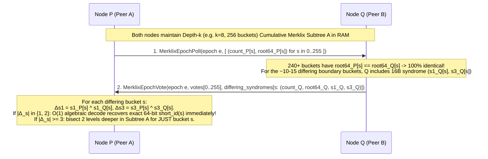
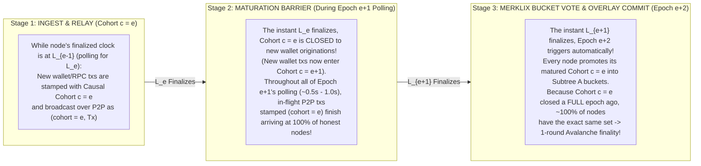
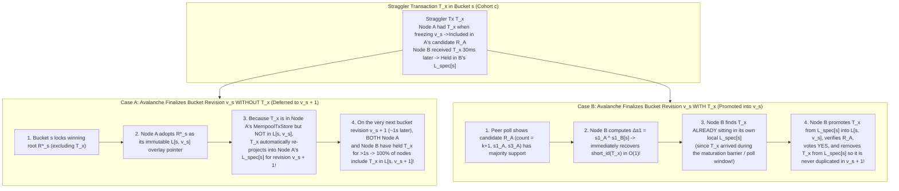
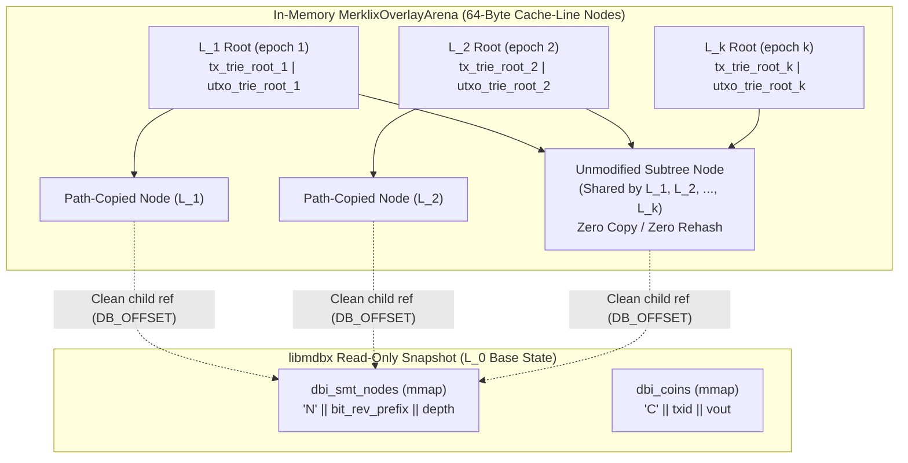
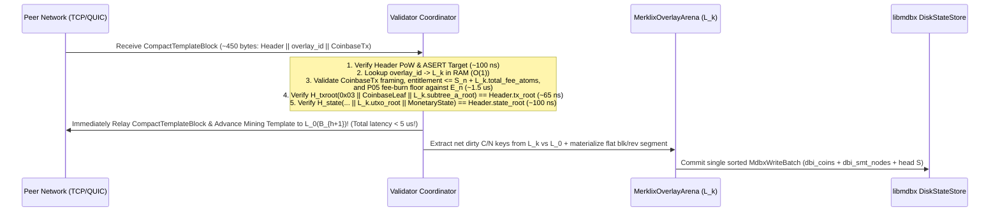
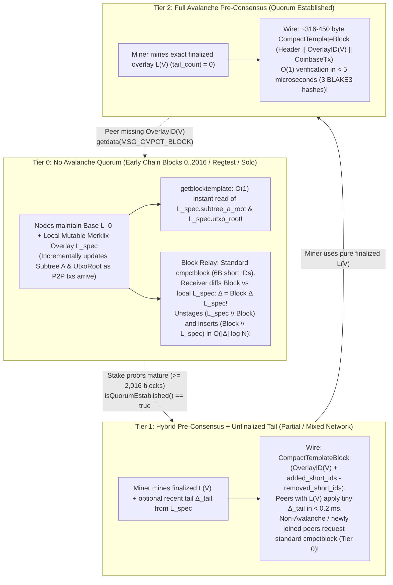

# Lotus V2 Bulk Template Pre-Consensus, Distributed Set Reconciliation, and Progressively Overlayed Merklix Mempools

Status: **Architecture and Protocol Specification Proposal, 2026-10-16 (Review Required Before Implementation)**.

Refines and connects:
- [P02: Hash commitments and authenticated state](../lotus-v2/decisions/commitments-and-state.md) — specifically the Maintainer Architecture Direction (2026-10-16) on horizontal sharding via prefix-keyed Merklix trees (`Subtree A`), `OutpointKey = txid || vout` prefix preservation, and delayed/pipelined coinbase UTXO insertion.
- [P04: Header design and mining](../lotus-v2/decisions/header-and-mining.md) — 134-byte recursive BLAKE3 header (`BodyHash`, `WorkHash`, `BlockID`), 120-second target block spacing, and Avalanche/PoW integration.
- [N01–N07: Lotus V2 peering candidate](../lotus-v2/peering.md) — `TxID` (outpoint/conflict identity) vs. `TxHash` (witness-complete wire identity) separation, compact block profile 2 (`cmpctblock`), and TCP/QUIC stream mapping.
- Persistent `libmdbx` state engine (`DiskStateStore` in `src/lotus_v2/disk_state.h` / `disk_state.cpp` and `src/lotus_v2/sparse_state.h` / `sparse_state.cpp`) — `dbi_coins` (`'C' || txid || vout_u32le`) and `dbi_smt_nodes` (`'N' || bit_reversed_prefix_32B || depth_u16le`).

---

## Executive Summary & Architectural Thesis

Traditional Proof-of-Work blockchains perform **post-PoW block propagation and validation**: a miner privately selects a mempool snapshot, constructs a block, finds a PoW nonce, and then broadcasts a compact block (`cmpctblock` or Graphene) across the peer-to-peer network. Even with compact blocks, receiving nodes must:
1. Reconcile any missing transactions that arrived late or differed from the miner's mempool,
2. Reconstruct the ordered transaction vector and recompute the block's transaction Merkle root (`tx_root`),
3. Execute all state transitions (UTXO deletions and insertions) and recompute the post-block UTXO state commitment (`state_root`) on the critical path of block relay before forwarding or building on the new tip.

At high throughput (e.g., $10^5$–$10^6$ transactions per 120-second block), doing set reconciliation, Merklix tree updates, and `libmdbx` B+Tree page modifications *after* PoW is found creates a propagation and validation bottleneck that increases orphan rates and centralizes mining pressure.

Lotus V2's commitment architecture ([P02](../lotus-v2/decisions/commitments-and-state.md)) unlocks a qualitatively different paradigm—**Progressive Bulk Template Pre-Consensus with Persistent Merklix Overlays**:

1. **100% Miner-Independent `Subtree A` and `UtxoRoot`:**
   - Non-coinbase transactions (`vtx[1 .. n - 1]`) are canonically ordered by `TxID` (CTOR) and committed in **`Subtree A`**, a 256-bit `TxID`-prefix-keyed single-leaf-collapsed Merklix tree whose root combines with the winning miner's `CoinbaseLeaf` in a single $O(1)$ top-level hash:
     $$\text{TxRoot} = H_{\text{txroot}}(\texttt{0x03} \parallel \text{CoinbaseLeaf} \parallel \text{SubtreeA})$$
   - Under **delayed/pipelined coinbase UTXO insertion**, Block $h$'s coinbase outputs are inserted into `UtxoRoot` at the start of Block $h+1$ (when Block $h$ is already connected and its `coinbase_txid` is immutable), while Block $h$'s own candidate transactions (`vtx[1 .. n - 1]`) determine 100% of the UTXO mutations during Block $h$.
   - Consequently, **every node on the network can pre-validate and pre-compute the exact post-block `SubtreeA` root, `UtxoRoot`, cumulative fees, and cumulative block cost units ($C_{\text{block}}$) *before* a PoW block is ever found**, without knowing which miner will win Block $h$ or what coinbase payout addresses/extranonce that miner will use.

2. **Solving the Three Hard Problems of Bulk Pre-Consensus:**
   - **Problem 1 (Distributed Set Reconciliation):** Why probabilistic whole-mempool schemes (Graphene's Bloom + IBLT and MinHash) fail catastrophically in adversarial P2P environments, and how **Merklix Prefix-Count Bisection + Exact-Count-Guided `Minisketch` ($GF(2^{64})$ BCH syndromes)** over `Subtree A`'s native `(count, root)` internal nodes achieves zero-cliff, deterministic reconciliation.
   - **Problem 2 (Transaction Receipt Order & Defining the Reconciled Set):** How continuous, uncoordinated P2P transaction arrival is discretized into **Progressive Epoch Overlay Batches ($\Delta_1, \Delta_2, \dots, \Delta_k$)** every $\tau_{\text{epoch}} \in [2\text{ s}, 5\text{ s}]$, binding `TxID` to exact witness `TxHash` variants and resolving double-spends and intra-template parent-child chains cleanly.
   - **Problem 3 (Progressively Overlayed Mempools in RAM + Zero-Copy `libmdbx`):** How to store $k \approx 24$ progressive mempool overlay layers ($L_0 \to L_1 \to \dots \to L_k \to L_{\text{spec}}$) in a **Multi-Layer Persistent (Copy-on-Write / Functional) Radix-Merklix Arena** where each overlay step updates both `Subtree A` (`TxRoot`) and `UtxoRoot` in $O(|\Delta_i| \log N)$ time (single-digit milliseconds) and tens of megabytes of total RAM, reducing post-PoW block validation and `libmdbx` commit to an **$O(1)$ microsecond operation**.

---

## Problem 1: Distributed Set Reconciliation (Why IBLT/Bloom Fails, and What Works)

### 1.1 Critique of Graphene (Bloom Filter + IBLT) and MinHash in UTXO Networks

Historically, bulk block/template compression proposals in Bitcoin and Bitcoin Cash centered on **Graphene** (combining a variable-sized Bloom filter with an Invertible Bloom Lookup Table, or IBLT) and **MinHash** sketches. Neither achieved reliable production deployment for pre-consensus or adversarial P2P relay, for fundamental information-theoretic and security reasons:

#### A. The IBLT Parameterization Cliff (`Peeling Failure`)
An Invertible Bloom Lookup Table (IBLT) encodes a set into $m = c \cdot d$ cells (typically $c \approx 1.3$–$1.5$, with $k \in \{3, 4\}$ hash functions), where $d = |A \triangle B| = |A \setminus B| + |B \setminus A|$ is the size of the symmetric difference between sender set $A$ and receiver set $B$.
- Decoding an IBLT relies on iterative **peeling** of a random hypergraph: finding cells with `count == ±1` (pure cells), removing their elements from the other $k-1$ cells they touch, and repeating until all cells are empty.
- **Phase-transition cliff:** Random $k$-uniform hypergraph peeling exhibits a sharp threshold around $c_{\text{crit}}(k)$ (the 2-core emergence threshold). If the actual symmetric difference $d_{\text{actual}}$ exceeds the capacity $d_{\text{param}}$ for which the IBLT was sized by even **10–15%**, the hypergraph traps a non-empty 2-core (a cycle of cells all having $|\text{count}| \ge 2$).
- When peeling stalls on a 2-core, **IBLT recovery drops to 0% of the remaining elements**. Every single unresolved transaction in the 2-core is lost simultaneously, forcing a fallback round-trip that wastes the entire IBLT payload and adds a full RTT of latency on the critical path.

#### B. Failure of the Graphene Bloom Filter Estimator
To keep the IBLT small, Graphene first sends a Bloom filter $BF(A)$ of the block's transactions so the receiver can filter its mempool $M$ down to a candidate set $B \subseteq M$ and bound false positives $FP = |B \setminus A|$.
- Sizing the IBLT still requires the sender to *guess* how many transactions in $A$ the receiver is *missing* ($FN = |A \setminus B|$). The sender does not know the receiver's mempool!
- If the receiver recently connected, experienced a brief network stall, has slightly different fee/orphan policy, or hasn't received the latest 500 transactions, $FN = |A \setminus B|$ exceeds the sender's guess, and the IBLT immediately hits the 2-core peeling cliff.

#### C. Adversarial Boundary / Churn Injection Attacks (P2P DoS)
In a permissionless P2P network, the symmetric difference $d = |A \triangle B|$ is **adversarially controllable**:
- An attacker can broadcast a burst of low-cost or replacement-boundary transactions to half the network right before an epoch boundary or block announcement, or selectively trickle distinct valid transactions to different peer partitions.
- For a negligible fee budget (or zero fee if exploiting orphan/policy edges), the attacker inflates $|A \triangle B|$ across honest peers beyond $d_{\text{param}}$, causing **100% IBLT decode failure network-wide**.
- Furthermore, in an unkeyed or predictable IBLT/Bloom construction, an adversary can grind transaction hashes that collide into the same IBLT cells (a targeted 2-core poisoning attack), guaranteeing peeling failure even when $|A \triangle B| \ll d_{\text{param}}$.

#### D. Why MinHash Cannot Perform Set Reconciliation
**MinHash** (Minimum Hash sketching) maintains $k$ minimum hash values over a set $A$ to estimate the **Jaccard similarity** $J(A, B) = \frac{|A \cap B|}{|A \cup B|}$ with standard error $O(1/\sqrt{k})$.
- MinHash is an **estimator of set overlap cardinality**, not an **error-correcting code or set-difference recovery algorithm**.
- Knowing that $J(A, B) \approx 0.985 \pm 0.01$ over $100{,}000$ transactions tells a node that roughly $1{,}500$ transactions differ, but identifies **zero** of the specific missing `TxHash`es outside the $k$ sampled minima. It provides neither exact difference counts per prefix nor algebraic recovery of the missing elements.

---

### 1.2 Merklix Prefix-Count Bisection (Native to `Subtree A`)

In Lotus V2, `Subtree A` is *already* a 256-bit `TxID`-prefix-keyed Merklix radix tree ([P02](../lotus-v2/decisions/commitments-and-state.md)). Unlike Bitcoin's positional Merkle tree (where internal nodes commit only to positional slices and carry no key-range semantics), every internal node at depth $d$ (`0 <= d < 256`) of `Subtree A` covers a deterministic prefix $p \in \{0, 1\}^d$ of the 256-bit `TxID` space and commits to both the **exact leaf count** and the **subtree cryptographic root** of its left and right children:

```text
TxLeaf(TxID, TxHash)                 = H_txroot(0x00 || TxID || TxHash)
TxMerklixNode(d, c_L, root_L, c_R, root_R) = H_txroot(0x01 || u16(d) || u32(c_L) || root_L || u32(c_R) || root_R)
EmptyTxMerklixRoot                   = H_txroot(0x02)
```

*(Note: For a depth-$d$ subtree with count $c = c_L + c_R$, the node summary in memory is simply `(count: u32, root: h32)` = 36 bytes).*

#### How Depth-$k$ Merklix Prefix Exchange Isolates Differences
Suppose Node $P$ and Node $Q$ hold candidate transaction sets $A$ and $B$ (or epoch batch sets) of size $N \approx 100{,}000$, and their top-level `(count, SubtreeA_Root)` differs.

1. **Single-Message Depth-$k$ Prefix Summary (`MerklixPrefixSummary`):**
   - At depth $k$ (e.g., $k = 8 \implies 256$ shards, or $k = 10 \implies 1{,}024$ shards), `Subtree A` partitions the 256-bit `TxID` space into $S = 2^k$ disjoint prefix buckets $s \in [0, 2^k - 1]$.
   - For each prefix bucket $s$, a node already has the cached Merklix summary `(count[s], root[s])` in RAM (maintained natively by its $2^k$ horizontal shards or Merklix overlay!).
   - Compare sending full 32-byte roots vs. compact 64-bit syndrome/root fingerprints per bucket:
     - Even with 64-bit truncated root tags (`root64[s]: u64`) + `delta_count[s]: u16`, a depth-8 summary ($256$ shards) is only $256 \times (2 + 8) = 2{,}560\text{ bytes}$ ($2.5\text{ KiB}$).
2. **Immediate Isolation of Identical Shards:**
   - For every shard $s \in [0, 2^k - 1]$ where `count_P[s] == count_Q[s]` and `root_P[s] == root_Q[s]`, **the entire subtree of $N / 2^k$ transactions is 100% cryptographically identical** (including both `TxID` and `TxHash` at every leaf!). Zero further work is performed on matching shards.
3. **Exact Count Delta in Differing Shards:**
   - For any shard $s$ where `root_P[s] != root_Q[s]`, both nodes immediately learn the net cardinality difference $\Delta c_s = |\text{count}_P[s] - \text{count}_Q[s]|$ and the total subtree size $c_s = \max(\text{count}_P[s], \text{count}_Q[s])$.
4. **Pure Bisection Trade-Off (RTTs vs. Bandwidth):**
   - If reconciliation used *pure* interactive bisection down the Merklix tree (stepping 4 bits / 16-way per round-trip from depth 8 to depth 16):
     - **Bandwidth** is minimal when $d = |A \triangle B|$ is tiny ($d \le 20$), requiring only $O(d \log(N/d))$ node summaries.
     - **Latency (RTTs)** scales as $O(\log_{2^b}(N/d))$ round-trips (typically 2 to 4 RTTs to reach singleton leaves). Across intercontinental P2P links ($100\text{–}150\text{ ms}$ RTT), 3–4 interactive RTTs cost $300\text{–}600\text{ ms}$.
   - Can we get the **1-RTT latency** of algebraic sketching *and* the **exact shard isolation and zero-cliff determinism** of Merklix trees? Yes—by combining Merklix prefix counts with `Minisketch`.

---

### 1.3 Hybrid Merklix Prefix Buckets + Exact-Count-Guided `Minisketch` ($GF(2^{64})$ BCH Syndromes)

Unlike IBLT (which uses random hash peeling and fails on 2-core cycles), **`Minisketch` (PinSketch / BIP330 Erlay)** operates algebraically over the finite field $GF(2^{64})$:
- Each element $x \in GF(2^{64}) \setminus \{0\}$ is a 64-bit short transaction identifier (specifically, `short_txhash = SipHash-2-4(k0, k1, TxHash)`).
- A sketch of capacity $t$ for a set $S$ consists of the first $t$ **odd power-sum syndromes** in $GF(2^{64})$:
  $$\sigma_j(S) = \sum_{x \in S} x^{2j - 1} \pmod{P_{64}(X)} \quad \text{for } j = 1, 2, \dots, t$$
  where addition in $GF(2^{64})$ is bitwise XOR ($\oplus$).
- Because XOR is linear over $GF(2^{64})$, combining two sketches $\Sigma(A) \oplus \Sigma(B)$ yields the exact power-sum syndromes of their symmetric difference $\Sigma(A \triangle B)$:
  $$\sigma_j(A) \oplus \sigma_j(B) = \sum_{x \in A \triangle B} x^{2j - 1}$$
- **Zero Peeling Cliff (Deterministic Berlekamp–Massey + Chien/ Cantor–Zassenhaus Root Finding):**
  - If $|A \triangle B| \le t$, Berlekamp–Massey finds the unique degree-$d$ error-locator polynomial $\Lambda(z) = \prod_{x \in A \triangle B} (1 - x z)$ and factors it over $GF(2^{64})$ with **100% algebraic certainty** (save for a $2^{-64}$ field collision probability) and **8 bytes per difference element** ($t \times 8\text{ bytes}$ total, vs. IBLT's ~18–24 bytes per element with a peeling cliff).

#### Inline 16-Byte Bucket Syndromes (`s1, s3`) for $O(1)$ 1-or-2-Tx Recovery (Zero Bloom / Zero IBLT)
Even `Minisketch` requires choosing a capacity $t \ge |A \triangle B|$ when applied monolithically to a whole block. **Combining `Subtree A`'s depth-$k$ Merklix prefix buckets with fast epochs ($\tau = 1.5\text{s}\text{–}2.0\text{s}$) and fixed 2-element $GF(2^{64})$ bucket syndromes (`s1, s3`) eliminates dynamic sketch sizing, Bloom filters, and IBLTs entirely:**

- At depth $k = 8$ ($256$ buckets) or $k = 10$ ($1{,}024$ buckets) with a $\tau = 1.5\text{s}\text{–}2.0\text{s}$ epoch cadence, even at $1{,}000\text{ tx/s}$, each bucket receives an average of only **$1.5\text{ to }6$ new transactions per epoch**, and boundary arrival jitter affects **at most $|\Delta_s| = 1\text{ or }2$ transactions** in the few buckets that differ!
- Therefore, every Merklix bucket summary at depth $k$ maintains two running 64-bit $GF(2^{64})$ power-sum syndromes over the cumulative set of transactions in bucket $s$ (keyed by $x = \text{SipHash-2-4}(k_0, k_1, \text{TxHash}) \in GF(2^{64}) \setminus \{0\}$):
  $$s_1[s] = \bigoplus_{x \in \text{Bucket}_s} x, \qquad s_3[s] = \bigoplus_{x \in \text{Bucket}_s} x^3 \pmod{P_{64}(X)}$$
- Maintaining `(s1, s3)` costs **two 64-bit XORs (~2 nanoseconds)** whenever a transaction is inserted into or removed from a bucket!
- When two nodes compare bucket $s$ and see `root_P[s] != root_Q[s]`, they compute:
  $$\Delta s_1 = s_{1, P}[s] \oplus s_{1, Q}[s], \qquad \Delta s_3 = s_{3, P}[s] \oplus s_{3, Q}[s], \qquad \Delta c = |\text{count}_P[s] - \text{count}_Q[s]|$$
  1. **1-Tx Difference ($|\Delta_s| = 1$, i.e., $\Delta c = 1$ and $(\Delta s_1)^3 \equiv \Delta s_3 \pmod{P_{64}}$):**
     - $\Delta s_1$ **IS** the exact 64-bit `short_id` of the single differing transaction! Decodes in **1 CPU instruction** with 100% certainty.
  2. **2-Tx Difference ($|\Delta_s| = 2$, i.e., $\Delta c \in \{0, 2\}$ and quadratic $z^2 + (\Delta s_1) z + \frac{\Delta s_3 \oplus (\Delta s_1)^3}{\Delta s_1} = 0$ has two distinct roots in $GF(2^{64})$):**
     - Solves the degree-2 quadratic over $GF(2^{64})$ in **~80 nanoseconds** to recover both exact 64-bit `short_id`s $x_1, x_2$!
  3. **Rare $\ge 3$-Tx Difference in Bucket $s$:**
     - Simply bisect **1 or 2 levels deeper in the Merklix tree** for *only* that specific bucket $s$ (where its 4 children at depth $k+2$ each have $1/4$ the transactions, reducing child differences back to $\le 2$)!



---

### 1.4 Comparison Matrix: Set Reconciliation & Template Sync Mechanisms

| Mechanism | Payload for Epoch Batch ($d = 32$ boundary txs across 28 buckets) | Round-Trips (RTTs) | Failure Mode Under Adversarial Churn ($d > d_{\text{est}}$) | Handles `TxID` vs. `TxHash` Variant Mismatch? | CPU Cost (Encode + Decode) |
| :--- | :--- | :--- | :--- | :--- | :--- |
| **Graphene (Bloom + Global IBLT)** | ~4.5 KiB (when $d \le d_{\text{est}}$) | 1 RTT (happy path) / **3+ RTTs on cliff** | **Catastrophic 0% recovery cliff** across entire batch if $d$ exceeds param by ~15% | No (unless keyed by `TxHash`, losing `Subtree A` alignment) | Low encode; fail-prone peeling |
| **MinHash Sketch** | N/A (cannot recover set difference) | N/A | Only estimates Jaccard index $J(A,B)$; **recovers 0 missing transactions** | No | Low |
| **Pure Merklix Prefix Bisection** | ~3–6 KiB total across rounds | **2–3 RTTs** (interactive tree walk) | **Zero cliff** (deterministic tree walk), higher latency on WAN links | **Yes** (`TxLeaf` commits to `TxID \|\| TxHash`) | Negligible (reads cached Merklix nodes) |
| **Compact Short-ID List (`cmpctblock`-style)** | $1{,}500 \times 6\text{ B} = \mathbf{9.0\text{ KiB}}$ | **1 RTT** (0.5 RTT announce + 1 RTT missing tx fetch) | **Zero cliff** (100% deterministic exact list) | **Yes** (6-byte SipHash of `TxHash` in CTOR `TxID` order) | **< 0.08 ms** (1,500 SipHashes) |
| **Merklix Prefix Buckets + Inline 16B `(s1, s3)` $GF(2^{64})$ Syndromes (Recommended)** | $2.5\text{ KiB}$ poll + $28 \times 16\text{ B} = \mathbf{2.95\text{ KiB}}$ total | **1 RTT** (0.5 RTT for matching buckets; $O(1)$ decode for $|\Delta_s| \le 2$) | **Zero global cliff**; any bucket with $|\Delta_s| \ge 3$ bisects 2 levels deeper in `Subtree A` | **Yes** (Bucket by `TxID` prefix; `s1, s3` over `SipHash(TxHash)`) | **< 0.01 ms** (XOR + quadratic solve in $GF(2^{64})$) |

---

## Problem 2: Leaderless Candidate Set Construction, Epoch Boundaries, and Transaction Shuffling

> [!IMPORTANT]
> **The Fundamental Pre-Consensus Questions (Maintainer Guidance):**
> 1. *"Avalanche just allows voting on if people will accept those snapshots (e.g. state root hashes) but that doesn't solve the problem of figuring out **what should be voted on in the first place**. Given that they need to be constructed by each node to vote on... how do you build those sets to begin with in a reasonably consistent way?"*
> 2. *"I prefer **leaderless methods** provided they can actually be made to work. 5 seconds is reasonable finality, but do we want faster? **How do you decide where an epoch boundary is? And how do transactions get shuffled between them?** Like every 100 txns every node calls an epoch and then starts reconciling?"*
> 3. *"Do we have a mechanism for like an **Avalanche vector clock** or something that would make it easier to trigger epochs?"*

### 2.1 Why Naive Monolithic Mempool Hashing and "Every 100 Txns" Triggers Fail

#### A. Why Hashing the Monolithic Mempool Fails
Suppose $M = 1{,}000$ honest nodes are connected over a global P2P network with one-way propagation delay $\tau_{\text{prop}} \approx 100\text{ ms}$ and transaction arrival rate $\lambda = 1{,}000\text{ tx/s}$.
- Even if two nodes $P$ and $Q$ agree on **99.9%** of their mempool transactions and differ on **just 1 single in-flight boundary transaction**, cryptographic hash functions (`BLAKE3`) have the **avalanche property**: changing a single leaf changes 100% of the bits of a monolithic `SubtreeA_Root` and `UtxoRoot`!
- With $b = 20$ boundary transactions in flight across the network, there are up to $2^{20} \approx 10^6$ possible subsets of boundary transactions. Every node computes a completely distinct monolithic root hash, and Avalanche can never form a quorum.

#### B. Why "Every 100 Transactions" Cannot Be Used to Trigger an Epoch Boundary
In an uncoordinated, leaderless P2P network, **count-triggered epochs fail for three structural reasons**:
1. **Out-of-Order Arrival Desynchronizes the Cut:** Because transactions arrive in different orders at different nodes, Node A's "first 100 transactions" ($\{T_1 \dots T_{98}, T_X, T_Y\}$) and Node B's "first 100 transactions" ($\{T_1 \dots T_{98}, T_Z, T_W\}$) are different sets even when both nodes have received 102 transactions total!
2. **Low-Traffic Liveness Stall:** If network traffic drops to $2\text{ tx/s}$ (or $1$ transaction during a quiet period), waiting for $100$ transactions would stall pre-consensus finality for $50+$ seconds (or forever for a single transaction), defeating fast pre-consensus.
3. **Burst Epoch-Number Desynchronization:** During a burst of $5{,}000\text{ tx/s}$, one side of the network would race to Epoch $e = 50$ in one second while another side is still polling on Epoch $e = 12$.

---

### 2.2 The Pipelined Avalanche Logical & Vector Clock (`Ingest -> Mature -> Vote`)

#### What Exists Today vs. What We Add
In the current Lotus V2 codebase (`src/lotus_v2/avalanche_poll.h`), `lotus::v2::ava::OutgoingPoll` carries only a local per-peer request nonce (`uint64_t round{}`):
```cpp
// Current src/lotus_v2/avalanche_poll.h:
struct OutgoingPoll { NodeId node{}; uint64_t round{}; std::vector<PollItem> items; };
```
There is no logical or causal clock shared across peers in `OutgoingPoll` today.

To trigger epochs leaderlessly without wall-clock guessing or count desynchronization, we introduce the **Avalanche Logical Clock ($e$) and Per-Bucket Vector Clock ($\mathbf{V} = \langle v_0, v_1, \dots, v_{255} \rangle$)**:

1. **Piggybacked Lamport Logical Clock (`finalized_epoch e`):**
   - Every confirmed block height $h$ resets the logical epoch clock to $e = 0$ (`L_0 = Base Block B_h + Pipelined Coinbase`).
   - Every `avapoll`, `avaresponse`, and P2P transaction relay message (`inv` / `tx`) piggybacks a compact causal header:
     ```text
     CausalEpochHeader = tip_block_id:h32 || finalized_epoch:u32 || finalized_overlay_id:h32
     ```
   - This forms a strict **Lamport causal chain** $L_0 \prec L_1 \prec L_2 \prec \dots \prec L_e$: whenever a node reaches Avalanche finality on $L_e$ (or receives an `avaresponse` / quorum certificate proving $L_e$ is finalized), it immediately advances its local logical clock to **$e + 1$**.

2. **The 3-Stage Hardware-Style Causal Pipeline (`Ingest -> Mature -> Vote`):**
   Instead of guessing wall-clock timestamps (`t - 500ms`), the **Logical Epoch Clock $e$** drives a deterministic 3-stage pipeline that guarantees **virtually 0% boundary churn** when voting begins:



   - **Why the 3-Stage Causal Pipeline Solves Candidate Set Construction:**
     - **Stage 1 (Ingest at Cohort $c = e$):** While the network is polling to finalize $L_e$, any new transaction originated by a wallet or RPC at an honest node is stamped with `cohort = e` and relayed over P2P.
     - **Stage 2 (Maturation Barrier during Epoch $e+1$):** As soon as $L_e$ finalizes, the network advances to polling for $L_{e+1}$ (which is voting on the *previous* cohort $c = e-1$). At that exact causal transition, **Cohort $c = e$ is closed to newly originated transactions** (new originations are stamped `cohort = e+1`). However, throughout the entire duration of Epoch $e+1$ polling (~$500\text{ ms}\text{–}1{,}000\text{ ms}$), nodes continue accepting in-flight P2P relay of transactions stamped `cohort = e`!
     - **Stage 3 (Vote during Epoch $e+2$):** When $L_{e+1}$ finalizes (~$0.5\text{ s}\text{–}1.0\text{ s}$ after Cohort $c = e$ closed!), **Epoch $e+2$ triggers automatically** to vote on Cohort $c = e$. Because Cohort $c = e$ closed an entire Avalanche epoch ago, every in-flight transaction from Cohort $c = e$ has had $500\text{–}1{,}000\text{ ms}$ ($5\times\text{–}10\times$ the network propagation delay!) to finish reaching every honest node!
     - Consequently, when nodes construct the 256 Merklix prefix buckets for Epoch $e+2$ from Cohort $c = e$, **$>99.5\%$ of buckets are already 100% identical across the entire network on Round 1!**

---

### 2.3 Per-Bucket Vector Clock $\mathbf{V} = \langle v_0, v_1, \dots, v_{255} \rangle$ (Asynchronous Shard Finality)

What if 254 out of the 256 Merklix prefix buckets in `Subtree A` are unanimous on the very first poll round (~150 ms), while 2 buckets ($s = 42$ and $s = 199$) experience a double-spend conflict or a late straggler transaction that takes 3 extra poll rounds to resolve?
- Under a single scalar epoch clock $e$, those 2 contended buckets would stall the other 254 uncontended buckets from advancing!
- By upgrading the epoch clock to a **256-Entry Merklix Bucket Vector Clock**:
  $$\mathbf{V} = \langle v_0, v_1, v_2, \dots, v_{255} \rangle \in \mathbb{N}^{256}$$
  where $v_s$ (`uint16_t`) is the finalized logical revision of Merklix prefix bucket $s \in [0..255]$ since Block $B_h$:

1. **Independent Per-Bucket Advancement:**
   - Each of the 256 prefix buckets of `Subtree A` advances its own vector clock component $v_s \to v_s + 1$ as soon as bucket $s$'s candidate Merklix node `(count[s], root[s])` reaches Avalanche finality!
   - Uncontended buckets (98%+ of buckets) advance every 1–2 poll rounds without ever waiting for a contended bucket.
   - If a bucket $s$ has zero new transactions in a tick, its vector component $v_s$ does not even need to increment (or increments as a 0-delta no-op), saving poll bandwidth.
2. **Any Vector Clock Cut $\mathbf{V}$ Defines an Exact, Deterministic Global Snapshot $L(\mathbf{V})$:**
   - Because `Subtree A` is a prefix-keyed Merklix tree and `OutpointKey = txid || vout` co-locates UTXO insertions with the exact same 256 `TxID` prefixes, **every vector clock value $\mathbf{V} = \langle v_0, \dots, v_{255} \rangle$ uniquely defines a complete block template overlay $L(\mathbf{V})$**:
     - `SubtreeA_Root(V)` is simply the top 8 levels of `Subtree A` hashed over the 256 finalized bucket roots `(count[s, v_s], root[s, v_s])` ($255$ BLAKE3 hashes, $\sim 15\text{ }\mu\text{s}$).
     - `OverlayID(V) = H_blockid("Lotus/v2/preconsensus/vector\0" || B_h.BlockID || V[0..255] || SubtreeA_Root(V) || UtxoRoot(V))`.
   - On the wire, $\mathbf{V}$ is **512 bytes** ($256 \times \text{u16}$), or **$< 64\text{ bytes}$** when delta-encoded relative to the minimum bucket revision $v_{\min} = \min_s v_s$!

---

### 2.4 How Straggler Transactions Are "Shuffled" (Promoted or Deferred) Between Cohort Cuts

What happens in the rare case where a straggler transaction $T_x$ stamped `cohort = c` arrives at Node A before Epoch $e+2$ freezes bucket $s$, but arrives at Node B slightly late (after Node B froze its initial candidate for bucket $s$)?

Because every bucket vote commits to the **Cumulative Merklix Bucket Root $L[s, v_s]$** (all transactions finalized in bucket $s$ across revisions $1 \dots v_s$) plus the **inline 16-byte `(s1, s3)` $GF(2^{64})$ syndrome**:



- **Strict Conservation Invariant (Zero Dropped or Duplicated Transactions):**
  - For every prefix bucket $s \in [0..255]$, a node's speculative bucket tail is defined by the invariant:
    $$L_{\text{spec}}[s] = \left\{ tx \in \text{ValidMempool}[s] \;\middle|\; tx \notin L[s, v_s] \text{ and inputs of } tx \text{ are unspent in } L(\mathbf{V}) \right\}$$
  - If $T_x$ is **promoted** into $L[s, v_s]$ (Case B), $tx \in L[s, v_s]$ becomes true, so $T_x$ is atomically removed from $L_{\text{spec}}[s]$ and can never be double-included in $v_s + 1$.
  - If $T_x$ is **deferred** from $L[s, v_s]$ (Case A), $tx \notin L[s, v_s]$ remains true, so $T_x$ stays at the head of $L_{\text{spec}}[s]$ (upgraded to Cohort $c + 1$) and is guaranteed to be included by 100% of honest nodes in the immediately following bucket revision $v_s + 1$!
- **Deterministic Superset Tie-Breaking:**
  - During polling for revision $v_s$, if Node B sees that a peer's candidate root $R_A$ differs from $R_B$ by 1 or 2 valid, non-conflicting transactions (recovered via $\Delta s_1, \Delta s_3$) that Node B *already holds* in its local $L_{\text{spec}}[s]$, Node B deterministically switches its preference to the **valid superset candidate with higher `count`** (breaking equal-count ties by lowest 256-bit `root[s]`). This collapses any straggler split in **1 single poll round**.

### 2.5 Binding `TxID` to `TxHash` (Preventing Witness / Argument Malleability Split)

In Lotus V2 ([P01](../lotus-v2/decisions/commitments-and-state.md), [N03](../lotus-v2/peering.md)):
- **`TxID`** commits to `chain_id || header_core || inputs_core_root || outputs_root` (excluding input witness scripts, arguments, and signatures). `TxID` determines outpoints (`txid || vout`), conflict detection, and the 256-bit key path in `Subtree A`.
- **`TxHash`** commits to `chain_id || header_core || full_inputs_root || outputs_root` (including all witness arguments and signatures).
- In `Subtree A`, the key path is `TxID`, while the leaf hash at that path commits to **both** `TxID` and `TxHash`:
  $$\text{TxLeaf}(\text{TxID}, \text{TxHash}) = H_{\text{txroot}}(\texttt{0x00} \parallel \text{TxID} \parallel \text{TxHash})$$

**The Malleability Hazard in Set Reconciliation:**
Suppose a transaction has two valid witness variants $(T_1, T_2)$ with the **same `TxID`** but **different `TxHash`es** ($\text{TxHash}_1 \ne \text{TxHash}_2$, e.g., different third-party signature padding or alternative MAST branch satisfaction).
- If set reconciliation only exchanged `TxID`s (or short IDs derived from `TxID`), Node $P$ (holding $T_1$) and Node $Q$ (holding $T_2$) would believe they have the same transaction set, yet they would compute **different `TxLeaf` hashes** and therefore **different `SubtreeA` roots**, breaking block validation!

**Normative Protocol Rule for Variant Binding:**
1. **Merklix Shard Roots Automatically Detect Variant Mismatch:** Because `TxLeaf` hashes `TxID || TxHash`, if Node $P$ has `(TxID, TxHash_1)` and Node $Q$ has `(TxID, TxHash_2)` in shard $s$, their shard counts match (`count_P[s] == count_Q[s]`), but their Merklix shard roots differ (`root_P[s] != root_Q[s]`).
2. **Syndromes `(s1, s3)` and Short-IDs MUST Key on `TxHash` (Never `TxID`):**
   - Every 64-bit $GF(2^{64})$ syndrome element $x \in GF(2^{64})$ and every 48-bit compact short ID is computed over the full **`TxHash`**:
     $$x = \text{SipHash-2-4}(k_0, k_1, \text{TxHash})$$
   - If Node $P$ holds $T_1$ ($\text{TxHash}_1$) and Node $Q$ holds $T_2$ ($\text{TxHash}_2$) for the same `TxID`, the $GF(2^{64})$ syndrome difference $A_s \triangle B_s$ contains **both** $x(\text{TxHash}_1)$ and $x(\text{TxHash}_2)$ (a two-sided difference of size 2 in bucket $s$, decoded immediately by the degree-2 quadratic over `(Δs1, Δs3)`!).
   - Upon decoding $x(\text{TxHash}_1)$, Node $Q$ fetches $T_1$ by `TxHash_1` via `getdata(MSG_TX, TxHash_1)`, verifies $T_1$, and binds $T_1$ as the canonical representative for that `TxID` in overlay $L_e$ (retaining $T_2$ in its bounded recent-variant cache per [N03](../lotus-v2/peering.md)).

---

### 2.6 Intra-Template Parent-Child Spends & Conflict Resolution

#### A. Intra-Template Parent-Child Spends Under CTOR (`TxID` Ordering)
In Lotus V2, non-coinbase transactions in a block (`vtx[1 .. n - 1]`) are canonically ordered by ascending 256-bit little-endian `TxID` (**CTOR**), and committed in `Subtree A` by `TxID` bit-path.
- Because `TxID` is a cryptographic hash, a child transaction $T_{\text{child}}$ spending an output `(T_parent.TxID, vout)` has an ~50% probability that $T_{\text{child}}.\text{TxID} < T_{\text{parent}}.\text{TxID}$ in CTOR wire order!
- Furthermore, in progressive overlays, $T_{\text{parent}}$ may be finalized in Layer $L_1$ ($\Delta_1$) while $T_{\text{child}}$ is finalized in Layer $L_2$ ($\Delta_2$), **or** both $T_{\text{parent}}$ and $T_{\text{child}}$ may be finalized together in the same batch $\Delta_i$.

**How Validation and `UtxoRoot` Updates Handle Intra-Template Spends Commutatively:**
1. **Across Overlay Layers ($T_{\text{parent}} \in \Delta_1, T_{\text{child}} \in \Delta_2$):**
   - When $\Delta_1$ is applied to $L_0 \to L_1$, `(T_parent.TxID, vout)` is inserted into `utxo_trie_root_1` (`UtxoRoot` of $L_1$) and `T_parent` is inserted into `tx_trie_root_1` (`Subtree A` of $L_1$).
   - When $\Delta_2$ is applied to $L_1 \to L_2$:
     - In `Subtree A`, `T_child` is inserted at its 256-bit `TxID` path into `tx_trie_root_1` to produce `tx_trie_root_2` (whether `T_child.TxID` is less than or greater than `T_parent.TxID` does not matter—`Subtree A` is a key-addressed radix trie!).
     - In `UtxoRoot`, `(T_parent.TxID, vout)` already exists as a live leaf in `utxo_trie_root_1`! Applying `T_child` simply deletes `(T_parent.TxID, vout)` from `utxo_trie_root_1` and inserts `T_child`'s spendable outputs to produce `utxo_trie_root_2`.
2. **Within the Same Batch ($T_{\text{parent}}, T_{\text{child}} \in \Delta_i$):**
   - Within a single batch $\Delta_i$ (or full block validation), UTXO state transitions are a **pure commutative map mutation** on outpoints:
     - Let $C(\Delta_i)$ be the set of all spendable coins created by transactions in $\Delta_i$, and $S(\Delta_i)$ be the set of all outpoints spent by transactions in $\Delta_i$.
     - Every input in $S(\Delta_i)$ is resolved either from $L_{i-1}$'s UTXO state or from $C(\Delta_i)$ (checking that no cycle exists—which is cryptographically impossible without breaking BLAKE3 `TxID` preimage resistance—and that `timelock`/`sequence` rules pass; note that intra-block spends require relative locktime `0`).
     - Any ephemeral outpoint created **and** spent within the same batch $\Delta_i$ ($o \in C(\Delta_i) \cap S(\Delta_i)$) is validated in RAM (feeding its `Coin` record directly to the child's VM execution and `owninput`/`sighash` checks) and **elided from the `UtxoRoot` trie update altogether** (net insertion + deletion = no-op on `utxo_trie_root_i`!).

#### B. Double-Spend Conflict Resolution via Contended-Outpoint Avalanche Polling
When two conflicting transactions $T_A$ and $T_B$ ($\text{TxID}_A \ne \text{TxID}_B$) spend the same outpoint $o = (\text{prev\_txid}, \text{prev\_vout})$:
1. **Single-Owner Shard Routing:** Because outpoints are keyed by `OutpointKey = prev_txid || prev_vout` ([P02](../lotus-v2/decisions/commitments-and-state.md)), the UTXO shard owning `prev_txid`'s $k$-bit prefix is the **single authoritative conflict detector** for outpoint $o$ on every node.
2. **Conflict Set Registration:** If a node sees both $T_A$ and $T_B$ before an overlay layer $L_i$ locks outpoint $o$, the UTXO shard places $T_A$ and $T_B$ into a conflict cell `ConflictSet[o] = {TxID_A, TxID_B}` and withholds both from $\Delta_i$ until one round of Avalanche conflict polling resolves the winner (or defers the contended outpoint by one epoch $\tau_{\text{epoch}} = 5\text{ s}$ while the uncontended 99.9% of $\Delta_i$ finalizes immediately!).
3. **Immutability Once Locked in $L_i$:** Once a transaction $T_A$ is finalized into an overlay layer $L_i$, outpoint $o$ is marked spent in `utxo_trie_root_i`. Any subsequently arriving conflicting transaction $T_B$ is immediately rejected against $L_i$.

---

## Problem 3: Progressively Overlayed Mempools with Low-Cost Merklix `TxRoot` and `UtxoRoot` Updates

### 3.1 Why Key-Addressed Merklix Trees Are $O(\Delta \log N)$ While Positional Merkle Trees Are $O(N)$

This is the foundational data-structure insight of the Lotus V2 architecture:

- **In Bitcoin / Bitcoin Cash (Positional Array-Split Merkle Tree, even with CTOR):**
  - Suppose a mempool template $L_1$ has $N = 100{,}000$ transactions sorted by `TxID` (`vtx[1 .. 100,000]`).
  - Now a new batch $\Delta_2$ of $m = 4{,}000$ transactions arrives. Because their `TxID`s are uniformly distributed across $[0, 2^{256}-1)$, inserting those $4{,}000$ transactions in CTOR order shifts the array index `idx` of **almost every single one of the original $100{,}000$ transactions**!
  - Shifting an element's array index from even to odd (or across power-of-two boundaries) invalidates its parent hash at layer 0, which invalidates layer 1, and so on—forcing a **100% full rebuild of all $104{,}000$ leaves ($O(N)$ hashes)** on every single template update!

- **In Lotus V2 (Prefix-Keyed Single-Leaf-Collapsed Merklix Trees for `Subtree A` and `UtxoRoot`):**
  - Both `Subtree A` (keyed by 256-bit `TxID`) and `UtxoRoot` (keyed by `OutpointKey = txid || vout`) are **radix tries (patricia / compressed binary tries)** over fixed bit-paths.
  - A transaction's position in `Subtree A` is determined **solely by the bits of its own `TxID`**, never by how many other transactions exist to its left or right.
  - Therefore, inserting $m = |\Delta_i|$ new transactions into a template of $N$ existing transactions touches **only the $m$ root-to-leaf paths of the newly inserted transactions**!
  - Every unmodified subtree is **100% structurally shared (zero copies, zero re-hashes)** between Layer $L_{i-1}$ and Layer $L_i$. Updating `Subtree A` and `UtxoRoot` from $L_{i-1} \to L_i$ requires only $O(m \log(N/m))$ node allocations and BLAKE3 hashes!

---

### 3.2 Multi-Layer Persistent (Copy-on-Write / Functional) Merklix Overlay Stack

To support $k \approx 24$ progressive epoch overlays ($L_0, L_1, \dots, L_k$) plus a speculative mempool tail ($L_{\text{spec}}$)—and to allow instant rollback or switching if an epoch batch is re-polled or a block arrives at an earlier overlay $L_j$ ($j \le k$)—Lotus V2 uses a **Persistent (Functional / Copy-on-Write) Radix-Merklix Trie** backed by a cache-aligned slab arena (`MerklixOverlayArena`).



---

### 3.3 Concrete C++ Data Structures for the Overlay Stack

#### 1. Compact 64-Byte Cache-Line-Aligned `TxOverlayNode` (`Subtree A`)
Every internal and leaf node of `Subtree A` in the overlay arena fits in **two 64-byte CPU cache lines (128 bytes)**—or **one 64-byte cache line** when child hashes are fetched via child node indices:

```cpp
namespace lotus::v2::overlay {

// 32-bit arena index. High bit (0x80000000) distinguishes special states.
using NodeIdx = uint32_t;
constexpr NodeIdx kEmptyNodeIdx = 0;

// Exactly 64 bytes (1 CPU cache line) per node in TxOverlayArena!
struct alignas(64) TxOverlayNode {
    Hash digest;               // 32B: TxLeaf(TxID, TxHash) if count==1, else TxMerklixNode hash
    Hash key_or_txid;          // 32B: Full TxID if leaf (count==1); prefix bits if branch (count>1)
    NodeIdx left{0};           //  4B: Left child index in TxOverlayArena (0 if empty/leaf)
    NodeIdx right{0};          //  4B: Right child index in TxOverlayArena (0 if empty/leaf)
    uint32_t count{0};         //  4B: Total transactions in this subtree (1 = collapsed leaf)
    uint16_t split_depth{0};   //  2B: Bit depth d (0..255) for branch, or 256 for leaf
    uint16_t epoch_born{0};    //  2B: Overlay layer index i that allocated this node
    uint32_t pool_tx_idx{0};   //  4B: Index into MempoolTxStore if leaf (gives O(1) access to TxHash/bytes)
    uint32_t reserved{0};      //  4B: Alignment padding -> 88B (or 64B if key_or_txid is looked up via pool_tx_idx)
};
```
*Optimization:* Because a leaf (`count == 1`) already has `pool_tx_idx` pointing to the immutable `MempoolTxEntry` (which stores `TxID`, `TxHash`, `fee`, `cost_units`, and `size_bytes`), `TxOverlayNode` does **not** need to duplicate `key_or_txid` inside the node! Dropping `key_or_txid` makes `TxOverlayNode` **exactly 56 bytes (padded to 64 bytes = 1 CPU cache line)**:
- `digest` (32 B)
- `left` (4 B), `right` (4 B)
- `count` (4 B), `pool_tx_idx` (4 B)
- `split_depth` (2 B), `epoch_born` (2 B), `flags` (4 B), `subtree_fee_delta` / `padding` (8 B) $\implies$ **64 bytes**.

#### 2. Persistent `UtxoOverlayNode` with Lazy `libmdbx` Fallthrough & `txid || vout` Co-Location
For `UtxoRoot`, the base UTXO set in `libmdbx` (`dbi_smt_nodes` and `dbi_coins`) may hold $10^8$ coins (~3–8 GB on disk), of which a 120-second block touches at most $\sim 2 \times 10^5$ outpoints ($0.2\%$).
- Therefore, the in-memory `UtxoOverlayArena` **never loads the full UTXO tree into RAM**.
- Instead, any child pointer in `UtxoOverlayNode` can be in one of three states encoded in its `ChildRef`:
  1. `EMPTY` (`kind == 0`): Empty subtree (`EmptyUtxoRoot()`).
  2. `ARENA_IDX` (`bit 31 == 0`): Points to a dirty/path-copied `UtxoOverlayNode` in RAM allocated by one of layers $L_1 \dots L_k$.
  3. `MDBX_CLEAN` (`bit 31 == 1`): Unmodified subtree since $L_0$ (`dbi_smt_nodes` at `path.Child(bit).Key()`). The parent node in RAM already caches the child's `(kind, digest)` summary (`33 bytes`) loaded when the parent was first split, so **recomputing the parent's `UtxoNode(d, left.digest, right.digest)` requires ZERO further `libmdbx` reads for clean siblings!**

```cpp
// 64-byte cache-line-aligned persistent UTXO Merklix node in UtxoOverlayArena
struct alignas(64) UtxoOverlayNode {
    Hash digest;               // 32B: UtxoLeaf(key, coin) if kind==1, else UtxoNode(d, l, r)
    uint32_t left_ref{0};      //  4B: Arena index (if dirty) or 0x80000000 | clean_summary_idx (if in libmdbx)
    uint32_t right_ref{0};     //  4B: Arena index (if dirty) or 0x80000000 | clean_summary_idx (if in libmdbx)
    uint32_t coin_arena_idx{0};//  4B: If kind==1 (singleton leaf), index into CoinRecordArena
    uint16_t depth{0};         //  2B: Bit depth d (0..255)
    uint8_t  kind{0};          //  1B: 0 = Empty, 1 = Singleton Leaf, 2 = Branch
    uint8_t  left_kind{0};     //  1B: Cached Summary.kind (0, 1, 2) of left child
    uint8_t  right_kind{0};    //  1B: Cached Summary.kind (0, 1, 2) of right child
    uint8_t  epoch_born{0};    //  1B: Overlay layer index (0..255)
    uint16_t tx_sub_count{0};  //  2B: Number of outputs sharing this txid prefix (for depth <= 256)
    uint8_t  padding[12];      // 12B: Pad to 64 bytes (1 cache line)
};
```

#### Why `OutpointKey = txid || vout` Prefix Preservation Is a Massive Multiplier for `UtxoRoot` Overlays
Under the Maintainer Architecture Direction ([P02](../lotus-v2/decisions/commitments-and-state.md)), `OutpointKey` preserves the 32-byte `txid` as bits $0 \dots 255$ and places the 32-bit `vout` in bits $256 \dots 287$ (or mixes `vout` only in the trailing bits):
1. **Single Shared Path for Multi-Output Transactions:**
   - Suppose a transaction `tx` in $\Delta_i$ creates $m_{\text{out}} = 4$ spendable outputs (`vout = 0, 1, 2, 3`).
   - In a hashed-outpoint tree (`H_outpointkey(txid || vout)`), those 4 outputs scatter to 4 completely unrelated 27-level paths in `UtxoRoot`, requiring $4 \times 27 = 108$ node allocations, $108$ BLAKE3 hashes, and 4 random `libmdbx` B+Tree page lookups!
   - With `OutpointKey = txid || vout` prefix preservation, **all 4 outputs share the exact same 256-bit `txid` prefix**!
   - First, we build the tiny mini-tree of `tx`'s 4 outputs in 3 BLAKE3 hashes ($vout \in \{0,1,2,3\}$).
   - Then, we insert that single mini-tree into `utxo_trie_root` along **one single path of depth $k \approx 25$** (~25 node allocations, ~25 BLAKE3 hashes, and **1 single `libmdbx` 4 KB leaf page touch**)!
   - For a 2-output average transaction, this cuts `UtxoRoot` insertion path copies, `libmdbx` reads, and BLAKE3 hashes by **nearly $2\times$** (and by $10\times$ for batch payout/airdrop transactions with 10+ outputs!).
2. **Co-Located Shard Ownership:**
   - The horizontal shard $s \in [0, 2^k - 1]$ that owns `tx.TxID` in `Subtree A` **also** owns the `UtxoRoot` subtree where all of `tx`'s outputs `(tx.TxID, vout)` are inserted!

#### 3. The Immutable `MempoolOverlayLayer` Descriptor ($L_i$)
Each layer $L_i$ ($i = 0, 1, \dots, k$) is an lightweight header pointing into the shared arenas:

```cpp
struct MempoolOverlayLayer {
    uint32_t layer_index{0};             // 0 = Base (B_h + B_h coinbase), 1..k = Epoch overlays
    Hash parent_block_id{};              // BlockID of tip B_h
    Hash overlay_id{};                   // Pre-consensus commitment ID for L_i

    // Persistent Merklix Trie Roots (per-shard and aggregated)
    std::array<NodeIdx, 256> shard_tx_roots{};   // Depth-8 shard roots for Subtree A
    std::array<NodeIdx, 256> shard_utxo_roots{}; // Depth-8 shard roots for UtxoRoot
    Hash subtree_a_root{};               // 32B: Aggregated Subtree A root (vtx[1..N_i])
    Hash utxo_root{};                    // 32B: Aggregated post-L_i UtxoRoot

    // Cumulative Block Accounting State (for instant coinbase & StateRoot construction)
    uint32_t total_tx_count{0};          // N_i = sum(|Δ_1| .. |Δ_i|)
    uint64_t total_body_bytes{0};        // Exact framed byte size of all vtx[1..N_i]
    uint64_t total_cost_units{0};        // Cumulative P05 cost units C_tx of vtx[1..N_i]
    uint64_t total_fee_atoms{0};         // Cumulative claimable miner fees (excluding IS_BURN)
    uint64_t total_burned_atoms{0};      // Cumulative burned atoms (for P05 fee-burn floor check)

    // Batch Delta Reference (for O(|Δ_i|) incremental diffing & libmdbx commit)
    std::vector<uint32_t> batch_tx_indices; // Sorted by TxID within Δ_i
};
```

---

### 3.4 Concrete Step-by-Step Lifecycle: Base $L_0 \to$ Overlays $L_1 \dots L_k \to$ Speculative $L_{\text{spec}}$

#### Step 1: Initializing Base Layer $L_0$ When Tip Block $B_h$ Connects
When Block $B_h$ connects at height $h$:
1. `DiskStateStore` holds a zero-copy `MDBX_TXN_RDONLY` snapshot (`EnsureReadTxn()`) at tip $B_h$.
2. **Delayed Coinbase UTXO Insertion ([P02](../lotus-v2/decisions/commitments-and-state.md)):**
   - Block $B_h$'s coinbase transaction (`B_h.vtx[0]`) is now immutable and known to every node.
   - Its spendable outputs (`(flags & 0x02) == 0`) are inserted into the empty `UtxoOverlayArena` on top of $B_h$'s `dbi_smt_nodes` root to form **`L_0.utxo_root`**.
   - `L_0.subtree_a_root` is initialized to `EmptyTxMerklixRoot` (`H_txroot(0x02)`), and all cumulative counters (`total_tx_count`, `total_body_bytes`, `total_cost_units`, `total_fee_atoms`) are `0`.

#### Step 2: Advancing $L_{i-1} \to L_i$ by Applying Epoch Batch $\Delta_i$ (Sort-Merge Batch Path-Copying)
Instead of inserting each of the $m = |\Delta_i|$ transactions one by one from the root (which would re-copy the top $\log_2 m$ levels $m$ times), we sort the $m$ operations by their 256-bit key (`TxID` for `Subtree A`; `OutpointKey` for `UtxoRoot`) and apply them in a **single recursive top-down divide-and-conquer pass** (executed in parallel across the $2^8 = 256$ prefix shards):

```cpp
// Batch-update a Subtree A shard from L_{i-1} to L_i in O(|ops| * log(N_shard / |ops|))
NodeIdx ApplyTxBatchRecursive(
    TxOverlayArena &arena,
    NodeIdx old_node_idx,
    std::span<const TxBatchOp> sorted_ops, // Pre-sorted by 256-bit TxID
    uint16_t depth,
    uint16_t epoch_id)
{
    if (sorted_ops.empty()) {
        return old_node_idx; // 100% structural sharing: 0 allocations, 0 hashes!
    }
    if (old_node_idx == kEmptyNodeIdx && sorted_ops.size() == 1) {
        // Single-leaf collapse: allocate 1 leaf node directly at current depth!
        return arena.AllocateLeaf(sorted_ops[0], epoch_id);
    }
    // If old_node_idx is a collapsed singleton leaf (count == 1), push it down to split
    // against sorted_ops; otherwise partition sorted_ops at bit `depth` via std::partition_point
    auto split_it = std::partition_point(sorted_ops.begin(), sorted_ops.end(),
        [depth](const TxBatchOp &op) { return !Bit(op.tx_id, depth); });

    std::span<const TxBatchOp> left_ops(sorted_ops.begin(), split_it);
    std::span<const TxBatchOp> right_ops(split_it, sorted_ops.end());

    const TxOverlayNode &old_node = arena.Get(old_node_idx);
    NodeIdx new_left  = ApplyTxBatchRecursive(arena, old_node.left,  left_ops,  depth + 1, epoch_id);
    NodeIdx new_right = ApplyTxBatchRecursive(arena, old_node.right, right_ops, depth + 1, epoch_id);

    // Allocate 1 path-copied branch node and compute 1 BLAKE3 hash:
    // H_txroot(0x01 || u16(depth) || u32(c_L) || root_L || u32(c_R) || root_R)
    return arena.AllocateBranch(depth, new_left, new_right, epoch_id);
}
```

Notice the power of **Sort-Merge Batch Path-Copying**:
- The top $\log_2 m$ levels of the tree ($d = 0 \dots 11$ for $m = 4{,}096$) are traversed and allocated **only once per batch**, not once per transaction!
- For $m = 4{,}096$ transactions inserted into a tree of $N = 100{,}000$ transactions:
  - The top 12 levels contain at most $2^{12} - 1 = 4{,}095$ shared internal nodes.
  - Below depth 12, each of the $4{,}096$ transactions diverges for an average of only $\log_2(100{,}000 / 4{,}096) \approx 4.6$ levels before hitting a collapsed singleton leaf!
  - Total new `TxOverlayNode`s allocated for the entire $4{,}096$-tx batch $\Delta_i$:
    $$\text{Nodes}_{\text{SubtreeA}}(\Delta_i) \approx 4{,}095\text{ (top levels)} + 4{,}096 \times (4.6\text{ branch} + 1\text{ leaf}) \approx \mathbf{27{,}000\text{ nodes}}$$
  - Compare this to naive one-by-one insertion ($4{,}096 \times 18 = 73{,}728$ nodes): batch divide-and-conquer cuts both memory allocations and BLAKE3 hashes by **$2.7\times$**!

---

### 3.5 Exact Memory and CPU Budget Math (100,000 Transactions Across 24 Overlays)

Let us calculate the exact memory footprint and CPU execution time for maintaining **24 progressive immutable overlays ($L_1 \dots L_{24}$)** over a 120-second block window ($\tau_{\text{epoch}} = 5\text{ s}$) with a massive throughput of **$N = 100{,}000$ transactions per block** ($\approx 833\text{ tx/s}$, or $m = 4{,}167$ transactions per 5-second overlay batch $\Delta_i$, with an average of $2.0$ inputs and $2.0$ spendable outputs per transaction):

#### A. Memory Budget Across All 24 Persistent Overlays ($L_1 \dots L_{24}$)

| Component | Per-Overlay $\Delta_i$ ($4{,}167$ txs) | Cumulative Across All 24 Overlays ($100{,}000$ txs) | Notes |
| :--- | :--- | :--- | :--- |
| **`Subtree A` (`TxOverlayArena`)** | $\sim 27{,}500\text{ nodes} \times 64\text{ B} = \mathbf{1.76\text{ MiB}}$ | $660{,}000\text{ nodes} \times 64\text{ B} = \mathbf{42.2\text{ MiB}}$ | Retains *all 24 historical roots* $L_1 \dots L_{24}$ simultaneously! |
| **`UtxoRoot` (`UtxoOverlayArena`)** | $\sim 4{,}167\text{ new txid paths} + 8{,}334\text{ spends} \to \sim 145{,}000\text{ nodes} \times 64\text{ B} = \mathbf{9.28\text{ MiB}}$ | $\sim 3.48\text{M nodes} \times 64\text{ B} = \mathbf{222.7\text{ MiB}}$ *(or **$\mathbf{37.1\text{ MiB}}$** with sliding 4-epoch history window)* | Because `OutpointKey = txid \|\| vout` co-locates all outputs of a tx under one path! |
| **New `Coin` Records (`CoinRecordArena`)** | $8{,}334\text{ coins} \times 96\text{ B} = \mathbf{0.80\text{ MiB}}$ | $200{,}000\text{ coins} \times 96\text{ B} = \mathbf{19.2\text{ MiB}}$ | Stored once in `CoinRecordArena`; overlays reference by 32-bit `coin_arena_idx`. |
| **Clean `libmdbx` Sibling Summaries** | $8{,}334\text{ paths} \times 12\text{ clean siblings} \times 33\text{ B} = \mathbf{3.30\text{ MiB}}$ | $\mathbf{39.6\text{ MiB}}$ (deduplicated across overlays) | Cached in arena on first read from `dbi_smt_nodes`. |
| **Total Overlay RAM (Sliding 4-Epoch Undo + Latest $L_k$)** | **$\sim 15.1\text{ MiB}$ per epoch** | **$\approx 98\text{ MiB}$ total RAM** (or $\approx 323\text{ MiB}$ if keeping all 24 historical snapshots unpruned) | Fits comfortably in L3 cache / a fraction of 1 GB RAM! |

> [!TIP]
> **Sliding Window Arena Reclamation:** Once Epoch $L_k$ is finalized by Avalanche pre-consensus, nodes only need to retain $L_{k-2}, L_{k-1}, L_k$ (the last 3 finalized layers, spanning 15 seconds) plus $L_0$ for race-condition block arrivals. Any path-copied interior node born in epoch $j < k - 2$ that was superseded in a later epoch is recycled to a per-shard freelist in $O(1)$, bounding total `TxOverlayArena + UtxoOverlayArena` memory for $100{,}000$ transactions to **under $100\text{ MiB}$**!

#### B. CPU & BLAKE3 Hashing Budget per 5-Second Epoch Update ($L_{i-1} \to L_i$)

Each internal Merklix node hash is a single-chunk (67-byte or 75-byte) tagged BLAKE3 evaluation ($\approx 65\text{ ns}$ on a single modern x86-64/ARM64 core, or $\approx 15\text{ ns}$ with AVX2/AVX-512/NEON multi-buffer SIMD hashing across sibling paths):

| Operation per 5-Second Batch $\Delta_i$ ($4{,}167$ txs) | Number of BLAKE3 Hashes | Single-Core Time | 8-Core Sharded Time (256 Shards across 8 Threads) |
| :--- | :--- | :--- | :--- |
| **`Subtree A` (`TxRoot`) Update** | $\sim 23{,}300$ node hashes ($+ 4{,}167$ `TxLeaf` hashes precomputed on tx arrival) | $\sim 1.5\text{ ms}$ | **$\sim 0.22\text{ ms}$** |
| **`UtxoRoot` Update (with `txid \|\| vout` prefix co-location)** | $\sim 8{,}334$ `UtxoLeaf` hashes $+ \sim 136{,}000$ `UtxoNode` hashes | $\sim 9.4\text{ ms}$ | **$\sim 1.35\text{ ms}$** |
| **`libmdbx` Read-Only Lookups (`RawGetView` via `mmap`)** | $\sim 8{,}334$ spent outpoints $\times \sim 6$ new page touches (in RAM page cache) | $\sim 3.2\text{ ms}$ | **$\sim 0.45\text{ ms}$** |
| **Top-Level 256-Shard Aggregation (Depth $7 \to 0$)** | $255$ `TxMerklixNode` $+ 255$ `UtxoNode` hashes $= 510$ hashes | $\sim 0.03\text{ ms}$ | **$\sim 0.03\text{ ms}$** |
| **Total Per-Epoch Overlay Transition ($L_{i-1} \to L_i$)** | **$\sim 168{,}000$ BLAKE3 hashes** | **$\approx 14.1\text{ ms}$** | **$\approx 2.05\text{ ms}$ every $5{,}000\text{ ms}$ ($0.04\%$ CPU duty cycle!)** |

---

### 3.6 $O(1)$ Block Receipt, Validation, and `libmdbx` Commit When PoW Arrives

Because every node has already pre-validated all transactions in $L_k$ and pre-computed `L_k.subtree_a_root`, `L_k.utxo_root`, `L_k.total_body_bytes`, `L_k.total_cost_units`, and `L_k.total_fee_atoms`:

#### 1. How a Miner Constructs a Block Header from $L_k$ in $O(1)$
When `getblocktemplate` runs (or whenever $L_k$ advances):
1. The miner constructs its own coinbase transaction `vtx[0]` claiming up to `S_n + L_k.total_fee_atoms - coinbase_resource_charge` ([P05/P06](../lotus-v2/decisions/commitments-and-state.md)) and computes `CoinbaseLeaf = H_txroot(0x00 || coinbase_txid || coinbase_txhash)`.
2. The miner computes `header.tx_root` in **1 single BLAKE3 hash ($O(1)$, ~65 ns)** without touching any shard:
   $$\text{header.tx\_root} = H_{\text{txroot}}(\texttt{0x03} \parallel \text{CoinbaseLeaf} \parallel L_k.\text{subtree\_a\_root})$$
3. Because Block $h+1$'s coinbase outputs are pipelined into `UtxoRoot` in Block $h+2$ ([P02](../lotus-v2/decisions/commitments-and-state.md)), **`L_k.utxo_root` is ALREADY the exact final `UtxoRoot` of Block $h+1$!**
4. The miner updates the 56-byte `MonetaryState` ($R_{n+1}, T_{n+1}, W_n, E_{n+1}$) using $C_{\text{block}} = C_{\text{coinbase}} + L_k.\text{total\_cost\_units}$ and computes `header.state_root` in **1 single 130-byte BLAKE3 hash ($O(1)$, ~100 ns)**:
   $$\text{header.state\_root} = H_{\text{state}}(\texttt{0x00} \parallel \text{ChainID} \parallel \text{u64}(h+1) \parallel L_k.\text{utxo\_root} \parallel \texttt{0x38} \parallel \text{MonetaryState}_{n+1})$$
5. `header.size` is simply $134 + 4 + \text{framed\_len}(\text{vtx}[0]) + L_k.\text{total\_body\_bytes}$.

#### 2. Wire Format: `CompactTemplateBlock` (`cmpcttmpl`)
When the winning miner finds a valid 64-bit PoW `nonce` for `Header`, it broadcasts a tiny **`CompactTemplateBlock`** message over TCP/QUIC:

```text
CompactTemplateBlock = Header (134 bytes)
                       || overlay_id:h32 (32 bytes, identifying L_k; or 0x00^32 if empty L_0)
                       || Bytes(CoinbaseTx) (~150-300 bytes)
                       || CS(tail_count)
                       || short_id:u48[tail_count]        # Optional tail Δ_tail beyond L_k (0 in normal operation!)
                       || CS(prefilled_tail_count)
                       || PrefilledTx[prefilled_tail_count]
```

- When the miner mined against finalized overlay $L_k$ (`tail_count == 0`), the **entire block announcement for a 100,000-transaction (~25 MB) block is ~450 bytes**!
- It fits inside a **single UDP datagram / single QUIC packet** with zero fragmentation and zero missing-transaction round-trips.

#### 3. Microsecond Validation & Commit Path on Receiving `CompactTemplateBlock`



1. **Instantaneous Header + Root Verification ($< 5\text{ }\mu\text{s}$):**
   - Verify 134-byte `Header` PoW (`BodyHash`, `WorkHash`, `BlockID <= target`) in $\sim 100\text{ ns}$.
   - Look up `overlay_id` in the local overlay table to obtain $L_k$ (and if `tail_count > 0`, apply the small tail $\Delta_{\text{tail}}$ on top of $L_k$ using the exact same `ApplyBatch` function).
   - Validate `CoinbaseTx` (`vtx[0]`) syntax, check `header.size == 138 + framed_len(CoinbaseTx) + L_k.total_body_bytes`, verify coinbase output claims against $S_n + L_k.\text{total\_fee\_atoms}$, and check P05 mandatory fee burn.
   - Compute `TxRoot = H_txroot(0x03 || CoinbaseLeaf || L_k.subtree_a_root)` (1 hash) and compare with `header.tx_root`.
   - Compute `StateRoot` from `L_k.utxo_root` and `MonetaryState` (1 hash) and compare with `header.state_root`.
   - **Total verification time before relaying the block and switching miners to Block $h+2$'s $L_0$: $< 5\text{ microseconds}$!**
2. **Flattening $L_k$ to `libmdbx` (`dbi_coins` and `dbi_smt_nodes`):**
   - Only the net difference between $L_0$ and $L_k$ needs to be written to `libmdbx`:
     - Any node in `UtxoOverlayArena` reachable from `L_k.utxo_root` with `epoch_born >= 1` is emitted as a `Put('N' || bit_rev_prefix || depth_u16le, EncodeNode(node))` into `MdbxWriteBatch`.
     - Any node in $L_0$ that was replaced or collapsed in $L_1 \dots L_k$ without a survivor at its `Path::Key()` is emitted as a `Delete('N' || ...)`.
     - All net created coins in $L_1 \dots L_k$ are emitted as `Put('C' || txid || vout, CoinBytes)` and all spent coins from $L_0$ as `Delete('C' || ...)`.
   - Because `OutpointKey = txid || vout` and `Path::Key()` (`'N' || bit_reversed_prefix || depth_u16le`) sort in the **exact same lexicographic prefix order** as `dbi_coins` and `dbi_smt_nodes`, the batch writes stream sequentially into `libmdbx` B+Tree leaf pages with minimal page splits.

---

## Problem 4: Bootstrap & Graceful Fallback When No Avalanche Nodes Are Present

> [!IMPORTANT]
> **Maintainer Question:**
> *"How does this fall back early on when there are no Avalanche nodes?"*

A critical systems requirement for Lotus V2 is **Zero Hard-Consensus Coupling** between the Avalanche pre-consensus overlay protocol and deterministic Proof-of-Work block validity. The system must operate seamlessly—and still gain massive $O(|\text{Block} \triangle L_{\text{spec}}| \log N)$ Merklix overlay speedups—from Block 0 (genesis bootstrap, regtest, solo mining, or periods without an Avalanche quorum) all the way to full-quorum pre-consensus.

### 4.1 Zero Consensus Coupling in the 134-Byte Block Header

In Lotus V2 ([P04](../lotus-v2/decisions/header-and-mining.md)), the 134-byte block header commits **only** to `tx_root` (32 bytes) and `state_root` (32 bytes):
```text
Header = prev_id:h32 || bits:u32 || time:u48 || nonce:u64
         || version:u32(2) || size:u64 || height:u64
         || tx_root:h32 || state_root:h32                     # 134 bytes
```
- The header contains **no** `OverlayID`, **no** vector clock $\mathbf{V}$, **no** epoch counter, and **no** Avalanche quorum certificate.
- `tx_root` ($H_{\text{txroot}}(\texttt{0x03} \parallel \text{CoinbaseLeaf} \parallel \text{SubtreeA})$) and `state_root` ($H_{\text{state}}(\dots \parallel \text{UtxoRoot} \parallel \text{MonetaryState})$) are **pure deterministic functions of the ordered transaction set in the block**.
- Therefore, **block validity is 100% identical whether 0 nodes, 5 nodes, or 10,000 nodes are running Avalanche**.

---

### 4.2 The 3-Tier Graceful Fallback Architecture (`Tier 0 -> Tier 1 -> Tier 2`)



#### Tier 0: Zero Avalanche Nodes (`isQuorumEstablished() == false`, Bootstrap Blocks 0–2,016, Regtest, Solo Mining)
As specified in [quorum bootstrap](lotus-v2-quorum-bootstrap.md), stake proofs require `AVALANCHE_STAKE_MATURITY = 2,016` confirmations (~2.8 days from genesis) before an Avalanche quorum can even form. Furthermore, early testnets or private networks may run with zero Avalanche nodes.

Even with **zero Avalanche nodes**, the Persistent Merklix Overlay (`MerklixOverlayArena`) provides two huge performance wins over traditional nodes:

1. **Instant $O(1)$ `getblocktemplate` (Mining Without Avalanche):**
   - With `isQuorumEstablished() == false`, the finalized overlay stack stops at $L_0$ (the base UTXO state of Tip Block $B_h$ plus $B_h$'s pipelined coinbase outputs).
   - However, as transactions arrive in the local mempool over P2P or RPC, the node **still maintains the live Merklix overlay $L_{\text{spec}}$ on top of $L_0$** (coalescing updates every 100–250 ms across the 256 prefix shards).
   - Consequently, whenever a miner calls `getblocktemplate` in Tier 0, **`L_spec.subtree_a_root`, `L_spec.utxo_root`, `L_spec.total_fee_atoms`, and `L_spec.total_cost_units` are ALREADY pre-computed in RAM**! Constructing a mining template in Tier 0 is still an **$O(1)$ microsecond operation** (1 hash for `TxRoot` + 1 hash for `StateRoot`).
2. **$O(|\text{Block} \triangle L_{\text{spec}}| \log N)$ Fast Block Validation via Symmetric Diff Against Local $L_{\text{spec}}$:**
   - In Tier 0, miners announce newly mined blocks using Compact Block Profile 2 (`cmpctblock`, [N04](../lotus-v2/peering.md)), listing the 6-byte `SipHash(TxHash)` short IDs of the block's transactions.
   - A traditional node receiving `cmpctblock` must apply all $N$ transactions in the block from scratch starting at $L_0$ ($O(N \log N)$ work).
   - A Lotus V2 node already has its own local mempool overlay $L_{\text{spec}}$ (containing, say, $98\%$ of the same transactions as the miner's block) pre-applied in `MerklixOverlayArena`!
   - Instead of rebuilding `Subtree A` and `UtxoRoot` from $L_0$, the receiving node computes the **symmetric difference between the block's transaction set $B$ and its local overlay $L_{\text{spec}}$**:
     - **Extra local mempool txs ($L_{\text{spec}} \setminus B$):** Erased/unstaged from the copy-on-write overlay (`EraseBatch`).
     - **Missing block txs ($B \setminus L_{\text{spec}}$):** Validated and inserted into the copy-on-write overlay (`InsertBatch`).
   - Because key-addressed Merklix trees (`Subtree A` and `UtxoRoot`) are **100% insertion/deletion-order independent**, starting from $L_{\text{spec}}$ and applying only the small symmetric difference $B \triangle L_{\text{spec}}$ (typically $1\text{–}3\%$ of the block!) produces the **exact same `SubtreeA` root and `UtxoRoot`** in **$O(|B \triangle L_{\text{spec}}| \log N)$ time ($\sim 50\times$ faster than full block validation, even with zero Avalanche nodes on the network!)**.

---

#### Tier 1: Hybrid Pre-Consensus + Tail Delta (`OverlayID(V) + Δ_tail`, Mixed / Transitioning Networks)
When Avalanche is active (or partially deployed across a subset of nodes):
1. **Miner With Unfinalized Tail:** Suppose Avalanche has finalized overlay $L(\mathbf{V})$, and the miner wants to include 50 brand-new high-fee transactions from its local $L_{\text{spec}}$ that arrived in the last 300 ms (or remove 1 transaction).
   - The miner sends `CompactTemplateBlock` referencing `OverlayID(V)` plus the compact short-ID delta ($\Delta_{\text{tail}}$).
   - Peers holding $L(\mathbf{V})$ apply just those 50 tail transactions on top of $L(\mathbf{V})$ in **$< 0.1\text{ ms}$** and verify the header roots immediately.
2. **Seamless Fallback for Non-Avalanche or Newly Connected Peers:**
   - What if a peer receiving `CompactTemplateBlock` just booted up, is syncing near tip, or has Avalanche disabled, and therefore does not recognize `OverlayID(V)`?
   - That peer simply replies with standard `getdata(MSG_CMPCT_BLOCK, BlockID)` (or `getdata(MSG_BLOCK, BlockID)`), receives the standard [N04](../lotus-v2/peering.md) `cmpctblock`, and validates it via **Tier 0** (diffing against its local $L_{\text{spec}}$)!
   - No node is ever forked off or stalled for lacking pre-consensus state.

---

#### Tier 2: Full Pre-Consensus (`OverlayID(V)` Only, $\sim 316\text{–}450\text{ Bytes}$, $O(1)$ Microsecond Receipt)
In steady-state operation with an active Avalanche quorum, miners mine directly against the latest finalized overlay $L(\mathbf{V})$ (`tail_count == 0`):
- The entire block announcement (`CompactTemplateBlock`) is just **`Header (134 B) || OverlayID (32 B) || CoinbaseTx (~150-250 B)`** ($\sim 316\text{–}450\text{ bytes}$ total, regardless of whether the block contains $1{,}000$ or $1{,}000{,}000$ transactions).
- Every peer holding $L(\mathbf{V})$ validates the entire block in **$< 5\text{ }\mu\text{s}$** (1 header PoW check + 1 coinbase check + 1 `TxRoot` BLAKE3 hash + 1 `StateRoot` BLAKE3 hash), immediately relays the block, advances its mining template to Block $h+1$'s $L_0$, and commits the net dirty `C`/`N` entries to `libmdbx`.

| Tier | Network Condition | `getblocktemplate` Cost | Wire Announcement Size ($N = 100{,}000$ txs) | Receiver Block Validation Cost |
| :--- | :--- | :--- | :--- | :--- |
| **Tier 0** | **0 Avalanche nodes** (Bootstrap $< 2{,}016$ blocks, regtest, solo) | **$O(1)$ ($< 2\text{ }\mu\text{s}$)** from local $L_{\text{spec}}$ | $\sim 600\text{ KiB}$ (`cmpctblock` 6B short IDs) | **$O(\|B \triangle L_{\text{spec}}\| \log N)$ ($\sim 1\text{–}2\text{ ms}$)** via Merklix diff against local $L_{\text{spec}}$ |
| **Tier 1** | **Hybrid** (Finalized $L(\mathbf{V})$ + $m_{\text{tail}}$ new txs, or mixed peers) | **$O(1)$ ($< 2\text{ }\mu\text{s}$)** | $\sim 450\text{ B} + 6\text{ B} \times m_{\text{tail}}$ | **$O(m_{\text{tail}} \log N)$ ($\sim 0.1\text{ ms}$)** on top of $L(\mathbf{V})$ (or Tier 0 fallback if `OverlayID` unknown) |
| **Tier 2** | **Full Pre-Consensus** (Miner mines exact finalized $L(\mathbf{V})$) | **$O(1)$ ($< 2\text{ }\mu\text{s}$)** | **$\sim 316\text{–}450\text{ bytes}$ total** (1 UDP/QUIC packet!) | **$O(1)$ ($< 5\text{ }\mu\text{s}$: 3 BLAKE3 hashes + coinbase check!)** |

---

## Summary of Architectural Decisions & Implementation Roadmap

1. **Commitment Prerequisites ([P02](../lotus-v2/decisions/commitments-and-state.md)):**
   - Adopt `TxRoot = H_txroot(0x03 || CoinbaseLeaf || SubtreeA)` where `Subtree A` is a 256-bit `TxID`-keyed single-leaf-collapsed Merklix tree with branch counts `(count_L, root_L, count_R, root_R)`.
   - Adopt `OutpointKey = txid || vout` prefix preservation in `UtxoRoot`.
   - Adopt delayed/pipelined coinbase UTXO insertion (Block $h$'s coinbase outputs enter `UtxoRoot` in $L_0$ of Block $h+1$).
2. **Leaderless Pipelined Avalanche Logical & Vector Clock (`Ingest -> Mature -> Vote`) & Set Reconciliation:**
   - Extend `avapoll`/`avaresponse` and P2P relay with a piggybacked **Lamport Logical Epoch Clock $e$** and **256-Entry Per-Bucket Vector Clock $\mathbf{V} = \langle v_0, \dots, v_{255} \rangle$** driving a 3-stage causal pipeline: **Stage 1 (Ingest at Cohort $c = e$)** $\to$ **Stage 2 (Maturation Barrier during Epoch $e+1$ polling while Cohort $c = e$ finishes P2P propagation)** $\to$ **Stage 3 (Merklix Bucket Vote at Epoch $e+2$)**.
   - Vote on **Cumulative Depth-8 (256-bucket) Merklix Prefix Roots $L[s, v_s]$**, allowing uncontended buckets to advance asynchronously without stalling on a contended bucket, while straggler transactions either promote from $L_{\text{spec}}[s]$ in $O(1)$ or automatically defer in $L_{\text{spec}}[s]$ to revision $v_s + 1$ without ever being dropped or duplicated.
   - Attach **inline 16-byte $GF(2^{64})$ power-sum syndromes `(s1, s3)`** (keyed on `SipHash(TxHash)`) to differing buckets so any 1- or 2-transaction boundary difference decodes algebraically in $O(1)$ with **zero Bloom filters and zero IBLT peeling cliffs**, falling back to Merklix child bisection if $|\Delta_s| \ge 3$.
3. **In-Memory Persistent Merklix Overlay Engine (`MerklixOverlayArena`):**
   - Maintain a copy-on-write 64-byte-node radix trie arena for `Subtree A` and `UtxoRoot` on top of a read-only `libmdbx` snapshot ($L_0$).
   - Use sort-merge batch path-copying across the 256 horizontal prefix shards to update both roots in ~1–2 ms per epoch and validate newly mined PoW blocks (`CompactTemplateBlock`) in $< 5\text{ }\mu\text{s}$.
4. **Zero-Consensus-Coupling & 3-Tier Graceful Fallback (`Tier 0 -> Tier 1 -> Tier 2`):**
   - Keep the 134-byte `Header` 100% free of pre-consensus metadata so block validity is invariant to Avalanche participation.
   - In **Tier 0** (0 Avalanche nodes / first 2,016 bootstrap blocks), use the local $L_{\text{spec}}$ Merklix overlay for $O(1)$ `getblocktemplate` and $O(|B \triangle L_{\text{spec}}| \log N)$ symmetric-diff validation of standard `cmpctblock` messages, upgrading seamlessly to **Tier 1** (`OverlayID + Δ_tail`) and **Tier 2** ($O(1)$ ~316–450 byte `CompactTemplateBlock`) whenever an Avalanche quorum is active.
