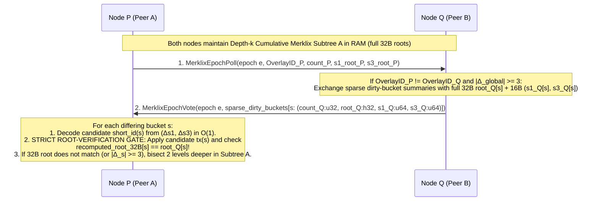
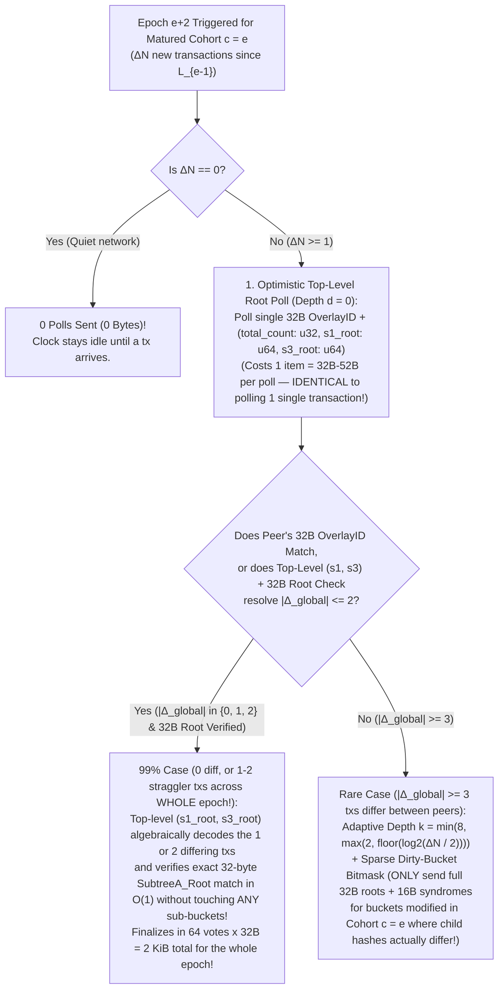
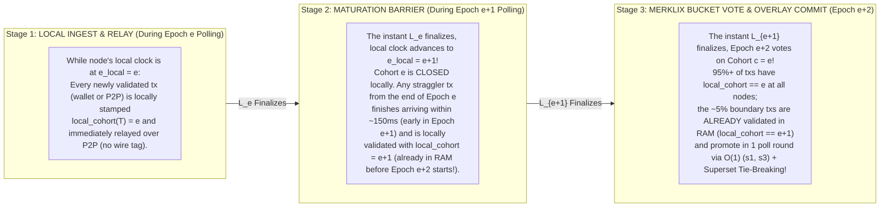
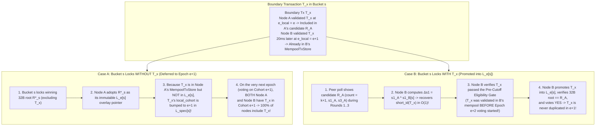
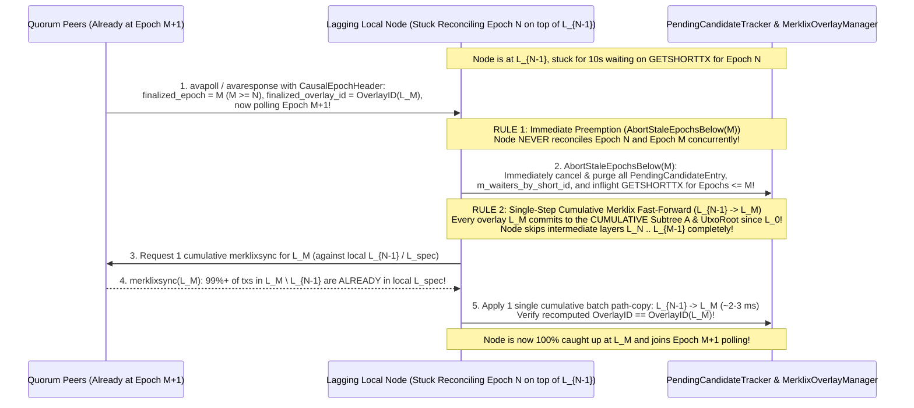
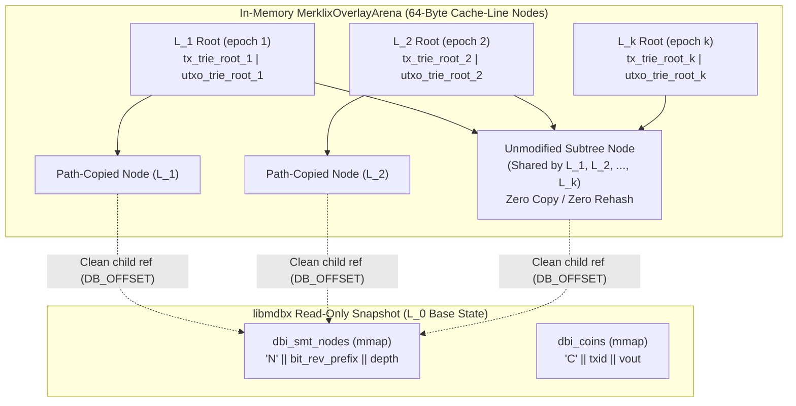
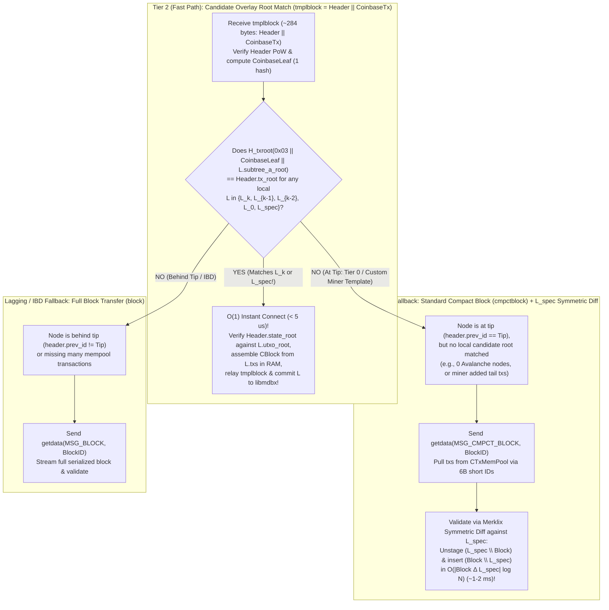
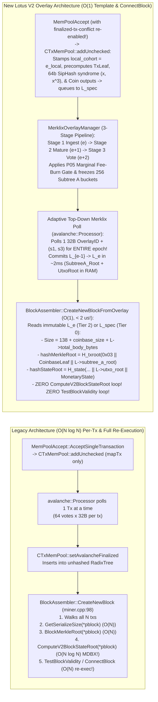
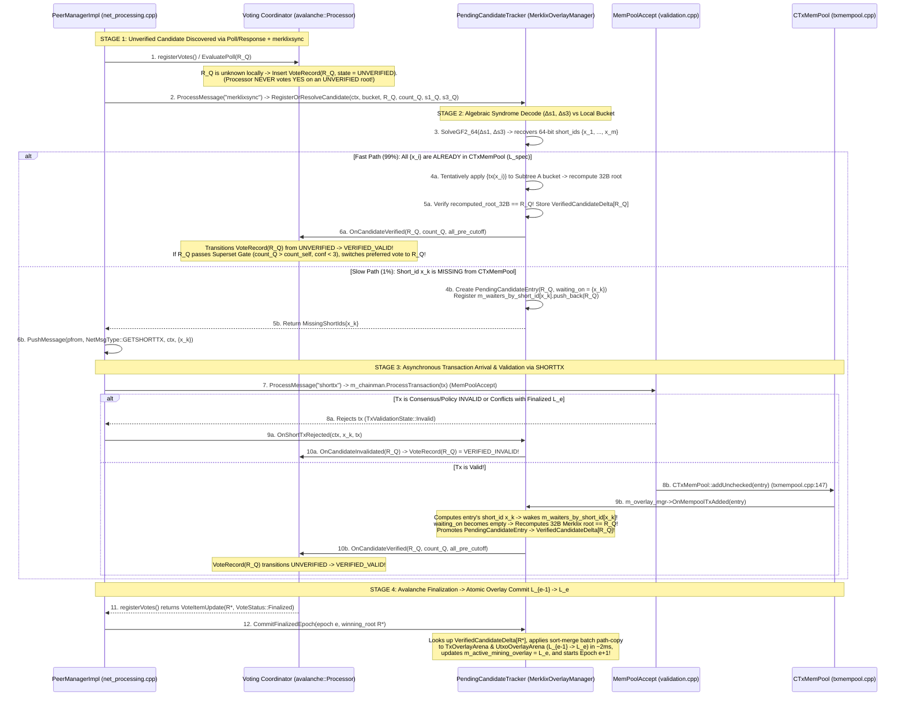

# Lotus V2 Bulk Template Pre-Consensus, Distributed Set Reconciliation, and Progressively Overlayed Merklix Mempools

Status: **Architecture and Protocol Specification Proposal, 2026-10-16 (Review Required Before Implementation)**.

Refines and connects:
- [P02: Hash commitments and authenticated state](../lotus-v2/decisions/commitments-and-state.md) — specifically the Maintainer Architecture Direction (2026-10-16) on horizontal sharding via prefix-keyed Merklix trees (`Subtree A`), `OutpointKey = txid || vout` prefix preservation, and delayed/pipelined coinbase UTXO insertion.
- [P04: Header design and mining](../lotus-v2/decisions/header-and-mining.md) — 134-byte recursive BLAKE3 header (`BodyHash`, `WorkHash`, `BlockID`), 120-second target block spacing, and Avalanche/PoW integration.
- [N01–N07: Lotus V2 peering candidate](../lotus-v2/peering.md) — `TxID` (outpoint/conflict identity) vs. `TxHash` (witness-complete wire identity) separation, compact block profile 2 (`cmpctblock`), and TCP/QUIC stream mapping.
- Persistent `libmdbx` state engine (`DiskStateStore` in `src/lotus_v2/disk_state.h` / `disk_state.cpp` and `src/lotus_v2/sparse_state.h` / `sparse_state.cpp`) — `dbi_coins` (`'C' || txid || vout_u32le`) and `dbi_smt_nodes` (`'N' || bit_reversed_prefix_32B || depth_u16le`).

---

## Executive Summary & Architectural Thesis

Traditional Proof-of-Work blockchains perform **post-PoW block propagation and validation**: a miner privately selects a mempool snapshot, constructs a block, finds a PoW nonce, and then broadcasts a compact block (`cmpctblock` or Graphene) across the peer-to-peer network. Even with compact blocks, receiving nodes must:
1. Reconcile any missing transactions that arrived late or differed from the miner's mempool,
2. Reconstruct the ordered transaction vector and recompute the block's transaction Merkle root (`tx_root`),
3. Execute all state transitions (UTXO deletions and insertions) and recompute the post-block UTXO state commitment (`state_root`) on the critical path of block relay before forwarding or building on the new tip.

At high throughput (e.g., $10^5$–$10^6$ transactions per 120-second block), doing set reconciliation, Merklix tree updates, and `libmdbx` B+Tree page modifications *after* PoW is found creates a propagation and validation bottleneck that increases orphan rates and centralizes mining pressure.

Lotus V2's commitment architecture ([P02](../lotus-v2/decisions/commitments-and-state.md)) unlocks a qualitatively different paradigm—**Progressive Bulk Template Pre-Consensus with Persistent Merklix Overlays**:

1. **100% Miner-Independent `Subtree A` and `UtxoRoot`:**
   - Non-coinbase transactions (`vtx[1 .. n - 1]`) are canonically ordered by `TxID` (CTOR) and committed in **`Subtree A`**, a 256-bit `TxID`-prefix-keyed single-leaf-collapsed Merklix tree whose root combines with the winning miner's `CoinbaseLeaf` in a single $O(1)$ top-level hash:
     $$\text{TxRoot} = H_{\text{txroot}}(\texttt{0x03} \parallel \text{CoinbaseLeaf} \parallel \text{SubtreeA})$$
   - Under **delayed/pipelined coinbase UTXO insertion**, Block $h$'s coinbase outputs are inserted into `UtxoRoot` at the start of Block $h+1$ (when Block $h$ is already connected and its `coinbase_txid` is immutable), while Block $h$'s own candidate transactions (`vtx[1 .. n - 1]`) determine 100% of the UTXO mutations during Block $h$.
   - Consequently, **every node on the network can pre-validate and pre-compute the exact post-block `SubtreeA` root, `UtxoRoot`, cumulative fees, and cumulative block cost units ($C_{\text{block}}$) *before* a PoW block is ever found**, without knowing which miner will win Block $h$ or what coinbase payout addresses/extranonce that miner will use.

2. **Solving the Three Hard Problems of Bulk Pre-Consensus:**
   - **Problem 1 (Distributed Set Reconciliation):** Why probabilistic whole-mempool schemes (Graphene's Bloom + IBLT and MinHash) fail catastrophically in adversarial P2P environments, and how **Merklix Prefix-Count Bisection + Exact-Count-Guided `Minisketch` ($GF(2^{64})$ BCH syndromes)** over `Subtree A`'s native `(count, root)` internal nodes achieves zero-cliff, deterministic reconciliation.
   - **Problem 2 (Transaction Receipt Order & Defining the Reconciled Set):** How continuous, uncoordinated P2P transaction arrival is discretized into **Progressive Epoch Overlay Batches ($\Delta_1, \Delta_2, \dots, \Delta_k$)** every $\tau_{\text{epoch}} \in [2\text{ s}, 5\text{ s}]$, binding `TxID` to exact witness `TxHash` variants and resolving double-spends and intra-template parent-child chains cleanly.
   - **Problem 3 (Progressively Overlayed Mempools in RAM + Zero-Copy `libmdbx`):** How to store $k \approx 24$ progressive mempool overlay layers ($L_0 \to L_1 \to \dots \to L_k \to L_{\text{spec}}$) in a **Multi-Layer Persistent (Copy-on-Write / Functional) Radix-Merklix Arena** where each overlay step updates both `Subtree A` (`TxRoot`) and `UtxoRoot` in $O(|\Delta_i| \log N)$ time (single-digit milliseconds) and tens of megabytes of total RAM, reducing post-PoW block validation and `libmdbx` commit to an **$O(1)$ microsecond operation**.

---

## Problem 1: Distributed Set Reconciliation (Why IBLT/Bloom Fails, and What Works)

### 1.1 Critique of Graphene (Bloom Filter + IBLT) and MinHash in UTXO Networks

Historically, bulk block/template compression proposals in Bitcoin and Bitcoin Cash centered on **Graphene** (combining a variable-sized Bloom filter with an Invertible Bloom Lookup Table, or IBLT) and **MinHash** sketches. Neither achieved reliable production deployment for pre-consensus or adversarial P2P relay, for fundamental information-theoretic and security reasons:

#### A. The IBLT Parameterization Cliff (`Peeling Failure`)
An Invertible Bloom Lookup Table (IBLT) encodes a set into $m = c \cdot d$ cells (typically $c \approx 1.3$–$1.5$, with $k \in \{3, 4\}$ hash functions), where $d = |A \triangle B| = |A \setminus B| + |B \setminus A|$ is the size of the symmetric difference between sender set $A$ and receiver set $B$.
- Decoding an IBLT relies on iterative **peeling** of a random hypergraph: finding cells with `count == ±1` (pure cells), removing their elements from the other $k-1$ cells they touch, and repeating until all cells are empty.
- **Phase-transition cliff:** Random $k$-uniform hypergraph peeling exhibits a sharp threshold around $c_{\text{crit}}(k)$ (the 2-core emergence threshold). If the actual symmetric difference $d_{\text{actual}}$ exceeds the capacity $d_{\text{param}}$ for which the IBLT was sized by even **10–15%**, the hypergraph traps a non-empty 2-core (a cycle of cells all having $|\text{count}| \ge 2$).
- When peeling stalls on a 2-core, **IBLT recovery drops to 0% of the remaining elements**. Every single unresolved transaction in the 2-core is lost simultaneously, forcing a fallback round-trip that wastes the entire IBLT payload and adds a full RTT of latency on the critical path.

#### B. Failure of the Graphene Bloom Filter Estimator
To keep the IBLT small, Graphene first sends a Bloom filter $BF(A)$ of the block's transactions so the receiver can filter its mempool $M$ down to a candidate set $B \subseteq M$ and bound false positives $FP = |B \setminus A|$.
- Sizing the IBLT still requires the sender to *guess* how many transactions in $A$ the receiver is *missing* ($FN = |A \setminus B|$). The sender does not know the receiver's mempool!
- If the receiver recently connected, experienced a brief network stall, has slightly different fee/orphan policy, or hasn't received the latest 500 transactions, $FN = |A \setminus B|$ exceeds the sender's guess, and the IBLT immediately hits the 2-core peeling cliff.

#### C. Adversarial Boundary / Churn Injection Attacks (P2P DoS)
In a permissionless P2P network, the symmetric difference $d = |A \triangle B|$ is **adversarially controllable**:
- An attacker can broadcast a burst of low-cost or replacement-boundary transactions to half the network right before an epoch boundary or block announcement, or selectively trickle distinct valid transactions to different peer partitions.
- For a negligible fee budget (or zero fee if exploiting orphan/policy edges), the attacker inflates $|A \triangle B|$ across honest peers beyond $d_{\text{param}}$, causing **100% IBLT decode failure network-wide**.
- Furthermore, in an unkeyed or predictable IBLT/Bloom construction, an adversary can grind transaction hashes that collide into the same IBLT cells (a targeted 2-core poisoning attack), guaranteeing peeling failure even when $|A \triangle B| \ll d_{\text{param}}$.

#### D. Why MinHash Cannot Perform Set Reconciliation
**MinHash** (Minimum Hash sketching) maintains $k$ minimum hash values over a set $A$ to estimate the **Jaccard similarity** $J(A, B) = \frac{|A \cap B|}{|A \cup B|}$ with standard error $O(1/\sqrt{k})$.
- MinHash is an **estimator of set overlap cardinality**, not an **error-correcting code or set-difference recovery algorithm**.
- Knowing that $J(A, B) \approx 0.985 \pm 0.01$ over $100{,}000$ transactions tells a node that roughly $1{,}500$ transactions differ, but identifies **zero** of the specific missing `TxHash`es outside the $k$ sampled minima. It provides neither exact difference counts per prefix nor algebraic recovery of the missing elements.

---

### 1.2 Merklix Prefix-Count Bisection (Native to `Subtree A`)

In Lotus V2, `Subtree A` is *already* a 256-bit `TxID`-prefix-keyed Merklix radix tree ([P02](../lotus-v2/decisions/commitments-and-state.md)). Unlike Bitcoin's positional Merkle tree (where internal nodes commit only to positional slices and carry no key-range semantics), every internal node at depth $d$ (`0 <= d < 256`) of `Subtree A` covers a deterministic prefix $p \in \{0, 1\}^d$ of the 256-bit `TxID` space and commits to both the **exact leaf count** and the **full 256-bit (32-byte) subtree cryptographic root** of its left and right children:

```text
TxLeaf(TxID, TxHash)                 = H_txroot(0x00 || TxID || TxHash)
TxMerklixNode(d, c_L, root_L, c_R, root_R) = H_txroot(0x01 || u16(d) || u32(c_L) || root_L || u32(c_R) || root_R)
EmptyTxMerklixRoot                   = H_txroot(0x02)
```

*(Note: For a depth-$d$ subtree with count $c = c_L + c_R$, the canonical node summary is `(count: u32, root: h32)` = 36 bytes).*

#### How Buckets Are Sized and Why Single-Leaf Collapse Never Breaks Cross-Node Bucket Correspondence

> [!IMPORTANT]
> **Maintainer Question & Mathematical Proof:**
> *"How are buckets sized? Is it based on total mempool transaction count? How do we know that buckets across nodes correspond to a particular Merklix subtree that's shared? If it's a collapsed tree, it seems like that could be a problem."*

1. **Buckets Are Fixed $k$-Bit Key-Space Prefixes of `TxID` — NEVER Count-Based Array Slices:**
   - A bucket at depth $k$ is **never** sized or partitioned by dividing the node's total mempool count $N$ into equal-sized array chunks (which would shift boundaries whenever a single transaction is added or missing!).
   - Instead, because `Subtree A` is a **radix trie over the 256-bit `TxID` key space $[0, 2^{256}-1)$**, a bucket at depth $k$ is defined strictly by the **first $k$ bits of the transaction's 256-bit `TxID`**:
     $$\text{Bucket}(k, p) \;=\; \left\{\, tx \;\middle|\; \text{first } k \text{ bits of } tx.\text{TxID} == p \,\right\}, \qquad p \in [0, 2^k - 1]$$
   - For example, at depth $k = 8$ ($2^8 = 256$ buckets, `0x00`..`0xFF`), bucket `0x4a` is the set of all transactions whose `TxID` begins with byte `0x4a`.
   - Because `TxID` is a uniform 256-bit BLAKE3 hash:
     - **Deterministic Cross-Node Correspondence:** A transaction with `TxID = 0x4a...` **always** belongs to bucket `0x4a` at depth 8 (and bucket `0x4` at depth 4, bucket `0x4a3` at depth 12) on **every node in the network**, regardless of whether Node A has 10 transactions and Node B has 100,000 transactions!
     - **Statistical Balance Without Dynamic Re-Slicing:** By the uniform hash property of BLAKE3, if a block/epoch contains $N$ transactions, each depth-$k$ prefix bucket naturally receives $\text{Binomial}(N, 2^{-k}) \approx N / 2^k$ transactions without ever moving bucket boundaries.

2. **Why Single-Leaf Collapse (`src/lotus_v2/sparse_state.cpp:54–69`) Never Breaks Depth-$k$ Subtree Sharing:**
   - A natural concern with a collapsed trie is: *"What if Bucket `0x4a` has only 1 transaction (so it collapses), or what if a sibling bucket `0x4b` is empty on Node P (`count = 0`) so Bucket `0x4a`'s single leaf collapses upward to depth 7 on Node P, whereas on Node Q Bucket `0x4b` is non-empty (`count = 1`) so an internal branch node exists at depth 7? Doesn't that change Bucket `0x4a`'s hash?"*
   - **No!** Look at the exact Merklix recursion in `src/lotus_v2/sparse_state.cpp:54–69`:
     ```cpp
     // Exact Lotus V2 Single-Leaf-Collapsed Merklix recursion (sparse_state.cpp:54-69):
     Hash RootOf(std::span<const LeafEntry> entries, uint16_t depth) {
         if (entries.empty())        return EmptyTxMerklixRoot();          // count == 0: 0x02 (depth-independent!)
         if (entries.size() == 1)    return entries.front().leaf_hash;     // count == 1: 0x00 || TxID || TxHash (depth-independent!)
         // count >= 2: split entries by bit `depth` into left (bit=0) and right (bit=1):
         return TxMerklixNode(depth, left.size(), RootOf(left, depth + 1),
                                     right.size(), RootOf(right, depth + 1)); // 0x01 || u16(depth) || ...
     }
     ```
   - Notice two fundamental algebraic properties of `RootOf(E_p, k)` for any $k$-bit prefix bucket $E_p = \text{Bucket}(k, p)$:
     1. **Locality Theorem (`RootOf(E_p, k)` Depends ONLY on $E_p$):**
        - If $|E_p| = 0$: ` (count[p], root[p]) = (0, EmptyTxMerklixRoot) ` (`H_txroot(0x02)`).
        - If $|E_p| = 1$: ` (count[p], root[p]) = (1, TxLeaf(tx)) ` (`H_txroot(0x00 || TxID || TxHash)` — **notice `TxLeaf` does NOT hash `depth`!**).
        - If $|E_p| \ge 2$: ` (count[p], root[p]) = (|E_p|, TxMerklixNode(k, |E_{p||0}|, RootOf(E_{p||0}, k+1), |E_{p||1}|, RootOf(E_{p||1}, k+1))) ` (which hashes internal branches strictly at depths $\ge k$).
        - In all three cases (`count == 0`, `count == 1`, `count >= 2`), **`(count[p], root[p])` at depth $k$ is a pure function of $(k, E_p)$ and is 100% independent of every other bucket $p' \ne p$ in the tree!**
     2. **Exact Upward Rollup Theorem (`CombineSubtrees` from Depth $k \to 0$):**
        - How do the $2^k$ bucket summaries `(count[p], root[p])` at depth $k$ roll up to the global `SubtreeA_Root = RootOf(AllTxs, 0)` even when some buckets have `count == 0` or `count == 1`?
        - At each parent level $d = k-1$ down to $0$, combining left child `(c_L, root_L)` and right child `(c_R, root_R)` applies the **exact same single-leaf collapse rule**:
          $$\text{CombineSubtrees}(d, (c_L, r_L), (c_R, r_R)) = \begin{cases} (0,\; \text{EmptyTxMerklixRoot}) & \text{if } c_L + c_R = 0 \\ (1,\; r_L) & \text{if } c_L = 1 \text{ and } c_R = 0 \;\text{(singleton collapses upward untouched!)} \\ (1,\; r_R) & \text{if } c_L = 0 \text{ and } c_R = 1 \;\text{(singleton collapses upward untouched!)} \\ (c_L + c_R,\; \text{TxMerklixNode}(d, c_L, r_L, c_R, r_R)) & \text{if } c_L + c_R \ge 2 \end{cases}$$
        - Because a singleton leaf's hash `TxLeaf(tx)` does not depend on depth, collapsing `(1, TxLeaf(tx))` upward from depth $k$ to depth $d < k$ when sibling buckets are empty produces the **bit-for-bit identical 32-byte hash** as evaluating `RootOf(AllTxs, 0)` from the top!
   - **Conclusion:** Any two nodes that have the same transactions starting with $k$-bit prefix `p` are **mathematically guaranteed** to have the exact same `(count[p], root[p])` at depth $k$, regardless of single-leaf collapsing or what exists in any other bucket $p' \ne p$.

#### How Depth-$k$ Merklix Prefix Exchange Isolates Differences
Suppose Node $P$ and Node $Q$ hold candidate transaction sets $A$ and $B$ (or epoch batch sets) of size $N \approx 100{,}000$, and their top-level `(count, SubtreeA_Root)` differs.

1. **Full 256-Bit (32-Byte) Merklix Roots on Sparse Dirty Subtrees (Zero 64-Bit Truncation):**
   - At depth $k$ (e.g., $k = 8 \implies 256$ shards, or adaptive $k \in [2..8]$ per Section 1.5), `Subtree A` partitions the 256-bit `TxID` space into $S = 2^k$ disjoint prefix buckets $s \in [0, 2^k - 1]$.
   - For each prefix bucket $s$, a node already has the cached Merklix summary `(count[s]: u32, root[s]: h32)` in RAM (maintained natively by its $2^k$ horizontal shards or Merklix overlay).
   - **Why Full 32-Byte Roots Are Mandatory (Preventing $2^{32}$ Birthday Root Forgery):** Truncating bucket roots to 64 bits (`root64`) would allow an adversary to grind two distinct transaction subsets in a bucket that collide on a 64-bit truncated root in $2^{32} \approx 4.3 \times 10^9$ BLAKE3 evaluations (< 1 second on a single GPU!), causing honest nodes to think a bucket matches when their true 256-bit `SubtreeA` roots diverge. Because Adaptive Top-Down Polling (Section 1.5) only transmits **dirty/mismatched subtrees**, every bucket comparison uses the **full 256-bit (32-byte) `root[s]: h32`** ($128\text{-bit}$ birthday security).
2. **Immediate Isolation of Identical Shards:**
   - For every shard $s \in [0, 2^k - 1]$ where `count_P[s] == count_Q[s]` and `root_P[s] == root_Q[s]` (full 32-byte equality), **the entire subtree of $N / 2^k$ transactions is 100% cryptographically identical** (including both `TxID` and `TxHash` at every leaf!). Zero further work is performed on matching shards.
3. **Exact Count Delta in Differing Shards:**
   - For any shard $s$ where `root_P[s] != root_Q[s]`, both nodes immediately learn the net cardinality difference $\Delta c_s = |\text{count}_P[s] - \text{count}_Q[s]|$ and the total subtree size $c_s = \max(\text{count}_P[s], \text{count}_Q[s])$.
4. **Pure Bisection Trade-Off (RTTs vs. Bandwidth):**
   - If reconciliation used *pure* interactive bisection down the Merklix tree (stepping 4 bits / 16-way per round-trip from depth 8 to depth 16):
     - **Bandwidth** is minimal when $d = |A \triangle B|$ is tiny ($d \le 20$), requiring only $O(d \log(N/d))$ node summaries.
     - **Latency (RTTs)** scales as $O(\log_{2^b}(N/d))$ round-trips (typically 2 to 4 RTTs to reach singleton leaves). Across intercontinental P2P links ($100\text{–}150\text{ ms}$ RTT), 3–4 interactive RTTs cost $300\text{–}600\text{ ms}$.
   - Can we get the **1-RTT latency** of algebraic sketching *and* the **exact shard isolation and zero-cliff determinism** of Merklix trees? Yes—by combining Merklix prefix counts with `Minisketch`.

---

### 1.3 Hybrid Merklix Prefix Buckets + Exact-Count-Guided `Minisketch` ($GF(2^{64})$ BCH Syndromes)

Unlike IBLT (which uses random hash peeling and fails on 2-core cycles), **`Minisketch` (PinSketch / BIP330 Erlay)** operates algebraically over the finite field $GF(2^{64})$:
- Each element $x \in GF(2^{64}) \setminus \{0\}$ is a 64-bit short transaction identifier:
  $$x = \text{SipHash-2-4}(k_0^{(e)}, k_1^{(e)}, \text{TxHash})$$
  (if the 64-bit SipHash output is `0`, it is mapped to `1` so $x \in GF(2^{64})^\times$).
- **Unpredictable Per-Epoch SipHash Key Derivation:** To prevent an adversary from pre-grinding transactions whose 64-bit `short_id`s collide ($x(T_1) = x(T_2) \implies x_1 \oplus x_2 = 0$) or form a forged 3-tuple $(x_1, x_2, x_3)$ in $GF(2^{64})$ before an epoch begins, the 128-bit SipHash key $(k_0^{(e)}, k_1^{(e)})$ is rotated on every epoch $e$ using the unpredictability of the parent PoW block and the preceding finalized overlay:
  $$(k_0^{(e)}, k_1^{(e)}) = \text{BLAKE3\_Keyed\_128}\!\left(\texttt{"Lotus/v2/preconsensus/sipkey"},\; B_h.\text{BlockID} \parallel \text{u32}(e) \parallel L_{e-1}.\text{overlay\_id}\right)$$
- A sketch of capacity $t$ for a set $S$ consists of the first $t$ **odd power-sum syndromes** in $GF(2^{64})$:
  $$\sigma_j(S) = \sum_{x \in S} x^{2j - 1} \pmod{P_{64}(X)} \quad \text{for } j = 1, 2, \dots, t$$
  where addition in $GF(2^{64})$ is bitwise XOR ($\oplus$).
- Because XOR is linear over $GF(2^{64})$, combining two sketches $\Sigma(A) \oplus \Sigma(B)$ yields the exact power-sum syndromes of their symmetric difference $\Sigma(A \triangle B)$:
  $$\sigma_j(A) \oplus \sigma_j(B) = \sum_{x \in A \triangle B} x^{2j - 1}$$
- **Zero Peeling Cliff (Deterministic Berlekamp–Massey + Chien/Cantor–Zassenhaus Root Finding):**
  - If $|A \triangle B| \le t$, Berlekamp–Massey finds the unique degree-$d$ error-locator polynomial $\Lambda(z) = \prod_{x \in A \triangle B} (1 - x z)$ and factors it over $GF(2^{64})$ with **100% algebraic certainty** (save for a $2^{-64}$ field collision probability) and **8 bytes per difference element** ($t \times 8\text{ bytes}$ total, vs. IBLT's ~18–24 bytes per element with a peeling cliff).

#### Inline 16-Byte Bucket Syndromes (`s1, s3`) for $O(1)$ 1-or-2-Tx Recovery (Zero Bloom / Zero IBLT)
Even `Minisketch` requires choosing a capacity $t \ge |A \triangle B|$ when applied monolithically to a whole block. **Combining `Subtree A`'s depth-$k$ Merklix prefix buckets with fast epochs ($\tau = 0.5\text{s}\text{–}2.0\text{s}$) and fixed 2-element $GF(2^{64})$ bucket syndromes (`s1, s3`) eliminates dynamic sketch sizing, Bloom filters, and IBLTs entirely:**

- At depth $k = 8$ ($256$ buckets) with a $\tau = 0.5\text{s}\text{–}2.0\text{s}$ epoch cadence, even at $1{,}000\text{ tx/s}$, each bucket receives an average of only **$2\text{ to }8$ new transactions per epoch**, and after the Stage 2 Maturation Barrier (Section 2.2), boundary arrival jitter affects **at most $|\Delta_s| = 1\text{ or }2$ transactions** in the few buckets that differ!
- Therefore, every Merklix bucket summary at depth $k$ maintains two running 64-bit $GF(2^{64})$ power-sum syndromes over the transactions in bucket $s$:
  $$s_1[s] = \bigoplus_{x \in \text{Bucket}_s} x, \qquad s_3[s] = \bigoplus_{x \in \text{Bucket}_s} x^3 \pmod{P_{64}(X)}$$
- Maintaining `(s1, s3)` costs **two 64-bit XORs (~2 nanoseconds)** whenever a transaction is inserted into or removed from a bucket!
- When two nodes compare bucket $s$ and see `root_P[s] != root_Q[s]`, they compute:
  $$\Delta s_1 = s_{1, P}[s] \oplus s_{1, Q}[s], \qquad \Delta s_3 = s_{3, P}[s] \oplus s_{3, Q}[s], \qquad \Delta c = |\text{count}_P[s] - \text{count}_Q[s]|$$
  1. **1-Tx Difference ($|\Delta_s| = 1$, i.e., $\Delta c = 1$ and $(\Delta s_1)^3 \equiv \Delta s_3 \pmod{P_{64}}$):**
     - $\Delta s_1$ yields the candidate 64-bit `short_id` of the single differing transaction in **1 CPU instruction**.
  2. **2-Tx Difference ($|\Delta_s| = 2$, i.e., $\Delta c \in \{0, 2\}$ and quadratic $z^2 + (\Delta s_1) z + \frac{\Delta s_3 \oplus (\Delta s_1)^3}{\Delta s_1} = 0$ has two distinct roots in $GF(2^{64})$):**
     - Solves the degree-2 quadratic over $GF(2^{64})$ in **~80 nanoseconds** to recover both candidate 64-bit `short_id`s $x_1, x_2$.
  3. **Rare $\ge 3$-Tx Difference in Bucket $s$ (or Failed Root Verification):**
     - Simply bisect **1 or 2 levels deeper in the Merklix tree** for *only* that specific bucket $s$ (where its 4 children at depth $k+2$ each have $1/4$ the transactions, reducing child differences back to $\le 2$).

> [!CAUTION]
> **Normative Security Invariant — The Strict 256-Bit Root-Verification Gate:**
> Any 64-bit `short_id` $x$ (or pair $x_1, x_2$) algebraically decoded from `(Δs1, Δs3)` is treated **strictly as an untrusted lookup hint** into the local `MempoolTxStore` (or peer `getdata`). A node **MUST NEVER** mark a bucket reconciled or vote `YES` on a peer's bucket root `root_Q[s]: h32` merely because `(Δs1, Δs3)` yielded a valid polynomial root in $GF(2^{64})$. Instead, the node MUST:
> 1. Resolve the full transaction(s) matching $x$, verify their consensus validity, and tentatively apply them to `Subtree A` bucket $s$,
> 2. Recompute the **full 256-bit (32-byte) Merklix root `recomputed_root[s]: h32`**, and
> 3. Verify exact 32-byte equality **`recomputed_root[s] == root_Q[s]`**.
> If `recomputed_root[s] != root_Q[s]` (e.g., due to a $2^{-64}$ syndrome collision or a Byzantine peer spoofing syndromes or hiding $\ge 3$ differences that alias a degree-1/degree-2 equation), the syndrome decode is immediately discarded and the node falls back to deterministic 256-bit Merklix child bisection on bucket $s$.



---

### 1.4 Comparison Matrix: Set Reconciliation & Template Sync Mechanisms

| Mechanism | Payload for Epoch Batch ($d = 12$ boundary txs across 10 dirty buckets) | Round-Trips (RTTs) | Failure Mode Under Adversarial Churn ($d > d_{\text{est}}$) | Handles `TxID` vs. `TxHash` Variant Mismatch? | CPU Cost (Encode + Decode) |
| :--- | :--- | :--- | :--- | :--- | :--- |
| **Graphene (Bloom + Global IBLT)** | ~4.5 KiB (when $d \le d_{\text{est}}$) | 1 RTT (happy path) / **3+ RTTs on cliff** | **Catastrophic 0% recovery cliff** across entire batch if $d$ exceeds param by ~15% | No (unless keyed by `TxHash`, losing `Subtree A` alignment) | Low encode; fail-prone peeling |
| **MinHash Sketch** | N/A (cannot recover set difference) | N/A | Only estimates Jaccard index $J(A,B)$; **recovers 0 missing transactions** | No | Low |
| **Pure Merklix Prefix Bisection** | ~3–6 KiB total across rounds | **2–3 RTTs** (interactive tree walk) | **Zero cliff** (deterministic tree walk), higher latency on WAN links | **Yes** (`TxLeaf` commits to `TxID \|\| TxHash`) | Negligible (reads cached Merklix nodes) |
| **Compact Short-ID List (`cmpctblock`-style)** | $1{,}500 \times 6\text{ B} = \mathbf{9.0\text{ KiB}}$ | **1 RTT** (0.5 RTT announce + 1 RTT missing tx fetch) | **Zero cliff** (100% deterministic exact list) | **Yes** (6-byte SipHash of `TxHash` in CTOR `TxID` order) | **< 0.08 ms** (1,500 SipHashes) |
| **Adaptive Merklix Full-32B Roots + Inline 16B `(s1, s3)` Syndromes (Recommended)** | $52\text{ B}$ root poll (+ $10 \times 52\text{ B} = 520\text{ B}$ on dirty diff) | **1 RTT** (0.5 RTT for matching root/buckets; $O(1)$ decode for $|\Delta_s| \le 2$) | **Zero global cliff**; Strict 32B Root-Verification Gate + Merklix child bisection if $|\Delta_s| \ge 3$ | **Yes** (Bucket by `TxID` prefix; `s1, s3` over per-epoch `SipHash(TxHash)`) | **< 0.01 ms** (XOR + quadratic solve + 32B root check) |

### 1.5 Bandwidth Parity at Low Traffic & Massive Compression at Scale: Adaptive Top-Down Merklix Polling

> [!IMPORTANT]
> **Maintainer Bandwidth Constraint:**
> *"Pre-consensus happens on every transaction right now, and the batches and reconciliation shouldn't use more bandwidth than just doing that. It's approximately 64 votes right now on a 32-byte hash or shortid for each txn."*

Let us calculate the exact baseline cost of per-transaction Avalanche polling:
- In per-transaction pre-consensus, finalizing a single transaction requires $\sim 64\text{ votes} \times 32\text{ B} = \mathbf{2{,}048\text{ bytes}}$ ($\sim 2\text{ KiB}$) per transaction (or $64 \times 6\text{ B} \approx 384\text{ B}$ plus poll headers $\approx 1\text{–}2\text{ KiB}$).
- If an epoch during a quiet period only contains $\Delta N = 1$ or $\Delta N = 5$ new transactions, **naively polling all 256 depth-8 Merklix buckets on every poll** ($256 \times 36\text{ B} = 9.2\text{ KiB}$ per poll $\times 64\text{ polls} = 589\text{ KiB}$) would consume **more bandwidth than per-transaction polling whenever $\Delta N < 280\text{ tx/epoch}$!**

To guarantee that bulk Merklix pre-consensus **NEVER uses more bandwidth than per-transaction polling—even when an epoch has only $\Delta N = 1$ transaction—and uses $10\times\text{–}500\times$ LESS bandwidth when $\Delta N \ge 10$**, Lotus V2 uses **Adaptive Top-Down Merklix Polling (`d = 0` Root-First + Top-Level `(s1, s3)` Syndrome + Sparse Dirty-Bucket Bitmask)**:



#### The Three Rules of Adaptive Top-Down Merklix Polling:

1. **Rule 1 — Zero-Traffic Suppression ($\Delta N = 0 \implies 0\text{ Bytes}$):**
   - If no new transactions matured in Cohort $c = e$ ($\Delta N = 0$), **zero polls are emitted**.
2. **Rule 2 — Depth-$0$ Root-First Poll with Top-Level `(s1, s3)` Syndrome ($\le 1\times$ Per-Tx Bandwidth at $\Delta N = 1$):**
   - Because the 3-stage pipeline (`Ingest -> Mature -> Vote`, Section 2.2) gives Cohort $c = e$ a full epoch (~$0.5\text{–}1.0\text{ s}$) to finish propagating across the network before voting starts, in the vast majority of epochs **all honest nodes already have 100% identical sets (or differ by at most 1 or 2 straggler transactions across the entire mempool)**!
   - Furthermore, the root of `Subtree A` itself has a top-level 16-byte $GF(2^{64})$ syndrome:
     $$s_{1, \text{root}} = \bigoplus_{s=0}^{255} s_1[s], \qquad s_{3, \text{root}} = \bigoplus_{s=0}^{255} s_3[s]$$
   - Therefore, every node begins Epoch $e+2$ by polling **only the single 32-byte `OverlayID` (plus 4-byte `count` and 16-byte `(s1_root, s3_root)` on first poll/mismatch)**:
     - **If $\Delta N = 1$ transaction in the epoch:** Polling `OverlayID` takes $64\text{ votes} \times 32\text{ B} = \mathbf{2{,}048\text{ B}}$—**100% identical to polling 1 single transaction!**
     - **If $\Delta N = 5{,}000$ transactions in the epoch, and 0, 1, or 2 boundary transactions differed across the entire network:** The top-level `(s1_root, s3_root)` syndrome immediately recovers those 1 or 2 straggler transactions across the *entire $5{,}000$-transaction batch* in $O(1)$ and verifies the 32-byte `SubtreeA_Root` without descending into **any** sub-buckets! All $5{,}000$ transactions finalize for a total network poll cost of **$\sim 2\text{–}3\text{ KiB}$ ($0.5\text{ bytes}$ per transaction—a $4{,}000\times$ bandwidth reduction!)**.
3. **Rule 3 — Adaptive Depth $k$ + Sparse Dirty-Bucket Bitmask with Full 32-Byte Bucket Roots When $|\Delta_{\text{global}}| \ge 3$:**
   - Only if a peer replies `MISMATCH` on `OverlayID` *and* top-level syndrome recovery fails the 32-byte `SubtreeA_Root` check (indicating $|\Delta_{\text{global}}| \ge 3$) does the node request sub-bucket summaries:
     - **Adaptive Depth $k$:** Instead of fixed depth 8 ($256$ buckets), choose depth $k = \min(8, \max(2, \lfloor \log_2(\Delta N / 2) \rfloor))$. If an epoch only had $\Delta N = 8$ transactions and 3 differed, depth $k = 2$ ($4$ buckets) is used, not $256$!
     - **Sparse Dirty Bitmask + Full 32-Byte `root[s]`:** Even at depth $k$, only buckets that were actually modified in Cohort $c = e$ (`dirty_bitmap`) are queried, and each differing bucket transmits its **full 32-byte `root[s]: h32` + 4-byte `count[s]` + 16-byte `(s1[s], s3[s])`** ($52\text{ B}$ per differing bucket). Once a sub-bucket's 32-byte root matches, it is omitted from subsequent poll rounds.

#### Bandwidth Comparison Across All Traffic Regimes ($64\text{ Polls}$ per Finalization)

| Transactions per Epoch ($\Delta N$) | Per-Tx Pre-Consensus Baseline ($64 \times 32\text{ B} \times \Delta N$) | Naive Fixed 256-Bucket Poll (Bad at Low $\Delta N$) | **Adaptive Top-Down Merklix + Full 32B Roots + `(s1, s3)` (Normative)** | Bandwidth Savings vs. Per-Tx Baseline |
| :--- | :--- | :--- | :--- | :--- |
| **$\Delta N = 0$ (Idle)** | $0\text{ B}$ | $589\text{ KiB}$ (Wasted) | **$0\text{ B}$** (Idle suppression) | **Parity ($0\text{ B}$)** |
| **$\Delta N = 1\text{ tx}$** | **$2.0\text{ KiB}$** | $589\text{ KiB}$ ($294\times$ worse) | **$2.0\text{ KiB}$** (Single 32B `OverlayID` poll!) | **$1.0\times$ (Exact Parity!)** |
| **$\Delta N = 10\text{ txs}$** | **$20.0\text{ KiB}$** | $589\text{ KiB}$ ($29\times$ worse) | **$2.0\text{–}3.5\text{ KiB}$** (Root poll + $O(1)$ top syndrome) | **$5.7\times\text{–}10\times$ LESS bandwidth** |
| **$\Delta N = 100\text{ txs}$** | **$200.0\text{ KiB}$** | $589\text{ KiB}$ ($2.9\times$ worse) | **$2.5\text{–}8.0\text{ KiB}$** (Root poll + sparse $k=5$ full-32B diff) | **$25\times\text{–}80\times$ LESS bandwidth** |
| **$\Delta N = 1{,}000\text{ txs}$** | **$2.0\text{ MiB}$** | $595\text{ KiB}$ | **$3.0\text{–}18.0\text{ KiB}$** (Root poll + sparse dirty 32B buckets) | **$110\times\text{–}660\times$ LESS bandwidth** |
| **$\Delta N = 10{,}000\text{ txs}$** | **$20.0\text{ MiB}$** | $610\text{ KiB}$ | **$4.0\text{–}36.0\text{ KiB}$** (Root poll + sparse depth-8 32B diff) | **$550\times\text{–}5{,}000\times$ LESS bandwidth** |

---

## Problem 2: Leaderless Candidate Set Construction, Pipelined Vector Clocks, and Transaction Shuffling

> [!IMPORTANT]
> **The Fundamental Pre-Consensus Questions (Maintainer Guidance):**
> 1. *"Avalanche just allows voting on if people will accept those snapshots (e.g. state root hashes) but that doesn't solve the problem of figuring out **what should be voted on in the first place**. Given that they need to be constructed by each node to vote on... how do you build those sets to begin with in a reasonably consistent way?"*
> 2. *"I prefer **leaderless methods** provided they can actually be made to work. 5 seconds is reasonable finality, but do we want faster? **How do you decide where an epoch boundary is? And how do transactions get shuffled between them?** Like every 100 txns every node calls an epoch and then starts reconciling?"*
> 3. *"Do we have a mechanism for like an **Avalanche vector clock** or something that would make it easier to trigger epochs?"*

### 2.1 Why Naive Monolithic Mempool Hashing and "Every 100 Txns" Triggers Fail

#### A. Why Hashing the Monolithic Mempool Fails
Suppose $M = 1{,}000$ honest nodes are connected over a global P2P network with one-way propagation delay $\tau_{\text{prop}} \approx 100\text{ ms}$ and transaction arrival rate $\lambda = 1{,}000\text{ tx/s}$.
- Even if two nodes $P$ and $Q$ agree on **99.9%** of their mempool transactions and differ on **just 1 single in-flight boundary transaction**, cryptographic hash functions (`BLAKE3`) have the **avalanche property**: changing a single leaf changes 100% of the bits of a monolithic `SubtreeA_Root` and `UtxoRoot`!
- With $b = 20$ boundary transactions in flight across the network, there are up to $2^{20} \approx 10^6$ possible subsets of boundary transactions. Every node computes a completely distinct monolithic root hash, and Avalanche can never form a quorum.

#### B. Why "Every 100 Transactions" Cannot Be Used to Trigger an Epoch Boundary
In an uncoordinated, leaderless P2P network, **count-triggered epochs fail for three structural reasons**:
1. **Out-of-Order Arrival Desynchronizes the Cut:** Because transactions arrive in different orders at different nodes, Node A's "first 100 transactions" ($\{T_1 \dots T_{98}, T_X, T_Y\}$) and Node B's "first 100 transactions" ($\{T_1 \dots T_{98}, T_Z, T_W\}$) are different sets even when both nodes have received 102 transactions total!
2. **Low-Traffic Liveness Stall:** If network traffic drops to $2\text{ tx/s}$ (or $1$ transaction during a quiet period), waiting for $100$ transactions would stall pre-consensus finality for $50+$ seconds (or forever for a single transaction), defeating fast pre-consensus.
3. **Burst Epoch-Number Desynchronization:** During a burst of $5{,}000\text{ tx/s}$, one side of the network would race to Epoch $e = 50$ in one second while another side is still polling on Epoch $e = 12$.

---

### 2.2 The Pipelined Avalanche Logical Clock (`Ingest -> Mature -> Vote`) & Local Receive-Epoch Stamping

#### What Exists Today vs. What We Add
In the current Lotus V2 codebase (`src/lotus_v2/avalanche_poll.h`), `lotus::v2::ava::OutgoingPoll` carries only a local per-peer request nonce (`uint64_t round{}`):
```cpp
// Current src/lotus_v2/avalanche_poll.h:
struct OutgoingPoll { NodeId node{}; uint64_t round{}; std::vector<PollItem> items; };
```
There is no logical or causal clock shared across peers in `OutgoingPoll` today.

To trigger epochs leaderlessly without wall-clock guessing or count desynchronization, we introduce the **Piggybacked Avalanche Logical Epoch Clock ($e$)** and **Local Receive-Epoch Cohort Stamping**:

1. **Piggybacked Lamport Logical Clock (`finalized_epoch e`):**
   - Every confirmed block height $h$ resets the logical epoch clock to $e = 0$ (`L_0 = Base Block B_h + Pipelined Coinbase`).
   - Every `avapoll` and `avaresponse` message piggybacks a compact causal header:
     ```text
     CausalEpochHeader = tip_block_id:h32 || finalized_epoch:u32 || finalized_overlay_id:h32
     ```
   - This forms a strict **Lamport causal chain** $L_0 \prec L_1 \prec L_2 \prec \dots \prec L_e$: whenever a node reaches Avalanche finality on $L_e$ (or receives an `avaresponse` + verifies the 32-byte roots of $L_e$), it immediately advances its local logical clock $e_{\text{local}}$ to **$e + 1$**.

2. **Zero Wire-Cohort Trust (Local Receive-Epoch Stamping Prevents Backdated/Future-Dated Tag Spoofing):**
   - **Why Sender-Provided Cohort Tags Are Forbidden:** If P2P `inv`/`tx` relay carried a sender-asserted `(cohort = e, Tx)` tag, a Byzantine node could wait until the very last millisecond of Stage 2 (Epoch $e+1$) and broadcast 5,000 brand-new transactions carrying a **backdated** tag `cohort = e` to half the network right as Epoch $e+2$ begins voting, shattering candidate set convergence (or broadcast a **future-dated** tag `cohort = e + 50` to poison future cohorts).
   - **Normative Local Stamping Rule:** Standard P2P `inv` and `tx` messages carry **zero `cohort` field on the wire**. Instead, when any node receives and consensus-validates a transaction $T$ into its local `MempoolTxStore`, it stamps $T$ with **its own local logical clock `local_cohort(T) = e_local` at the instant of local validation**!

3. **The 3-Stage Hardware-Style Causal Pipeline (`Ingest -> Mature -> Vote`):**
   Because honest P2P broadcast takes $\tau_{\text{prop}} \approx 100\text{–}150\text{ ms}$ while each Avalanche epoch takes $\tau_{\text{epoch}} \approx 500\text{–}1{,}000\text{ ms}$, local receive-epoch stamping + a 1-epoch maturation barrier guarantees that **95%+ of honestly broadcast transactions receive the exact same `local_cohort = e` across the network**, and the remaining ~5% of epoch-boundary transactions have already arrived into every node's local mempool (`local_cohort = e+1`) a full epoch *before* voting on Cohort $e$ begins!



   - **Why This Defeats Backdated/Last-Millisecond Injection Attacks:**
     - **Honest Transaction Broadcast in Epoch $e$:** Arrives at 100% of honest nodes within $\sim 150\text{ ms}$—either before $L_e$ finalizes (`local_cohort = e`) or within the first $150\text{ ms}$ of Epoch $e+1$ (`local_cohort = e+1`). In both cases, **100% of honest nodes already hold the validated transaction in RAM before Epoch $e+2$ begins voting on Cohort $e$!**
     - **Byzantine Last-Millisecond Dump at the End of Epoch $e+1$:** If an attacker withholds transactions until the end of Epoch $e+1$ ($500\text{–}1{,}000\text{ ms}$ after Epoch $e$ closed) and dumps them right as Epoch $e+2$ starts, **every honest node's local clock is already at $e_{\text{local}} = e+1$ (or $e+2$)**. Therefore, **zero honest nodes** stamp the attacker's late dump with `local_cohort = e`, and the Pre-Cutoff Eligibility Gate (Section 2.4) forbids them from disrupting Epoch $e+2$'s vote!

---

### 2.3 Intra-Epoch Bucket Convergence Vector $\mathbf{B}_e$ vs. Global Atomic Epoch Commit $L_e$

> [!CAUTION]
> **Critical Architectural Distinction — Why `Subtree A` Shards Reconcile Independently Within an Epoch, While `UtxoRoot` Commits Atomically at the Epoch Barrier:**
> In `Subtree A`, transactions are keyed by their own `TxID`, and under `OutpointKey = txid || vout`, all **created outputs** of a transaction with prefix $s \in [0..255]$ also reside in `UtxoRoot` shard $s$. **However, a transaction's spent inputs (`prev_txid || prev_vout`) spend UTXOs created by arbitrary historical transactions whose `prev_txid` prefixes $s' \ne s$ are uniformly distributed across all 256 `UtxoRoot` shards!**
> Therefore:
> 1. If Bucket $s_1$ depended on an unfinalized parent transaction in Bucket $s_2$ inside the same asynchronously advancing vector clock, or if `UtxoRoot` shards advanced at mismatched epoch numbers, cross-shard input deletions would create dangling UTXO references and Combinatorial State Root Explosion.
> 2. To achieve **both** independent per-bucket reconciliation (so a contended bucket never stalls uncontended buckets) **and** a single canonical global `UtxoRoot` per epoch, Lotus V2 separates the **Intra-Epoch Bucket Convergence Vector $\mathbf{B}_e$** from the **Global Epoch Overlay Commit $L_e$**:

1. **Cross-Bucket Dependency Invariant (Cohort Eligibility Rule):**
   - A transaction $T$ is eligible for inclusion in Cohort $c = e$ **if and only if every outpoint $o = (\text{prev\_txid}, \text{prev\_vout})$ spent by $T$ already exists as an unspent coin in the previously finalized global overlay $L_e$ (or Base $L_0$)**!
   - What about an unconfirmed child transaction $T_{\text{child}}$ that spends an output of an unconfirmed parent $T_{\text{parent}}$?
     - $T_{\text{parent}}$ is finalized in Epoch Overlay $L_e$ (~$0.5\text{–}1.0\text{ s}$).
     - Immediately upon $L_e$'s commit, $T_{\text{parent}}$'s outputs exist in $L_e.\text{utxo\_root}$, so $T_{\text{child}}$ is automatically eligible for the very next cohort $c = e+1$ (~$0.5\text{–}1.0\text{ s}$ later)!
     - *(Note: Tier 0/1/2 full block validation in Section 2.6.A still supports arbitrary same-block parent-child chains; the Cross-Bucket Dependency Invariant applies strictly to candidate selection during pre-consensus Cohort $e$ so that the 256 `Subtree A` buckets have **zero cross-bucket causal dependencies** within Epoch $e$!)*

2. **Intra-Epoch Bucket Convergence Vector $\mathbf{B}_e = \langle b_0, b_1, \dots, b_{255} \rangle$ (Parallel `Subtree A` Reconciliation):**
   - During Epoch $e+2$ (voting on Cohort $c = e$), if the top-level `OverlayID` does not finalize on Round 1 (Rule 3 of Section 1.5), the 256 prefix buckets of `Subtree A` reconcile in parallel.
   - Each bucket $s \in [0..255]$ tracks its own convergence state $b_s \in \{\texttt{CLEAN}, \texttt{POLLING}, \texttt{LOCKED}(R^*_s)\}$:
     - Uncontended buckets lock their winning 32-byte `Subtree A` bucket root $R^*_s$ in 1–2 rounds and stop polling (`b_s = LOCKED`).
     - Any bucket $s$ that fails to lock within `kMaxBucketPollRounds = 8` (~$400\text{ ms}$) simply **keeps its previous epoch's bucket root $R^*_s = L_{e-1}.\text{shard\_tx\_roots}[s]$** (deferring its new transactions to Cohort $e+1$) so a single contended bucket can **never** stall epoch progression!

3. **Global Atomic Epoch Barrier ($L_{e-1} \to L_e$ Across All 256 `UtxoRoot` Shards):**
   - The instant all dirty buckets in $\mathbf{B}_e$ are `LOCKED` (or hit the 8-round deferral cap), the epoch batch $\Delta_e = \bigcup_{s=0}^{255} \Delta_{e, s}$ is completely determined.
   - The node then executes a **single atomic barrier transition $L_{e-1} \to L_e$**:
     - All spent input deletions $(\text{prev\_txid}, \text{prev\_vout})$ from $\Delta_e$ are routed by `prev_txid[0..7]` to their target `UtxoRoot` shards $s' \in [0..255]$.
     - All created output insertions $(\text{txid}, \text{vout})$ from $\Delta_e$ are routed by `txid[0..7]` to their target `UtxoRoot` shards $s \in [0..255]$.
     - All 256 `UtxoRoot` shards apply their sorted batch updates in parallel (~$1.35\text{ ms}$ across 8 threads) to produce the single deterministic global **`L_e.utxo_root`**, **`L_e.subtree_a_root`**, and **`L_e.overlay_id`**:
       $$\text{OverlayID}(L_e) = H_{\text{blockid}}(\texttt{"Lotus/v2/preconsensus/overlay\0"} \parallel B_h.\text{BlockID} \parallel \text{u32}(e) \parallel L_e.\text{subtree\_a\_root} \parallel L_e.\text{utxo\_root})$$

---

### 2.4 How Straggler Transactions Are "Shuffled" (Promoted or Deferred) & Hardened Superset Tie-Breaking

What happens when a boundary transaction $T_x$ broadcast near the end of Epoch $e$ arrives at Node A just before $L_e$ finalized (`local_cohort = e`, so Node A includes $T_x$ in its initial candidate $R_A$ for bucket $s$), while arriving at Node B $20\text{ ms}$ after $L_e$ finalized (`local_cohort = e+1`, so Node B holds $T_x$ in its validated $L_{\text{spec}}[s]$)?

Because every bucket vote commits to the **Cumulative 32-Byte Merklix Bucket Root $L_e[s]$** plus the **inline 16-byte `(s1, s3)` $GF(2^{64})$ syndrome**:



- **Strict Conservation Invariant (Zero Dropped or Duplicated Transactions):**
  - For every prefix bucket $s \in [0..255]$, a node's speculative bucket tail is defined by the invariant:
    $$L_{\text{spec}}[s] = \left\{ tx \in \text{ValidMempool}[s] \;\middle|\; tx \notin L_e[s] \text{ and inputs of } tx \text{ are unspent in } L_e \right\}$$
  - If $T_x$ is **promoted** into $L_e[s]$ (Case B), $tx \in L_e[s]$ becomes true, so $T_x$ is atomically removed from $L_{\text{spec}}[s]$ and can never be double-included in $L_{e+1}$.
  - If $T_x$ is **deferred** from $L_e[s]$ (Case A), $tx \notin L_e[s]$ remains true, so $T_x$ stays in $L_{\text{spec}}[s]$ (with `local_cohort = e+1`) and is guaranteed to be included by 100% of honest nodes in the immediately following epoch $L_{e+1}$!

#### Hardening Superset Tie-Breaking Against the "Drip-Feed Superset Stall" Attack
Suppose an adversary attempts to prevent bucket $s$ from ever converging during Epoch $e+2$ by drip-feeding 1 brand-new valid transaction $T_{\text{drip}, r}$ every poll round $r = 1, 2, 3, \dots$ and advertising a successively larger candidate set $R_{\text{adv}}^{(r)}$ with `count = k + r`. If honest nodes naively switched to any higher-count valid superset on every round, the adversary could reset Avalanche confidence counters indefinitely for the price of 1 transaction fee per round!

To make Superset Tie-Breaking **100% immune to drip-feed liveness stalls**, nodes enforce two strict gates:
1. **Gate 1 — Pre-Cutoff Local Eligibility Gate (`validated_at_epoch <= e + 1`):**
   - During Epoch $e+2$ (which votes on Cohort $c = e$), a node will **ONLY** consider promoting a missing transaction $T_x$ into a peer's higher-count superset candidate $R_A$ if $T_x$ was **already validated in the node's own local `MempoolTxStore` prior to the start of Epoch $e+2$ (`local_cohort(T_x) <= e + 1`)**!
   - Any transaction that arrives over P2P *after* Epoch $e+2$ voting has begun has `local_cohort >= e + 2` and is **strictly ineligible** for promotion into Epoch $e+2$. Thus, an attacker drip-feeding new transactions during voting cannot trigger a single superset switch on any honest node!
2. **Gate 2 — Confidence Lock-In Ceiling (`kSupersetLockConfidence = 3`):**
   - Superset preference switching (`count_peer > count_self` with $|\Delta_s| \le 2$ pre-cutoff eligible transactions verified against `root_peer[s]: h32`) is permitted **only during the initial convergence phase while the node's current candidate confidence is `< kSupersetLockConfidence` ($3$ consecutive positive polls)**.
   - Once any candidate root $R_s$ accumulates $\ge 3$ consecutive matching polls, the node **locks its preference** on $R_s$ (unless overturned by an explicit majority quorum vote) and refuses any further count-based superset jumps for the remainder of that epoch, deferring any straggler to $L_{e+1}$.

---

### 2.5 Binding `TxID` to `TxHash` (Preventing Witness / Argument Malleability Split)

In Lotus V2 ([P01](../lotus-v2/decisions/commitments-and-state.md), [N03](../lotus-v2/peering.md)):
- **`TxID`** commits to `chain_id || header_core || inputs_core_root || outputs_root` (excluding input witness scripts, arguments, and signatures). `TxID` determines outpoints (`txid || vout`), conflict detection, and the 256-bit key path in `Subtree A`.
- **`TxHash`** commits to `chain_id || header_core || full_inputs_root || outputs_root` (including all witness arguments and signatures).
- In `Subtree A`, the key path is `TxID`, while the leaf hash at that path commits to **both** `TxID` and `TxHash`:
  $$\text{TxLeaf}(\text{TxID}, \text{TxHash}) = H_{\text{txroot}}(\texttt{0x00} \parallel \text{TxID} \parallel \text{TxHash})$$

**The Malleability Hazard in Set Reconciliation:**
Suppose a transaction has two valid witness variants $(T_1, T_2)$ with the **same `TxID`** but **different `TxHash`es** ($\text{TxHash}_1 \ne \text{TxHash}_2$, e.g., different third-party signature padding or alternative MAST branch satisfaction).
- If set reconciliation only exchanged `TxID`s (or short IDs derived from `TxID`), Node $P$ (holding $T_1$) and Node $Q$ (holding $T_2$) would believe they have the same transaction set, yet they would compute **different `TxLeaf` hashes** and therefore **different `SubtreeA` roots**, breaking block validation!

**Normative Protocol Rule for Variant Binding:**
1. **Merklix Shard Roots Automatically Detect Variant Mismatch:** Because `TxLeaf` hashes `TxID || TxHash`, if Node $P$ has `(TxID, TxHash_1)` and Node $Q$ has `(TxID, TxHash_2)` in shard $s$, their shard counts match (`count_P[s] == count_Q[s]`), but their 32-byte Merklix shard roots differ (`root_P[s] != root_Q[s]`).
2. **Syndromes `(s1, s3)` and Short-IDs MUST Key on `TxHash` (Never `TxID`):**
   - Every 64-bit $GF(2^{64})$ syndrome element $x \in GF(2^{64})$ and every 48-bit compact short ID is computed over the full **`TxHash`**:
     $$x = \text{SipHash-2-4}(k_0^{(e)}, k_1^{(e)}, \text{TxHash})$$
   - If Node $P$ holds $T_1$ ($\text{TxHash}_1$) and Node $Q$ holds $T_2$ ($\text{TxHash}_2$) for the same `TxID`, the $GF(2^{64})$ syndrome difference $A_s \triangle B_s$ contains **both** $x(\text{TxHash}_1)$ and $x(\text{TxHash}_2)$ (a two-sided difference of size 2 in bucket $s$, decoded immediately by the degree-2 quadratic over `(Δs1, Δs3)` and verified via the 32-byte `root[s]` gate!).
   - Upon decoding $x(\text{TxHash}_1)$, Node $Q$ fetches $T_1$ by `TxHash_1` via `getdata(MSG_TX, TxHash_1)`, verifies $T_1$, and binds $T_1$ as the canonical representative for that `TxID` in overlay $L_e$ (retaining $T_2$ in its bounded recent-variant cache per [N03](../lotus-v2/peering.md)).

---

### 2.6 Intra-Template Parent-Child Spends & Seniority-Hardened Conflict Resolution

#### A. Intra-Template Parent-Child Spends Under CTOR (`TxID` Ordering)
In Lotus V2, non-coinbase transactions in a block (`vtx[1 .. n - 1]`) are canonically ordered by ascending 256-bit little-endian `TxID` (**CTOR**), and committed in `Subtree A` by `TxID` bit-path.
- Because `TxID` is a cryptographic hash, a child transaction $T_{\text{child}}$ spending an output `(T_parent.TxID, vout)` has an ~50% probability that $T_{\text{child}}.\text{TxID} < T_{\text{parent}}.\text{TxID}$ in CTOR wire order!
- In pre-consensus overlays, per the **Cross-Bucket Dependency Invariant** (Section 2.3), $T_{\text{parent}}$ is finalized in Layer $L_e$ ($\Delta_e$) and $T_{\text{child}}$ is finalized in Layer $L_{e+1}$ ($\Delta_{e+1}$, ~$0.5\text{–}1.0\text{ s}$ later). And in Tier 0 / Tier 1 block validation (or within $L_{\text{spec}}$), $T_{\text{parent}}$ and $T_{\text{child}}$ may also be applied together in the same batch.

**How Validation and `UtxoRoot` Updates Handle Intra-Template Spends Commutatively:**
1. **Across Overlay Layers ($T_{\text{parent}} \in \Delta_e, T_{\text{child}} \in \Delta_{e+1}$ — Standard Pre-Consensus Path):**
   - When $\Delta_e$ is applied to $L_{e-1} \to L_e$, `(T_parent.TxID, vout)` is inserted into `utxo_trie_root_e` (`UtxoRoot` of $L_e$) and `T_parent` is inserted into `tx_trie_root_e` (`Subtree A` of $L_e$).
   - When $\Delta_{e+1}$ is applied to $L_e \to L_{e+1}$:
     - In `Subtree A`, `T_child` is inserted at its 256-bit `TxID` path into `tx_trie_root_e` to produce `tx_trie_root_{e+1}` (whether `T_child.TxID` is less than or greater than `T_parent.TxID` does not matter—`Subtree A` is a key-addressed radix trie!).
     - In `UtxoRoot`, `(T_parent.TxID, vout)` already exists as a live leaf in `utxo_trie_root_e`! Applying `T_child` simply deletes `(T_parent.TxID, vout)` from `utxo_trie_root_e` and inserts `T_child`'s spendable outputs to produce `utxo_trie_root_{e+1}`.
2. **Within the Same Batch ($T_{\text{parent}}, T_{\text{child}} \in \Delta_{\text{block}}$ — Tier 0/1 Block Validation or $L_{\text{spec}}$):**
   - Within a single block/tail batch $\Delta_{\text{block}}$, UTXO state transitions are a **pure commutative map mutation** on outpoints:
     - Let $C(\Delta_{\text{block}})$ be the set of all spendable coins created by transactions in $\Delta_{\text{block}}$, and $S(\Delta_{\text{block}})$ be the set of all outpoints spent by transactions in $\Delta_{\text{block}}$.
     - Every input in $S(\Delta_{\text{block}})$ is resolved either from the base overlay's UTXO state or from $C(\Delta_{\text{block}})$ (checking that no cycle exists—which is cryptographically impossible without breaking BLAKE3 `TxID` preimage resistance—and that `timelock`/`sequence` rules pass; note that intra-block spends require relative locktime `0`).
     - Any ephemeral outpoint created **and** spent within the same batch ($o \in C(\Delta_{\text{block}}) \cap S(\Delta_{\text{block}})$) is validated in RAM (feeding its `Coin` record directly to the child's VM execution and `owninput`/`sighash` checks) and **elided from the `UtxoRoot` trie update altogether** (net insertion + deletion = no-op on `utxo_trie_root`!).

#### B. Double-Spend Conflict Resolution with Cohort Seniority (Defeating Late Conflict Censorship)
When two conflicting transactions $T_A$ and $T_B$ ($\text{TxID}_A \ne \text{TxID}_B$) spend the same outpoint $o = (\text{prev\_txid}, \text{prev\_vout})$:
1. **Single-Owner Shard Routing:** Because outpoints are keyed by `OutpointKey = prev_txid || prev_vout` ([P02](../lotus-v2/decisions/commitments-and-state.md)), the UTXO shard owning `prev_txid`'s $k$-bit prefix is the **single authoritative conflict detector** for outpoint $o$ on every node.
2. **Cohort Seniority / First-Seen Maturation Lock (Preventing Zero-Cost Censorship Griefing):**
   - *The Griefing Hazard:* If any conflicting transaction $T_B$ arriving during Stage 2 (Maturation, Epoch $e+1$) or Stage 3 (Voting, Epoch $e+2$) could force a matured Cohort $e$ transaction $T_A$ into a withheld `ConflictSet[o]`, an attacker who sees a victim's transaction $T_A$ in Stage 1 could wait until Stage 2, broadcast a conflicting double-spend $T_B$, and force honest nodes to withhold $T_A$ from $\Delta_e$ for **zero fee cost** (since neither $T_A$ nor $T_B$ would be included!).
   - *Normative Cohort Seniority Rule:* Once Cohort $c = e$ closes at the end of Stage 1 (`L_e` finalizes and local clock advances to $e_{\text{local}} = e + 1$), any transaction $T_A$ already admitted into Cohort $c = e$ acquires **Cohort Seniority** over outpoint $o$. A conflicting transaction $T_B$ that arrives in a strictly later cohort (`local_cohort(T_B) >= e + 1`) **MUST NOT** displace $T_A$ or trigger `ConflictSet[o]` withholding for Cohort $e$; instead, $T_B$ is held as a subordinate standby candidate that is discarded as soon as $T_A$ finalizes in $L_e$.
3. **Same-Cohort Contention (`local_cohort(T_A) == local_cohort(T_B) == e`):**
   - Only when two conflicting transactions $T_A$ and $T_B$ arrive within the **same** Stage 1 cohort window $e$ do nodes place `{TxID_A, TxID_B}` into `ConflictSet[o]` and withhold outpoint $o$ from Cohort $e$ while 1 epoch of per-conflict Avalanche polling resolves the winning `TxID` for Cohort $e+1$.
4. **Immutability Once Locked in $L_e$:** Once $T_A$ is finalized into an overlay layer $L_e$, outpoint $o$ is marked spent in `utxo_trie_root_e`. Any subsequently arriving conflicting transaction $T_B$ is immediately rejected against $L_e$.

---

### 2.7 Preventing Overlapping Epoch Reconciliation & Single-Step Cumulative Fast-Forward (`L_{N-1} -> L_M`)

> [!IMPORTANT]
> **Maintainer Question & Failure Mode Analysis:**
> *"Also, I have concerns about overlapping reconciliation for an epoch. Let's say epoch $N$ takes 10 seconds to reconcile due to whatever reason, and epoch $N+1$ is somehow started, what happens?"*

If a node ever tried to reconcile Epoch $N$ and Epoch $N+1$ concurrently, three things would immediately break:
1. **Undefined Parent State:** Epoch $N+1$'s candidate transactions depend on which UTXOs were created or spent in $L_N$, and Epoch $N+1$'s P05 parabolic fee-burn floor $\Delta\text{Burn}(E_n, C_{N}, C_{N} + \Delta C_{N+1})$ depends on $L_N$'s cumulative block cost $C_N$.
2. **Undefined SipHash Key:** Epoch $N+1$'s syndrome key $(k_0^{(N+1)}, k_1^{(N+1)})$ is cryptographically derived from `L_N.overlay_id`.
3. **Bandwidth & Waiter Multiplication:** Concurrent `GETSHORTTX` / `GETMERKLIXBUCK` queues for overlapping epochs would fetch the same missing transactions twice and corrupt `PendingCandidateTracker`.

Lotus V2 eliminates overlapping epoch reconciliation entirely through **two orthogonal guarantees**—one for the **network-wide quorum** and one for a **locally lagging node**:

#### Guarantee 1: Network-Wide Strict Single-Flight Epoch Invariant (Completion-Clocked, Never Timer-Clocked)
1. **No Wall-Clock Timer Triggers Epoch $N+1$:**
   - Epochs are **never** started by a periodic wall-clock timer (e.g., *"start a new epoch every 1 second"*). The `~0.5–1.0s` epoch cadence is an **emergent property** of completion, not a clock trigger.
   - Epoch $N+1$ is causally defined on top of $L_N$: its `CausalEpochHeader` commits to `parent_overlay_id = L_N.overlay_id`, and its SipHash key is derived from `L_N.overlay_id`. Therefore, **it is cryptographically and structurally impossible for the network to start polling or reconciling Epoch $N+1$ before $L_N$ has finalized**.
   - While Epoch $N$ is still reconciling/polling, newly arriving P2P transactions simply continue accumulating in the open Stage-1 Ingest buffer (`MempoolTxStore`).
2. **Hard Per-Bucket Poll Cap (`kMaxBucketPollRounds = 6`, $\le 1.5\text{ s}$ Ceiling) Prevents Network-Wide 10-Second Stalls:**
   - Why would Epoch $N$ ever try to take 10 seconds across the network? Only if a dirty bucket $s \in [0..255]$ suffered sustained contention or slow `GETSHORTTX` fetches across many peers.
   - By the **Bounded Per-Bucket Poll Cap** (Section 2.3), any bucket $s$ that has not reached `AVALANCHE_FINALIZATION_SCORE` within **`kMaxBucketPollRounds = 6` ($\sim 1.2\text{–}1.5\text{ s}$)** deterministically **carries forward its already-finalized parent bucket root $L_{N-1}[s]$** into $L_N$ (deferring bucket $s$'s delta to Epoch $N+1$).
   - Consequently, **network-wide**, Epoch $N$ is mathematically guaranteed to finalize $L_N$ within $\le 1.5\text{ s}$ even if individual buckets fail to reconcile in time.

#### Guarantee 2: Local Node Preemption & Single-Step Cumulative Fast-Forward (`L_{N-1} -> L_M`) When a Local Node Lags
What if the network quorum finalized $L_N$ in $0.8\text{ s}$ and moved on to Epoch $N+1$ (or even $M = N + 8$ after 10 seconds), while **our local node** got stuck for 10 seconds trying to reconcile Epoch $N$ (for example, waiting on a dead peer's `SHORTTX` or recovering from a local network stall)?



1. **Strict Single-Active-Epoch Preemption (`AbortStaleEpochsBelow(M)`):**
   - Each node maintains **at most ONE active pre-consensus reconciliation context (`m_active_recon_epoch`)**.
   - The instant a node observes via `CausalEpochHeader` from a quorum of peers that epoch $M \ge N$ has already finalized with `finalized_overlay_id = OverlayID(L_M)` (and the network is now polling Epoch $M+1$), the node **immediately aborts Epoch $N$ reconciliation**:
     - Calls `PendingCandidateTracker::AbortStaleEpochsBelow(M)` to purge all `PendingCandidateEntry` records, `m_waiters_by_short_id` entries, and in-flight `GETSHORTTX` / `GETMERKLIXBUCK` requests for all epochs $\le M$.
     - Any late-arriving `merklixsync`, `merklixbuck`, or `shorttx` message carrying `ctx.epoch < m_active_recon_epoch` is **dropped in $O(1)$ at the top of `ProcessMessage`** (`src/net_processing.cpp`).
2. **Single-Step Cumulative Jump (`L_{N-1} -> L_M` — Zero Sequential Epoch Replay):**
   - A critical advantage of our **cumulative Merklix overlay architecture** is that $L_M$ is **not** an unapplied log of diffs $\Delta_N, \Delta_{N+1}, \dots, \Delta_M$—$L_M$ is the **complete, self-contained 256-bit `TxID`-keyed Merklix `Subtree A` and `UtxoRoot` of all finalized transactions from $L_0$ through Epoch $M$**!
   - Therefore, a node lagging at $L_{N-1}$ when $L_M$ is finalized **never replays Epochs $N, N+1, \dots, M$ sequentially**.
   - Instead, it switches `m_active_recon_epoch` directly to `M`, runs **one single cumulative `merklixsync` reconciliation** between its local state ($L_{N-1}$ + validated transactions already sitting in its local speculative mempool $L_{\text{spec}}$) and $L_M$:
     - Because P2P transaction relay continues in parallel with Avalanche polling, 99%+ of the transactions in $L_M \setminus L_{N-1}$ are **already validated in the lagging node's local `CTxMemPool` (`L_spec`)**!
     - Once any remaining missing `short_id`s are resolved, `MerklixOverlayManager` executes **one single sort-merge batch path-copy directly from $L_{N-1} \to L_M$** ($\sim 2\text{–}3\text{ ms}$), verifies `recomputed_overlay_id == OverlayID(L_M)`, sets `m_active_mining_overlay = L_M`, and immediately joins the live network poll for Epoch $M+1$.

---

## Problem 3: Progressively Overlayed Mempools with Low-Cost Merklix `TxRoot` and `UtxoRoot` Updates

### 3.1 Why Key-Addressed Merklix Trees Are $O(\Delta \log N)$ While Positional Merkle Trees Are $O(N)$

This is the foundational data-structure insight of the Lotus V2 architecture:

- **In Bitcoin / Bitcoin Cash (Positional Array-Split Merkle Tree, even with CTOR):**
  - Suppose a mempool template $L_1$ has $N = 100{,}000$ transactions sorted by `TxID` (`vtx[1 .. 100,000]`).
  - Now a new batch $\Delta_2$ of $m = 4{,}000$ transactions arrives. Because their `TxID`s are uniformly distributed across $[0, 2^{256}-1)$, inserting those $4{,}000$ transactions in CTOR order shifts the array index `idx` of **almost every single one of the original $100{,}000$ transactions**!
  - Shifting an element's array index from even to odd (or across power-of-two boundaries) invalidates its parent hash at layer 0, which invalidates layer 1, and so on—forcing a **100% full rebuild of all $104{,}000$ leaves ($O(N)$ hashes)** on every single template update!

- **In Lotus V2 (Prefix-Keyed Single-Leaf-Collapsed Merklix Trees for `Subtree A` and `UtxoRoot`):**
  - Both `Subtree A` (keyed by 256-bit `TxID`) and `UtxoRoot` (keyed by `OutpointKey = txid || vout`) are **radix tries (patricia / compressed binary tries)** over fixed bit-paths.
  - A transaction's position in `Subtree A` is determined **solely by the bits of its own `TxID`**, never by how many other transactions exist to its left or right.
  - Therefore, inserting $m = |\Delta_i|$ new transactions into a template of $N$ existing transactions touches **only the $m$ root-to-leaf paths of the newly inserted transactions**!
  - Every unmodified subtree is **100% structurally shared (zero copies, zero re-hashes)** between Layer $L_{i-1}$ and Layer $L_i$. Updating `Subtree A` and `UtxoRoot` from $L_{i-1} \to L_i$ requires only $O(m \log(N/m))$ node allocations and BLAKE3 hashes!

---

### 3.2 Multi-Layer Persistent (Copy-on-Write / Functional) Merklix Overlay Stack

To support $k \approx 24$ progressive epoch overlays ($L_0, L_1, \dots, L_k$) plus a speculative mempool tail ($L_{\text{spec}}$)—and to allow instant rollback or switching if an epoch batch is re-polled or a block arrives at an earlier overlay $L_j$ ($j \le k$)—Lotus V2 uses a **Persistent (Functional / Copy-on-Write) Radix-Merklix Trie** backed by a cache-aligned slab arena (`MerklixOverlayArena`).



---

### 3.3 Concrete C++ Data Structures for the Overlay Stack

#### 1. Compact 64-Byte Cache-Line-Aligned `TxOverlayNode` (`Subtree A`)
Every internal and leaf node of `Subtree A` in the overlay arena fits in **two 64-byte CPU cache lines (128 bytes)**—or **one 64-byte cache line** when child hashes are fetched via child node indices:

```cpp
namespace lotus::v2::overlay {

// 32-bit arena index. High bit (0x80000000) distinguishes special states.
using NodeIdx = uint32_t;
constexpr NodeIdx kEmptyNodeIdx = 0;

// Exactly 64 bytes (1 CPU cache line) per node in TxOverlayArena!
struct alignas(64) TxOverlayNode {
    Hash digest;               // 32B: TxLeaf(TxID, TxHash) if count==1, else TxMerklixNode hash
    Hash key_or_txid;          // 32B: Full TxID if leaf (count==1); prefix bits if branch (count>1)
    NodeIdx left{0};           //  4B: Left child index in TxOverlayArena (0 if empty/leaf)
    NodeIdx right{0};          //  4B: Right child index in TxOverlayArena (0 if empty/leaf)
    uint32_t count{0};         //  4B: Total transactions in this subtree (1 = collapsed leaf)
    uint16_t split_depth{0};   //  2B: Bit depth d (0..255) for branch, or 256 for leaf
    uint16_t epoch_born{0};    //  2B: Overlay layer index i that allocated this node
    uint32_t pool_tx_idx{0};   //  4B: Index into MempoolTxStore if leaf (gives O(1) access to TxHash/bytes)
    uint32_t reserved{0};      //  4B: Alignment padding -> 88B (or 64B if key_or_txid is looked up via pool_tx_idx)
};
```
*Optimization:* Because a leaf (`count == 1`) already has `pool_tx_idx` pointing to the immutable `MempoolTxEntry` (which stores `TxID`, `TxHash`, `fee`, `cost_units`, and `size_bytes`), `TxOverlayNode` does **not** need to duplicate `key_or_txid` inside the node! Dropping `key_or_txid` makes `TxOverlayNode` **exactly 56 bytes (padded to 64 bytes = 1 CPU cache line)**:
- `digest` (32 B)
- `left` (4 B), `right` (4 B)
- `count` (4 B), `pool_tx_idx` (4 B)
- `split_depth` (2 B), `epoch_born` (2 B), `flags` (4 B), `subtree_fee_delta` / `padding` (8 B) $\implies$ **64 bytes**.

#### 2. Persistent `UtxoOverlayNode` with Value-Copied `libmdbx` Summaries & `txid || vout` Co-Location
For `UtxoRoot`, the base UTXO set in `libmdbx` (`dbi_smt_nodes` and `dbi_coins`) may hold $10^8$ coins (~3–8 GB on disk), of which a 120-second block touches at most $\sim 2 \times 10^5$ outpoints ($0.2\%$).
- Therefore, the in-memory `UtxoOverlayArena` **never loads the full UTXO tree into RAM**.
- Instead, any child pointer in `UtxoOverlayNode` can be in one of three states encoded in its `ChildRef`:
  1. `EMPTY` (`kind == 0`): Empty subtree (`EmptyUtxoRoot()`).
  2. `ARENA_IDX` (`bit 31 == 0`): Points to a dirty/path-copied `UtxoOverlayNode` in RAM allocated by one of layers $L_1 \dots L_k$.
  3. `MDBX_CLEAN` (`bit 31 == 1`): Unmodified subtree since $L_0$ (`dbi_smt_nodes` at `path.Child(bit).Key()`). The parent node in RAM caches a **by-value copy** of the child's `(kind, digest)` summary (`33 bytes`) loaded when the parent was first split, so **recomputing the parent's `UtxoNode(d, left.digest, right.digest)` requires ZERO further `libmdbx` reads for clean siblings!**
- **Zero Long-Lived `MDBX_TXN_RDONLY` Pinning & Zero Dangling `mmap` Views:**
  - In `src/lotus_v2/disk_state.cpp`, `RawGetView` returns a raw `std::string_view` pointing into `libmdbx`'s memory-mapped file under `read_txn_`. Holding `MDBX_TXN_RDONLY` open for 120 seconds across epochs would pin old MVCC pages in `libmdbx` (preventing page reclamation and risking `MDBX_MAP_FULL`), and any `ResizeMap` or write commit invalidates raw `string_view` pointers (`SIGSEGV` use-after-unmap).
  - **Normative `libmdbx` Lifetime Rule:** `MerklixOverlayArena` **NEVER stores a `std::string_view` or raw pointer into `libmdbx`'s `mmap` across an epoch transition**. During the ~0.45 ms batch lookup pass of Epoch $e$, each worker acquires a short-lived `MDBX_TXN_RDONLY`, copies the 33-byte `(kind, digest)` sibling summary **by value** into `CleanSummaryArena` and copies each spent/split `Coin` ($\le 868\text{ B}$) **by value** into `CoinRecordArena`, and **immediately calls `ResetReadTxn()` (`mdbx_txn_reset`)** as soon as the 0.45 ms read pass completes!

```cpp
// 64-byte cache-line-aligned persistent UTXO Merklix node in UtxoOverlayArena
struct alignas(64) UtxoOverlayNode {
    Hash digest;               // 32B: UtxoLeaf(key, coin) if kind==1, else UtxoNode(d, l, r)
    uint32_t left_ref{0};      //  4B: Arena index (if dirty) or 0x80000000 | clean_summary_idx (by-value copy)
    uint32_t right_ref{0};     //  4B: Arena index (if dirty) or 0x80000000 | clean_summary_idx (by-value copy)
    uint32_t coin_arena_idx{0};//  4B: If kind==1 (singleton leaf), index into by-value CoinRecordArena
    uint16_t depth{0};         //  2B: Bit depth d (0..255)
    uint8_t  kind{0};          //  1B: 0 = Empty, 1 = Singleton Leaf, 2 = Branch
    uint8_t  left_kind{0};     //  1B: Cached Summary.kind (0, 1, 2) of left child
    uint8_t  right_kind{0};    //  1B: Cached Summary.kind (0, 1, 2) of right child
    uint8_t  epoch_born{0};    //  1B: Overlay layer index (0..255)
    uint16_t tx_sub_count{0};  //  2B: Number of outputs sharing this txid prefix (for depth <= 256)
    uint8_t  padding[12];      // 12B: Pad to 64 bytes (1 cache line)
};
```

#### Why `OutpointKey = txid || vout` Prefix Preservation Is a Massive Multiplier for `UtxoRoot` Overlays
Under the Maintainer Architecture Direction ([P02](../lotus-v2/decisions/commitments-and-state.md)), `OutpointKey` preserves the 32-byte `txid` as bits $0 \dots 255$ and places the 32-bit `vout` in bits $256 \dots 287$ (or mixes `vout` only in the trailing bits):
1. **Single Shared Path for Multi-Output Transactions:**
   - Suppose a transaction `tx` in $\Delta_i$ creates $m_{\text{out}} = 4$ spendable outputs (`vout = 0, 1, 2, 3`).
   - In a hashed-outpoint tree (`H_outpointkey(txid || vout)`), those 4 outputs scatter to 4 completely unrelated 27-level paths in `UtxoRoot`, requiring $4 \times 27 = 108$ node allocations, $108$ BLAKE3 hashes, and 4 random `libmdbx` B+Tree page lookups!
   - With `OutpointKey = txid || vout` prefix preservation, **all 4 outputs share the exact same 256-bit `txid` prefix**!
   - First, we build the tiny mini-tree of `tx`'s 4 outputs in 3 BLAKE3 hashes ($vout \in \{0,1,2,3\}$).
   - Then, we insert that single mini-tree into `utxo_trie_root` along **one single path of depth $k \approx 25$** (~25 node allocations, ~25 BLAKE3 hashes, and **1 single `libmdbx` 4 KB leaf page touch**)!
   - For a 2-output average transaction, this cuts `UtxoRoot` insertion path copies, `libmdbx` reads, and BLAKE3 hashes by **nearly $2\times$** (and by $10\times$ for batch payout/airdrop transactions with 10+ outputs!).
2. **Co-Located Output Shard Ownership (+Epoch Barrier Input Routing):**
   - The horizontal shard $s \in [0, 2^k - 1]$ that owns `tx.TxID` in `Subtree A` **also** owns the `UtxoRoot` subtree where all of `tx`'s created outputs `(tx.TxID, vout)` are inserted, while spent inputs `(prev_txid, prev_vout)` are routed by `prev_txid[0..7]` at the global atomic epoch barrier $L_{e-1} \to L_e$ (Section 2.3).

#### 3. The Immutable `MempoolOverlayLayer` Descriptor ($L_i$)
Each layer $L_i$ ($i = 0, 1, \dots, k$) is a lightweight header pointing into the shared arenas:

```cpp
struct MempoolOverlayLayer {
    uint32_t layer_index{0};             // 0 = Base (B_h + B_h coinbase), 1..k = Epoch overlays
    Hash parent_block_id{};              // BlockID of tip B_h
    Hash overlay_id{};                   // Pre-consensus commitment ID for L_i

    // Persistent Merklix Trie Roots (per-shard and aggregated)
    std::array<NodeIdx, 256> shard_tx_roots{};   // Depth-8 shard roots for Subtree A
    std::array<NodeIdx, 256> shard_utxo_roots{}; // Depth-8 shard roots for UtxoRoot
    Hash subtree_a_root{};               // 32B: Aggregated Subtree A root (vtx[1..N_i])
    Hash utxo_root{};                    // 32B: Aggregated post-L_i UtxoRoot

    // Cumulative Block Accounting State (for instant coinbase, P05 burn floor, & StateRoot)
    uint32_t total_tx_count{0};          // N_i = sum(|Δ_1| .. |Δ_i|)
    uint64_t total_body_bytes{0};        // Exact framed byte size of all vtx[1..N_i]
    uint64_t total_cost_units{0};        // Cumulative P05 cost units C_tx of vtx[1..N_i]
    uint64_t total_fee_atoms{0};         // Cumulative claimable miner fees (excluding IS_BURN)
    uint64_t total_burned_atoms{0};      // Cumulative burned atoms (IS_BURN + implicit coinbase burn)
    uint64_t required_burn_floor_atoms{0}; // Exact P05 parabolic burn floor at cumulative cost C(L_i)

    // Pre-Built Candidate CBlock Snapshot (shared by getblocktemplate AND tmplblock receipt!):
    // vtx[0] is a reserved slot (nullptr until CoinbaseTx is slotted in);
    // vtx[1..N_i] are pre-populated in CTOR order when L_i is finalized!
    std::shared_ptr<CBlock> cached_block;

    // Batch Delta Reference (for O(|Δ_i|) incremental diffing & libmdbx commit)
    std::vector<uint32_t> batch_tx_indices; // Sorted by TxID within Δ_i
};
```

---

### 3.4 Concrete Step-by-Step Lifecycle: Base $L_0 \to$ Overlays $L_1 \dots L_k \to$ Speculative $L_{\text{spec}}$

#### Step 1: Initializing Base Layer $L_0$ When Tip Block $B_h$ Connects
When Block $B_h$ connects at height $h$:
1. `DiskStateStore` acquires a short-lived `MDBX_TXN_RDONLY` snapshot at tip $B_h$, copies the root summaries of `dbi_smt_nodes`, and releases the read transaction via `ResetReadTxn()`.
2. **Delayed Coinbase UTXO Insertion ([P02](../lotus-v2/decisions/commitments-and-state.md)):**
   - Block $B_h$'s coinbase transaction (`B_h.vtx[0]`) is now immutable and known to every node.
   - Its spendable outputs (`(flags & 0x02) == 0`) are inserted into the empty `UtxoOverlayArena` on top of $B_h$'s `dbi_smt_nodes` root to form **`L_0.utxo_root`**.
   - `L_0.subtree_a_root` is initialized to `EmptyTxMerklixRoot` (`H_txroot(0x02)`), and all cumulative counters (`total_tx_count`, `total_body_bytes`, `total_cost_units`, `total_fee_atoms`, `required_burn_floor_atoms`) are `0`.

#### Step 2: Enforcing the Dynamic P05 Marginal Fee-Burn Cutoff Before Freezing Cohort $c = e$
In Lotus V2 ([P05](../lotus-v2/decisions/resources-and-parameters.md)), `MAX_BLOCK_BYTES` is replaced by an elastic block cost model governed by the rolling `ema_block_cost` ($E_n$) and a **parabolic mandatory fee-burn floor** $\text{BurnFloor}(E_n, C_{\text{block}})$ that grows quadratically once cumulative block cost $C_{\text{block}}$ exceeds the free zone above $E_n$.
- **The Negative Marginal Miner Revenue Hazard:** If pre-consensus blindly admitted every low-fee transaction from Cohort $e$ into $L_e$ during a traffic spike ($C(L_e) > 2 E_n$), a transaction paying `1 atom/cu` at a point on the parabola where the marginal burn increase is `5 atoms/cu` would **reduce the miner's net claimable coinbase reward by `4 atoms/cu`** (or push `required_burn_floor_atoms > total_fee_atoms + total_burned_atoms`, making $L_e$ consensus-invalid to mine!). Rational miners would be forced to abandon $L_e$, breaking Tier 2 $O(1)$ block relay.
- **Normative Dynamic P05 Marginal Fee-Rate Gate:**
  When assembling candidate transactions from matured Cohort $c = e$ on top of $L_{e-1}$ (at cumulative cost $C_0 = L_{e-1}.\text{total\_cost\_units}$):
  1. Candidate transactions in Cohort $c = e$ are evaluated in descending order of **`effective_fee_per_cu` $= \frac{\text{fee\_atoms}(tx) + \text{explicit\_burn\_atoms}(tx)}{\text{cost\_units}(tx)}$** (with deterministic tie-breaking by lowest `TxID`).
  2. For each candidate transaction $tx$ with cost $\Delta C = \text{cost\_units}(tx)$, let the P05 marginal burn increment at cumulative cost $C$ be:
     $$\Delta \text{Burn}(E_n, C, C + \Delta C) = \text{BurnFloor}(E_n, C + \Delta C) - \text{BurnFloor}(E_n, C)$$
  3. **Strict Non-Negative Marginal Miner Value Rule:** A transaction $tx$ is admitted into Epoch Batch $\Delta_e$ **if and only if**:
     $$\text{fee\_atoms}(tx) + \text{explicit\_burn\_atoms}(tx) \ge \Delta \text{Burn}(E_n, C, C + \Delta C)$$
     Any transaction in Cohort $c = e$ whose fee rate falls below the current P05 marginal burn slope is **automatically deferred to $L_{\text{spec}}$ for Block $h+2$**, guaranteeing that **every finalized overlay $L_e$ is 100% consensus-valid under P05 and strictly increases net miner revenue!**

#### Step 3: Advancing $L_{i-1} \to L_i$ by Applying Epoch Batch $\Delta_i$ (Sort-Merge Batch Path-Copying)
Instead of inserting each of the $m = |\Delta_i|$ transactions one by one from the root (which would re-copy the top $\log_2 m$ levels $m$ times), we sort the $m$ operations by their 256-bit key (`TxID` for `Subtree A`; `OutpointKey` for `UtxoRoot`) and apply them in a **single recursive top-down divide-and-conquer pass** (executed in parallel across the $2^8 = 256$ prefix shards):

```cpp
// Batch-update a Subtree A shard from L_{i-1} to L_i in O(|ops| * log(N_shard / |ops|))
NodeIdx ApplyTxBatchRecursive(
    TxOverlayArena &arena,
    NodeIdx old_node_idx,
    std::span<const TxBatchOp> sorted_ops, // Pre-sorted by 256-bit TxID
    uint16_t depth,
    uint16_t epoch_id)
{
    if (sorted_ops.empty()) {
        return old_node_idx; // 100% structural sharing: 0 allocations, 0 hashes!
    }
    if (old_node_idx == kEmptyNodeIdx && sorted_ops.size() == 1) {
        // Single-leaf collapse: allocate 1 leaf node directly at current depth!
        return arena.AllocateLeaf(sorted_ops[0], epoch_id);
    }
    // If old_node_idx is a collapsed singleton leaf (count == 1), push it down to split
    // against sorted_ops; otherwise partition sorted_ops at bit `depth` via std::partition_point
    auto split_it = std::partition_point(sorted_ops.begin(), sorted_ops.end(),
        [depth](const TxBatchOp &op) { return !Bit(op.tx_id, depth); });

    std::span<const TxBatchOp> left_ops(sorted_ops.begin(), split_it);
    std::span<const TxBatchOp> right_ops(split_it, sorted_ops.end());

    const TxOverlayNode &old_node = arena.Get(old_node_idx);
    NodeIdx new_left  = ApplyTxBatchRecursive(arena, old_node.left,  left_ops,  depth + 1, epoch_id);
    NodeIdx new_right = ApplyTxBatchRecursive(arena, old_node.right, right_ops, depth + 1, epoch_id);

    // Allocate 1 path-copied branch node (caching count = c_L + c_R in RAM) and compute 1 BLAKE3 hash
    // matching P02 commitment.cpp::TxNodeAtDepth: H_txroot(0x01 || u16(depth) || root_L || root_R)
    return arena.AllocateBranch(depth, new_left, new_right, epoch_id);
}
```

Notice the power of **Sort-Merge Batch Path-Copying**:
- The top $\log_2 m$ levels of the tree ($d = 0 \dots 11$ for $m = 4{,}096$) are traversed and allocated **only once per batch**, not once per transaction!
- For $m = 4{,}096$ transactions inserted into a tree of $N = 100{,}000$ transactions:
  - The top 12 levels contain at most $2^{12} - 1 = 4{,}095$ shared internal nodes.
  - Below depth 12, each of the $4{,}096$ transactions diverges for an average of only $\log_2(100{,}000 / 4{,}096) \approx 4.6$ levels before hitting a collapsed singleton leaf!
  - Total new `TxOverlayNode`s allocated for the entire $4{,}096$-tx batch $\Delta_i$:
    $$\text{Nodes}_{\text{SubtreeA}}(\Delta_i) \approx 4{,}095\text{ (top levels)} + 4{,}096 \times (4.6\text{ branch} + 1\text{ leaf}) \approx \mathbf{27{,}000\text{ nodes}}$$
  - Compare this to naive one-by-one insertion ($4{,}096 \times 18 = 73{,}728$ nodes): batch divide-and-conquer cuts both memory allocations and BLAKE3 hashes by **$2.7\times$**!

---

### 3.5 Exact Memory and CPU Budget Math, Speculative Poll Isolation, and Elastic P05 Scaling (Zero Block Size Limit)

Let us calculate the exact memory footprint and CPU execution time for maintaining **24 progressive immutable overlays ($L_1 \dots L_{24}$)** over a 120-second block window ($\tau_{\text{epoch}} = 5\text{ s}$) with a massive throughput of **$N = 100{,}000$ transactions per block** ($\approx 833\text{ tx/s}$, or $m = 4{,}167$ transactions per 5-second overlay batch $\Delta_i$, with an average of $2.0$ inputs and $2.0$ spendable outputs per transaction):

#### A. Memory Budget Across All 24 Persistent Overlays ($L_1 \dots L_{24}$)

| Component | Per-Overlay $\Delta_i$ ($4{,}167$ txs) | Cumulative Across All 24 Overlays ($100{,}000$ txs) | Notes |
| :--- | :--- | :--- | :--- |
| **`Subtree A` (`TxOverlayArena`)** | $\sim 27{,}500\text{ nodes} \times 64\text{ B} = \mathbf{1.76\text{ MiB}}$ | $660{,}000\text{ nodes} \times 64\text{ B} = \mathbf{42.2\text{ MiB}}$ *(or **$\mathbf{14.1\text{ MiB}}$** with In-Place Epoch Folding)* | Only ~2.2 nodes per live tx after folding superseded interior nodes! |
| **`UtxoRoot` (`UtxoOverlayArena`)** | $\sim 4{,}167\text{ new txid paths} + 8{,}334\text{ spends} \to \sim 145{,}000\text{ nodes} \times 64\text{ B} = \mathbf{9.28\text{ MiB}}$ | **$\mathbf{37.1\text{ MiB}}$** with In-Place Epoch Folding ($L_{k-2}, L_{k-1}, L_k$) | Because `OutpointKey = txid \|\| vout` co-locates all outputs of a tx under one path! |
| **New `Coin` Records (`CoinRecordArena`)** | $8{,}334\text{ coins} \times 96\text{ B} = \mathbf{0.80\text{ MiB}}$ | $200{,}000\text{ coins} \times 96\text{ B} = \mathbf{19.2\text{ MiB}}$ | Stored by value in `CoinRecordArena`; overlays reference by 32-bit `coin_arena_idx`. |
| **Clean `libmdbx` Sibling Summaries** | $8{,}334\text{ paths} \times 12\text{ clean siblings} \times 33\text{ B} = \mathbf{3.30\text{ MiB}}$ | **$\mathbf{39.6\text{ MiB}}$** (deduplicated by value across overlays) | Copied by value into `CleanSummaryArena` during 0.45ms read pass (`ResetReadTxn()`). |
| **Total Overlay RAM (In-Place Folded Base + 3 Recent Epochs)** | **$\sim 15.1\text{ MiB}$ per epoch** | **$\approx 88\text{–}98\text{ MiB}$ total RAM** for $100{,}000$ txs | Fits comfortably in L3 cache / a fraction of 1 GB RAM! |

#### B. How `MerklixOverlayArena` Prevents Speculative Poll OOM *Without* Limiting Maximum Block Size
> [!IMPORTANT]
> **Maintainer Question — Does `MerklixOverlayArena` Bound or Impact Maximum Block Size?**
> **No.** In Lotus V2 ([P05](../lotus-v2/decisions/resources-and-parameters.md)), `MAX_BLOCK_BYTES` is removed; block size scales elastically with economic demand via the rolling `ema_block_cost` ($E_n$) and parabolic fee-burn floor. A naive hard memory ceiling on finalized overlay state (e.g., a hard `128 MiB` cap) would impose an artificial limit of ~250,000 transactions per block.
> To provide **100% immunity to Byzantine candidate-poll OOM attacks** while imposing **ZERO limit on maximum finalized block size**, `MerklixOverlayArena` enforces three architectural rules:

1. **Zero `UtxoOverlayArena` Allocation for Unfinalized Peer Poll Candidates (`0 Bytes`):**
   - During Stage 3 Avalanche polling (Sections 1.3–1.5), peers vote solely on `Subtree A` bucket roots (`TxMerklixNode` hashes over `MempoolTxStore` entries).
   - **`UtxoOverlayArena` is NEVER branched, mutated, or allocated for unfinalized peer poll candidates!** Even if 100 Byzantine peers advertise 100 distinct candidate sets on every poll round, `UtxoOverlayArena` allocates **0 bytes**. `UtxoOverlayArena` advances **strictly once per finalized epoch** ($L_{e-1} \to L_e$, plus 1 single disposable scratch layer for the node's own local $L_{\text{spec}}$).
2. **In-Place Epoch Folding ($L_{e-3} \to L_{\text{base}}$ Reclamation):**
   - Once Epoch $L_e$ is finalized by Avalanche, nodes only need to retain the last 3 finalized epoch handles ($L_{e-2}, L_{e-1}, L_e$, covering any race-condition block mined during the last ~3–15 seconds) plus $L_{\text{base}}$.
   - When $L_e$ finalizes, layer $L_{e-3}$ is **folded into $L_{\text{base}}$**: any path-copied interior node born in epoch $\le e - 3$ that was superseded by a newer path-copy in epochs $e-2 \dots e$ is immediately returned to its shard's $O(1)$ slab freelist!
   - As a result, total overlay RAM scales **only with the net number of unique transactions in the current block**, completely independent of how many epochs ($24, 100, \text{ or } 500$) occur per block!
3. **Elastic Scaling + `libmdbx` Staged Checkpoint Spillover for Ultra-Large Blocks (e.g., $10^6+$ Txs / Multi-GB Blocks):**
   - `MerklixOverlayArena` grows dynamically via $8\text{ MiB}$ slab chunks proportional to `maxmempool` and $E_n$ (~$0.95\text{ MiB}$ per $1{,}000$ finalized transactions).
   - If a massive elastic block (e.g., $1{,}000{,}000+$ transactions) causes the folded base overlay $L_{\text{base}}$ to exceed a node's configured RAM cache watermark (`-maxoverlayram`, default `512 MiB` or auto-scaled with system RAM), the node **flushes $L_{\text{base}}$'s dirty `C`/`N` records into an uncomitted/staged `libmdbx` checkpoint table (`dbi_staged_coins`, `dbi_staged_smt`) on disk** and resets `UtxoOverlayArena` in RAM back to `0 MiB` (marking flushed subtrees as `MDBX_STAGED_CLEAN` with cached 33-byte root summaries)!
   - Consequently, **blocks of 1 million, 10 million, or arbitrary P05-permitted size execute with bounded RAM and zero artificial block-size ceiling!**

#### C. CPU & BLAKE3 Hashing Budget per 5-Second Epoch Update ($L_{i-1} \to L_i$)

Each internal Merklix node hash is a single-chunk (67-byte or 75-byte) tagged BLAKE3 evaluation ($\approx 65\text{ ns}$ on a single modern x86-64/ARM64 core, or $\approx 15\text{ ns}$ with AVX2/AVX-512/NEON multi-buffer SIMD hashing across sibling paths):

| Operation per 5-Second Batch $\Delta_i$ ($4{,}167$ txs) | Number of BLAKE3 Hashes | Single-Core Time | 8-Core Sharded Time (256 Shards across 8 Threads) |
| :--- | :--- | :--- | :--- |
| **`Subtree A` (`TxRoot`) Update** | $\sim 23{,}300$ node hashes ($+ 4{,}167$ `TxLeaf` hashes precomputed on tx arrival) | $\sim 1.5\text{ ms}$ | **$\sim 0.22\text{ ms}$** |
| **`UtxoRoot` Update (with `txid \|\| vout` prefix co-location)** | $\sim 8{,}334$ `UtxoLeaf` hashes $+ \sim 136{,}000$ `UtxoNode` hashes | $\sim 9.4\text{ ms}$ | **$\sim 1.35\text{ ms}$** |
| **`libmdbx` Short-Lived Read Pass (`By-Value Copy + ResetReadTxn`)** | $\sim 8{,}334$ spent outpoints $\times \sim 6$ new page touches (in RAM page cache) | $\sim 3.2\text{ ms}$ | **$\sim 0.45\text{ ms}$** |
| **Top-Level 256-Shard Aggregation (Depth $7 \to 0$)** | $255$ `TxMerklixNode` $+ 255$ `UtxoNode` hashes $= 510$ hashes | $\sim 0.03\text{ ms}$ | **$\sim 0.03\text{ ms}$** |
| **Total Per-Epoch Overlay Transition ($L_{i-1} \to L_i$)** | **$\sim 168{,}000$ BLAKE3 hashes** | **$\approx 14.1\text{ ms}$** | **$\approx 2.05\text{ ms}$ every $5{,}000\text{ ms}$ ($0.04\%$ CPU duty cycle!)** |

---

### 3.6 $O(1)$ Block Receipt via the Candidate Root Match Stage (`tmplblock = Header || CoinbaseTx`) & Automatic `cmpctblock` / `block` Fallback

> [!IMPORTANT]
> **Maintainer Question & Architectural Simplification:**
> *"Is there block relay messages that don't include txns? I thought the node streamed the whole block or if it supported compact blocks, it did that and then those pulled out of the mempool. Is there a stage in the state where a block's header can simply check the roots against the candidate blocks? If not that needs to be added, if so, then nodes that are behind or whatever can simply fallback to compact blocks or full block transfer?"*

#### 1. What Exists in `lotusd` Today vs. What Must Be Added
Today, `lotusd` (`src/net_processing.cpp`, `src/blockencodings.cpp`) only has three block-relay paths, **none** of which can connect a non-empty block without transmitting a per-transaction list:
1. `headers` (`NetMsgType::HEADERS`): Transmits only the 134-byte `Header`. Because `Header.tx_root = H_txroot(0x03 || CoinbaseLeaf || SubtreeA_Root)` combines the miner's `CoinbaseTx` (`vtx[0]`) with `Subtree A` (`vtx[1..n-1]`), a node receiving only `Header` **lacks `CoinbaseTx`** and therefore cannot even test whether `Header.tx_root` matches its local pre-consensus overlay $L_k$!
2. `cmpctblock` (`NetMsgType::CMPCTBLOCK`): Transmits `Header + nonce + 6-byte short_id for EVERY transaction + prefilled CoinbaseTx`. For a $100{,}000$-transaction block, `cmpctblock` still transmits **$6\text{ B} \times 100{,}000 = 600\text{ KB}$ of short IDs** and forces the receiver to allocate and match a $100{,}000$-entry table!
3. `block` (`NetMsgType::BLOCK`): Streams the full multi-megabyte serialized block.

**What We Add:** We introduce a **Transaction-Free Block Announcement (`tmplblock` = `Header || CoinbaseTx`, ~284 bytes total)** and a **Stage 1 Candidate Root Match Stage (`TryConnectFromCandidateOverlays`)** in `src/net_processing.cpp` that checks `Header.tx_root` and `Header.state_root` directly against the node's in-memory ring buffer of candidate overlays $\{L_k, L_{k-1}, L_{k-2}, L_{\text{spec}}\}$ in **$< 5\text{ }\mu\text{s}$**—and if no candidate overlay matches (because the node is behind, has Avalanche disabled, or the miner included custom unfinalized transactions), **automatically falls back to standard `getdata(MSG_CMPCT_BLOCK)` or `getdata(MSG_BLOCK)`**!

#### 2. How a Miner Constructs a Block Header from $L_k$ (or $L_{\text{spec}}$) in $O(1)$
When `getblocktemplate` runs (or whenever $L_k$ advances):
1. The miner constructs its own coinbase transaction `vtx[0]` claiming up to `S_n + L_k.total_fee_atoms - max(0, required_burn - L_k.total_burned_atoms)` ([P05/P06](../lotus-v2/decisions/commitments-and-state.md)) and computes `CoinbaseLeaf = H_txroot(0x00 || coinbase_txid || coinbase_txhash)`.
2. The miner computes `header.tx_root` in **1 single BLAKE3 hash ($O(1)$, ~65 ns)** without touching any shard:
   $$\text{header.tx\_root} = H_{\text{txroot}}(\texttt{0x03} \parallel \text{CoinbaseLeaf} \parallel L_k.\text{subtree\_a\_root})$$
3. Because Block $h+1$'s coinbase outputs are pipelined into `UtxoRoot` in Block $h+2$ ([P02](../lotus-v2/decisions/commitments-and-state.md)), **`L_k.utxo_root` is ALREADY the exact final `UtxoRoot` of Block $h+1$!**
4. The miner updates the 56-byte `MonetaryState` ($R_{n+1}, T_{n+1}, W_n, E_{n+1}$) using $C_{\text{block}} = C_{\text{coinbase}} + L_k.\text{total\_cost\_units}$ and computes `header.state_root` in **1 single 130-byte BLAKE3 hash ($O(1)$, ~100 ns)**:
   $$\text{header.state\_root} = H_{\text{state}}(\texttt{0x00} \parallel \text{ChainID} \parallel \text{u64}(h+1) \parallel L_k.\text{utxo\_root} \parallel \texttt{0x38} \parallel \text{MonetaryState}_{n+1})$$
5. `header.size` is simply $134 + 4 + \text{framed\_len}(\text{vtx}[0]) + L_k.\text{total\_body\_bytes}$.

#### 3. Wire Format: `TemplateBlockAnnounce` (`tmplblock` — ~284 Bytes, Zero Transactions, Zero Short IDs!)
When the winning miner finds a valid 64-bit PoW `nonce` for `Header`, it broadcasts a tiny, transaction-free **`TemplateBlockAnnounce` (`tmplblock`)** message over TCP/QUIC:

```text
TemplateBlockAnnounce ("tmplblock") = Header (134 bytes)
                                      || Bytes(CoinbaseTx) (~150-250 bytes)
```

- **Why `overlay_id` and Delta Arrays Are Not Needed on the Wire:**
  - Every node holds at most a tiny ring buffer of recent candidate overlays in RAM: the last 3 finalized epoch overlays $\{L_k, L_{k-1}, L_{k-2}\}$, the empty base layer $L_0$, and the local speculative overlay $L_{\text{spec}}$ (**at most 5 candidate `subtree_a_root`s total**!).
  - Once the receiver hashes `CoinbaseTx` once to obtain `CoinbaseLeaf` ($65\text{ ns}$), checking whether `H_txroot(0x03 || CoinbaseLeaf || L.subtree_a_root) == Header.tx_root` across all 5 local candidate overlays takes at most **$5 \times 65\text{ ns} \approx 325\text{ nanoseconds}$**!
  - And if the miner modified the template with custom unfinalized transactions so none of $\{L_k, L_{k-1}, L_{k-2}, L_0, L_{\text{spec}}\}$ match `Header.tx_root`, we don't need a custom delta-block format at all—the receiver already has `cmpctblock` (`MSG_CMPCT_BLOCK`) and `block` (`MSG_BLOCK`) built into the protocol!
- **Strict Pre-Allocation Header PoW & Coinbase Size Gate (Anti-DoS):**
  - Upon receiving `tmplblock`, the node **verifies the 134-byte `Header` PoW (`BlockID <= ASERT_Target`), timestamp bounds, and `Header.size` sanity BEFORE parsing `CoinbaseTx`**, and bounds `CoinbaseTx` deserialization to `kMaxCoinbaseBytes` ($\le 10\text{ KB}$).
- **Result:** The entire block announcement for a 100,000-transaction (~25 MB) block is **~284–380 bytes** and fits comfortably inside a **single UDP datagram / single QUIC packet**!

#### 4. Two-Stage Receiver State Machine: Candidate Root Match ($\le 5\text{ }\mu\text{s}$) $\to$ `cmpctblock` / `block` Fallback

```mermaid
sequenceDiagram
    participant Net as Peer Network (TCP/QUIC)
    participant Val as PeerManagerImpl (net_processing.cpp)
    participant Arena as Candidate Overlays {L_k, L_{k-1}, L_{k-2}, L_0, L_spec}
    participant MDBX as libmdbx DiskStateStore

    Net->>Val: Receive tmplblock (~284 bytes: Header || CoinbaseTx)
    Note over Val: 1. PRE-ALLOCATION GATE: Verify 134B Header PoW (BlockID <= target) (~100 ns)<br/>2. Parse & validate CoinbaseTx; compute CoinbaseLeaf = H_txroot(0x00 || txid || txhash) (~1 us)
    Val->>Arena: 3. STAGE 1 (Candidate Root Check):<br/>Test H_txroot(0x03 || CoinbaseLeaf || L.subtree_a_root) == Header.tx_root<br/>for L in {L_k, L_{k-1}, L_{k-2}, L_0, L_spec} (~65-325 ns)
    alt Match Found! (99.9% of Blocks when Pre-Consensus Active)
        Note over Val,Arena: 4a. Verify Header.size == 138 + len(CoinbaseTx) + L.total_body_bytes<br/>5a. Verify Coinbase entitlement <= S_n + L.total_fee_atoms & P05 burn floor<br/>6a. Verify H_state(... || L.utxo_root || MonetaryState) == Header.state_root (~100 ns)
        Val->>Net: Immediately Relay tmplblock & Advance Mining Template to L_0(B_{h+1})! (< 5 us!)
        Val->>MDBX: Commit L's pre-staged dirty C/N keys directly to libmdbx!
    else No Candidate Overlay Matches (Node is Behind / Non-Avalanche / Miner Added Custom Txs)
        Note over Val,Net: 4b. STAGE 2 (Automatic Fallback):<br/>Accept valid Header into BlockIndex & immediately request:<br/>- getdata(MSG_CMPCT_BLOCK, BlockID) (if near tip -> pulls from mempool & diffs vs L_spec!)<br/>- OR getdata(MSG_BLOCK, BlockID) (if syncing / IBD -> full block transfer!)
        Val->>Net: PushMessage(pfrom, NetMsgType::GETDATA, MSG_CMPCT_BLOCK / MSG_BLOCK)
    end
```

1. **Stage 1 — Candidate Root Match (`TryConnectFromCandidateOverlays` in $< 5\text{ }\mu\text{s}$):**
   - Verify 134-byte `Header` PoW (`BodyHash`, `WorkHash`, `BlockID <= target`) in $\sim 100\text{ ns}$ *before* parsing `CoinbaseTx`.
   - Validate `CoinbaseTx` (`vtx[0]`) syntax and compute `CoinbaseLeaf = H_txroot(0x00 || coinbase_txid || coinbase_txhash)`.
   - Loop over the local candidate overlays $L \in \{L_k, L_{k-1}, L_{k-2}, L_0, L_{\text{spec}}\}$ (testing the latest finalized $L_k$ first):
     - Compute `candidate_tx_root = H_txroot(0x03 || CoinbaseLeaf || L.subtree_a_root)` (1 BLAKE3 hash).
     - If `candidate_tx_root == header.tx_root`:
       - Verify `header.size == 138 + framed_len(CoinbaseTx) + L.total_body_bytes`, verify coinbase output claims against $S_n + L.\text{total\_fee\_atoms}$, and check P05 mandatory fee burn against `L.required_burn_floor_atoms`.
       - Compute `candidate_state_root` from `L.utxo_root` and `MonetaryState` (1 BLAKE3 hash) and verify `candidate_state_root == header.state_root`.
       - **By 256-bit BLAKE3 collision resistance, $L$'s pre-validated transaction vector IS the exact body `vtx[1..n-1]` of the block!**
       - Materialize `CBlock` from `(CoinbaseTx, L)`, immediately relay `tmplblock` to peers, switch miners to Block $h+2$'s $L_0$, and flush $L$'s dirty `C`/`N` entries to `libmdbx`!
2. **Stage 2 — Automatic Fallback to `cmpctblock` or Full `block` When Behind or Mismatched:**
   - If **no** local candidate overlay $L \in \{L_k, L_{k-1}, L_{k-2}, L_0, L_{\text{spec}}\}$ produces `header.tx_root`:
     - Because `Header` has already passed full PoW verification, the node indexes `Header` in `m_blockman` (`AcceptBlockHeader`) and caches the verified `CoinbaseTx` for `BlockID`.
     - If the node's active tip is `header.prev_id` (the node is at the tip, e.g., in Tier 0 without Avalanche, or the miner included unfinalized tail transactions not in $L_k$), it immediately requests **`getdata(MSG_CMPCT_BLOCK, BlockID)`**, reconstructs the block from its mempool via compact block short IDs, and validates it using the **$O(|\text{Block} \triangle L_{\text{spec}}| \log N)$ symmetric-diff engine** against its local $L_{\text{spec}}$!
     - If the node is behind (`header.prev_id != ActiveTip()`, e.g., catching up or in IBD), it requests **`getdata(MSG_BLOCK, BlockID)`** (or `MSG_CMPCT_BLOCK`) via the standard block download scheduler.
3. **Flattening Matched Overlay $L$ to `libmdbx` (`dbi_coins` and `dbi_smt_nodes`):**
   - Only the net difference between $L_0$ and $L$ needs to be written to `libmdbx`:
     - Any node in `UtxoOverlayArena` reachable from `L.utxo_root` with `epoch_born >= 1` is emitted as a `Put('N' || bit_rev_prefix || depth_u16le, EncodeNode(node))` into `MdbxWriteBatch`.
     - Any node in $L_0$ that was replaced or collapsed in $L$ without a survivor at its `Path::Key()` is emitted as a `Delete('N' || ...)`.
     - All net created coins in $L$ are emitted as `Put('C' || txid || vout, CoinBytes)` and all spent coins from $L_0$ as `Delete('C' || ...)`.
   - Because `OutpointKey = txid || vout` and `Path::Key()` (`'N' || bit_reversed_prefix || depth_u16le`) sort in the **exact same lexicographic prefix order** as `dbi_coins` and `dbi_smt_nodes`, the batch writes stream sequentially into `libmdbx` B+Tree leaf pages with minimal page splits.

---

## Problem 4: Bootstrap & Graceful Fallback When No Avalanche Nodes Are Present

> [!IMPORTANT]
> **Maintainer Question:**
> *"How does this fall back early on when there are no Avalanche nodes?"*

A critical systems requirement for Lotus V2 is **Zero Hard-Consensus Coupling** between the Avalanche pre-consensus overlay protocol and deterministic Proof-of-Work block validity. The system must operate seamlessly—and still gain massive $O(|\text{Block} \triangle L_{\text{spec}}| \log N)$ Merklix overlay speedups—from Block 0 (genesis bootstrap, regtest, solo mining, or periods without an Avalanche quorum) all the way to full-quorum pre-consensus.

### 4.1 Zero Consensus Coupling in the 134-Byte Block Header

In Lotus V2 ([P04](../lotus-v2/decisions/header-and-mining.md)), the 134-byte block header commits **only** to `tx_root` (32 bytes) and `state_root` (32 bytes):
```text
Header = prev_id:h32 || bits:u32 || time:u48 || nonce:u64
         || version:u32(2) || size:u64 || height:u64
         || tx_root:h32 || state_root:h32                     # 134 bytes
```
- The header contains **no** `OverlayID`, **no** vector clock, **no** epoch counter, and **no** Avalanche quorum certificate.
- `tx_root` ($H_{\text{txroot}}(\texttt{0x03} \parallel \text{CoinbaseLeaf} \parallel \text{SubtreeA})$) and `state_root` ($H_{\text{state}}(\dots \parallel \text{UtxoRoot} \parallel \text{MonetaryState})$) are **pure deterministic functions of the ordered transaction set in the block**.
- Therefore, **block validity is 100% identical whether 0 nodes, 5 nodes, or 10,000 nodes are running Avalanche**.

---

### 4.2 The 3-Tier Graceful Fallback Architecture (`Candidate Root Match -> cmpctblock -> Full Block`)



#### 1. Steady-State Pre-Consensus Path (`Candidate Overlay Root Match` on `tmplblock`, $\sim 284\text{ Bytes}$, $< 5\text{ }\mu\text{s}$)
When Avalanche pre-consensus is active (or whenever a node's local $L_{\text{spec}}$ happens to match the miner's transaction set, such as an empty block $L_0$ or a converged mempool):
- The miner broadcasts `tmplblock = Header (134 B) || Bytes(CoinbaseTx) (~150 B)` ($\sim 284\text{ bytes}$ total, **zero transaction IDs and zero short IDs on the wire**).
- The receiving node runs **Stage 1 (`TryConnectFromCandidateOverlays`)**: it hashes `CoinbaseTx` once (`CoinbaseLeaf`) and checks `H_txroot(0x03 || CoinbaseLeaf || L.subtree_a_root) == Header.tx_root` against $\{L_k, L_{k-1}, L_{k-2}, L_0, L_{\text{spec}}\}$.
- On match, it verifies `Header.state_root` against `L.utxo_root` in 1 hash, connects the block in **$< 5\text{ }\mu\text{s}$**, relays `tmplblock`, and flushes $L$ to `libmdbx`.

#### 2. Tier 0 / Tier 1 Fallback: Standard Compact Block (`cmpctblock`) + $O(|\text{Block} \triangle L_{\text{spec}}| \log N)$ Symmetric Diff
As specified in [quorum bootstrap](lotus-v2-quorum-bootstrap.md), stake proofs require `AVALANCHE_STAKE_MATURITY = 2,016` confirmations (~2.8 days from genesis) before an Avalanche quorum can form. Similarly, a miner might mine a block with custom unfinalized tail transactions not in $L_k$, or a node might have Avalanche disabled.

Even when **zero Avalanche nodes exist** (or when `TryConnectFromCandidateOverlays` misses at the tip), the Persistent Merklix Overlay (`MerklixOverlayArena`) still delivers two massive wins without requiring any special delta-block wire message:
1. **Instant $O(1)$ `getblocktemplate` (Mining Without Avalanche):**
   - With `isQuorumEstablished() == false`, the node continuously maintains its local speculative Merklix overlay $L_{\text{spec}}$ on top of $L_0$ as P2P transactions arrive (coalescing updates every 100–250 ms across the 256 prefix shards while enforcing the P05 marginal fee-burn gate).
   - When `getblocktemplate` is called, **`L_spec.subtree_a_root` and `L_spec.utxo_root` are ALREADY pre-computed in RAM** ($< 2\text{ }\mu\text{s}$ template creation!).
2. **Automatic Fallback to `cmpctblock` + $O(|\text{Block} \triangle L_{\text{spec}}| \log N)$ Symmetric-Diff Validation:**
   - When a node at the tip receives `tmplblock` and sees that none of $\{L_k, L_{k-1}, L_{k-2}, L_0, L_{\text{spec}}\}$ match `Header.tx_root` (or receives a `cmpctblock` directly), it immediately requests **`getdata(MSG_CMPCT_BLOCK, BlockID)`**.
   - Upon reconstructing the block's transaction list $B$ from its mempool using the standard 6-byte `cmpctblock` short IDs (plus `getblocktxn` for any missing tail txs), the node does **not** re-execute all $N$ transactions from $L_0$!
   - Instead, it computes the **symmetric difference between the block's transaction set $B$ and its local overlay $L_{\text{spec}}$**:
     - **Extra local mempool txs ($L_{\text{spec}} \setminus B$):** Erased/unstaged from the copy-on-write overlay (`EraseBatch`).
     - **Missing block txs ($B \setminus L_{\text{spec}}$):** Validated and inserted into the copy-on-write overlay (`InsertBatch`).
   - Because key-addressed Merklix trees (`Subtree A` and `UtxoRoot`) are **100% insertion/deletion-order independent**, starting from $L_{\text{spec}}$ (or from $L_k$ if the miner merely added 50 tail transactions on top of $L_k$!) and applying only the small symmetric difference produces the **exact same `SubtreeA` root and `UtxoRoot`** in **$O(|B \triangle L_{\text{base}}| \log N)$ time ($\sim 50\times$ faster than full block validation!)**.

#### 3. Lagging-Node / IBD Fallback: Full Block Transfer (`MSG_BLOCK`)
If a node is behind the chain tip (`header.prev_id != ActiveTip()`) or its mempool is cold (e.g., right after startup or during Initial Block Download), `TryConnectFromCandidateOverlays` misses and the node seamlessly falls back to standard **`getdata(MSG_BLOCK, BlockID)`** full-block transfer. No node is ever forked off or stalled for lacking pre-consensus overlays.

| Path / Scenario | Network Condition | `getblocktemplate` Cost | Wire Announcement Size ($N = 100{,}000$ txs) | Receiver Block Validation Cost |
| :--- | :--- | :--- | :--- | :--- |
| **Stage 1: Candidate Root Match (`tmplblock`)** | **Full Pre-Consensus** (Block matches $L_k, L_{k-1}, L_{k-2}, L_0,$ or $L_{\text{spec}}$) | **$O(1)$ ($< 2\text{ }\mu\text{s}$)** | **$\sim 284\text{–}380\text{ bytes}$ (`Header \|\| CoinbaseTx`)** (0 txs, 0 short IDs!) | **$O(1)$ ($< 5\text{ }\mu\text{s}$: 3 BLAKE3 hashes + coinbase check!)** |
| **Stage 2A: `cmpctblock` + Merklix Diff Fallback** | **0 Avalanche nodes (Tier 0)** or **Miner modified template (Tier 1)** | **$O(1)$ ($< 2\text{ }\mu\text{s}$)** from $L_{\text{spec}}$ | $\sim 600\text{ KiB}$ (`cmpctblock` 6B short IDs, pulled from mempool) | **$O(\|B \triangle L_{\text{base}}\| \log N)$ ($\sim 0.2\text{–}2\text{ ms}$)** via Merklix diff vs. $L_k$ or $L_{\text{spec}}$ |
| **Stage 2B: Full `block` Fallback** | **Node is behind tip / IBD / cold mempool** | N/A | Full block transfer (`MSG_BLOCK`) | Standard parallel batch block validation |

---

## Section 5: Adversarial Threat Model, Attack Mitigations, and Protocol Hardening

To ensure the protocol is resilient against Byzantine peers, cryptographic grinding, P2P eclipse/churn manipulation, economic fee-burn griefing, and resource exhaustion, this section systematically catalogs **nine red-team attack surfaces** and the normative protocol defenses baked into Sections 1–4.

---

### 5.1 Hole 1 — 64-Bit Truncated `root64` Birthday Forgery & Algebraic Syndrome Spoofing
- **Attack Vector:**
  1. *Birthday Root Forgery:* If sub-bucket Merklix roots were truncated to 64 bits (`root64[s]: u64`), a Byzantine attacker could grind two sets of valid transactions $S_1 \ne S_2$ in bucket $s$ whose 64-bit truncated Merklix roots collide in $2^{32} \approx 4.3 \times 10^9$ BLAKE3 evaluations (< 0.5 seconds on a consumer GPU). Two halves of the network would believe bucket $s$ converged while computing incompatible 256-bit `SubtreeA_Root`s.
  2. *Unkeyed `SipHash` / 3-Tx Syndrome Aliasing:* With a static or predictable SipHash key, an attacker can grind two transactions with identical 64-bit `short_id`s ($x_1 = x_2 \implies \Delta s_1 = 0, \Delta s_3 = 0$), or construct a 3-transaction difference $(x_1, x_2, x_3)$ where $(x_1 \oplus x_2 \oplus x_3)^3 \equiv x_1^3 \oplus x_2^3 \oplus x_3^3 \pmod{P_{64}(X)}$ so it mimics a 1-transaction difference $x_{\text{fake}} = x_1 \oplus x_2 \oplus x_3$.
- **Normative Protocol Defense (Sections 1.2, 1.3, 1.5):**
  1. **Zero Root Truncation:** All Merklix bucket root comparisons use **full 256-bit (32-byte) `root[s]: h32`** ($128\text{-bit}$ birthday security). Because Adaptive Top-Down Polling (Section 1.5) only transmits dirty/mismatched subtrees, sending full 32-byte roots costs zero extra bytes in the 99% root-match case and only $+24\text{ B}$ per dirty bucket on mismatch.
  2. **Per-Epoch Unpredictable SipHash Key:** $(k_0^{(e)}, k_1^{(e)}) = \text{BLAKE3\_Keyed\_128}(\texttt{"Lotus/v2/preconsensus/sipkey"}, B_h.\text{BlockID} \parallel \text{u32}(e) \parallel L_{e-1}.\text{overlay\_id})$, preventing pre-epoch `short_id` collision grinding.
  3. **Strict 256-Bit Root-Verification Gate:** Any `short_id` decoded from $(\Delta s_1, \Delta s_3)$ is treated strictly as an *untrusted lookup hint*; a node accepts a bucket transition **only** after resolving and validating the full transaction(s), recomputing the 256-bit `TxMerklixNode` hash, and verifying `recomputed_root_32B[s] == peer_root_32B[s]`. Any mismatch immediately triggers deterministic 256-bit Merklix child bisection.

---

### 5.2 Hole 2 — Backdated & Future-Dated Cohort Tag Spoofing on P2P Relay
- **Attack Vector:** If P2P transaction relay carried a sender-supplied `(cohort = e, Tx)` tag, a Byzantine node could withhold 5,000 transactions until 10 ms before Epoch $e+2$ begins voting on Cohort $e$, then broadcast them with a **backdated** tag `cohort = e` to half the network (causing a 50/50 split on Cohort $e$'s candidate set), or broadcast transactions with a **future-dated** tag `cohort = e + 100` to poison future cohorts.
- **Normative Protocol Defense (Section 2.2):**
  1. **Zero Wire-Cohort Trust:** P2P `inv` and `tx` messages carry **no `cohort` tag on the wire**.
  2. **Local Receive-Epoch Stamping (`local_cohort(T) = e_local`):** Each node stamps a transaction with its own local logical epoch `e_local` at the instant the transaction passes local mempool validation.
  3. **Maturation Barrier Immunity:** Honestly broadcast transactions in Epoch $e$ propagate in $\sim 150\text{ ms}$ and are locally validated by all honest nodes either during Epoch $e$ (`local_cohort = e`) or early in Epoch $e+1$ (`local_cohort = e+1`, well before Epoch $e+2$ voting starts). Conversely, a last-millisecond dump at the end of Epoch $e+1$ arrives after honest nodes have advanced to $e_{\text{local}} \ge e+1$ (or $e+2$) and is blocked from disrupting Cohort $e$ by the Pre-Cutoff Eligibility Gate.

---

### 5.3 Hole 3 — Cross-Shard UTXO Spend Coupling vs. Asynchronous Bucket Clocks
- **Attack Vector:** While `Subtree A` is partitioned by `tx.TxID` prefix $s \in [0..255]$ and created outputs (`OutpointKey = txid || vout`) land in the same `UtxoRoot` prefix shard $s$, **spent inputs (`prev_txid || prev_vout`) delete UTXOs from arbitrary other `UtxoRoot` shards $s' \ne s$**. If buckets advanced their UTXO states at independent asynchronous revisions without a global epoch barrier, cross-bucket unconfirmed spends and cross-shard input deletions would cause combinatorial `UtxoRoot` divergence across peers.
- **Normative Protocol Defense (Section 2.3):**
  1. **Cross-Bucket Dependency Invariant:** A transaction $T$ is eligible for Cohort $c = e$ **if and only if all of its spent outpoints already exist in the previously finalized global overlay $L_e$ (or Base $L_0$)**. Unconfirmed children spending parents finalized in $L_e$ automatically enter Cohort $e+1$ (~$0.5\text{–}1.0\text{ s}$ later), eliminating all intra-epoch cross-bucket causal dependencies.
  2. **Separation of Intra-Epoch Bucket Convergence ($\mathbf{B}_e$) from Global Atomic Epoch Commit ($L_e$):** Within Epoch $e+2$, the 256 `Subtree A` buckets reconcile in parallel via $\mathbf{B}_e$ (with an 8-round deferral cap so a contended bucket simply keeps $L_{e-1}[s]$ and never stalls other buckets). Once $\mathbf{B}_e$ locks $\Delta_e = \bigcup_s \Delta_{e,s}$, all spent input deletions and created output insertions are applied in a **single atomic barrier transition $L_{e-1} \to L_e$** across all 256 `UtxoRoot` shards.

---

### 5.4 Hole 4 — The "Drip-Feed Superset Stall" Liveness Attack
- **Attack Vector:** During Stage 3 bucket polling, an adversary broadcasts 1 new valid transaction per poll round ($r = 1, 2, \dots$) into bucket $s$ and advertises a candidate root with `count = k + r`. If honest nodes unconditionally switched to any higher-count valid superset, the adversary could reset Avalanche confidence to `0` on every round and stall bucket $s$ indefinitely.
- **Normative Protocol Defense (Section 2.4):**
  1. **Gate 1 — Pre-Cutoff Local Eligibility Gate (`local_cohort(T_x) <= e + 1`):** When voting on Cohort $c = e$ during Epoch $e+2$, a node ONLY promotes a missing transaction $T_x$ into a peer's higher-count superset candidate if $T_x$ was **already validated in the node's local mempool prior to the start of Epoch $e+2$ voting**. Transactions arriving mid-vote (`local_cohort >= e + 2`) cannot trigger superset switches.
  2. **Gate 2 — Confidence Lock-In Ceiling (`kSupersetLockConfidence = 3`):** Once a candidate bucket root accumulates $\ge 3$ consecutive positive polls, the node locks its preference and refuses count-based superset jumps for the remainder of that epoch.

---

### 5.5 Hole 5 — Zero-Cost Double-Spend Censorship (`ConflictSet[o]` Withholding Grief)
- **Attack Vector:** Victim broadcasts $T_A$ spending outpoint $o$ during Stage 1 (Cohort $e$). Attacker observes $T_A$ on P2P and broadcasts a conflicting transaction $T_B$ spending $o$ during Stage 2 (Epoch $e+1$). If the presence of $T_B$ caused honest nodes to withhold *both* $T_A$ and $T_B$ in `ConflictSet[o]` during Epoch $e+2$, the attacker could censor $T_A$ for **zero fee cost** (since neither $T_A$ nor $T_B$ is mined).
- **Normative Protocol Defense (Section 2.6.B):**
  - **Cohort Seniority / First-Seen Maturation Lock:** Once Cohort $c = e$ closes at the end of Stage 1 (`L_e` finalizes), any transaction $T_A$ admitted into Cohort $c = e$ holds **Cohort Seniority** over outpoint $o$. A conflicting transaction $T_B$ arriving in a later cohort (`local_cohort(T_B) >= e + 1`) **cannot** displace $T_A$ or trigger `ConflictSet[o]` withholding for Cohort $e$. Only conflicts arriving within the *same* Stage 1 cohort window (`local_cohort(T_A) == local_cohort(T_B) == e`) enter `ConflictSet[o]` polling.

---

### 5.6 Hole 6 — P05 Parabolic Block Burn Floor & Negative Marginal Miner Revenue Attack
- **Attack Vector:** Under Lotus V2's elastic block size model ([P05](../lotus-v2/decisions/resources-and-parameters.md)), mandatory fee burn $\text{BurnFloor}(E_n, C_{\text{block}})$ increases quadratically with cumulative block cost $C_{\text{block}}$. Flooding the mempool with minimum-fee transactions during a burst could push the marginal P05 burn cost per `cu` above those transactions' fee rates—reducing the miner's net claimable reward for every extra transaction added to $L_e$ (or making $L_e$ violate the P05 burn floor).
- **Normative Protocol Defense (Section 3.4, Step 2):**
  - **Dynamic P05 Marginal Fee-Rate Gate:** Before freezing Cohort $c = e$ on top of $L_{e-1}$, candidate transactions are sorted by descending `effective_fee_per_cu` and admitted into $\Delta_e$ **only while $\text{fee}(tx) + \text{explicit\_burn}(tx) \ge \Delta \text{Burn}(E_n, C, C + \text{cu}(tx))$**. Transactions below the current parabolic marginal burn slope remain in $L_{\text{spec}}$ for future blocks, guaranteeing that every finalized overlay $L_e$ is consensus-valid and maximizes net miner revenue.

---

### 5.7 Hole 7 — `TemplateBlockAnnounce` (`tmplblock`) Pre-PoW Allocation DoS & Candidate Root Miss Handling
- **Attack Vector:**
  1. Sending a fake `tmplblock` (`Header || CoinbaseTx`) with an invalid PoW header and a multi-megabyte bogus `CoinbaseTx` payload to trigger memory allocation or hashing work before PoW is checked.
  2. A node that is lagging behind, has Avalanche disabled, or receives a block mined by a miner with custom unfinalized transactions does not have a matching candidate overlay root in $\{L_k, L_{k-1}, L_{k-2}, L_0, L_{\text{spec}}\}$.
- **Normative Protocol Defense (Section 3.6 & Section 4.2):**
  1. **Strict Pre-Allocation Header PoW & Coinbase Size Gate:** Nodes verify the 134-byte `Header` PoW (`BlockID <= target`) and `Header.size` bounds **before** parsing `CoinbaseTx`, and cap `CoinbaseTx` deserialization at `kMaxCoinbaseBytes` ($\le 10\text{ KB}$).
  2. **Two-Stage Candidate Root Check $\to$ Automatic `cmpctblock` / `block` Fallback:** `TryConnectFromCandidateOverlays` checks `H_txroot(0x03 || CoinbaseLeaf || L.subtree_a_root) == Header.tx_root` across $\{L_k, L_{k-1}, L_{k-2}, L_0, L_{\text{spec}}\}$ in $< 5\text{ }\mu\text{s}$. If no local candidate overlay matches, the node accepts the PoW-verified `Header` into `BlockIndex` and immediately sends standard **`getdata(MSG_CMPCT_BLOCK, BlockID)`** (pulling transactions from the mempool and validating via symmetric diff against $L_{\text{spec}}$) or **`getdata(MSG_BLOCK, BlockID)`** (full block transfer when behind tip).

---

### 5.8 Hole 8 — `libmdbx` Long-Lived `MDBX_TXN_RDONLY` Pinning & Dangling `mmap` Views
- **Attack Vector:** Holding `MDBX_TXN_RDONLY` open across all 120 seconds of an overlay lifecycle pins historical MVCC pages in `libmdbx` (preventing garbage collection under churn) and exposes `UtxoOverlayNode` to `SIGSEGV` use-after-unmap crashes if `RawGetView` `std::string_view` pointers into the `mmap` are retained across a map resize or write transaction.
- **Normative Protocol Defense (Section 3.3.2 & 3.4):**
  - **By-Value Arena Copy + Immediate `ResetReadTxn()`:** `MerklixOverlayArena` never retains raw pointers or `std::string_view`s into `libmdbx`. During each ~0.45 ms epoch read pass, worker threads copy the 33-byte `(kind, digest)` sibling summaries by value into `CleanSummaryArena` and copy spent/split `Coin` bytes ($\le 868\text{ B}$) by value into `CoinRecordArena`, immediately calling `ResetReadTxn()` (`mdbx_txn_reset`) when the read pass finishes.

---

### 5.9 Hole 9 — Speculative Poll Arena Exhaustion vs. Elastic P05 Block Size Scaling
- **Attack Vector:** A Byzantine peer sends thousands of `avapoll` messages advertising distinct unfinalized bucket roots to force the victim to allocate copy-on-write `UtxoOverlayNode` trees in RAM until `OOM`; conversely, if the victim defends itself with a naive hard RAM cap (e.g., `128 MiB`) on finalized overlays, that cap would artificially limit maximum block size in violation of P05's elastic block cost design!
- **Normative Protocol Defense (Section 3.5.B):**
  1. **Zero `UtxoOverlayArena` Allocation on Peer Polls (`0 Bytes`):** Unfinalized peer polls operate strictly on `Subtree A` (`TxRoot`) hashes over `MempoolTxStore`. `UtxoOverlayArena` is **never** mutated or branched for unfinalized poll candidates—advancing strictly once per finalized epoch $L_{e-1} \to L_e$.
  2. **In-Place Epoch Folding ($L_{e-3} \to L_{\text{base}}$):** Superseded interior nodes from epochs $\le e - 3$ are recycled immediately to per-shard freelists in $O(1)$, so RAM scales only with net unique block transactions, not epoch count.
  3. **Elastic RAM Scaling + `libmdbx` Staged Checkpoint Spillover:** If an ultra-large elastic block ($10^6+$ txs) ever exceeds a node's configured `-maxoverlayram` cache watermark, folded $L_{\text{base}}$ subtrees flush to `dbi_staged_coins` / `dbi_staged_smt` in `libmdbx` and free their RAM slabs—guaranteeing **zero artificial limit on maximum block size**.

---

### 5.10 Hole 10 — Overlapping Epoch Reconciliation & Lagging-Node State Pileup (10-Second Stall Scenario)
- **Failure / Attack Vector:** What happens if Epoch $N$ takes 10 seconds to reconcile on a node (due to slow `GETSHORTTX` responses, heavy packet loss, or adversarial delay), while Epoch $N+1$ (or $M > N$) is started? Concurrent reconciliation across overlapping epochs would corrupt parent UTXO / P05 burn-floor assumptions, use undefined SipHash keys, and multiply in-flight fetch queues.
- **Normative Protocol Defense (Section 2.7 & Section 6.4):**
  1. **Network-Wide Completion-Clocked Single-Flight Invariant + 6-Round Bucket Cap (`<= 1.5s`):** Epochs are **never** started by a wall-clock timer; Epoch $N+1$ requires `parent_overlay_id = L_N.overlay_id` and derives its SipHash key from `L_N.overlay_id`, so the quorum cannot start Epoch $N+1$ until $L_N$ finalizes. Furthermore, `kMaxBucketPollRounds = 6` (~1.2–1.5s) forces any non-converged bucket $s$ to carry forward $L_{N-1}[s]$ into $L_N$, preventing Epoch $N$ from ever stalling network-wide.
  2. **Local Preemption (`AbortStaleEpochsBelow(M)`) + Single-Step Cumulative Fast-Forward ($L_{N-1} \to L_M$):** Each node maintains at most **one** active reconciliation epoch (`m_active_recon_epoch`). If a lagging local node stuck at $L_{N-1}$ sees via `CausalEpochHeader` that the quorum has already finalized $L_M$ ($M \ge N$), it immediately aborts and purges all pending reconciliation state for Epoch $N$ (`AbortStaleEpochsBelow(M)`), performs **one single cumulative `merklixsync` diff directly between $L_{N-1}$ and $L_M$** (resolving 99%+ of transactions from its local `L_spec`), commits $L_{N-1} \to L_M$ in a single batch path-copy, and joins Epoch $M+1$!

---

### 5.11 Summary Matrix of Red-Team Vulnerabilities and Normative Mitigations

| # | Vulnerability / Attack Vector | Severity (Unmitigated) | Normative Protocol Mitigation | Spec Section |
| :--- | :--- | :--- | :--- | :--- |
| **1** | **64-bit `root64` birthday collision ($2^{32}$) & syndrome spoofing** | Critical (Consensus / Template Split) | Full 32-byte `root[s]: h32` on dirty buckets + per-epoch keyed SipHash + **Strict 256-Bit Root-Verification Gate** before accepting any syndrome decode | §1.2, §1.3, §1.5, §5.1 |
| **2** | **Backdated / future-dated `cohort` tag spoofing on P2P** | Critical (Candidate Set Split) | Remove wire `cohort` tag; stamp **`local_cohort(T) = e_local`** at local validation time + 1-epoch Maturation Barrier | §2.2, §5.2 |
| **3** | **Cross-shard UTXO input deletion vs. async bucket vector clocks** | Critical (`UtxoRoot` Divergence) | **Cross-Bucket Dependency Invariant** + parallel intra-epoch `Subtree A` vector $\mathbf{B}_e$ (with 6-round deferral cap) + **atomic epoch barrier $L_{e-1} \to L_e$** | §2.3, §5.3 |
| **4** | **Drip-feed superset liveness stall during bucket polling** | High (Pre-Consensus Liveness Stall) | **Pre-Cutoff Eligibility Gate** (`local_cohort <= e + 1`) + **Confidence Lock-In Ceiling** (`kSupersetLockConfidence = 3`) | §2.4, §5.4 |
| **5** | **Zero-cost late double-spend `ConflictSet[o]` censorship grief** | High (Zero-Fee Tx Censorship) | **Cohort Seniority Lock**: once Cohort $e$ closes Stage 1, later conflicts (`local_cohort >= e + 1`) cannot withhold or displace $T_A \in \text{Cohort } e$ | §2.6.B, §5.5 |
| **6** | **P05 parabolic fee-burn floor / negative marginal miner revenue** | High (Miner Template Abandonment) | **Dynamic P05 Marginal Fee-Rate Gate**: admit txs sorted by `effective_fee_per_cu` only while $\text{fee} + \text{burn} \ge \Delta\text{Burn}(E_n, C, C+\Delta C)$ | §3.4, §5.6 |
| **7** | **`tmplblock` pre-PoW allocation DoS & candidate root miss** | High (Memory DoS / Behind-Node Failure) | **Pre-Allocation Header PoW Gate** + **Stage 1 Candidate Root Check** ($\{L_k, L_{k-1}, L_{k-2}, L_0, L_{\text{spec}}\}$) + **Stage 2 Auto-Fallback** to `getdata(MSG_CMPCT_BLOCK)` / `MSG_BLOCK` | §3.6, §4.2, §5.7 |
| **8** | **Long-lived `MDBX_TXN_RDONLY` pinning & dangling `mmap` `string_view`s** | High (`SIGSEGV` / `MDBX_MAP_FULL`) | Copy 33B sibling summaries & `Coin` bytes **by value** into arenas during ~0.45ms read pass and immediately call **`ResetReadTxn()`** | §3.3.2, §3.4, §5.8 |
| **9** | **Speculative poll arena OOM vs. artificial cap on P05 elastic block size** | High (OOM or Artificial Block Cap) | **0 Bytes allocated in `UtxoOverlayArena` for peer polls** + **In-Place Epoch Folding ($L_{e-3} \to L_{\text{base}}$)** + **`libmdbx` Staged Checkpoint Spillover** (zero block size limit!) | §3.5.B, §5.9 |
| **10** | **Overlapping epoch reconciliation & 10-second lagging-node pileup** | High (State Corruption / Queue Explosion) | **Completion-clocked single-flight epochs** + **6-round bucket cap ($\le 1.5\text{s}$)** + **`AbortStaleEpochsBelow(M)` preemption** & **1-step cumulative jump ($L_{N-1} \to L_M$)** | §2.7, §5.10, §6.4 |

---

## Section 6: Exact Step-by-Step C++ Implementation Plan (Un-Decoupling Avalanche from `CTxMemPool` and Overhauling `BlockAssembler` & `ConnectBlock`)

> [!IMPORTANT]
> **Maintainer Requirement:**
> *"Also, we need a very exact step-by-step implementation plan for that work as part of the bulk preconsensus idea -- and it needs to un-decouple avalanche from the mempool -- but mempool and block template construction end up becoming very different I think"*

### 6.1 Architectural Shift: How Mempool and Block Template Construction Fundamentally Change

In the legacy Lotus / Bitcoin ABC codebase (`src/txmempool.cpp`, `src/node/miner.cpp`, `src/validation.cpp`), the mempool, Avalanche pre-consensus, and block template assembly were structured around **per-transaction polling and full-block re-execution**:
1. **Legacy Mempool (`CTxMemPool` in `src/txmempool.h:222–560`):**
   - Maintained a Boost multi-index table (`mapTx`) plus a 16-ary RCU pointer tree (`RadixTree<CTxMemPoolEntry, MemPoolEntryRadixTreeAdapter> finalizedTxs` in `src/txmempool.h:323`, backed by `src/radix.h:39`).
   - Every time a single transaction finalized via Avalanche (`net_processing.cpp:7382`), it called `m_mempool.setAvalancheFinalized()` (`src/txmempool.cpp:563–700`), which walked `CalculateMemPoolAncestors()`, re-checked `ContextualCheckTransactionForCurrentBlock()`, walked every input against `CoinsTip().AccessCoin()`, and inserted each transaction into `finalizedTxs` **without computing any Merklix `Subtree A` hash or `UtxoRoot` state transition**.
2. **Legacy Block Template Construction (`BlockAssembler::CreateNewBlock` in `src/node/miner.cpp:98–259`):**
   - On every `getblocktemplate` call:
     - Walked all leaves of `finalizedTxs.forEachLeaf(...)` (`miner.cpp:369–382`) or ran an $O(N \log N)$ topological priority-queue scan in `addTxs()` (`miner.cpp:289–362`), copying every `CTransactionRef` into `pblock->vtx`.
     - Serialized the entire multi-megabyte `CBlock` just to compute `nSerializeSize = GetSerializeSize(*pblock)` (`miner.cpp:223`).
     - Recomputed `BlockMerkleRoot(*pblock)` from scratch over all $N$ transactions (`miner.cpp:232`).
     - Called `ComputeV2BlockStateRoot(*pblock, ...)` (`miner.cpp:233–235`), which **re-executed every single transaction's UTXO deletions and insertions from scratch against `DiskStateStore` (`libmdbx`)**!
     - Called `TestBlockValidity(*pblock, ...)` (`miner.cpp:239–248`), which invoked `ConnectBlock()` to **execute all $N$ transactions a second time**!
3. **Why Patch `000-decouple-avalanche-consensus.patch` Temporarily Decoupled Avalanche:**
   - Commit `07602db167` (`000-decouple-avalanche-consensus.patch`) stripped the finalized-conflict check from `MemPoolAccept::PreChecks` (`src/validation.cpp:629`) and stripped `PreConsensusPolicy` from `Chainstate::ConnectTip` (`src/validation.cpp:3008`) to decouple legacy miner-fund/staking parking while keeping PoW chain selection authoritative.

Under **Bulk Template Pre-Consensus and Progressively Overlayed Merklix Mempools**, `CTxMemPool`, `BlockAssembler`, and `ConnectBlock` undergo a clean paradigm shift:



---

### 6.2 Phase 1: Un-Decouple Avalanche Pre-Consensus in `MemPoolAccept` and `ConnectTip` (While Preserving Authoritative PoW)

**Goal:** Restore pre-consensus conflict protection in `src/validation.cpp` and `src/policy/block/preconsensus.cpp` that was removed in `000-decouple-avalanche-consensus.patch`, without re-introducing legacy `MinerFundPolicy` or `RTTPolicy` block parking.

#### Step 1.1: Re-Enable Finalized-Conflict Rejection in `MemPoolAccept::PreChecks`
- **File:** `src/validation.cpp` (around line 626, where `000-decouple-avalanche-consensus.patch` removed lines 629–634).
- **Exact Change:** Restore the check against `m_pool.isAvalancheFinalizedPreConsensus(ptxConflicting->GetId())` (which now queries the finalized overlay layer $L_e$ AND any transaction with **Cohort Seniority** in a closed maturing cohort per Hole 5 / Section 2.6.B):
  ```cpp
  // src/validation.cpp in MemPoolAccept::PreChecks(ATMPArgs &args, Workspace &ws):
  for (const CTxIn &txin : tx.vin) {
      if (const auto ptxConflicting = m_pool.GetConflictTx(txin.prevout)) {
          // 1. Hard reject if conflicting tx is already finalized in overlay L_e
          //    OR holds Cohort Seniority in a closed Stage 2 maturing cohort:
          if (m_pool.isAvalancheFinalizedPreConsensus(ptxConflicting->GetId()) ||
              m_pool.hasCohortSeniority(ptxConflicting->GetId())) {
              return state.Invalid(TxValidationResult::TX_CONFLICT,
                                   "finalized-tx-conflict");
          }
          // 2. Same-cohort contention (local_cohort(tx) == local_cohort(ptxConflicting)):
          return state.Invalid(
              TxValidationResult::TX_AVALANCHE_RECONSIDERABLE,
              "txn-mempool-conflict");
      }
  }
  ```

#### Step 1.2: Re-Wire `PreConsensusPolicy` + Fast-Path Overlay Verification in `Chainstate::ConnectTip`
- **Files:** `src/validation.cpp` (`Chainstate::ConnectTip`, around line 2997) and `src/policy/block/preconsensus.h/.cpp`.
- **Exact Change:**
  1. Re-include `<policy/block/preconsensus.h>` in `src/validation.cpp`.
  2. In `Chainstate::ConnectTip`, before executing the full per-transaction `ConnectBlock` loop, check if the incoming block matched one of the node's candidate overlays $L \in \{L_k, L_{k-1}, L_{k-2}, L_0, L_{\text{spec}}\}$ during the Candidate Root Match Stage:
     - **Fast Path (Candidate Overlay Root Match):** If `m_mempool->GetOverlayManager().MatchCandidateOverlay(block.hashMerkleRoot, *block.vtx[0])` returns a pre-validated overlay $L$ on top of `pindexNew->pprev->GetBlockHash()`, verify `CoinbaseTx`, `hashMerkleRoot`, `hashStateRoot`, and P05 `required_burn_floor_atoms` in **$< 5\text{ }\mu\text{s}$** ($O(1)$) and flush $L$'s dirty `C`/`N` records directly to `DiskStateStore`!
     - **Symmetric-Diff Path (`cmpctblock` Fallback):** Compute $\Delta_{\text{rem}} = L_{\text{base}} \setminus \text{Block}$ and $\Delta_{\text{add}} = \text{Block} \setminus L_{\text{base}}$ against $L_k$ or $L_{\text{spec}}$, validate only the newly added transactions $\Delta_{\text{add}}$, check `PreConsensusPolicy` to ensure no finalized transaction was double-spent by $\Delta_{\text{add}}$, and update `MerklixOverlayArena` in $O(|\text{Block} \triangle L_{\text{base}}| \log N)$ time!

---

### 6.3 Phase 2: Evolve `CTxMemPool` (`src/txmempool.h/.cpp` & `src/radix.h`) into a Pipelined Merklix Overlay Engine

**Goal:** Replace the unhashed `RadixTree<CTxMemPoolEntry> finalizedTxs` (`src/txmempool.h:323`) and the $O(N^2)$ per-tx `CTxMemPool::setAvalancheFinalized()` (`src/txmempool.cpp:563`) with `lotus::v2::overlay::MerklixOverlayManager` (`src/lotus_v2/mempool_overlay.h/.cpp`).

#### Step 2.1: Extend `CTxMemPoolEntry` with Precomputed Merklix & Cohort Metadata
- **File:** `src/txmempoolentry.h`
- **Exact Additions to `CTxMemPoolEntry`:**
  ```cpp
  struct PrecomputedOverlayMeta {
      lotus::v2::Hash tx_leaf_hash;     // H_txroot(0x00 || TxID || TxHash), computed once on arrival
      uint64_t cost_units{0};           // P05 transaction cost units C_tx
      uint64_t explicit_burn_atoms{0};  // Sum of IS_BURN (0x02) output values
      uint64_t effective_fee_per_cu{0}; // (fee_atoms + explicit_burn_atoms) / cost_units
      uint32_t local_cohort_epoch{0};   // Local logical epoch e_local when validated (Hole 2 fix)
      uint32_t pool_tx_idx{0};          // Dense 32-bit slot index in MempoolTxStore
  };
  ```

#### Step 2.2: Hook `CTxMemPool::addUnchecked` and `CTxMemPool::removeUnchecked`
- **File:** `src/txmempool.cpp` (`addUnchecked` at lines 147–199; `removeUnchecked` at lines 201–243).
- **Exact Changes:**
  1. In `CTxMemPool::addUnchecked(CTxMemPoolEntryRef entry)` (`src/txmempool.cpp:196`):
     - Stamp `entry` with `local_cohort_epoch = m_overlay_mgr->GetLocalEpoch()` (never from the wire!).
     - Allocate a dense slot `pool_tx_idx` in `m_overlay_mgr->TxStore()` and record precomputed `TxLeaf(TxID, TxHash)` and spendable output `Coin`s.
     - Enqueue `pool_tx_idx` into Cohort `local_cohort_epoch` (if all inputs are confirmed in $L_e$) and stage it into the live speculative overlay $L_{\text{spec}}$.
  2. In `CTxMemPool::removeUnchecked(txiter it, MemPoolRemovalReason reason)` (`src/txmempool.cpp:208–223`):
     - Replace `finalizedTxs.remove(txid)` with `m_overlay_mgr->OnTxRemoved(txid, reason)`.
  3. In `CTxMemPool::ConnectBlockReset(const CBlock &block, const CBlockIndex *pindexNew)`:
     - When tip $B_h$ connects, reset the logical epoch clock to $e = 0$, initialize $L_0$ by applying $B_h$'s delayed coinbase outputs (`B_h.vtx[0]`) on top of `DiskStateStore` (`ResetReadTxn()` immediately after reading root summaries per Hole 8), and re-project remaining unconfirmed mempool transactions into $L_{\text{spec}}$.

#### Step 2.3: Replace `CTxMemPool::setAvalancheFinalized` with Batch Epoch Transitions
- **Files:** `src/lotus_v2/mempool_overlay.h`, `src/lotus_v2/mempool_overlay.cpp`, and `src/txmempool.h:533`.
- **Exact Methods on `MerklixOverlayManager`:**
  1. `FreezeCandidateCohort(uint32_t target_epoch, uint64_t ema_block_cost)`:
     - Selects all transactions in `MempoolTxStore` with `local_cohort_epoch <= target_epoch` that are not yet in $L_{e-1}$ and whose spent outpoints all exist in $L_{e-1}$ (**Cross-Bucket Dependency Invariant**, Hole 3) and are not in a same-cohort `ConflictSet[o]` (**Cohort Seniority**, Hole 5).
     - Sorts candidates by descending `effective_fee_per_cu` and admits them while $\text{fee} + \text{burn} \ge \Delta\text{Burn}(E_n, C, C + \Delta C)$ (**Dynamic P05 Marginal Fee-Rate Gate**, Hole 6).
     - Computes the per-epoch SipHash key $(k_0^{(e)}, k_1^{(e)}) = \text{BLAKE3\_Keyed\_128}(\texttt{"Lotus/v2/preconsensus/sipkey"}, B_h.\text{BlockID} \parallel e \parallel L_{e-1}.\text{overlay\_id})$ (Hole 1) and builds the candidate `Subtree A` bucket roots `(count[s], root_32B[s], s1[s], s3[s])` in `TxOverlayArena` (without touching `UtxoOverlayArena` yet, per Hole 9!).
  2. `CommitFinalizedEpoch(uint32_t epoch_e, std::span<const uint32_t> finalized_pool_indices)`:
     - Executes parallel sort-merge batch path-copying (`ApplyTxBatchRecursive` and `ApplyUtxoBatchRecursive`) across the 256 prefix shards to produce immutable `MempoolOverlayLayer` $L_e$ (`subtree_a_root`, `utxo_root`, `overlay_id`, `total_fee_atoms`, `total_cost_units`, `required_burn_floor_atoms`) in **$\sim 2.05\text{ ms}$**.
     - Pre-populates `L_e->cached_block` (`vtx[0] = nullptr` placeholder, `vtx[1..N_e]` in CTOR order via `std::merge` of `L_{e-1}->cached_block->vtx` and the newly finalized batch $\Delta_e$) once when $L_e$ is finalized—so **both `getblocktemplate` and incoming `tmplblock` headers reuse the exact same pre-built `CBlock` by merely slotting in `vtx[0] = coinbase_tx`!**
     - Acquires short-lived `MDBX_TXN_RDONLY`, copies newly touched 33B sibling summaries and spent `Coin` records by value into `CleanSummaryArena` / `CoinRecordArena`, and calls `ResetReadTxn()` immediately (Hole 8).
     - Folds $L_{e-3} \to L_{\text{base}}$ (`FoldOldEpochToBase(e - 3)`), spilling to `dbi_staged_coins` / `dbi_staged_smt` only if total arena RAM exceeds `-maxoverlayram` (Hole 9).

---

### 6.4 Phase 3: Generalized Merklix Set-Reconciliation Messages & Internal Plumbing to the Voting Coordinator

> [!IMPORTANT]
> **Maintainer Architectural Questions:**
> 1. *"Would those be AVA messages, or some other type of thing like a mempool reconciliation messages, or do you imagine this being more generalized?"*
> 2. *"I'm also wondering how data from these messages makes it back to whatever voting coordinator and mempool processing needs to happen to create proper overlays."*
> 3. *"Also, I have concerns about overlapping reconciliation for an epoch. Let's say epoch N takes 10 seconds to reconcile due to whatever reason, and epoch N+1 is somehow started, what happens?"*

#### Why Set Reconciliation Messages Should Be Generalized Mempool / Merklix Messages (NOT `ava*`-Specific)

Making the reconciliation messages **generalized Merklix mempool-reconciliation messages** (`merklixsync`, `getmerklixbuck`, `merklixbuck`, `getshorttx`, `shorttx`) rather than `ava*`-specific messages provides two major architectural advantages:
1. **Strict Separation of Concerns (`avalanche::Processor` Stays a Pure Hash-Voting Engine):**
   - `avalanche::Processor` (`src/avalanche/processor.h/.cpp`) remains strictly a cryptographic voting and confidence engine over 32-byte hashes (`avapoll` / `avaresponse`). It **never** parses transactions, finite-field syndromes, or Merklix radix trees.
   - All set reconciliation, `short_id` decoding, transaction fetching, and Merklix tree construction live in `CTxMemPool` / `MerklixOverlayManager` (`src/lotus_v2/mempool_overlay.h/.cpp`) and `PeerManagerImpl` (`src/net_processing.cpp`).
2. **One Unified Reconciliation Protocol Across Both Pre-Consensus Overlays and Live Mempool Sync (Including Tier 0 Without Avalanche!):**
   - By prefixing every reconciliation message with a 1-byte **`ReconScope`** tag, the **exact same 5 messages and C++ handlers** power both pre-consensus and general P2P mempool synchronization:
     - `ReconScope::PRECONSENSUS_EPOCH (0x01)`: Reconciling a candidate epoch overlay `(tip_block_id, epoch)` when an `avapoll` / `avaresponse` vote reveals a difference (or performing a single-step cumulative jump $L_{N-1} \to L_M$ when catching up!).
     - `ReconScope::LIVE_MEMPOOL_SYNC (0x02)`: Periodic Erlay-style low-bandwidth P2P mempool synchronization against `L_spec` **even in Tier 0 when zero Avalanche nodes exist on the network** (e.g., bootstrap blocks $0 \dots 2{,}016$, regtest, or newly connected peers syncing their mempools in 1 RTT without flooding `inv`s)!

---

#### Step 3.1 (Phase 3A): Typed `CInv` & `AnyVoteItem` Dispatch in `avalanche::Processor` + Generalized Merklix Wire Messages

- **Files:** `src/protocol.h`, `src/protocol.cpp`, `src/avalanche/processor.h:103–158`, `src/net_processing.cpp:6758–6831`.
- **How Nodes Know What Kind of Item They Are Voting On (`CInv::type` $\leftrightarrow$ `AnyVoteItem`):**
  In `lotusd`, `avapoll` (`src/avalanche/protocol.h:54`) carries `std::vector<CInv> invs`, where each `CInv` is `{ uint32_t type; uint256 hash; }`. In `PeerManagerImpl::ProcessMessage` (`src/net_processing.cpp:6796`), the receiver switches on `inv.type` to route the vote query to the appropriate subsystem, while `avalanche::Processor` stores active items in `VoteMap` keyed by the `std::variant` `AnyVoteItem` (`src/avalanche/processor.h:103`) so incoming `avaresponse` updates are dispatched by variant type (`src/net_processing.cpp:6957`).
  We extend `GetDataMsg` (`src/protocol.h:395`) and `AnyVoteItem` (`src/avalanche/processor.h:103`) with two explicit item types so every vote domain has dedicated machinery:

| `CInv::type` (`src/protocol.h`) | `AnyVoteItem` Variant (`src/avalanche/processor.h:103`) | What `inv.hash` Identifies | Unknown-Hash Resolution Machinery (`avapoll` $\to$ `getdata` $\to$ Payload) |
| :--- | :--- | :--- | :--- |
| `MSG_AVA_PROOF` (`0x20000001`) | `const ProofRef` | `ProofId`: Stake proof | Vote `-1`, send `getdata(MSG_AVA_PROOF)` $\to$ peer replies with `avaproof` |
| `MSG_BLOCK` (`2`) | `const CBlockIndex *` | `BlockHash`: PoW block (unpark / park / finalize) | Vote `-1` (or `-2` if header known), send `getdata(MSG_CMPCT_BLOCK / MSG_BLOCK)` |
| `MSG_AVA_STAKE_CONTENDER` (`0x20000004`) | `const StakeContenderId` | `StakeContenderId = H(prevblockhash, proofid)`: Staker coinbase winner (`~25%` reward share) | Derived locally in `StakeContenderCache::promoteToBlock` from known finalized proofs |
| **`MSG_AVA_TREASURY_CONTENDER` (`0x20000005`)** *(new)* | **`const TreasuryContenderId`** | `TreasuryContenderId = H(prevblockhash, payout_script_hash)`: Staker-voted treasury payout script (`~25%` reward share) | Derived from staker proof endorsements in `TreasuryContenderCache`, or fetched via `getdata(MSG_AVA_TREASURY_CONTENDER)` $\to$ `avatreasury` |
| **`MSG_AVA_MEMPOOL_BATCH` (`0x20000006`)** *(new)* | **`const MempoolBatchVoteItem`** | `MempoolBatchId = H("Lotus/v2/ava/batch", tip_block_id \|\| epoch \|\| depth \|\| prefix \|\| count \|\| root_32B)` | If `batch_id` matches local `MerklixOverlayManager`, vote `0` immediately! If unknown/differing, vote `-2` and send `getdata(MSG_AVA_MEMPOOL_BATCH, batch_id)` $\to$ peer replies with `merklixsync` (`ReconScope::PRECONSENSUS_EPOCH`)! |
| `MSG_TX` (`1`) | `const CTransactionRef` | `TxId`: Individual double-spend conflict loser/winner fallback | Vote `-1` if unknown, `getdata(MSG_TX)` $\to$ `tx` |

- **Exact `avapoll` Dispatch Addition in `src/net_processing.cpp:6796`:**
  ```cpp
  switch (inv.type) {
      case MSG_BLOCK: {
          vote = WITH_LOCK(cs_main, return GetAvalancheVoteForBlock(BlockHash(inv.hash)));
      } break;
      case MSG_AVA_PROOF: {
          vote = getAvalancheVoteForProof(*m_avalanche, avalanche::ProofId(inv.hash));
      } break;
      case MSG_AVA_STAKE_CONTENDER: {
          if (fStakingPreconsensus) {
              vote = m_avalanche->getStakeContenderStatus(avalanche::StakeContenderId(inv.hash));
          }
      } break;
      case MSG_AVA_TREASURY_CONTENDER: {
          if (fTreasuryPreconsensus) {
              vote = m_avalanche->getTreasuryContenderStatus(avalanche::TreasuryContenderId(inv.hash));
              if (vote == -1) {
                  vGetData.emplace_back(MSG_AVA_TREASURY_CONTENDER, inv.hash);
              }
          }
      } break;
      case MSG_AVA_MEMPOOL_BATCH: {
          if (fPreconsensus) {
              vote = GetAvalancheVoteForMempoolBatch(*m_avalanche, inv.hash, pfrom);
              // If inv.hash is not yet in m_verified_candidates, returns -2 (reconciling)
              // and requests getdata(MSG_AVA_MEMPOOL_BATCH, inv.hash) -> peer sends MERKLIXSYNC!
          }
      } break;
      case MSG_TX: {
          if (fPreconsensus) {
              vote = GetAvalancheVoteForTx(*m_avalanche, TxId(inv.hash));
          }
      } break;
  }
  ```

- **Exact Additions to `namespace NetMsgType` (`src/protocol.h:160`):**
  - Five **generalized Merklix mempool reconciliation** message types:
    - `NetMsgType::MERKLIXSYNC    = "merklixsync"` (also sent in response to `getdata(MSG_AVA_MEMPOOL_BATCH, batch_id)`: carries `(tip, epoch, depth, prefix, count, root_32B, s1, s3)` + sparse dirty-bucket `BucketSyndrome`s)
    - `NetMsgType::GETMERKLIXBUCK = "getmerklixbuck"` (request child Merklix bisection at depth $d+2$ or leaf `short_id`s for buckets where $|\Delta_s| \ge 3$)
    - `NetMsgType::MERKLIXBUCK    = "merklixbuck"` (response carrying child `BucketSyndrome`s or bounded leaf `short_id`s)
    - `NetMsgType::GETSHORTTX     = "getshorttx"` (fetch full transactions by 64-bit `short_id` when missing from local `CTxMemPool`)
    - `NetMsgType::SHORTTX        = "shorttx"` (response delivering serialized `CTransaction`s matching requested 64-bit `short_id`s)
  - Plus `NetMsgType::AVATREASURY = "avatreasury"` (delivers `(prevblockhash, CScript treasuryPayoutScript)` in response to `getdata(MSG_AVA_TREASURY_CONTENDER, id)`).

```text
# Generalized Scope Header shared by all 5 Merklix reconciliation messages:
ReconContext = scope:u8                  # 0x01 = PRECONSENSUS_EPOCH, 0x02 = LIVE_MEMPOOL_SYNC
               || context_hash:h32       # tip_block_id (for 0x01/0x02)
               || epoch_or_nonce:u64     # epoch_id (for 0x01) or peer_salt (for 0x02)

# 1. Sent when a peer's Merklix root differs (either after an avapoll mismatch or during Tier 0 periodic mempool sync):
merklixsync    = ReconContext
                 || candidate_root:h32                  # MempoolBatchId (scope 0x01) or L_spec.subtree_a_root (scope 0x02)
                 || total_count:u32
                 || s1_root:u64 || s3_root:u64
                 || adaptive_depth:u8                   # k in [0, 2..8] (0 if only top-level sent)
                 || dirty_bitmap:bitfield[(1 << k) / 8] # 1 bit per bucket at depth k
                 || BucketSyndrome[popcount(dirty_bitmap)]

BucketSyndrome = count:u32 || root_32B:h32 || s1:u64 || s3:u64   # 52 bytes per dirty bucket

# 2. Request child bisection when a bucket s has |Δ_s| >= 3:
getmerklixbuck = ReconContext
                 || target_depth:u8                     # e.g., d + 2 (4-way child split)
                 || CS(prefix_count)                    # Max 64 prefixes per request
                 || bucket_prefix:u16[prefix_count]
                 || want_leaf_short_ids:u8              # 1 if bucket count <= 16 (send short_ids directly)

# 3. Response to getmerklixbuck:
merklixbuck    = ReconContext
                 || target_depth:u8
                 || CS(entry_count)
                 || (BucketSyndrome[entry_count] OR BucketShortIdList[entry_count])

# 4. Request full transactions by 64-bit short_id (solves getdata(MSG_TX) needing a 32-byte TxHash!):
getshorttx     = ReconContext
                 || CS(short_id_count)                  # Max 128 short_ids per request
                 || short_id:u64[short_id_count]

# 5. Deliver full transactions for requested short_ids:
shorttx        = ReconContext
                 || CS(tx_count)
                 || Bytes(CTransaction)[tx_count]
```

---

#### Step 3.2 (Phase 3B): Internal Plumbing — How Data from Reconciliation Messages Flows Through `MemPoolAccept` & `MerklixOverlayManager` Back to `avalanche::Processor`

This is the critical systems question: **when `merklixsync`, `merklixbuck`, or `shorttx` arrives in `src/net_processing.cpp`, how does that data flow through transaction validation (`MemPoolAccept`), build candidate Merklix overlays in `CTxMemPool`, and notify the voting coordinator (`avalanche::Processor`) so it knows which `OverlayID` / bucket root to vote for?**

##### A. End-to-End Internal Data Flow & Lock Hierarchy
To prevent deadlocks between networking, mempool validation, and Avalanche voting, all callbacks obey the existing strict lock order:
$$\texttt{cs\_main} \;\prec\; \texttt{m\_mempool.cs} \;\prec\; \texttt{m\_overlay\_mgr.cs} \;\prec\; \texttt{m\_avalanche->cs}$$



##### B. The 4-State Lifecycle of a Candidate Root in `avalanche::VoteRecord` and `PendingCandidateTracker` (Plus Overlapping-Epoch Preemption)

To ensure `avalanche::Processor` **never** votes `YES` on an unvalidated hash, `MerklixOverlayManager` **always** has the exact validated transactions needed to build $L_e$ the microsecond a vote finalizes, and **no two pre-consensus epochs ever reconcile concurrently**, `PendingCandidateTracker` enforces a strict single-active-epoch state machine:

```cpp
// In src/lotus_v2/mempool_overlay.h:
enum class CandidateVerificationState : uint8_t {
    UNVERIFIED       = 0, // Seen in avapoll/merklixsync, waiting on missing short_ids or child bisection
    VERIFIED_VALID   = 1, // All txs in CTxMemPool + 32-byte Merklix root verified == R_Q!
    VERIFIED_INVALID = 2, // Contains an invalid/conflicting tx or failed 32-byte root check
    COMMITTED_EPOCH  = 3, // Finalized by Avalanche quorum and committed as immutable layer L_e
};

struct VerifiedCandidateDelta {
    uint32_t epoch{0};
    uint16_t depth{0};
    uint16_t bucket_prefix{0};
    uint256  merklix_root{};                   // Verified 32-byte root R_Q
    uint32_t total_count{0};
    bool     all_txs_pre_cutoff{true};         // True iff all txs had local_cohort <= e + 1 (Hole 4 Gate)
    std::vector<uint32_t> added_pool_indices;  // Validated MempoolTxStore indices added vs self
    std::vector<uint32_t> removed_pool_indices;// Validated MempoolTxStore indices omitted vs self
};

struct PendingCandidateEntry {
    ReconContext ctx;
    uint16_t depth{0};
    uint16_t bucket_prefix{0};
    uint256  target_root{};                    // Unverified 32B root R_Q claimed by peer
    uint32_t claimed_count{0};
    NodeId   source_peer{NO_NODE};
    std::unordered_set<uint64_t> missing_short_ids; // Remaining 64-bit short_ids being fetched via GETSHORTTX
    std::vector<uint32_t> resolved_pool_indices;    // Tx indices resolved so far
};
```

1. **State 1 (`UNVERIFIED` — Registered When `merklixsync` or `avapoll` Arrives):**
   - When Peer Q polls or responds with a candidate root $R_Q \ne R_{\text{self}}$, `avalanche::Processor` inserts $R_Q$ with `CandidateVerificationState::UNVERIFIED`.
   - **Voting Rule:** While $R_Q$ is `UNVERIFIED`, if another peer polls us on $R_Q$, `avalanche::Processor` responds `CONTENDED_EPOCH` (neutral/defer)—it **never** votes `ACCEPT` on an `UNVERIFIED` root.
   - `PeerManagerImpl::ProcessMessage` (`src/net_processing.cpp`) passes the `merklixsync` payload to `m_mempool.GetOverlayManager().RegisterOrResolveCandidate(...)`.

2. **State 2 (`Fast-Path Local Resolution` — All Decoded `short_id`s Already in `CTxMemPool`):**
   - `RegisterOrResolveCandidate` computes $\Delta s_1 = s_{1, P} \oplus s_{1, Q}$ and $\Delta s_3 = s_{3, P} \oplus s_{3, Q}$ and solves the degree-1 or degree-2 polynomial over $GF(2^{64})$ to obtain $\{x_1, x_2\}$.
   - It looks up each $x_i$ in `m_epoch_shortid_index` (which indexes every transaction currently in `CTxMemPool` under $(k_0^{(e)}, k_1^{(e)})$).
   - **In 99% of cases, all $\{x_i\}$ are already in `CTxMemPool`!**
   - `MerklixOverlayManager` tentatively computes the 32-byte Merklix bucket root with `{tx(x_i)}` applied:
     - Verify `recomputed_root_32B == R_Q` (**Strict 256-Bit Root-Verification Gate**, Hole 1).
     - Verify every added transaction satisfies the **Cross-Bucket Dependency Invariant** (inputs exist in $L_{e-1}$, Hole 3), **Cohort Seniority** (Hole 5), and the **P05 Marginal Fee-Burn Gate** (Hole 6).
     - Save `VerifiedCandidateDelta` in `m_verified_candidates[R_Q]` and immediately invoke **`m_avalanche->OnCandidateVerified(R_Q, count_Q, all_pre_cutoff)`**!
     - Inside `avalanche::Processor`, `VoteRecord(R_Q)` transitions to **`VERIFIED_VALID`**. If $R_Q$ has a higher transaction count than our current preference, `all_txs_pre_cutoff == true`, and current confidence `< 3` (Hole 4), `avalanche::Processor` atomically switches its preferred root for bucket $s$ to $R_Q$!

3. **State 3 (`Slow-Path Missing Transaction Fetch` — `GETSHORTTX` $\to$ `SHORTTX` $\to$ `MemPoolAccept` $\to$ `addUnchecked` Hook):**
   - What if $x_k \in \{x_1, x_2\}$ is **not** in `CTxMemPool` yet?
     1. `RegisterOrResolveCandidate` creates a `PendingCandidateEntry` for $R_Q$ with `missing_short_ids = {x_k}`, registers `m_waiters_by_short_id[x_k].push_back(R_Q)`, and returns `MissingShortIds{x_k}` to `net_processing.cpp`.
     2. `net_processing.cpp` sends `NetMsgType::GETSHORTTX(ctx, {x_k})` to `pfrom`.
     3. When `NetMsgType::SHORTTX` arrives in `PeerManagerImpl::ProcessMessage` (`src/net_processing.cpp`):
        - For each serialized `CTransactionRef tx` in `shorttx`:
          - Verify `x = SipHash-2-4(k0_e, k1_e, tx->GetHash())` was requested in `m_inflight_shorttx[pfrom.GetId()]`.
          - Call **`m_chainman.ProcessTransaction(tx)`** (`MemPoolAccept::AcceptSingleTransaction` in `src/validation.cpp`).
          - **Case 3A (`MemPoolAccept` Rejects `tx` as Invalid or Finalized-Conflict):**
            - `net_processing.cpp` calls `m_mempool.GetOverlayManager().OnShortTxRejected(ctx, x, state)`:
            - Every `PendingCandidateEntry` waiting on `x` is immediately marked **`VERIFIED_INVALID`**, and `m_avalanche->OnCandidateInvalidated(R_Q)` is called so `avalanche::Processor` permanently rejects $R_Q$!
          - **Case 3B (`MemPoolAccept` Accepts `tx` into `CTxMemPool`):**
            - `MemPoolAccept::Finalize` calls `CTxMemPool::addUnchecked(entry)` (`src/txmempool.cpp:147`).
            - At the end of `CTxMemPool::addUnchecked(entry)` (`src/txmempool.cpp:198`), `addUnchecked` calls **`m_overlay_mgr->OnMempoolTxAdded(entry)`**!
            - *(Note: Even if the missing transaction arrived via standard P2P `tx` relay 2 ms before `SHORTTX` arrived, `addUnchecked` still calls `OnMempoolTxAdded(entry)` and wakes the exact same waiter!)*
            - `OnMempoolTxAdded(entry)` computes `entry`'s 64-bit `short_id` $x$, removes $x$ from every waiting `PendingCandidateEntry` in `m_waiters_by_short_id[x]`, and as soon as `pending.missing_short_ids.empty()` becomes true:
              - Recomputes the 32-byte Merklix root `recomputed_root_32B`.
              - If `recomputed_root_32B == R_Q` and Cohort/P05 invariants pass, promotes `PendingCandidateEntry` to `VerifiedCandidateDelta[R_Q]` and calls **`m_avalanche->OnCandidateVerified(R_Q, ...)`**!
              - If `recomputed_root_32B != R_Q` (Peer Q lied in its syndrome or had $\ge 3$ differences that aliased a quadratic), `PendingCandidateEntry` is discarded, `Misbehaving` is incremented if Q sent a bogus single-tx syndrome, and `net_processing.cpp` sends `GETMERKLIXBUCK` to bisect bucket $s$'s 4 children!

4. **State 4 (`COMMITTED_EPOCH` — Finalization Callback from `avalanche::Processor` to `MerklixOverlayManager`):**
   - In `PeerManagerImpl::ProcessMessage` (`src/net_processing.cpp:7233`, handling `NetMsgType::AVARESPONSE`), when `m_avalanche->registerVotes(...)` reports `VoteStatus::Finalized` for `OverlayVoteItem(epoch e, winning_root R*)`:
     - Because `R*` is already in `m_verified_candidates[R*]` (`VERIFIED_VALID`), `m_mempool.GetOverlayManager().CommitFinalizedEpoch(e, R*)` already has the exact vector of validated `MempoolTxStore` indices (`added_pool_indices`, `removed_pool_indices`) sitting in RAM!
     - `CommitFinalizedEpoch(e, R*)` executes the sort-merge batch path-copy in `TxOverlayArena` and `UtxoOverlayArena` ($L_{e-1} \to L_e$) in **$\sim 2.05\text{ ms}$**, atomically updates `m_active_mining_overlay = L_e`, folds $L_{e-3} \to L_{\text{base}}$, and starts Epoch $e + 1$!

5. **Rule 5 (`AbortStaleEpochsBelow(M)` & Single-Step Cumulative Fast-Forward $L_{N-1} \to L_M$ — Zero Overlapping Epochs):**
   - What if our local node stalls for 10 seconds while reconciling Epoch $N$, and a quorum of peers announces via `CausalEpochHeader` that Epoch $M \ge N$ (`OverlayID(L_M)`) is already finalized?
   - `PendingCandidateTracker` enforces `m_active_recon_epoch`:
     - Any incoming `merklixsync`, `merklixbuck`, or `shorttx` with `ctx.epoch < m_active_recon_epoch` is **dropped in $O(1)$**.
     - Upon observing quorum finalization of `OverlayID(L_M)` ($M \ge N$), `MerklixOverlayManager::AbortStaleEpochsBelow(M)` immediately clears all `PendingCandidateEntry`, `m_waiters_by_short_id`, and `m_inflight_shorttx` state for Epoch $N$, sets `m_active_recon_epoch = M`, reconciles $L_{N-1}$ directly against $L_M$ in **one single cumulative `merklixsync` pass** (skipping intermediate epochs $N \dots M-1$), commits $L_{N-1} \to L_M$ in one batch path-copy, and joins Epoch $M+1$!

---

### 6.5 Phase 4: $O(1)$ Overlay `BlockAssembler` + Avalanche Coinbase Reward Split (`50% Miner / 25% Staker / 25% Staker-Voted Treasury`) & Soft Block Parking

> [!IMPORTANT]
> **Maintainer Direction on Coinbase Reward Split & Soft Block Parking:**
> 1. **No Need to Grind the Coinbase:** Because the 134-byte Lotus V2 header has a full **64-bit `nonce`** (plus `timestamp`), miners have $2^{64}$ hashes per header without ever mutating `vtx[0]` (`CoinbaseTx`). Thus `CreateNewBlock` builds `vtx[0]` once and computes `header.tx_root` and `header.state_root` once ($O(1)$, 2 BLAKE3 hashes).
> 2. **Avalanche Coinbase Split (`~50% Miner / ~25% Staker / ~25% Staker-Voted Treasury`, exact ratios configurable):**
>    - **Hard Consensus vs. Soft Avalanche Parking Policy:** Hard consensus (`src/lotus_v2/validation.cpp`) only enforces that total coinbase output value $\le S_n + \text{fees} - \text{mandatory\_burn}$ (never hardcoding any address or split so the chain works seamlessly in Tier 0 without Avalanche).
>    - When Avalanche is active, **soft block-parking policies** in `Chainstate::ConnectTip` (`src/validation.cpp:3008`, restored from `000-decouple-avalanche-consensus.patch`) enforce three policies before accepting a block as the active tip:
>      1. **`StakingRewardsPolicy` (`src/policy/block/stakingrewards.cpp`):** Requires `vtx[0]` to pay at least `STAKER_REWARD_RATIO` (e.g. **25%** of net claimable block reward) to the finalized `MSG_AVA_STAKE_CONTENDER` winner(s) for `pindexPrev->GetBlockHash()`.
>      2. **`TreasuryPolicy` (replaces hardcoded `MinerFundPolicy` in `src/policy/block/minerfund.cpp`):** Instead of a hardcoded address whitelist, requires `vtx[0]` to pay at least `TREASURY_REWARD_RATIO` (e.g. **25%** of net claimable block reward) to the finalized **`MSG_AVA_TREASURY_CONTENDER`** payout script voted on by stakers for `pindexPrev->GetBlockHash()`.
>      3. **`PreConsensusPolicy` (`src/policy/block/preconsensus.cpp`):** Requires the block to match a finalized overlay $L_k$ (or contain zero conflicts with finalized transactions).
>    - If a block violates any of these three soft rules, `ConnectTip` **parks the block (`pindexNew->nStatus.withParked()`)** and the node votes `Rejected` (`1`) on `MSG_BLOCK` in Avalanche!
> 3. **Zero Impact on `Subtree A` or `UtxoRoot` in $L_k$:** Because all three payouts (`50% Miner`, `25% Staker`, `25% Treasury`) are outputs of `vtx[0]` (`CoinbaseTx`), and `vtx[0]`'s outputs are pipelined into `UtxoRoot` at Block $h+2$ ([P02](../lotus-v2/decisions/commitments-and-state.md)), **adding the Staker and Treasury outputs to `vtx[0]` changes ZERO bytes of `L_k->subtree_a_root` and ZERO bytes of `L_k->utxo_root`!** And when `tmplblock` (`Header || CoinbaseTx`) arrives on the wire, the receiving node has the entire 3-output `CoinbaseTx` right in `tmplblock` to verify `StakingRewardsPolicy` and `TreasuryPolicy` in $< 1\text{ }\mu\text{s}$!

#### Step 4.1: Add `m_overlay_id` to `CBlockTemplate` (`src/node/miner.h`)
- **File:** `src/node/miner.h` (in `struct CBlockTemplate`, around line 35).
- **Exact Addition:**
  ```cpp
  struct CBlockTemplate {
      CBlock block;
      uint256 m_overlay_id{}; // OverlayID(L_e) if built from finalized pre-consensus overlay; 0 if Tier 0
      std::shared_ptr<const lotus::v2::overlay::MempoolOverlayLayer> m_overlay_layer;
      // ...
  };
  ```

#### Step 4.2: Replace the Body of `BlockAssembler::CreateNewBlock` in `src/node/miner.cpp:140–258`
- **File:** `src/node/miner.cpp` (lines 140–258).
- **Exact Side-by-Side Comparison (Old `miner.cpp` vs. New $O(1)$ Overlay `miner.cpp` with `50/25/25` Coinbase Split):**

```cpp
// NEW src/node/miner.cpp (replaces lines 140-258 of BlockAssembler::CreateNewBlock):
bool useFinalizedOverlay =
    m_avalanche && add_finalized_txs &&
    m_avalanche->isPreconsensusActivated(pindexPrev);

std::shared_ptr<const lotus::v2::overlay::MempoolOverlayLayer> overlay;
if (m_mempool) {
    LOCK(m_mempool->cs);
    // In Tier 2 (Avalanche active): returns latest finalized overlay L_e (or L_0 if empty).
    // In Tier 0 (No Avalanche): flushes any pending coalesced txs into L_spec (~0.2ms) and returns L_spec!
    overlay = m_mempool->GetOverlayManager().GetMiningOverlay(
        useFinalizedOverlay, pindexPrev, chainParams.GetConsensus());
}

// 1. Populate block accounting from pre-computed overlay counters in O(1):
const uint64_t body_bytes = overlay ? overlay->total_body_bytes : 0;
const Amount total_fees   = overlay ? Amount(int64_t(overlay->total_fee_atoms)) : Amount::zero();
const uint64_t total_cu   = overlay ? overlay->total_cost_units : 0;
const uint64_t burned_tx  = overlay ? overlay->total_burned_atoms : 0;
const uint64_t burn_floor = overlay ? overlay->required_burn_floor_atoms : 0;

// 2. Construct CoinbaseTx (vtx[0]) with 50% Miner / 25% Staker Winner / 25% Treasury Winner:
const uint64_t extra_coinbase_burn = (burn_floor > burned_tx) ? (burn_floor - burned_tx) : 0;
CMutableTransaction coinbaseTx = BuildV2CoinbaseTx(
    scriptPubKeyIn, pindexPrev, nHeight, consensusParams,
    total_fees - Amount(int64_t(extra_coinbase_burn)), m_avalanche);
// Inside BuildV2CoinbaseTx:
//   - If IsStakingRewardsActivated && m_avalanche->getStakingRewardWinners(prevHash, stakerWinners):
//       stakerShare = (netClaimableReward * STAKER_REWARD_RATIO) / 100;   // default 25%
//       coinbaseTx.vout.push_back(CTxOut(stakerShare, stakerWinners[0]));
//   - If IsTreasuryGovernanceActivated && m_avalanche->getTreasuryWinner(prevHash, treasuryScript):
//       treasuryShare = (netClaimableReward * TREASURY_REWARD_RATIO) / 100; // default 25%
//       coinbaseTx.vout.push_back(CTxOut(treasuryShare, treasuryScript));
//   - minerShare = netClaimableReward - stakerShare - treasuryShare;      // default 50%
//   - coinbaseTx.vout[0] = CTxOut(minerShare, scriptPubKeyIn);

CTransactionRef coinbaseRef = MakeTransactionRef(std::move(coinbaseTx));
if (overlay && overlay->cached_block) {
    // Reuse the snapshot's pre-built CBlock candidate (vtx[1..N_e] already in CTOR order!)
    // and simply slot in vtx[0] = coinbaseRef in O(1)!
    *pblock = *overlay->cached_block;
    pblock->vtx[0] = coinbaseRef;
    pblocktemplate->m_overlay_id = overlay->HasFinalizedQuorum() ? overlay->overlay_id : uint256::ZERO;
    pblocktemplate->m_overlay_layer = overlay;
} else {
    pblock->vtx.assign({coinbaseRef});
}

// 3. O(1) Block Size (NO GetSerializeSize(*pblock) over 100,000 txs!):
const uint64_t nSerializeSize =
    lotus::v2::kHeaderBytes + GetSizeOfCompactSize(pblock->vtx.size()) +
    ::GetSerializeSize(*coinbaseRef) + body_bytes;
pblock->SetSize(nSerializeSize);

// 4. O(1) hashMerkleRoot (1 single BLAKE3 hash combining CoinbaseLeaf + L->subtree_a_root!):
const lotus::v2::Hash subtree_a =
    overlay ? overlay->subtree_a_root : lotus::v2::EmptyTxMerklixRoot();
pblock->hashMerkleRoot = ComputeV2TxRootFromSubtreeA(*coinbaseRef, subtree_a);

// 5. O(1) hashStateRoot (1 single BLAKE3 hash combining L->utxo_root + next MonetaryState!):
//    NO ComputeV2BlockStateRoot(*pblock) re-execution! NO TestBlockValidity(*pblock) loop!
pblock->hashStateRoot = ComputeV2StateRootFromOverlay(
    pindexPrev, uint64_t(nHeight), *coinbaseRef,
    overlay ? overlay->utxo_root : m_mempool->GetOverlayManager().GetBaseUtxoRoot(),
    total_cu, burned_tx + extra_coinbase_burn);

return std::move(pblocktemplate);
```

- **Performance Impact on `BlockAssembler::CreateNewBlock`:**
  - **Old `CreateNewBlock` at $N = 100{,}000$ txs:** $\sim 450\text{–}900\text{ ms}$ under `cs_main` + `m_mempool->cs` (iterating `mapTx`/`finalizedTxs`, serializing 25 MB of transactions, computing $200{,}000$ Merkle hashes, running $100{,}000$ UTXO state transitions in `ComputeV2BlockStateRoot`, and running `ConnectBlock` in `TestBlockValidity`).
  - **New `CreateNewBlock` at $N = 100{,}000$ txs:** **$< 2\text{ microseconds}$** ($2$ BLAKE3 hashes + slotting `vtx[0] = coinbaseRef` into the snapshot's pre-built `cached_block`)!

---

### 6.6 Phase 5: Wire Transaction-Free Block Relay (`tmplblock`), the Candidate Root Match Stage (`TryConnectFromCandidateOverlays`), and Direct Overlay-to-`libmdbx` Commit

**Goal:** Add the ~284-byte transaction-free `TemplateBlockAnnounce` (`tmplblock` = `Header || CoinbaseTx`) and the **Candidate Root Match Stage (`TryConnectFromCandidateOverlays`)** to `src/net_processing.cpp`, verifying `StakingRewardsPolicy` (`25%`) and `TreasuryPolicy` (`25%`) directly against `tmplblock.coinbase_tx`, automatically falling back to standard `getdata(MSG_CMPCT_BLOCK)` or `getdata(MSG_BLOCK)` if no local candidate overlay matches, and committing matched overlays directly to `DiskStateStore` (`src/lotus_v2/disk_state.cpp`).

#### Step 5.1: Add `TemplateBlockAnnounce` (`tmplblock`) Serialization (`src/blockencodings.h/.cpp`, `src/protocol.h`)
- **Files:** `src/protocol.h` (add `NetMsgType::TMPLBLOCK = "tmplblock"`), `src/blockencodings.h/.cpp`.
- **Exact Struct (Zero Transaction List, Zero Short-ID List):**
  ```cpp
  struct TemplateBlockAnnounce {
      CBlockHeader header;         // 134-byte Lotus V2 header
      CTransactionRef coinbase_tx; // Miner's vtx[0] (~150-250 bytes, including Miner/Staker/Treasury outputs)

      SERIALIZE_METHODS(TemplateBlockAnnounce, obj) {
          READWRITE(obj.header, obj.coinbase_tx);
      }
  };
  ```

#### Step 5.2: Implement the Candidate Root Match Stage (`TryConnectFromCandidateOverlays`) & Automatic `cmpctblock` / `block` Fallback in `src/net_processing.cpp`
- **File:** `src/net_processing.cpp` (handler for `NetMsgType::TMPLBLOCK`, plus hook at the top of `NetMsgType::CMPCTBLOCK`).
- **Exact Two-Stage Handler:**
  ```cpp
  // In PeerManagerImpl::ProcessMessage (src/net_processing.cpp) for NetMsgType::TMPLBLOCK:
  CBlockHeader header;
  vRecv >> header;

  // 1. Pre-Allocation PoW & Header Gate (Hole 7 fix):
  BlockValidationState state;
  CBlockIndex *pindexHeader = nullptr;
  if (!m_chainman.AcceptBlockHeader(header, state, &pindexHeader)) {
      if (state.IsInvalid()) Misbehaving(pfrom.GetId(), state);
      return;
  }

  // 2. Bounded CoinbaseTx Deserialization (<= kMaxCoinbaseBytes):
  CTransactionRef coinbase_tx;
  vRecv >> coinbase_tx;
  if (!coinbase_tx || !coinbase_tx->IsCoinBase()) {
      Misbehaving(pfrom.GetId(), 100, "invalid-tmplblock-coinbase");
      return;
  }

  // 3. STAGE 1 — Candidate Overlay Root Check (checks {L_k, L_{k-1}, L_{k-2}, L_0, L_spec} in < 5 us!):
  if (pindexHeader->pprev == m_chainman.ActiveChain().Tip() && m_mempool) {
      if (auto matched_overlay = m_mempool->GetOverlayManager().MatchCandidateOverlay(
              header, *coinbase_tx, m_chainman.GetConsensus())) {
          // Exact 256-bit match on BOTH header.tx_root AND header.state_root!
          // matched_overlay->cached_block ALREADY has vtx[1..n-1] pre-populated from when L_k finalized
          // (the exact same snapshot that feeds getblocktemplate!).
          // We simply slot in header and vtx[0] = coinbase_tx in O(1)!
          std::shared_ptr<CBlock> pblock = matched_overlay->cached_block;
          static_cast<CBlockHeader &>(*pblock) = header;
          pblock->vtx[0] = coinbase_tx;

          // Note: ConnectMatchedOverlayBlock runs StakingRewardsPolicy (25%) and TreasuryPolicy (25%)
          // on pblock->vtx[0]; if violated, it parks pindexHeader instead of relaying/activating!
          if (m_chainman.ConnectMatchedOverlayBlock(pindexHeader, pblock, matched_overlay)) {
              RelayTemplateBlockAnnounce(header, coinbase_tx);
          }
          return;
      }
  }

  // 4. STAGE 2 — Automatic Fallback to Compact Block (if at tip) or Full Block (if behind):
  if (pindexHeader->pprev == m_chainman.ActiveChain().Tip()) {
      // Node is at tip (e.g., Tier 0 without Avalanche, or miner added custom unfinalized txs):
      // Pull from mempool via standard compact block & validate via Merklix diff against L_spec!
      PushMessage(pfrom, NetMsgType::GETDATA, std::vector<CInv>{{MSG_CMPCT_BLOCK, header.GetBlockHash()}});
  } else {
      // Node is behind tip / catching up: request full block (or compact block via block scheduler):
      PushMessage(pfrom, NetMsgType::GETDATA, std::vector<CInv>{{MSG_BLOCK, header.GetBlockHash()}});
  }
  ```

#### Step 5.3: Direct Sorted Batch Commit from `MerklixOverlayArena` to `DiskStateStore` (`src/lotus_v2/disk_state.cpp`)
- **Files:** `src/lotus_v2/disk_state.h`, `src/lotus_v2/disk_state.cpp` (`ApplyBlock` / new `CommitOverlayLayer`).
- **Exact Method:**
  - Add `DiskStateStore::CommitFinalizedOverlay(const MempoolOverlayLayer &L, const BlockUndoOutput &undo)` to `src/lotus_v2/disk_state.cpp`:
    - Instead of re-running `SparseStateTree` over the block's transactions in `ApplyBlock`, `CommitFinalizedOverlay` extracts the net modified `dbi_coins` (`'C' || txid || vout`) and `dbi_smt_nodes` (`'N' || bit_rev_prefix || depth`) directly from $L$'s `UtxoOverlayArena` (plus any staged spillover in `dbi_staged_coins` / `dbi_staged_smt`), writes them in sorted prefix order in a single `MDBX_TXN_RDWR` batch, updates tip metadata `'S'`, and initializes Block $(h+1)$'s base layer $L_0$ by inserting `block.vtx[0]`'s spendable coinbase outputs!

---

### 6.6.5 Phase 6: Upstreamable C++20 `Boost.Asio` Coroutine RPC Engine (`Stage G1`) + Lotus V2 Lock-Free RCU Snapshots & True $O(1)$ `getblocktemplate` (`Stage G2`)

> [!NOTE]
> **Standalone Architecture Document:** Full design details, coroutine suspension rules, RCU snapshot layouts, and the $O(1)$ `getblocktemplate` / `submittemplateblock` JSON specification are in the companion document **[`docs/plans/lotus-v2-rpc-coroutines-and-lockfree-snapshots.md`](./lotus-v2-rpc-coroutines-and-lockfree-snapshots.md)**.

- **Stage G1 — Upstreamable ABC C++20 `Boost.Asio` Coroutine HTTP/RPC Engine (`Patches 035–036`, Zero Lotus V2 Coupling):**
  - **Patch `035` (`035-rpc-asio-cpp20-coroutine-http-dispatcher.patch`):** Replaces the 4-thread blocking `WorkQueue<HTTPClosure>` in `src/httpserver.cpp` with a `boost::asio::thread_pool` + C++20 `boost::asio::awaitable` coroutine dispatcher and adds an optional `AsyncActor` to `CRPCCommand` (`src/rpc/server.h:147`) alongside the existing synchronous `Actor`.
  - **Patch `036` (`036-rpc-async-longpoll-waitforblock-and-gbt.patch`):** Converts `waitfornewblock`, `waitforblock`, `waitforblockheight` (`src/rpc/blockchain.cpp`) and `getblocktemplate` `longpollid` (`src/rpc/mining.cpp:1016–1051`) from blocking an OS thread in `wait_until` to `co_await` on `AsyncBlockChangeWaiter`, so 1,000+ long-polling miners/clients consume **0 OS worker threads** while waiting.
- **Stage G2 — Lotus V2 Lock-Free RCU `ChainAndMempoolSnapshot` & True $O(1)$ `getblocktemplate` (`Patches 037–038`):**
  - **Patch `037` (`037-v2-rcu-snapshot-and-lockfree-rpc-queries.patch`):** Adds `ChainAndMempoolSnapshot`, `SnapshotPublisher` (`std::atomic<std::shared_ptr<const ChainAndMempoolSnapshot>>`), and non-suspendable `ScopedMdbxReadTxn` (`MDBX_TXN_RDONLY`). Migrates `getblockchaininfo`, `getblockheader`, `gettxout`, `getmempoolinfo`, and `getrawmempool` to wait-free RCU + `libmdbx` MVCC reads with **zero `cs_main` or `mempool.cs` locks**.
  - **Patch `038` (`038-v2-o1-getblocktemplate-and-submittemplateblock.patch`):** Eliminates the legacy $O(N)$ `EncodeHexTx(tx)` loop in `getblocktemplate` (`src/rpc/mining.cpp:1115–1137`). Because Lotus V2's `TxRoot = H_txroot(0x03 || CoinbaseLeaf || SubtreeA)` and `StateRoot = H_state(0x02 || UtxoRoot || MonetaryState)` commit to all $N$ non-coinbase transactions via two 32-byte roots (`L_e->subtree_a_root` and `L_e->utxo_root`), `getblocktemplate` over pre-consensus templates becomes **truly $O(1)$ in both CPU ($< 5\text{ }\mu\text{s}$, zero locks) and payload size ($\sim 1\text{ KB}$ JSON)**: returning `overlay_id`, `subtree_a_root`, `utxo_root`, `stateroot`, and the `50% / 25% / 25%` `coinbasetxn` (while lazily caching `L_e->cached_gbt_txs` on the immutable overlay for any legacy caller requesting full transaction hex), and pairing with `submittemplateblock(header_hex, coinbase_tx_hex)`.
  - **Patch `039` (`039-add-atomic-testrawtxbatch-and-submitrawtxbatch-rpc.patch`):** Adds `testrawtxbatch` (lock-free atomic dry-run validation of arbitrary multi-hop DAG topologies $T_1 \to T_2 \to \dots \to T_m$ against `ChainAndMempoolSnapshot` + ephemeral `BatchCoinsView`) and `submitrawtxbatch` (two-phase all-or-nothing validation + atomic mempool/epoch commit with identical `entry_epoch` and zero partial commits).

---

### 6.6.6 Phase 7: `inv` Queue Deduplication & Relay Tuning for 5-Second Epochs, Quorum- & Relative-Stake-Driven Avalanche Activation, and Dependency-Injected `V2PeerProtocolHandler` (`Stage H`)

#### 1. `inv` Queue Deduplication & Poisson Relay Tuning (`src/net_processing.cpp`)

While wallets should rely on multi-node submission and VPNs/Tor for origin privacy rather than P2P timing jitter alone, maintaining a short per-peer `inv` queue (`m_tx_inventory_to_send` in [`src/net_processing.cpp:9088–9199`](file:///private/tmp/lotus-v2-lane-b-mdbx-daemon-20261015/src/net_processing.cpp#L9088-L9199)) serves a critical bandwidth and CPU optimization: **suppressing redundant crossing `inv`s via `m_tx_inventory_known_filter`** ([`line 9172`](file:///private/tmp/lotus-v2-lane-b-mdbx-daemon-20261015/src/net_processing.cpp#L9172)) and coalescing bursts of transactions into single TCP frames.

However, the legacy intervals in `src/net_processing.cpp` were tuned for **600-second blocks without 5-second pre-consensus epochs**:

| Parameter / Mechanism | Legacy Location in `src/net_processing.cpp` | Legacy Value & Behavior | Problem for 5s Pre-Consensus Epochs & Deduplication | Lotus V2 Target Value & Mechanism |
| :--- | :--- | :--- | :--- | :--- |
| **Inbound `inv` Queue Interval (`INBOUND_INVENTORY_BROADCAST_INTERVAL`)** | Line `275`, `PeerManagerImpl::NextInvToInbounds` (`lines 1821–1832`), `computeNextInvSendTime` (`lines 9046–9048`) | `5s` mean exponential delay (`m_rng.rand_exp_duration(5s)`), shared across all inbound peers via `m_next_inv_to_inbounds` | A 5s mean exponential draw frequently samples $10\text{–}15\text{ s}$ tails—spanning **2 to 3 entire pre-consensus epochs** (`T_epoch = 5s`) before an inbound peer even receives an `inv(MSG_TX)`! | **`500ms` mean** (`INBOUND_INVENTORY_BROADCAST_INTERVAL = 500ms`). Gives incoming `inv`s from inbound peers time to populate `m_tx_inventory_known_filter` (preventing redundant `inv` echoes) while delivering `inv` well inside the 2.5s `Stage 1 (Ingest)` window. |
| **Outbound `inv` Queue Interval (`OUTBOUND_INVENTORY_BROADCAST_INTERVAL`)** | `computeNextInvSendTime` (`lines 9049–9053`) | **`0s` delay** (`next = current_time;` unbuffered immediate flush on every `SendMessages` wakeup) | With `0ms` buffering on outbound peers, when Peer A sends us a tx, we immediately blast 1-tx `inv` packets to outbound Peers B, C, D at the exact same millisecond they are sending `inv` to us—before `m_tx_inventory_known_filter` can record their `inv`s! | **`150ms` per-peer exponential queue window** (`OUTBOUND_INVENTORY_BROADCAST_INTERVAL = 150ms`, `next = current_time + m_rng.rand_exp_duration(150ms)`). Absorbs crossing `inv`s from other peers into `m_tx_inventory_known_filter` so we don't relay what peers already know, batches `inv`s per TCP frame, and keeps 4-hop propagation under $\sim 600\text{ ms} \ll 2.5\text{ s}$. |
| **Non-Preferred Peer `getdata` Delay (`TX_REQUEST_PARAMS.nonpref_peer_delay`)** | Lines `168, 189–196` | **`2s` fixed delay** before requesting `getdata(MSG_TX)` from an inbound or non-preferred peer | Adds a deterministic `2,000ms` stall on top of the `inv` queue whenever a transaction is first announced by an inbound peer. | **`200ms`** (`std::chrono::milliseconds(200)` in `TX_REQUEST_PARAMS` and `PROOF_REQUEST_PARAMS`; widen `DataRequestParameters::nonpref_peer_delay` and `overloaded_peer_delay` from `std::chrono::seconds` to `std::chrono::milliseconds`). |
| **Per-Peer `inv` Drain Rate Cap (`INVENTORY_BROADCAST_PER_SECOND`)** | Lines `280–285`, `9160–9162` | **`7` tx/s per MB** (`35` tx per 5s trickle) | At $1,000\text{ tx/s}$ ($5,000$ txs per 5s epoch), a 7 tx/s/MB drain cap artificially starves `inv` propagation and forces every epoch to rely heavily on `GETSHORTTX` recovery. | **`250` tx/s per MB** (`INVENTORY_BROADCAST_PER_SECOND = 250`), with `INVENTORY_MAX_RECENT_RELAY = 35000`. |
| **`FindTxForGetData` Filter vs. `GETSHORTTX` (`shorttx`)** | `PeerManagerImpl::FindTxForGetData` (`lines 3546–3583`) | Refuses `getdata(MSG_TX)` unless `txid` is in `peer.GetTxRelay()->m_recently_announced_invs` or older than `UNCONDITIONAL_RELAY_DELAY` (`2min`) | During `merklixsync` set reconciliation, Peer P decodes a missing 64-bit `short_id` from Peer Q's `(s1, s3)` syndrome **before** Peer Q's `inv` queue timer has fired! If `FindTxForGetData` gated `GETSHORTTX`, Peer Q would refuse to serve the transaction! | **`GETSHORTTX` (`shorttx`) bypasses `m_recently_announced_invs`:** `HandleGetShortTx` resolves 64-bit `short_id`s directly via `m_mempool.GetOverlayManager().LookupTxByShortId(ctx, short_id)` and serves any transaction in `CTxMemPool` whose `local_cohort <= ctx.epoch + 1`. Additionally, `UNCONDITIONAL_RELAY_DELAY` for `getdata(MSG_TX)` is reduced from `2min` to **`15s`** ($3 \times T_{\text{epoch}}$). |

- **Exact Code Change in `src/net_processing.cpp` (`lines 189–196, 275–286, 9039–9057`):**
  ```cpp
  static constexpr DataRequestParameters TX_REQUEST_PARAMS{
      250,                               // max_peer_request_in_flight (was 100)
      25000,                             // max_peer_announcements (was 5000)
      std::chrono::milliseconds(200),    // nonpref_peer_delay (was 2s)
      std::chrono::milliseconds(500),    // overloaded_peer_delay (was 2s)
      std::chrono::seconds(10),          // getdata_interval (was 60s)
      NetPermissionFlags::Relay,
  };

  static constexpr auto INBOUND_INVENTORY_BROADCAST_INTERVAL{500ms};  // was 5s
  static constexpr auto OUTBOUND_INVENTORY_BROADCAST_INTERVAL{150ms}; // was 0s (unbuffered)
  static constexpr unsigned int INVENTORY_BROADCAST_PER_SECOND = 250; // was 7
  static constexpr unsigned int INVENTORY_MAX_RECENT_RELAY = 35000;   // was 3500

  // In PeerManagerImpl::SendMessages (src/net_processing.cpp:9039):
  auto computeNextInvSendTime =
      [&](std::chrono::microseconds &next)
          EXCLUSIVE_LOCKS_REQUIRED(g_msgproc_mutex) -> bool {
      bool fSendTrickle = pto->HasPermission(NetPermissionFlags::NoBan);
      if (next < current_time) {
          fSendTrickle = true;
          if (pto->IsInboundConn()) {
              next = NextInvToInbounds(
                  current_time, INBOUND_INVENTORY_BROADCAST_INTERVAL);
          } else {
              // 150ms mean outbound queue window: lets incoming invs from peers
              // populate m_tx_inventory_known_filter before we flush (avoiding
              // duplicate crossing invs) while keeping 4-hop relay < 600ms.
              next = current_time +
                     m_rng.rand_exp_duration(OUTBOUND_INVENTORY_BROADCAST_INTERVAL);
          }
      }
      return fSendTrickle;
  };
  ```

---

#### 2. Quorum- & Relative-Stake-Driven Avalanche Activation (Zero Block-Height Magic Numbers)

- **Why Online Quorum + Relative Staked Coins Is Better Than a Hardcoded Block Height:**
  - Using a hardcoded block height (`nAvalancheBootstrapHeight`) is brittle: if a network mines past height 200 before operators have brought enough Avalanche staking nodes online, height-based activation would turn on soft block-parking prematurely. Conversely, on a test or custom network where enough mature stake and Avalanche nodes come online immediately after coinbase maturity, waiting for an arbitrary block height is unnecessary.
  - Because Lotus V2 tracks the exact live **`current_supply`** inside the 56-byte [`MonetaryState`](../lotus-v2/decisions/commitments-and-state.md) committed by every block header (`StateRoot`), and [`avalanche::Processor::isQuorumEstablished()`](file:///private/tmp/lotus-v2-lane-b-mdbx-daemon-20261015/src/avalanche/processor.cpp#L840-L924) already tracks live connected Avalanche nodes and proof scores, we can gate all Avalanche soft policies purely on **live online quorum + relative staked supply**!
- **Exact Three-Condition Quorum Gate in `avalanche::Processor::isQuorumEstablished()` (`src/avalanche/processor.cpp:840–907`):**
  1. **Minimum Online Avalanche Nodes & Proof Inventory Exchange:**
     - `peerManager->getNodeCount() >= minQuorumNodes` (default `8` connected Avalanche nodes across distinct proofs, configurable via `-avalancheminquorumnodes` for tests), **AND**
     - `avaproofsNodeCounter >= minAvaproofsNodeCount` (minimum peers that have completed `avaproofs` synchronization outside IBD).
  2. **Minimum Relative Staked Coins (`minQuorumStakeRatio` of Live `MonetaryState.current_supply`):**
     - Let `current_supply_atoms` be the active tip's `MonetaryState.current_supply` (`DiskStateStore::ReadTipMonetaryState()`).
     - Require total known finalized proof stake `totalPeersStakeAtoms` to satisfy:
       $$\text{totalPeersStakeAtoms} \ge \max\left(\text{minQuorumStakeAtoms},\; \lfloor \text{current\_supply\_atoms} \times \text{minQuorumSupplyRatio} \rfloor\right)$$
       (where `minQuorumSupplyRatio` defaults to e.g. `1%` of circulating supply, configurable via `-avalancheminquorumsupplyratio`, and `minQuorumScore` remains configurable via `-avalancheminquorumscore`).
     - During Genesis cold-start (before coinbase maturity or before stakers register proofs), `totalPeersStakeAtoms == 0`, so this check is automatically `false` with zero height special-casing!
  3. **Minimum Connected Stake Ratio (`minQuorumConnectedScoreRatio`):**
     - `connectedPeersScore >= std::round(double(totalPeersScore) * minQuorumConnectedScoreRatio)` (default `0.80`, ensuring at least 80% of the registered stake weight is actively online and reachable).
- **Graceful Tier-0 Behavior When `!isQuorumEstablished()`:**
  - `isPreconsensusActivated(pindexPrev)`, `isStakingRewardsActivated(pindexPrev)`, and `isTreasuryGovernanceActivated(pindexPrev)` all check `m_avalanche && m_avalanche->isQuorumEstablished()`.
  - While `!isQuorumEstablished()`:
    - `BuildV2CoinbaseTx` (`src/node/miner.cpp`) allocates **100% of net claimable block reward** (`S_n + fees - burn`) to `vtx[0].vout[0]` (the miner's `scriptPubKeyIn`), and `ConnectTip` (`src/validation.cpp`) connects valid PoW blocks directly in Tier 0 without parking.
  - As soon as enough Avalanche nodes and relative staked coins come online (`isQuorumEstablished() == true`) and finalize winners for `pindexPrev->GetBlockHash()`:
    - `BuildV2CoinbaseTx` includes the `25%` Staker output (`getStakingRewardWinners`) and `25%` Treasury output (`getTreasuryWinner`), and `PreConsensusPolicy`, `StakingRewardsPolicy`, and `TreasuryPolicy` enforce soft block-parking on new tips.

---

#### 3. Dependency-Injected `V2PeerProtocolHandler` & Upstreamable `NodeContext` Hygiene (`src/net/v2_protocol_handler.h/.cpp`)

- **Why We Should Not Bloat `src/net_processing.cpp`'s 9,555-Line `ProcessMessage` Switch:**
  - `src/net_processing.cpp` is already 9,555 lines long, with `PeerManagerImpl::ProcessMessage` spanning nearly 2,750 lines of cascading `if (msg_type == ...)` branches.
  - A full rewrite of legacy `net_processing.cpp` that isn't upstreamed to Bitcoin ABC would create massive rebase friction. Conversely, dumping 7 new Lotus V2 wire message handlers (`tmplblock`, `merklixsync`, `getmerklixbuck`, `merklixbuck`, `getshorttx`, `shorttx`, `avatreasury`) inline into `net_processing.cpp` would make `ProcessMessage` harder to maintain and test.
- **Clean Dependency-Injected Handler Class (`lotus::v2::net::V2PeerProtocolHandler`):**
  - All new V2 P2P protocol logic is encapsulated in a dedicated, constructor-injected service class (`src/net/v2_protocol_handler.h/.cpp`) owned by `node::NodeContext` / `PeerManagerImpl`:
    ```cpp
    namespace lotus::v2::net {

    class V2PeerProtocolHandler {
    public:
        struct Dependencies {
            const Config &config;
            CConnman &connman;
            ChainstateManager &chainman;
            CTxMemPool &mempool;
            MerklixOverlayManager &overlay_mgr;
            avalanche::Processor *avalanche; // nullable in Tier 0
            node::SnapshotPublisher &snapshot_publisher;
        };

        explicit V2PeerProtocolHandler(Dependencies deps);

        // Returns true if msg_type is a V2 protocol message and was handled:
        bool TryHandleMessage(CNode &pfrom, const std::string &msg_type,
                              DataStream &vRecv, std::chrono::microseconds now,
                              const std::atomic<bool> &interrupt);

        void OnEpochTick(std::chrono::microseconds now);

    private:
        void HandleTmplBlock(CNode &pfrom, DataStream &vRecv);
        void HandleMerklixSync(CNode &pfrom, DataStream &vRecv);
        void HandleGetMerklixBuck(CNode &pfrom, DataStream &vRecv);
        void HandleMerklixBuck(CNode &pfrom, DataStream &vRecv);
        void HandleGetShortTx(CNode &pfrom, DataStream &vRecv);
        void HandleShortTx(CNode &pfrom, DataStream &vRecv);
        void HandleAvaTreasury(CNode &pfrom, DataStream &vRecv);

        Dependencies m_deps;
    };

    } // namespace lotus::v2::net
    ```
  - In `PeerManagerImpl::ProcessMessage` (`src/net_processing.cpp`), routing is a **single 4-line delegation** (zero rebase friction!):
    ```cpp
    if (m_v2_handler && m_v2_handler->TryHandleMessage(
            pfrom, msg_type, vRecv, time_received, interruptMsgProc)) {
        return;
    }
    ```

---

### 6.7 Modular Component Architecture & 19-Commit Incremental Staging Roadmap (`Patches 020–038`, on top of `000`–`019`)

> [!IMPORTANT]
> **Why Incremental Staging Matters (No Monolithic Commits):**
> Implementing overlay arenas, $GF(2^{64})$ syndromes, mempool hooks, $O(1)$ block assembly, `tmplblock` relay, staking/treasury voting, Avalanche batch polling, upstreamable C++20 coroutine RPCs + `NodeContext` DI cleanups, lock-free RCU overlay snapshots, `inv` queue tuning, BLAKE3 SIMD, and V2 fuzzers in one giant commit would be impossible to review or bisect.
> Since the consolidated daemon queue (`daemon/patches/v2/series`) currently ends at `019-swap-chronik-bridge-to-v2-headers-and-outputs.patch` (`2587132166`), below is the **19-commit incremental patch roadmap (`020`–`038`)** broken into **8 decoupled stages** (including **Stage G1** which has zero V2 coupling and can be upstreamed directly to Bitcoin ABC), where **every single commit compiles cleanly, passes 100% of existing unit + functional tests, and includes its own isolated test suite before the next commit is stacked on top.**

| Patch # | Patch Name | Component & Scope | Files Modified / Added | Standalone Verification Gate |
| :--- | :--- | :--- | :--- | :--- |
| **Stage A** | **Pure Offline Primitives (Zero Mempool, P2P, or Consensus Coupling)** | | | |
| **`020`** | `020-add-v2-merklix-overlay-arenas.patch` | Pure in-memory `TxOverlayArena` (using exact P02 `TxNodeAtDepth`), `UtxoOverlayArena` (using exact P02 `OutpointKey` + single-path coinbase insertion), `MempoolOverlayLayer` ($L_0 \dots L_k$), sort-merge batch path-copying, by-value `libmdbx` clean sibling/coin copy (`ResetReadTxn()`), and in-place epoch folding ($L_{e-3} \to L_{\text{base}}$). | `src/lotus_v2/mempool_overlay.h/.cpp` *(new)*<br/>`src/lotus_v2/test/mempool_overlay_tests.cpp` *(new)* | `mempool_overlay_tests`: prove $L_0 \to L_1 \to L_2$ + single-path coinbase produces byte-identical `TxRoot` & `StateRoot` to `BlockMerkleRoot` and `ComputeV2BlockStateRoot`. |
| **`021`** | `021-add-v2-gf64-minisketch-syndromes.patch` | Pure $GF(2^{64})$ power-sum syndrome (`s1, s3`) encoder + quadratic root solver for $|\Delta| \in \{1, 2\}$, plus per-epoch keyed `SipHash-2-4(TxHash)` 64-bit `short_id` derivation. | `src/lotus_v2/set_reconciliation.h/.cpp` *(new)*<br/>`src/lotus_v2/test/set_reconciliation_tests.cpp` *(new)* | `set_reconciliation_tests`: exhaustive 1-tx, 2-tx, and $\ge 3$-tx collision/aliasing property tests. |
| **`022`** | `022-add-disk-state-commit-finalized-overlay.patch` | Add `DiskStateStore::CommitFinalizedOverlay` and `ComputeV2StateRootFromOverlay` (`src/primitives/block.cpp`) to adopt or flush a `MempoolOverlayLayer`'s state in $O(1)$ / one sorted batch. | `src/lotus_v2/disk_state.h/.cpp`<br/>`src/primitives/block.h/.cpp`<br/>`src/lotus_v2/test/disk_state_overlay_tests.cpp` *(new)* | Prove `CommitFinalizedOverlay` + `ComputeV2StateRootFromOverlay` match full-block execution bit-for-bit. |
| **Stage B** | **Local Speculative Mempool Overlay & $O(1)$ Block Assembly (Works in Tier 0 Without Avalanche!)** | | | |
| **`023`** | `023-wire-txmempool-speculative-merklix-overlay.patch` | Attach `MerklixOverlayManager` to `CTxMemPool`. Hook `addUnchecked`, `removeUnchecked`, and `ConnectBlockReset` to maintain $L_0$ and live speculative overlay $L_{\text{spec}}$ + `cached_block`. | `src/txmempool.h/.cpp`<br/>`src/txmempoolentry.h`<br/>`src/test/txmempool_overlay_tests.cpp` *(new)* | All unit + functional tests + new unit tests verifying `L_spec.subtree_a_root` and `L_spec.utxo_root` after mempool adds/evictions/reorgs. |
| **`024`** | `024-overhaul-miner-to-o1-overlay-assembly.patch` | Update `BlockAssembler::CreateNewBlock` to read `GetMiningOverlay()` ($L_{\text{spec}}$ in Tier 0), slot `vtx[0] = coinbaseRef` into `overlay->cached_block`, and compute `hashMerkleRoot` and `hashStateRoot` in $O(1)$ ($< 5\text{ }\mu\text{s}$). | `src/node/miner.h/.cpp`<br/>`src/test/miner_tests.cpp` | `miner_tests` + `mining_basic.py`, `feature_block.py`: verify $O(1)$ template assembly produces consensus-valid blocks in $< 5\text{ }\mu\text{s}$. |
| **Stage C** | **Dependency-Injected `V2PeerProtocolHandler`, Transaction-Free Block Relay (`tmplblock`), & Candidate Root Match Stage** | | | |
| **`025`** | `025-add-v2-protocol-handler-and-tmplblock-relay.patch` | Add dependency-injected `V2PeerProtocolHandler` (`src/net/v2_protocol_handler.h/.cpp`), `NetMsgType::TMPLBLOCK` (`Header \|\| CoinbaseTx`), Stage 1 `MatchCandidateOverlay` (`{L_k, L_{k-1}, L_{k-2}, L_0, L_spec}`), and Stage 2 automatic fallback to `getdata(MSG_CMPCT_BLOCK / MSG_BLOCK)`. | `src/net/v2_protocol_handler.h/.cpp` *(new)*<br/>`src/protocol.h/.cpp`<br/>`src/blockencodings.h/.cpp`<br/>`src/net_processing.cpp`<br/>`src/validation.h/.cpp`<br/>`test/functional/p2p_tmplblock_relay.py` *(new)* | Functional test proving synced nodes connect blocks via 284-byte `tmplblock` in 0 RTT, while lagging/unsynced nodes fall back to `cmpctblock` / `block`. |
| **Stage D** | **Generalized P2P Merklix Mempool Reconciliation (`merklixsync` / `merklixbuck` / `shorttx`)** | | | |
| **`026`** | `026-add-generalized-merklix-reconciliation-protocol.patch` | Add `merklixsync`, `getmerklixbuck`, `merklixbuck`, `getshorttx`, `shorttx` to `V2PeerProtocolHandler` and `PendingCandidateTracker` (`ProcessTransaction` $\to$ `addUnchecked` $\to$ `OnMempoolTxAdded`). | `src/net/v2_protocol_handler.h/.cpp`<br/>`src/protocol.h/.cpp`<br/>`src/lotus_v2/mempool_overlay.h/.cpp`<br/>`test/functional/p2p_merklix_mempool_sync.py` *(new)* | Test `ReconScope::LIVE_MEMPOOL_SYNC (0x02)` in Tier 0 (no Avalanche): prove two nodes with differing mempools reconcile via `(s1, s3)` and child bisection. |
| **Stage E** | **Avalanche Block Parking, Staking Rewards (`25%`), and Staker-Voted Treasury (`25%`)** | | | |
| **`027`** | `027-restore-avalanche-block-parking-and-staking-rewards.patch` | Restore Avalanche block parking (`ParkBlock`/`UnparkBlock` in `ConnectTip` and `avaresponse`). Configure `StakingRewardsPolicy` (`STAKER_REWARD_RATIO = 25%`, configurable) for V2 blocks. | `src/validation.cpp`<br/>`src/net_processing.cpp`<br/>`src/policy/block/stakingrewards.h/.cpp`<br/>`test/functional/abc_p2p_avalanche_policy_stakingrewards.py` | Existing + V2 staking rewards functional tests pass: blocks omitting finalized staker payout are parked; compliant blocks connect. |
| **`028`** | `028-add-avalanche-treasury-contender-voting-and-policy.patch` | Add `MSG_AVA_TREASURY_CONTENDER`, `NetMsgType::AVATREASURY`, `TreasuryContenderCache`, and `TreasuryPolicy` (`TREASURY_REWARD_RATIO = 25%`, leaving `50%` to Miner). Update `BuildV2CoinbaseTx` in `src/node/miner.cpp` to emit the `50% / 25% / 25%` split. | `src/protocol.h/.cpp`<br/>`src/avalanche/treasurycontendercache.h/.cpp` *(new)*<br/>`src/avalanche/processor.h/.cpp`<br/>`src/policy/block/treasurypolicy.h/.cpp` *(new)*<br/>`src/node/miner.cpp`<br/>`test/functional/avalanche_treasury_voting.py` *(new)* | Functional test proving stakers converge on a treasury payout script via `MSG_AVA_TREASURY_CONTENDER`, `getblocktemplate` pays `50/25/25`, and violating blocks are parked. |
| **Stage F** | **Avalanche Bulk Mempool Batch Voting (`MSG_AVA_MEMPOOL_BATCH`) & Epoch Pipeline** | | | |
| **`029`** | `029-add-avalanche-mempool-batch-voting.patch` | Add `MSG_AVA_MEMPOOL_BATCH` (`0x20000006`) and `MempoolBatchVoteItem` to `AnyVoteItem`. Wire `avapoll`/`avaresponse` to `PendingCandidateTracker` (`ReconScope::PRECONSENSUS_EPOCH`) and `CommitFinalizedEpoch(e, R*)`. | `src/protocol.h`<br/>`src/avalanche/processor.h/.cpp`<br/>`src/net_processing.cpp`<br/>`src/test/avalanche_batch_voting_tests.cpp` *(new)* | Unit + functional tests verifying adaptive top-down Merklix bucket polling, `getdata(MSG_AVA_MEMPOOL_BATCH)` $\to$ `merklixsync`, and `L_e` finalization. |
| **`030`** | `030-enable-causal-epoch-pipeline-and-preconsensus-policy.patch` | Enable the 3-stage `Ingest -> Mature -> Vote` logical epoch clock, `AbortStaleEpochsBelow(M)` cumulative jump $L_{N-1} \to L_M$, `finalized-tx-conflict` in `MemPoolAccept::PreChecks`, and `PreConsensusPolicy` parking in `ConnectTip`. | `src/lotus_v2/mempool_overlay.h/.cpp`<br/>`src/validation.cpp`<br/>`src/policy/block/preconsensus.h/.cpp`<br/>`test/functional/abc_p2p_avalanche_transaction_voting.py` | Full pre-consensus functional test suite: double-spend rejection, lagging-node cumulative catch-up $L_{N-1} \to L_M$, and rogue block parking. |
| **`031`** | `031-retire-legacy-per-tx-radix-preconsensus.patch` | Remove superseded per-tx `finalizedTxs` (`RadixTree<const CTxMemPoolEntry>`) and legacy `BlockAssembler` per-tx poll loop (`src/net_processing.cpp:7169`). | `src/txmempool.h/.cpp`<br/>`src/net_processing.cpp` | Full CTest + functional test suite pass with zero legacy per-tx radix overhead. |
| **Stage G1** | **Upstreamable ABC C++20 `Boost.Asio` Coroutine RPC Engine & `NodeContext` DI Cleanup ([`lotus-v2-rpc-coroutines-and-lockfree-snapshots.md`](./lotus-v2-rpc-coroutines-and-lockfree-snapshots.md))** | | | |
| **`032`** | `032-rpc-asio-cpp20-coroutine-http-dispatcher.patch` | *(Upstreamable to ABC)* Replace blocking `WorkQueue<HTTPClosure>` and static HTTP worker globals in `src/httpserver.cpp` with a dependency-injected C++20 `boost::asio::thread_pool` + `boost::asio::awaitable` coroutine dispatcher (`HttpRpcCoroEngine` owned by `NodeContext`). Add optional `AsyncActor` (`boost::asio::awaitable<bool>`) to `CRPCCommand` (`src/rpc/server.h`). | `src/node/context.h`<br/>`src/httpserver.h/.cpp`<br/>`src/rpc/server.h/.cpp`<br/>`src/rpc/util.h/.cpp`<br/>`src/test/httpserver_tests.cpp` | `httpserver_tests` + `rpc_*.py` pass unchanged; async coroutine RPCs suspend without occupying an OS worker thread. |
| **`033`** | `033-rpc-async-longpoll-waitforblock-and-gbt.patch` | *(Upstreamable to ABC)* Add `AsyncBlockChangeWaiter` (injected via `NodeContext`, replacing global `g_best_block_mutex`/`g_best_block_cv`/`cond_blockchange` and moving `g_txindex`/`g_coin_stats_index` into `NodeContext`) and convert `waitfornewblock`, `waitforblock`, `waitforblockheight` (`src/rpc/blockchain.cpp`) and `getblocktemplate` `longpollid` (`src/rpc/mining.cpp`) from blocking `wait_until` on OS threads to `co_await`. | `src/node/context.h`<br/>`src/rpc/blockchain.h/.cpp`<br/>`src/rpc/mining.cpp`<br/>`test/functional/rpc_longpoll_coroutines.py` *(new)* | Functional test proving 200+ concurrent `waitfornewblock` + `getblocktemplate(longpollid)` calls with `-rpcthreads=4` never starve concurrent normal RPCs. |
| **Stage G2** | **Lotus V2 Lock-Free RCU Snapshots, True $O(1)$ `getblocktemplate`, and Atomic Batch RPCs ([`lotus-v2-rpc-coroutines-and-lockfree-snapshots.md`](./lotus-v2-rpc-coroutines-and-lockfree-snapshots.md))** | | | |
| **`034`** | `034-v2-rcu-snapshot-and-lockfree-rpc-queries.patch` | Add `ChainAndMempoolSnapshot`, `SnapshotPublisher` (`std::atomic<std::shared_ptr<const ChainAndMempoolSnapshot>>` injected via `NodeContext`), and `ScopedMdbxReadTxn`. Convert `getblockchaininfo`, `getblockheader`, `gettxout`, `getmempoolinfo`, and `getrawmempool` to lock-free RCU overlay + MVCC reads (zero `cs_main` / `mempool.cs`). | `src/node/snapshot.h/.cpp` *(new)*<br/>`src/node/context.h`<br/>`src/lotus_v2/disk_state.h/.cpp`<br/>`src/rpc/blockchain.cpp`<br/>`src/rpc/mempool.cpp`<br/>`src/test/snapshot_rcu_tests.cpp` *(new)* | Unit + concurrency stress test: 64 concurrent reader coroutines calling `gettxout` / `getmempoolinfo` while `ConnectTip` and `addUnchecked` mutate state continuously with zero lock contention. |
| **`035`** | `035-v2-o1-getblocktemplate-and-submittemplateblock.patch` | Make `getblocktemplate` truly $O(1)$ ($< 5\text{ }\mu\text{s}$, zero locks, $\sim 1\text{ KB}$ response) over V2 pre-consensus overlays by returning `overlay_id`, `subtree_a_root`, `utxo_root`, `stateroot`, and `50/25/25` `coinbasetxn` from `SnapshotPublisher::Load()`, lazily caching `cached_gbt_txs` on `MempoolOverlayLayer` for legacy callers, waking long-polls on new finalized epoch $L_e$, and adding `submittemplateblock`. | `src/rpc/mining.cpp`<br/>`src/lotus_v2/mempool_overlay.h/.cpp`<br/>`test/functional/mining_v2_o1_gbt.py` *(new)* | `mining_v2_o1_gbt.py`: prove `< 5 us` $O(1)$ `getblocktemplate` + `submittemplateblock` at 100k mempool txs with zero `cs_main` / `mempool.cs` locks. |
| **`036`** | `036-add-atomic-testrawtxbatch-and-submitrawtxbatch-rpc.patch` | Add `testrawtxbatch` (lock-free atomic dry-run validation of arbitrary DAG topologies over `BatchCoinsView` + `ChainAndMempoolSnapshot`) and `submitrawtxbatch` / `submitpackage(..., atomic=true)` (two-phase all-or-nothing validation + atomic mempool/epoch commit with zero partial commits). | `src/rpc/mempool.cpp`<br/>`src/validation.h/.cpp`<br/>`test/functional/rpc_atomic_tx_batch.py` *(new)* | `rpc_atomic_tx_batch.py`: prove multi-hop Stamp/Signet chains ($T_1 \to T_2 \to T_3$) and fan-out batches commit all-or-nothing (0 partial commits when $T_k$ fails or races). |
| **Stage H** | **Pre-`1.0.0` `inv` Queue Deduplication, Quorum/Relative-Stake Activation, BLAKE3 SIMD, & Fuzz Targets** | | | |
| **`037`** | `037-tune-inv-queue-and-quorum-relative-stake-activation.patch` | Tune `inv` queue intervals (`INBOUND_INVENTORY_BROADCAST_INTERVAL = 500ms`, per-outbound-peer `OUTBOUND_INVENTORY_BROADCAST_INTERVAL = 150ms` for `m_tx_inventory_known_filter` deduplication, `nonpref_peer_delay = 200ms`, `INVENTORY_BROADCAST_PER_SECOND = 250`) and gate `PreConsensusPolicy`, `StakingRewardsPolicy`, and `TreasuryPolicy` on `Processor::isQuorumEstablished()` (minimum online Avalanche nodes + `minQuorumSupplyRatio` of live circulating supply, with zero block-height magic numbers). | `src/net_processing.cpp`<br/>`src/avalanche/processor.h/.cpp`<br/>`src/node/miner.cpp`<br/>`test/functional/p2p_v2_relay_and_quorum_bootstrap.py` *(new)* | Functional test proving Genesis cold-start mines in Tier 0 until online Avalanche node count and relative staked coin ratio establish quorum, then transitions seamlessly to `50/25/25` + pre-consensus. |
| **`038`** | `038-enable-blake3-simd-and-add-v2-fuzz-targets.patch` | Enable hardware SIMD acceleration (`NEON` on ARM64, `SSE2`/`SSE4.1`/`AVX2`/`AVX512` on x86_64) in `lotus_v2_blake3` (`src/lotus_v2/CMakeLists.txt`) and register pre-`1.0.0` libFuzzer targets for V2 transactions/VM/1KB BigInts, `merklixsync`/$GF(2^{64})$ syndromes, and `tmplblock`/`cmpctblock`. | `src/lotus_v2/CMakeLists.txt`<br/>`src/test/fuzz/v2_vm_and_tx.cpp` *(new)*<br/>`src/test/fuzz/v2_merklix_sync.cpp` *(new)*<br/>`src/test/fuzz/v2_tmplblock.cpp` *(new)* | Verify 3x–6x BLAKE3 throughput speedup with identical digest vectors across portable/NEON/AVX2 + clean libFuzzer execution under ASan/UBSan. |

---

## Summary of Architectural Decisions & Implementation Roadmap

1. **Commitment Alignment with Consolidated Baseline (`000`–`019`, [P02](../lotus-v2/decisions/commitments-and-state.md)):**
   - `TxRoot = H_txroot(0x03 || CoinbaseLeaf || SubtreeA)` where `Subtree A` is a 256-bit `TxID`-keyed single-leaf-collapsed Merklix tree using exact P02 `TxNodeAtDepth(d, l, r) = H_txroot(0x01 || u16(d) || l || r)` while caching `subtree_tx_count` in RAM (`TxOverlayNode`) and `BucketSyndrome` wire messages.
   - `OutpointKey(outpoint) = txid[0..28] || (u32_le(txid[28..32]) ^ vout)` prefix preservation in `UtxoRoot` (`src/lotus_v2/sparse_state.cpp`), allowing `L_e` to pre-stage all non-coinbase transactions `vtx[1..n-1]` and slot in `vtx[0]`'s 1–3 coinbase outputs along a single shared 224-bit prefix path (~27 BLAKE3 hashes, $< 3\text{ }\mu\text{s}$) with 100% P02 `C17` compatibility.
2. **Typed Avalanche Polling (`CInv` & `AnyVoteItem`) + Generalized Merklix Reconciliation:**
   - Distinguish every vote domain via explicit `CInv::type` and `AnyVoteItem` variants: `MSG_AVA_PROOF` (proofs), `MSG_BLOCK` (blocks), `MSG_AVA_STAKE_CONTENDER` (25% staker reward winner), **`MSG_AVA_TREASURY_CONTENDER`** (25% staker-voted treasury payout script), and **`MSG_AVA_MEMPOOL_BATCH`** (pre-consensus epoch/bucket Merklix roots).
   - Keep set reconciliation generalized (`merklixsync`, `getmerklixbuck`, `merklixbuck`, `getshorttx`, `shorttx` with `ReconScope`) and encapsulated inside a constructor-injected **`V2PeerProtocolHandler`** (`src/net/v2_protocol_handler.h/.cpp`) so it works both when an `avapoll` encounters an unknown `MSG_AVA_MEMPOOL_BATCH` and in Tier 0 live mempool sync without bloating `src/net_processing.cpp`.
3. **Avalanche Staking Rewards (`25%`), Staker-Voted Treasury (`25%`), Miner Share (`50%`), Soft Block Parking, and Quorum / Relative-Stake Activation:**
   - Keep the 50% / 25% / 25% coinbase split as an Avalanche soft block-parking policy (`StakingRewardsPolicy` + `TreasuryPolicy` in `ConnectTip`) gated by `Processor::isQuorumEstablished()` (minimum online Avalanche nodes + minimum connected stake ratio + minimum staked fraction of live circulating supply from `MonetaryState`, with zero block-height magic numbers) so Genesis cold-start operates cleanly in Tier 0 until mature UTXO stake proofs form a real online quorum.
4. **In-Memory Persistent Merklix Overlay Engine (`MerklixOverlayArena`), `tmplblock` Relay, & `inv` Queue Deduplication:**
   - Pre-populate `L_e->cached_block` (`vtx[1..N_e]` in CTOR order) once when snapshot $L_e$ finalizes so both `getblocktemplate` and incoming ~284-byte `tmplblock` (`Header || CoinbaseTx`) announcements simply slot in `vtx[0] = coinbase_tx` in $O(1)$.
   - Tune `inv` queue intervals (`500ms` inbound mean, `150ms` per-outbound-peer queue window, `200ms` non-preferred `getdata` delay, `250` tx/s/MB broadcast cap) so incoming `inv`s from peers populate `m_tx_inventory_known_filter` before we flush (eliminating redundant crossing `inv`s) while completing propagation well inside the 2.5s `Stage 1 (Ingest)` epoch window.
5. **Upstreamable C++20 `Boost.Asio` Coroutine RPC Engine (`Stage G1`) + Lotus V2 Lock-Free RCU Snapshots, True $O(1)$ `getblocktemplate`, and Atomic Batch RPCs (`Stage G2`, see [`lotus-v2-rpc-coroutines-and-lockfree-snapshots.md`](./lotus-v2-rpc-coroutines-and-lockfree-snapshots.md)):**
   - First, replace the legacy 4-thread blocking `WorkQueue` and static globals in `src/httpserver.cpp` and OS-thread-parking `wait_until` long-polls (`waitfornewblock`, `getblocktemplate` `longpollid`) with `NodeContext`-injected C++20 `boost::asio::awaitable` coroutines in two standalone, upstreamable ABC patches (`032`–`033`).
   - Second, add `ChainAndMempoolSnapshot` (`std::atomic<std::shared_ptr<const ChainAndMempoolSnapshot>>`) + `ScopedMdbxReadTxn` (`034`), true $O(1)$ overlay `getblocktemplate` + `submittemplateblock` (`035`), and lock-free atomic batch validation (`testrawtxbatch`) + two-phase all-or-nothing batch submission (`submitrawtxbatch`, `036`).
6. **19-Commit Modular Implementation Roadmap (`Patches 020–038`):**
   - Execute the work in 8 cleanly isolated stages (`020`–`038`) on top of `019-swap-chronik-bridge-to-v2-headers-and-outputs.patch` (`2587132166`)—ending with Stage H (`037`–`038`) to tune `inv` queue deduplication, enforce quorum/relative-stake activation, enable BLAKE3 hardware SIMD (`NEON`/`AVX2`), and add dedicated libFuzzer suites before `1.0.0`.


