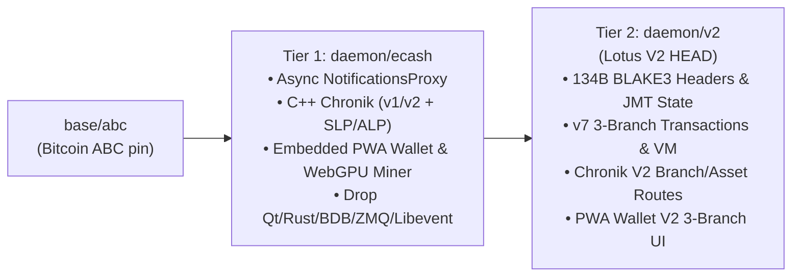

# Implementation Plan: Embedded PWA Wallet & Node Controller, Async `CWallet` Queue, and Removal of `bitcoin-qt` (`Qt5`)

**Target Baseline:** Layers on top of the `Boost.Beast` HTTP/WebSocket + `zstd` server (`ecash-boost-beast-http-ws-p2p-plan.md`).
- **Commits 1–3 (`ecash/` layer):** Portable across any `bitcoind` / `lotusd` node.
- **Commit 4 (`v2/` or `ecash/` cleanup):** Completely removes `src/qt/` (~45,000 LoC / 8.0 MB) and 16 Qt/X11/Freetype/QREncode recipes from `depends/packages/`.

---

## 1. Architectural Motivation & Overview

### Why Replace `bitcoin-qt` with an Embedded PWA Served by `Boost.Beast`?

1. **Eliminates 60% of `depends/packages/` and macOS/Xcode Build Breakage:**
   - Out of 26 package recipes in `depends/packages/`, **16 exist solely for `bitcoin-qt`** (`qt.mk`, `qrencode.mk`, `freetype.mk`, `fontconfig.mk`, `expat.mk`, `libXau.mk`, `libxcb.mk`, `libxcb_util*.mk` $\times 5$, `libxkbcommon.mk`, `xcb_proto.mk`, `xproto.mk`, `cpython.mk`, `native_cpython.mk`).
   - Downloading and compiling Qt requires gigabytes of tarballs, Qt account/mirror headaches, brittle macOS SDK patches (`AGL`, `NSApp`, `macdeployqt`), and slow C++ `moc`/`uic`/`rcc` codegen.

2. **First-Class JavaScript / Web Developer Experience (Zero C++ Rebuild Needed to Edit UI):**
   - Almost no modern frontend engineers work in Qt5 `.ui` XML or `QWidget` C++.
   - By housing the wallet UI in `web/wallet-pwa/` as clean, zero-build-step ES2022 JavaScript + CSS + HTML, **any JS developer can open `web/wallet-pwa/`, edit the UI in VS Code, and refresh their browser against a running `lotusd` node (`-walletpwadir=/path/to/web/wallet-pwa` for instant live reload!)** without installing Qt Creator, CMake, or a C++ compiler.
   - For production/release builds, `contrib/devtools/bundle_wallet_pwa.py` packs and compresses `web/wallet-pwa/` with `zstd -19` into a single C++ header (`src/webui/wallet_pwa_assets.h`, ~80 KB total in `.rodata`).

3. **Installable to macOS Dock / Windows Taskbar / iOS / Android as a Standalone App:**
   - Because `http://127.0.0.1` / `http://localhost` and `https://<remote-node>` (via `Boost.Beast` TLS) are Browser Secure Contexts, serving `/wallet/manifest.webmanifest` (`"display": "standalone"`, `"display_override": ["window-controls-overlay", "standalone"]`) and `/wallet/sw.js` (Service Worker) allows one-click **"Add to Dock"** (macOS Safari/Chrome) or **"Install App"** (Chrome/Edge/iOS/Android).
   - Once installed in the macOS Dock:
     - Launches in its own chromeless native-style window (`~/Applications/Lotus Wallet.app`).
     - Because the Service Worker (`sw.js`) caches the UI shell in `CacheStorage`, clicking the Dock icon opens the window **instantly even if `lotusd` is offline or restarting**, showing a live connection state and reconnecting automatically when `lotusd` comes online.
     - Supports switching between **Local Node (`http://127.0.0.1:10604`)** and **Remote Nodes (`https://my-node:10604`)** from the same Dock app.

4. **Decouples `CWallet` from the Consensus `ValidationSignals` Thread:**
   - Currently, `NotificationsProxy` (`src/node/interfaces.cpp`) runs `CWallet::transactionAddedToMempool` and `CWallet::blockConnected` synchronously on the shared `ValidationSignals` thread—acquiring `LOCK(cs_wallet)`, scanning every transaction with `IsMine()`, and performing synchronous SQLite disk writes (`WalletBatch::WriteTx`) while P2P (`UpdatedBlockTip`) and Avalanche callbacks wait in line.
   - Putting a dedicated bounded FIFO worker queue in `NotificationsProxy` (with our `SyncTransactionQueue()` barrier for `BlockUntilSyncedToCurrentChain()`) completely removes wallet lock/SQLite stalls from consensus and P2P notifications while preserving 100% deterministic RPC consistency and crash recovery (`CBlockLocator` rescan).

---

## 2. Staged 4-Commit Implementation Plan

### Commit 1: `wallet: offload Chain::NotificationsProxy callbacks to dedicated worker queue with SyncTransactionQueue barrier`

#### Files to Modify
- `src/validationinterface.h`
- `src/validationinterface.cpp`
- `src/node/interfaces.cpp`
- `src/wallet/test/wallet_tests.cpp`

#### Exact Implementation Steps

1. **`CValidationInterface::SyncTransactionQueue()` Barrier (`src/validationinterface.h` & `src/validationinterface.cpp`):**
   - In `class CValidationInterface` (`src/validationinterface.h`), add:
     ```cpp
     /**
      * If this subscriber offloads callbacks onto an internal asynchronous
      * worker queue (such as ChronikValidationInterface or NotificationsProxy),
      * block until all previously enqueued callbacks on that worker queue have
      * completed. Called by SyncWithValidationInterfaceQueue() and
      * FlushBackgroundCallbacks().
      */
     virtual void SyncTransactionQueue() {}
     ```
   - In `ValidationSignals::FlushBackgroundCallbacks()` and `ValidationSignals::SyncWithValidationInterfaceQueue()` (`src/validationinterface.cpp`), after flushing the primary `m_task_runner`, iterate all registered subscribers to drain their secondary worker queues:
     ```cpp
     m_internals->Iterate([](CValidationInterface &callbacks) {
         callbacks.SyncTransactionQueue();
     });
     ```

2. **Asynchronous Worker Queue in `NotificationsProxy` (`src/node/interfaces.cpp`):**
   - Update `NotificationsProxy` (`src/node/interfaces.cpp:438-474`) to own a dedicated background worker thread and bounded FIFO queue (`MAX_QUEUE_SIZE = 65536`), identical to `ChronikValidationInterface`:
     ```cpp
     class NotificationsProxy : public CValidationInterface {
     public:
         explicit NotificationsProxy(
             std::shared_ptr<Chain::Notifications> notifications)
             : m_notifications(std::move(notifications)),
               m_worker_thread([this] { WorkerLoop(); }) {}

         ~NotificationsProxy() { StopWorker(); }

         void StopWorker() {
             {
                 std::lock_guard<std::mutex> lock(m_mutex);
                 m_stopping = true;
             }
             m_cv.notify_all();
             m_cv_space.notify_all();
             if (m_worker_thread.joinable()) {
                 m_worker_thread.join();
             }
         }

         void SyncTransactionQueue() override {
             if (std::this_thread::get_id() == m_worker_thread.get_id()) {
                 return;
             }
             auto promise = std::make_shared<std::promise<void>>();
             auto future = promise->get_future();
             bool enqueued = false;
             {
                 std::unique_lock<std::mutex> lock(m_mutex);
                 m_cv_space.wait(lock, [this] {
                     return m_stopping || m_queue.size() < MAX_QUEUE_SIZE;
                 });
                 if (!m_stopping) {
                     m_queue.push_back([promise]() { promise->set_value(); });
                     enqueued = true;
                 }
             }
             if (enqueued) {
                 m_cv.notify_one();
                 future.wait();
             }
         }
     ```
   - Zero-copy event enqueuing in `NotificationsProxy`:
     - `TransactionAddedToMempool`: captures `tx` (`CTransactionRef`) and `mempool_sequence` by value into `Enqueue(...)`.
     - `TransactionRemovedFromMempool`: captures `tx` (`CTransactionRef`), `reason`, and `mempool_sequence` by value into `Enqueue(...)`.
     - `BlockConnected`: captures `role`, `block` (`std::shared_ptr<const CBlock>`, zero-copy refcount bump!), and `const int height = index->nHeight` by value into `Enqueue(...)`.
     - `BlockDisconnected`: captures `block` (`std::shared_ptr<const CBlock>`) and `const int height = index->nHeight` by value into `Enqueue(...)`.
     - `UpdatedBlockTip`: enqueues `m_notifications->updatedBlockTip()`.
     - `ChainStateFlushed`: captures `role` and `locator` (`CBlockLocator`) by value into `Enqueue(...)`.
   - In `NotificationsHandlerImpl::disconnect()` (`src/node/interfaces.cpp:486-491`), call `m_proxy->StopWorker()` after `UnregisterSharedValidationInterface(m_proxy)` so all queued wallet notifications finish draining before `CWallet` unloads or closes SQLite.

3. **How RPC Consistency & Crash Recovery Work:**
   - Every wallet RPC (`getbalance`, `listtransactions`, `listunspent`, `sendtoaddress`, etc.) calls `CWallet::BlockUntilSyncedToCurrentChain()` $\rightarrow$ `waitForNotificationsIfTipChanged(last_block_hash)`.
   - If a newly connected block is still in `NotificationsProxy::m_queue`, `m_last_block_processed != active.Tip()->GetBlockHash()`, so `waitForNotificationsIfTipChanged` calls `SyncWithValidationInterfaceQueue()` $\rightarrow$ `NotificationsProxy::SyncTransactionQueue()`, which blocks the RPC caller until the wallet worker thread finishes indexing that block!
   - If the node is killed (`SIGKILL` / power loss) before `NotificationsProxy::m_queue` drains, `CWallet` reads its persisted `CBlockLocator` (`bestblock`) from SQLite on next startup and automatically rescans the missing blocks (`ScanForWalletTransactions`).

---

### Commit 2: `webui: add src/webui/ CMake build integration, asset bundler, Boost.Beast /wallet handler, and -gui launcher`

#### 2.1 Exact Repository Directory Layout (`src/webui/`)

All PWA Wallet source files and C++ HTTP glue live inside **`src/webui/`** (directly replacing `src/qt/` inside `src/`):

```text
src/webui/
├── CMakeLists.txt                 # CMake target `webui` + add_custom_command generating wallet_pwa_assets.h
├── bundle-wallet-pwa.py           # Pure Python 3 stdlib script converting wallet-pwa/* -> wallet_pwa_assets.h
├── wallet_pwa_http.h              # Public C++ API called by src/httpserver.cpp and src/init.cpp
├── wallet_pwa_http.cpp            # Boost.Beast route handler, one-time ZSTD_compress cache, & session cookie auth
└── wallet-pwa/                    # Pure ES2022 JS / CSS / HTML source (editable by any web developer!)
    ├── index.html                 # Main PWA application shell
    ├── styles.css                 # Ledger-style dark/light theme & tabular layout CSS
    ├── app.js                     # Full RPC + Chronik WS wallet & node controller logic
    ├── miner-webgpu.js            # Zero-dependency WGSL compute shader GPU miner
    ├── miner-worker.js            # Multi-core Web Worker CPU miner fallback
    ├── manifest.webmanifest       # Standalone Dock/Taskbar PWA manifest
    ├── sw.js                      # Offline app-shell Service Worker
    └── icon.svg                   # Vector Lotus app icon (any/maskable)
```

Why this layout is ideal:
1. **Zero Committed Binary Blobs in Git:** Only clean, human-readable `.html`, `.css`, `.js`, `.webmanifest`, and `.svg` files are checked into `src/webui/wallet-pwa/`.
2. **Automatic Incremental CMake/Ninja Builds:** Editing any file in `src/webui/wallet-pwa/` and running `ninja lotusd` automatically triggers `bundle-wallet-pwa.py` to regenerate `${CMAKE_BINARY_DIR}/src/webui/wallet_pwa_assets.h` and relink `lotusd` in ~1 second.
3. **Zero Third-Party Python Dependencies in Guix / `depends`:** `bundle-wallet-pwa.py` uses **only Python's built-in standard library** (`sys`, `pathlib`, `hashlib`) to emit raw `constexpr uint8_t` byte arrays and SHA-256 ETags into `${CMAKE_BINARY_DIR}/src/webui/wallet_pwa_assets.h`. Then, in C++ (`wallet_pwa_http.cpp`), a `std::call_once` compresses each asset once at startup using `ZSTD_compress(..., 19)` (from `Zstd::zstd`, already linked into `server`), taking `< 1.5 ms` total and caching both the raw and `zstd`-compressed buffers in RAM for the lifetime of the process!
4. **Zero-Rebuild Live Dev Mode (`-walletpwadir`):** While designing UI changes, a JS developer can run `lotusd -walletpwadir=/path/to/src/webui/wallet-pwa`, edit `src/webui/wallet-pwa/app.js` in VS Code, and refresh their browser immediately without even running `ninja`.

#### 2.2 Exact CMake Integration (`src/CMakeLists.txt`, `src/config/CMakeLists.txt`, and `src/webui/CMakeLists.txt`)

1. **In `src/CMakeLists.txt`:**
   - Near line 21 (`option(BUILD_WALLET ...)`), add:
     ```cmake
     option(BUILD_WEBUI "Embed the PWA Wallet and Node Controller UI in lotusd" ON)
     ```
   - Near line 769 (right after `if(BUILD_WALLET) ... endif()`), wire `src/webui`:
     ```cmake
     # Embedded PWA Wallet & Node Controller UI
     if(BUILD_WEBUI)
         add_subdirectory(webui)
         target_link_libraries(server webui)
         target_compile_definitions(server PUBLIC ENABLE_WEBUI=1)
     endif()
     ```

2. **Create `src/webui/CMakeLists.txt`:**
   ```cmake
   # Copyright (c) 2026 The Lotus developers
   # Distributed under the MIT software license, see the accompanying
   # file COPYING or http://www.opensource.org/licenses/mit-license.php.

   project(webui)

   set(WALLET_PWA_SOURCE_FILES
       "${CMAKE_CURRENT_SOURCE_DIR}/wallet-pwa/index.html"
       "${CMAKE_CURRENT_SOURCE_DIR}/wallet-pwa/styles.css"
       "${CMAKE_CURRENT_SOURCE_DIR}/wallet-pwa/app.js"
       "${CMAKE_CURRENT_SOURCE_DIR}/wallet-pwa/miner-webgpu.js"
       "${CMAKE_CURRENT_SOURCE_DIR}/wallet-pwa/miner-worker.js"
       "${CMAKE_CURRENT_SOURCE_DIR}/wallet-pwa/manifest.webmanifest"
       "${CMAKE_CURRENT_SOURCE_DIR}/wallet-pwa/sw.js"
       "${CMAKE_CURRENT_SOURCE_DIR}/wallet-pwa/icon.svg"
   )

   set(WALLET_PWA_GENERATED_HEADER "${CMAKE_CURRENT_BINARY_DIR}/wallet_pwa_assets.h")

   add_custom_command(
       OUTPUT "${WALLET_PWA_GENERATED_HEADER}"
       COMMAND
           "${Python_EXECUTABLE}"
           "${CMAKE_CURRENT_SOURCE_DIR}/bundle-wallet-pwa.py"
           "${WALLET_PWA_GENERATED_HEADER}"
           ${WALLET_PWA_SOURCE_FILES}
       COMMENT "Bundling src/webui/wallet-pwa assets into ${WALLET_PWA_GENERATED_HEADER}"
       DEPENDS
           "${CMAKE_CURRENT_SOURCE_DIR}/bundle-wallet-pwa.py"
           ${WALLET_PWA_SOURCE_FILES}
       VERBATIM
   )

   add_library(webui STATIC
       wallet_pwa_http.cpp
       "${WALLET_PWA_GENERATED_HEADER}"
   )

   target_include_directories(webui
       PUBLIC
           "${CMAKE_CURRENT_SOURCE_DIR}/.."
       PRIVATE
           "${CMAKE_CURRENT_BINARY_DIR}"
   )

   target_link_libraries(webui
       PUBLIC
           util
           Zstd::zstd
   )
   ```

3. **Create `src/webui/bundle-wallet-pwa.py`:**
   - Pure Python 3 standard-library script invoked by `add_custom_command`:
     ```python
     #!/usr/bin/env python3
     # Copyright (c) 2026 The Lotus developers
     import hashlib
     import pathlib
     import sys

     MIME_TYPES = {
         ".html": "text/html; charset=utf-8",
         ".css": "text/css; charset=utf-8",
         ".js": "application/javascript; charset=utf-8",
         ".webmanifest": "application/manifest+json; charset=utf-8",
         ".svg": "image/svg+xml",
     }

     def main():
         out_header = pathlib.Path(sys.argv[1])
         in_files = [pathlib.Path(p) for p in sys.argv[2:]]
         lines = [
             "// Automatically generated by src/webui/bundle-wallet-pwa.py. DO NOT EDIT.",
             "#pragma once",
             "#include <cstddef>",
             "#include <cstdint>",
             "#include <string_view>",
             "namespace webui {",
             "struct EmbeddedAsset {",
             "    std::string_view route_path;",
             "    std::string_view file_name;",
             "    std::string_view content_type;",
             "    std::string_view etag;",
             "    const uint8_t *data;",
             "    size_t size;",
             "};",
         ]
         entries = []
         for idx, path in enumerate(in_files):
             raw = path.read_bytes()
             etag = f'"\\"{hashlib.sha256(raw).hexdigest()[:16]}\\""'
             mime = MIME_TYPES.get(path.suffix, "application/octet-stream")
             var_name = f"ASSET_DATA_{idx}"
             hex_bytes = ", ".join(f"0x{b:02x}" for b in raw)
             lines.append(f"alignas(8) constexpr uint8_t {var_name}[] = {{ {hex_bytes} }};")
             route = f"/wallet/{path.name}"
             entries.append(
                 f'    {{"{route}", "{path.name}", "{mime}", {etag}, {var_name}, {len(raw)}}}'
             )
         lines.append("constexpr EmbeddedAsset WALLET_PWA_ASSETS[] = {")
         lines.append(",\n".join(entries))
         lines.append("};")
         lines.append("} // namespace webui\n")
         out_header.parent.mkdir(parents=True, exist_ok=True)
         out_header.write_text("\n".join(lines), encoding="utf-8")

     if __name__ == "__main__":
         main()
     ```

4. **`Boost.Beast` Static & Session Route Handler (`src/webui/wallet_pwa_http.h` & `src/webui/wallet_pwa_http.cpp`):**
   - On first request (or `webui::InitWalletPwa()`), runs `std::call_once` to pre-compress each `EmbeddedAsset` in `WALLET_PWA_ASSETS` with `ZSTD_compress(..., 19)` into a static `std::vector<uint8_t> zstd_body`.
   - Registers `/wallet` and `/wallet/*` on the `Boost.Beast` HTTP server (`src/httpserver.cpp`, before RPC auth check for static asset `GET` requests):
     - `GET /wallet` or `GET /wallet/` $\rightarrow$ serves `index.html` (`text/html; charset=utf-8`).
     - `GET /wallet/<filename>` $\rightarrow$ serves `app.js`, `styles.css`, `miner-webgpu.js`, `miner-worker.js`, `manifest.webmanifest`, `sw.js` (with `Service-Worker-Allowed: /wallet`), or `icon.svg`.
     - If `-walletpwadir=<dir>` is configured, reads `<dir>/<filename>` directly from disk with `Cache-Control: no-store` so JS developers get instant live reload.
     - Otherwise checks `If-None-Match == asset.etag` (`304 Not Modified`), and serves `zstd_body` with `Content-Encoding: zstd` when `Accept-Encoding` contains `zstd` (or `asset.data` uncompressed otherwise).

5. **Frictionless Local `.cookie` Auth + `-gui` Flag (`src/init.cpp` & `src/httprpc.cpp`):**
   - Add CLI options in `src/init.cpp`:
     - `-webui` (default `1` when `ENABLE_WEBUI` is defined): serve the `/wallet` PWA on the HTTP/RPC port.
     - `-walletpwadir=<dir>`: serve `/wallet/*` assets live from `<dir>` on disk for frontend development.
     - `-gui` (default `0`): on daemon startup, after the HTTP server binds, generate a 256-bit random one-time bootstrap token mapped to the local `.cookie` credentials, and open `http://127.0.0.1:<rpcport>/wallet/#bootstrap=<token>` in the user's default browser (`open` on macOS, `xdg-open` on Linux, `ShellExecuteW` on Windows).
   - When the PWA loads with `#bootstrap=<token>`, it calls `POST /wallet/session` to exchange the one-time bootstrap token for an `HttpOnly; SameSite=Strict; Path=/` cookie (`__lotus_session`), clears `location.hash` via `history.replaceState`, and authenticates all subsequent JSON-RPC `POST /` and `POST /wallet/<name>` requests via that cookie (while also supporting standard `Authorization: Basic ...` for remote nodes).

---

### Commit 3: `webui: implement full bitcoin-qt feature parity + Lotus V2 3-branch & token support in PWA Wallet`

#### Files to Create / Modify
- `src/webui/wallet-pwa/index.html`
- `src/webui/wallet-pwa/styles.css`
- `src/webui/wallet-pwa/app.js`
- `src/webui/wallet-pwa/miner-webgpu.js`
- `src/webui/wallet-pwa/miner-worker.js`
- `src/webui/wallet-pwa/manifest.webmanifest`
- `src/webui/wallet-pwa/sw.js`
- `src/webui/wallet-pwa/icon.svg`

#### 3.1 Detailed UI/UX Architecture & Visual Specification (Ledger Live Left-Sidebar + 1:1 `bitcoin-qt` Mapping)

Because a standalone PWA window does not use native OS menu bars (`File`, `Settings`, `Window`, `Help`), we replace `bitcoin-qt`'s top toolbar + native menu bar with a **Ledger Live-style fixed Left Navigation Sidebar (`240px`) + Top Utility Header (`56px`) + Main Content Viewport + `bitcoin-qt` Bottom Status Bar (`32px`)**.

##### Full-Window ASCII Layout Wireframe

```text
+--------------------------------------------------------------------------------------------------+
| [o o o]  LOTUS  |  Wallet: [ main_wallet.dat v ] [+ New] [Lock]  |  [Eye] [XPI v] [Node: Local v]|
+----------------------+---------------------------------------------------------------------------+
|                      |                                                                           |
|  PORTFOLIO           |  OVERVIEW                                        Last block: 4s ago (Final)|
|  [1] Overview        |  +----------------------------------+  +-------------------------------+  |
|  [2] Send            |  | BALANCES                  [XPI]  |  | RECENT TRANSACTIONS           |  |
|  [3] Receive         |  |                                  |  |                               |  |
|  [4] Transactions    |  | Available:     142,500.000000 XPI|  | [+] Received   +2,500.00 XPI  |  |
|  [5] Address Book    |  | Pending:            +0.000000 XPI|  |     lotus_16PS...   2 mins ago|  |
|  [6] Tokens & V2     |  | Immature:          260.000000 XPI|  |                               |  |
|                      |  | -------------------------------- |  | [-] Sent         -120.50 XPI  |  |
|  TOOLS & WALLET      |  | Total:         142,760.000000 XPI|  |     lotus_16PS...  14 mins ago|  |
|  [7] Sign / Verify   |  +----------------------------------+  |                               |  |
|  [8] PSBT & Raw Tx   |                                        | [M] Mined        +260.00 XPI  |  |
|  [9] Wallet Manager  |  +----------------------------------+  |     Block #84120    1 hour ago|  |
|                      |  | TOKENS & V2 NATIVE ASSETS        |  +-------------------------------+  |
|  NODE & DEBUG        |  |  • GOLD (V2 Asset)     1,000.00  |                                     |
|  [0] Node Info       |  |  • USDT (ALP)            450.25  |                                     |
|  [`] RPC Console     |  +----------------------------------+                                     |
|  [N] Network Graph   |                                                                           |
|  [P] Peers & Bans    |                                                                           |
|  [M] Miner / Regtest |                                                                           |
|                      |                                                                           |
| -------------------- |                                                                           |
|  [Install to Dock]   |                                                                           |
+----------------------+---------------------------------------------------------------------------+
| [Sync: 100% (#84120)]  |  [HD] [Encrypted/Unlocked] [Avalanche: Finalized] [Peers: 12 (Active)]  |
+--------------------------------------------------------------------------------------------------+
```

##### Complete 1:1 Mapping of Every `bitcoin-qt` Menu, Toolbar, and Dialog

Every single `.ui` form and `QAction` in [`src/qt/bitcoingui.cpp`](file:///Users/shammah/repos/lotus-v2-optimizations/daemon/workspace-v2/src/qt/bitcoingui.cpp) is preserved and given a permanent, discoverable home in the UI:

| `bitcoin-qt` Original Location (`src/qt/`) | New PWA Location | Underlying JSON-RPCs Used |
| :--- | :--- | :--- |
| **Toolbar $\rightarrow$ Overview** (`overviewpage.ui`) | **Left Sidebar $\rightarrow$ `Overview`** (`Alt+1`) | `getbalances`, `getwalletinfo`, `listtransactions("*", 10)` |
| **Toolbar $\rightarrow$ Send** (`sendcoinsdialog.ui`, `sendcoinsentry.ui`) | **Left Sidebar $\rightarrow$ `Send`** (`Alt+2`) | `sendtoaddress`, `sendmany`, `estimatesmartfee`, `validateaddress` |
| **Send $\rightarrow$ Coin Control...** (`coincontroldialog.ui`) | **Send Tab $\rightarrow$ `Coin Control` Drawer/Modal** | `listunspent`, `lockunspent`, `listlockunspent`, `fundrawtransaction` |
| **Toolbar $\rightarrow$ Receive** (`receivecoinsdialog.ui`, `receiverequestdialog.ui`) | **Left Sidebar $\rightarrow$ `Receive`** (`Alt+3`) | `getnewaddress`, `listreceivedbyaddress`, `getaddressinfo` + Pure-JS SVG QR |
| **Toolbar $\rightarrow$ Transactions** (`transactionview.cpp`, `transactiondescdialog.ui`) | **Left Sidebar $\rightarrow$ `Transactions`** (`Alt+4`) | `listtransactions`, `listsinceblock`, `gettransaction`, `abandontransaction` |
| **File $\rightarrow$ Sending / Receiving addresses** (`addressbookpage.ui`, `editaddressdialog.ui`) | **Left Sidebar $\rightarrow$ `Address Book`** (`Alt+5`) | `listreceivedbyaddress(0, true, true)`, `setlabel`, `getaddressesbylabel` |
| *(New for Lotus V2)* **3-Branch & Native Assets** | **Left Sidebar $\rightarrow$ `Tokens & V2`** (`Alt+6`) | `v2_wallet_*`, `/chronik/token-id/*`, `/chronik/v2/*` |
| **File $\rightarrow$ Sign message... / Verify message...** (`signverifymessagedialog.ui`) | **Left Sidebar $\rightarrow$ `Sign / Verify`** (`Alt+7`) | `signmessage`, `verifymessage`, `signmessagewithprivkey` |
| **File $\rightarrow$ Load PSBT... / Open URI...** (`openuridialog.ui`) | **Left Sidebar $\rightarrow$ `PSBT & URI Tools`** (`Alt+8`) | `decodepsbt`, `walletprocesspsbt`, `finalizepsbt`, `decoderawtransaction`, `sendrawtransaction` |
| **File $\rightarrow$ Create / Open / Close / Backup Wallet** (`createwalletdialog.ui`) + **Settings $\rightarrow$ Encrypt / Change Passphrase** (`askpassphrasedialog.ui`) | **Left Sidebar $\rightarrow$ `Wallet Manager`** (`Alt+9`) + **Top Header Wallet Bar** | `listwallets`, `listwalletdir`, `createwallet`, `loadwallet`, `unloadwallet`, `backupwallet`, `encryptwallet`, `walletpassphrase`, `walletpassphrasechange`, `walletlock` |
| **Settings $\rightarrow$ Mask values** (`Ctrl+Shift+M`) | **Top Header $\rightarrow$ Eye Icon (`Privacy Mode`)** (`Ctrl+Shift+M`) | Blurs/replaces all currency amounts with `•••••• XPI` across all tabs |
| **Status Bar $\rightarrow$ Unit Display Control** (`bitcoinunits.h`) | **Top Header $\rightarrow$ Unit Dropdown (`XPI` / `mXPI` / `µXPI` / `sats`)** | Formats all displayed and entered amounts in selected denomination |
| **Window $\rightarrow$ Information** (`debugwindow.ui` Tab 1) | **Left Sidebar $\rightarrow$ `Node Info`** (`Alt+0`) | `getblockchaininfo`, `getnetworkinfo`, `getmempoolinfo`, `uptime`, `getmemoryinfo` |
| **Window $\rightarrow$ Console** (`debugwindow.ui` Tab 2) | **Left Sidebar $\rightarrow$ `RPC Console`** (`` Ctrl+` ``) | Executes any JSON-RPC command; `help` autocomplete + history (`Up`/`Down`) |
| **Window $\rightarrow$ Network Traffic** (`trafficgraphwidget.h`) | **Left Sidebar $\rightarrow$ `Network Graph`** | `getnettotals` (live HTML5 Canvas `Bytes In` / `Bytes Out` chart + Clear button) |
| **Window $\rightarrow$ Peers** (`peertablemodel.h`, `bantablemodel.h`) | **Left Sidebar $\rightarrow$ `Peers & Bans`** | `getpeerinfo`, `disconnectnode`, `addnode`, `setban`, `listbanned`, `clearbanned` |
| *(New)* **Built-In GPU / CPU Miner** (`miner-webgpu.js`, `miner-worker.js`) | **Left Sidebar $\rightarrow$ `WebGPU Miner`** (`Alt+M`) | `getblocktemplate`, `submitblock`, `getmininginfo`, `generatetoaddress`, `getnewaddress` |
| **Status Bar $\rightarrow$ Sync Progress & Modal Overlay** (`modaloverlay.ui`) | **Bottom Status Bar $\rightarrow$ Clickable Sync Pill** (opens slide-up Sync Modal) | `getblockchaininfo` (`blocks`, `headers`, `verificationprogress`, `mediantime`, `initialblockdownload`) |
| **Status Bar $\rightarrow$ HD / Lock / Network Active Icons** | **Bottom Status Bar $\rightarrow$ Right-hand Interactive Badges** | `getwalletinfo` (`hdseedid`, `unlocked_until`), `setnetworkactive(!active)` |

##### Built-In WebGPU (WGSL Compute Shader) + Web Worker Miner (`Left Sidebar -> WebGPU Miner`)

We already implemented a zero-dependency WGSL compute shader miner ([`/private/tmp/wt-lotus-v2-website/web/lotus-v2-portal/public/miner-webgpu.js`](file:///private/tmp/wt-lotus-v2-website/web/lotus-v2-portal/public/miner-webgpu.js), 20.8 KB raw / ~4 KB `zstd`-compressed) and Web Worker fallback ([`miner-worker.js`](file:///private/tmp/wt-lotus-v2-website/web/lotus-v2-portal/public/miner-worker.js), 15.7 KB raw / ~3 KB `zstd`-compressed). Bundling both directly into `/wallet/miner-webgpu.js` and `/wallet/miner-worker.js` inside `wallet_pwa_assets.h` adds **only ~7 KB** to the `lotusd` binary and gives the PWA Wallet a built-in GPU miner:

1. **Direct Wallet Payout Integration:**
   - Payout address dropdown auto-populates from the active wallet's receiving addresses (or generates a fresh `"Mining Reward"` address via `getnewaddress("Mining Reward")`).
2. **Real `getblocktemplate` + `submitblock` Loop (Plus 1-Click Regtest `generatetoaddress`):**
   - Polls `getblocktemplate` (and listens to `/chronik/ws` `BlockConnected` events to immediately switch templates on new blocks without mining stale work).
   - Builds the coinbase transaction paying the selected wallet address and updates the header commitment / Merkle root.
   - Dispatches `@compute @workgroup_size(256)` batches on `navigator.gpu` ( supporting both **Lotus V2 2-stage Tagged BLAKE3 `WorkHash -> BlockID`** from `miner-webgpu.js` and legacy SHA-256 / Lotus v1 PoW), reading back only a 4-byte `atomic<u32>` hit count per dispatch unless a winning nonce is found.
   - Automatically falls back to multi-core `Worker` threads (`navigator.hardwareConcurrency`) if WebGPU is unavailable or when the user toggles **GPU (`WebGPU`) vs. CPU (`Web Workers`)**.
   - When a winning nonce is found, serializes the block and calls `submitblock`, triggering a celebratory notification and immediately updating the wallet's `Immature` / `Mined` balance card!
3. **Live Miner Telemetry Dashboard:**
   - Displays Detected GPU Adapter name (`adapter.info.device` / `architecture`, e.g., `Apple M3 Max`), live Hashrate gauge (`MH/s` or `GH/s`), GPU Duty Cycle / Intensity slider (`10%` – `100%`, adjusting target dispatch frame time from `1ms` to `12ms`), Total Hashes, Best Share Difficulty, and Session Blocks Mined.

##### Browser-Native Superpowers (Impossible or Painful in `bitcoin-qt`)

1. **Real-Time WebSocket Event Push (`/wallet/ws`) + Native OS Notifications:**
   - Instead of `bitcoin-qt`'s `QTimer` polling RPCs every few seconds, `src/webui/wallet_pwa_http.cpp` exposes an authenticated Boost.Beast WebSocket endpoint at `/wallet/ws` (authenticated via the same `HttpOnly` `__lotus_session` cookie).
   - Whenever `NotificationsProxy`'s background worker thread processes `TransactionAddedToMempool`, `BlockConnected`, `BlockDisconnected`, or wallet balance changes, it broadcasts a compact JSON event frame to connected `/wallet/ws` clients.
   - The PWA updates balances, transaction tables, and active `getblocktemplate` mining jobs in **under 1 ms**, and fires native macOS Notification Center / OS desktop banners via the Web `Notification` API (`new Notification("Incoming Transaction: +1,250.00 XPI", ...)`).

2. **Direct USB Hardware Wallet Support via WebHID (`src/webui/wallet-pwa/js/hw-ledger.js`):**
   - In `bitcoin-qt`, talking to a Ledger or Trezor required installing Python 3 (`cpython.mk`), `pip install hwi`, `libusb`, and configuring an external `HWI` binary path.
   - In Chromium/Brave/Edge PWAs, `navigator.hid` (**WebHID**) and `navigator.usb` (**WebUSB**) are built directly into the browser runtime.
   - `src/webui/wallet-pwa/js/hw-ledger.js` communicates APDU frames directly with USB Ledger/Trezor devices in pure JS to import xpubs and sign V1 and V2 (`nVersion == 7` Taproot + `SIGHASH_LOTUS`) PSBTs with zero external Python or C libraries.

3. **macOS Touch ID / Passkey Session Lock (`WebAuthn`):**
   - Using `navigator.credentials` (`WebAuthn` platform authenticator), users on macOS with Touch ID (or Windows Hello / iOS Face ID) can lock the PWA screen when stepping away and unlock the UI with a single Touch ID tap.

##### Visual Design System & Styling (`src/webui/wallet-pwa/styles/`)

1. **Color Palette (Dark-first Ledger Live / Modern Desktop Aesthetic with Light Mode Toggle):**
   - **Sidebar & Chrome Background:** `#0b0f19` (deep slate-navy) with `1px solid rgba(255, 255, 255, 0.07)` borders.
   - **Main Viewport Background:** `#111827` (rich charcoal).
   - **Card / Panel Surface:** `#1e293b` with subtle glass highlight (`border: 1px solid rgba(255, 255, 255, 0.08)` and `border-radius: 12px`).
   - **Primary Accent (Lotus Violet/Magenta):** `linear-gradient(135deg, #c026d3, #7c3aed)` for active sidebar pill, primary CTA buttons, and QR accents.
   - **Semantic Status Colors:**
     - Confirmed / Incoming / Network Active: `#10b981` (Emerald)
     - Unconfirmed / Syncing / Warning: `#f59e0b` (Amber)
     - Outgoing / Disconnected / Banned / Error: `#ef4444` (Rose)
   - **Typography:**
     - UI Sans: `-apple-system, BlinkMacSystemFont, "Inter", "Segoe UI", sans-serif`.
     - Amounts, Addresses, TxIds, and RPC Console: `"JetBrains Mono", "SF Mono", ui-monospace, monospace` with `font-variant-numeric: tabular-nums` so numbers and decimal points align vertically in tables just like `bitcoin-qt`.

2. **Window Controls Overlay (Native macOS Titlebar Integration):**
   - Uses `display_override: ["window-controls-overlay", "standalone"]` and CSS `env(titlebar-area-x)` / `-webkit-app-region: drag` on the top header bar so when installed to the macOS Dock, the macOS traffic-light window buttons (`Close`, `Minimize`, `Zoom`) sit seamlessly inside the dark top bar with no ugly white titlebar strip.

3. **Two-Column `Overview` & Split-Pane `Send` / `Receive` Layouts (Matching `bitcoin-qt` Ergonomics):**
   - **Overview View:** Mirrors `overviewpage.ui` with the **Balances Card** (Available, Pending, Immature, Total, plus Watch-Only column if watch-only keys exist) and **Tokens/V2 Assets Card** on the left (`45%` width), and the **Recent Transactions List** on the right (`55%` width).
   - **Send View:** Mirrors `sendcoinsdialog.ui`:
     - Top collapsible **Coin Control Features** panel (`Inputs...` button opens the interactive UTXO tree/table modal showing Quantity, Bytes, Amount, Fee, After Fee, Change, and custom change address input).
     - Middle scrollable list of **Recipient Rows** (`Pay To` address with address-book lookup icon, `Label` input, `Amount` input with unit toggle & `Subtract fee from amount` checkbox, and `Add Recipient` / `Clear All` buttons).
     - Bottom **Transaction Fee** bar (`Recommended` with confirmation target slider vs. `Custom` sat/kB input) and `Send` button with confirmation summary modal.
   - **Receive View:** Mirrors `receivecoinsdialog.ui`:
     - Top form (`Label`, `Amount (optional)`, `Message (optional)`, `Address Type`, and `Create New Receiving Address` button).
     - Bottom **Requested Payments History** table; clicking any row opens the **Payment Request Modal** (`receiverequestdialog.ui`) with the crisp SVG QR code, `Copy URI`, `Copy Address`, and `Save SVG` buttons.

#### 3.2 Exact Implementation Steps
1. Implement the Left-Hand Sidebar navigation, Top Header Bar (Wallet switcher, Privacy eye mask `Ctrl+Shift+M`, Unit selector `XPI`/`mXPI`/`µXPI`/`sats`, Node selector), and Bottom Status Bar (clickable Sync Progress pill + Modal Sync Overlay, HD badge, Lock/Unlock toggle, Avalanche badge, and clickable Peer/Network Active toggle) in `src/webui/wallet-pwa/index.html` and `src/webui/wallet-pwa/styles/`.
2. Copy [`/private/tmp/wt-lotus-v2-website/web/lotus-v2-portal/public/miner-webgpu.js`](file:///private/tmp/wt-lotus-v2-website/web/lotus-v2-portal/public/miner-webgpu.js) and [`miner-worker.js`](file:///private/tmp/wt-lotus-v2-website/web/lotus-v2-portal/public/miner-worker.js) into `src/webui/wallet-pwa/js/` and wire the **WebGPU Miner** view (`getblocktemplate` + `submitblock` + regtest `generatetoaddress` + live GPU hashrate/intensity dashboard) directly to the active wallet's receiving addresses.
3. Implement all 13 sidebar views and modals in `src/webui/wallet-pwa/js/` according to the 1:1 `bitcoin-qt` mapping table above, including:
   - Pure-JS zero-dependency SVG QR Code encoder (`js/qr.js`).
   - Real-time `/wallet/ws` WebSocket push listener + Web Notifications for incoming transactions and mined blocks.
   - WebHID hardware wallet bridge (`js/hw-ledger.js`) and `WebAuthn` Touch ID lock screen.
   - HTML5 Canvas live Network Traffic graph (`getnettotals`).
   - Interactive RPC Console with command history and `help` autocomplete.
   - Full Coin Control UTXO selector (`listunspent`, `lockunspent`) and Lotus V2 (`nVersion == 7`) 3-branch Taproot & native token builder.
4. Build `ninja bitcoind` — CMake automatically invokes `src/webui/bundle-wallet-pwa.py` to generate `${CMAKE_CURRENT_BINARY_DIR}/wallet_pwa_assets.h`.

---

### Commit 4: `build: remove bitcoin-qt (src/qt) and 16 Qt/XCB/Freetype/QREncode depends packages`

#### Files & Directories to Delete / Modify
- Delete `src/qt/` (entire directory: ~45,000 lines / 8.0 MB)
- Delete `cmake/modules/FindQt5.cmake` (and any Qt helper modules)
- Delete `cmake/modules/FindQREncode.cmake`
- Delete 16 `depends/packages/` recipes:
  - `depends/packages/qt.mk`
  - `depends/packages/qrencode.mk`
  - `depends/packages/freetype.mk`
  - `depends/packages/fontconfig.mk`
  - `depends/packages/expat.mk`
  - `depends/packages/libXau.mk`
  - `depends/packages/libxcb.mk`
  - `depends/packages/libxcb_util.mk`
  - `depends/packages/libxcb_util_image.mk`
  - `depends/packages/libxcb_util_keysyms.mk`
  - `depends/packages/libxcb_util_render.mk`
  - `depends/packages/libxcb_util_wm.mk`
  - `depends/packages/libxkbcommon.mk`
  - `depends/packages/xcb_proto.mk`
  - `depends/packages/xproto.mk`
  - `depends/packages/cpython.mk`
  - `depends/packages/native_cpython.mk`
- Delete `depends/patches/qt/`
- Modify `depends/packages/packages.mk` and `depends/Makefile` to remove `qt_*_packages`, `qrencode_packages`, and `cpython_*_packages`.
- Modify `src/CMakeLists.txt` and `src/config/CMakeLists.txt` to remove `BUILD_BITCOIN_QT`, `USE_QRCODE`, and `add_subdirectory(qt)`.

---

## 3. Verification & Testing Matrix

1. **Async Wallet Queue Unit & Functional Tests:**
   - Run `ninja check-bitcoin-wallet` (`wallet_tests`) and `test/functional/wallet_basic.py` to verify `NotificationsProxy` background worker queue + `SyncTransactionQueue()` barrier preserve 100% deterministic RPC synchronization on `generatetoaddress`, `sendtoaddress`, and `syncwithvalidationinterfacequeue`.
2. **PWA Asset Serving & Compression Test (`test/functional/rpc_wallet_pwa.py`):**
   - Verify `GET /wallet` returns `200 OK` with `Content-Encoding: zstd` when `Accept-Encoding: zstd` is sent, and uncompressed HTML when omitted.
   - Verify `GET /wallet/manifest.webmanifest` and `GET /wallet/sw.js` (`Service-Worker-Allowed: /wallet`) return valid PWA headers.
   - Verify `POST /wallet/session` bootstrap token exchange sets `__lotus_session` cookie and allows authenticated JSON-RPC + `/wallet/ws` WebSocket calls from the PWA.
   - Verify `-walletpwadir=<tempdir>` serves live-edited JS/CSS files directly from disk with zero C++ rebuild.
3. **Qt-Free Build Verification:**
   - Run `cmake -GNinja .. && ninja bitcoind` on macOS without Qt5 or `qrencode` installed, verifying clean build and zero Qt dependencies.

---

## 4. Phase 2 Dependency Elimination Roadmap (~45-Second Full Builds)

Once `src/qt/` (16 packages) and Rust `chronik` (`rust.mk`, `cxx.mk`, `rocksdb.mk`) are removed, 19 of the 26 recipes in `depends/packages/` are already gone. We can eliminate the remaining legacy C dependencies in three small follow-up commits:

| Legacy Dependency | Files to Remove | Replacement |
| :--- | :--- | :--- |
| **Oracle BerkeleyDB 4.8 (`bdb.mk`)** — 2010 C library that breaks on modern Clang/macOS SDKs | `depends/packages/bdb.mk`, `src/wallet/bdb.h`, `src/wallet/bdb.cpp` | **SQLite-Only Wallet (`src/wallet/sqlite.cpp`)**: Already the default for descriptor & modern wallets. |
| **ZeroMQ (`zeromq.mk`)** — Raw TCP pub/sub sockets | `depends/packages/zeromq.mk`, `src/zmq/` | **Boost.Beast WebSockets (`/ws` & `/wallet/ws`)**: C++ Chronik + `wallet_pwa_http.cpp` push structured block/tx/address/wallet notifications over the existing HTTP port. |
| **Libevent (`libevent.mk`)** — Legacy HTTP & event loop (`httpserver.cpp` already migrated to `Boost.Beast` in `ecash/040`) | `depends/packages/libevent.mk` | Migrate the last two callers (`src/bitcoin-cli.cpp` and `src/torcontrol.cpp`) to `Boost.Asio` / `Boost.Beast`. |

After those three commits, the entire repository (`bitcoind` + C++ Chronik + PWA GUI Wallet + WebGPU Miner) depends **only** on:
- Header-only **Boost** (`MultiIndex`, `Signals2`, `Asio`, `Beast`)
- **`sqlite3`** (amalgamated single `sqlite3.c` file)
- **`libmdbx`** (amalgamated `mdbx.c` in `src/chronik/mdbx/`)
- **`zstd`** and **`jemalloc`**

---

## 5. Two-Tier Stacked Architecture (`daemon/ecash` $\rightarrow$ `daemon/v2`) via `lotus-git.py`

We permanently maintain the **two-tier split** between `daemon/ecash` and `daemon/v2` inside `daemon/workspace-v2` so that every chain-agnostic improvement can be used directly on eCash (or upstreamed/backported to Bitcoin ABC, Dogecoin, and BCHN) without dragging in Lotus V2 consensus rules:



### How Commits 1–4 Map Across the Two Tiers

| Commit | Target Tier | Why |
| :--- | :--- | :--- |
| **Commit 1:** `wallet: offload Chain::NotificationsProxy callbacks to dedicated worker queue with SyncTransactionQueue barrier` | **Tier 1 (`daemon/ecash`)** | 100% chain-agnostic wallet + `ValidationSignals` optimization; benefits both eCash and Lotus V2. |
| **Commit 2:** `webui: add embedded Boost.Beast PWA wallet asset server, bundle-wallet-pwa.py, and -gui browser launcher` | **Tier 1 (`daemon/ecash`)** | 100% chain-agnostic CMake + HTTP/WebSocket asset server (`src/webui/`). |
| **Commit 3a:** `webui: add Ledger-style PWA wallet UI, WebHID hardware wallet bridge, and WebGPU miner` | **Tier 1 (`daemon/ecash`)** | Full 1:1 `bitcoin-qt` replacement UI (`Overview`, `Send`, `Coin Control`, `Receive`, `Transactions`, `Address Book`, `SLP/ALP Tokens`, `RPC Console`, `Peers`, `WebGPU SHA256/BLAKE3 Miner`) that works out-of-the-box on eCash (`XEC`) and Lotus (`XPI`) by reading `getblockchaininfo` / `getnetworkinfo`. |
| **Commit 4:** `build: remove bitcoin-qt (src/qt) and 16 Qt/XCB/Freetype/QREncode depends packages` | **Tier 1 (`daemon/ecash`)** | Removes `src/qt/` and 16 GUI `depends/packages/*.mk` recipes for both eCash and Lotus V2. |
| **Commit 3b (V2 Extension):** `webui(v2): add v7 3-branch Taproot & native V2 asset builder to PWA wallet` | **Tier 2 (`daemon/v2`)** | Adds Lotus V2-specific `nVersion == 7` 3-branch (`vBranches[0..2]`) and native `tokenId` builder views on top of the Tier 1 PWA wallet. |

### Mechanistic Workflow with [`daemon/scripts/lotus-git.py`](file:///Users/shammah/repos/lotus-v2-optimizations/daemon/scripts/lotus-git.py)

1. **Developing in `daemon/workspace-v2` and Sinking Tier-1 Commits to `daemon/ecash`:**
   - Commit any chain-agnostic change on `HEAD` in `daemon/workspace-v2`, then sink it down onto `daemon/ecash` in one command:
     ```bash
     make -C daemon sink-to-ecash COMMIT=HEAD
     ```
   - `lotus-git.py` automatically cherry-picks the commit onto `daemon/ecash`, replays all Tier-2 `daemon/v2` commits on top of it, advances `daemon/ecash`, and re-exports both `daemon/patches/ecash/` and `daemon/patches/v2/`.
2. **Syncing Both Tiers & Pushing `daemon/*` Branches Without Touching Monorepo `main`:**
   ```bash
   make -C daemon sync SERIES=v2 VERIFY=1 PUSH=1
   ```
3. **Rebasing Both Tiers Onto a New Upstream Bitcoin ABC Commit:**
   ```bash
   make -C daemon rebase-upstream SERIES=v2 COMMIT=latest
   ```
   Uses `git rebase --update-refs` to rebase `daemon/ecash` and `daemon/v2` together in a single pass while keeping their boundary intact.


